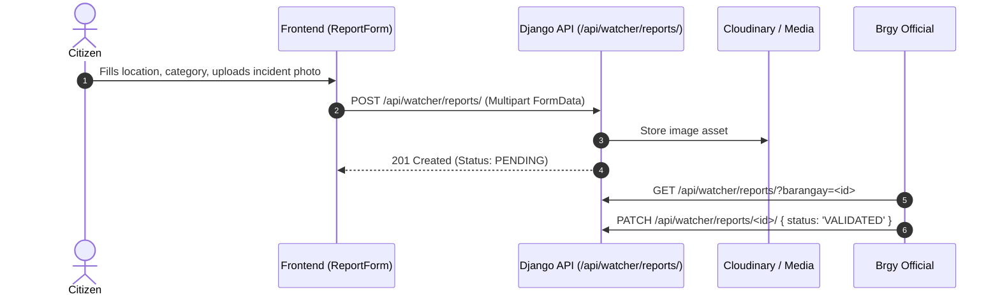
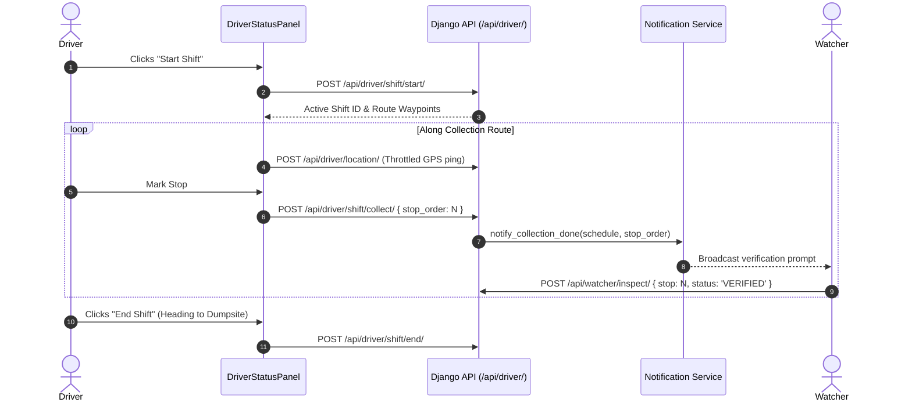
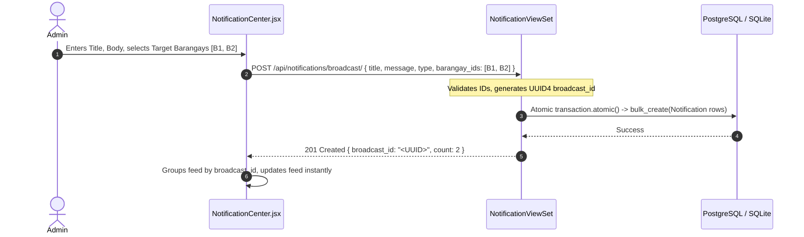

# WasteWatch Project Handover Document
**Target Audience:** Incoming Senior Software Engineer / AI Assistant (New Claude Session)  
**Document Status:** Complete, Self-Contained, and Grounded in Repository Evidence  
**Generated Date:** October 26, 2026  
**Repository Working Directory:** `d:\Coding\Waste Watch`  
**Active Git Branch:** `codex-refactored`  

---

## 1. Executive Summary

This handover document was prepared to establish development continuity for **WasteWatch** following the expiration of the previous Claude session. All technical information, architecture descriptions, task statuses, and constraints documented herein have been reconstructed directly from the repository's git history, active source files, database models, automated tests, local configuration, and project documentation. **No assumptions or fabricated conversation histories have been introduced.**

### Core System Summary
- **Official Title:** WasteWatch: A Progressive Web-Based Solid Waste Management System tailored for Lucena City, Philippines.
- **Architecture:** Decoupled client-server architecture consisting of a **Django REST Framework (DRF)** backend and a **React 18 + Vite** Progressive Web Application (PWA) frontend.
- **Current Git Branch:** `codex-refactored`
- **Current HEAD Commit:** `08d2985` (*Fix: carousel padding and derived index, image error handling, General category, resident card preview, and drag-safe modals*)
- **Status of Recent Tasks:** 
  - **Security & RBAC:** Privilege escalation vulnerability on `UserViewSet` resolved and covered by 14 unit tests (`3bd9d1c`).
  - **Broadcast Notifications:** Atomic multi-barangay broadcast endpoints (`POST /api/notifications/broadcast/`, `DELETE /api/notifications/broadcast/<bid>/`) implemented with database migration `0005_notification_broadcast_id.py` and full test coverage (`85ec5af`).
  - **News & Announcements Suite:** Completely refactored with deep linking (`?article=<id>`), safe search filtering, extracted modals, responsive carousel layout, and zero emojis (`6d66391`, `437fb16`, `08d2985`).
  - **Admin Notification Center:** Re-engineered with atomic dispatching, honest delivery scope cards, live resident preview mirroring citizen notifications, and drag-safe modal backdrops (`185d250`, `437fb16`, `08d2985`).
- **Active Working Tree State:** Uncommitted modifications exist in the **Driver Suite** (`DriverStatusPanel.jsx`, `RouteOverview.jsx`, `DriverCollectionLog.jsx`, `DriverHotspotAlert.jsx`), **Dumpsite Suite** (`DumpsiteDashboard.jsx`, `CollectionLogs.jsx`), and `MiniMap.jsx`. These represent active or partially staged work that should be audited before making edits.

---

## 2. Project Overview and Requirements

### 2.1 Purpose & Domain
WasteWatch modernizes solid waste collection in Lucena City (33 Barangays, including Isabang, Gulang-Gulang, Ilayang Dupay, Ibabang Dupay, Market View, Cotta, Dalahican, etc.). The system addresses erratic collection schedules, unmonitored illegal dumpsites, lack of fleet visibility, and citizen disengagement through real-time GPS tracking, photo-verified collection logging, automated SMS/in-app advisories, and administrative analytics.

### 2.2 User Roles & Permissions Matrix
The system enforces strict Role-Based Access Control (RBAC) via the custom user model `accounts.User.role` (`accounts/models.py:UserRole`):

| Role Code | Display Name | Core Capabilities | Dashboard / Primary Route |
| :--- | :--- | :--- | :--- |
| `citizen` | Citizen (Default) | View public map & schedules; report waste incidents with photos; view news, advisories, personal & barangay notifications. | `/` (Public), `/notifications`, `/announcements`, `/schedule` |
| `watcher` | Barangay Watcher | Pre-collection inspection; post-collection photographic verification at route stops; dispute missed pickups. | `/dashboard` → `WatcherTasksHub`, `/verification-tasks`, `/watcher/confirm` |
| `driver` | Collection Truck Driver | Start/end collection shift; turn-by-turn route stop execution; mark stops collected; log vehicle issues/delays. | `/dashboard` → `RouteOverview`, `DriverStatusPanel`, `DriverCollectionLog` |
| `brgy_official`| Barangay Official | Review and approve/reject citizen waste incident reports for their specific barangay; view local barangay statistics. | `/dashboard` → `ValidateReports`, `BarangayDetail` |
| `admin` | CENRO / System Admin | Full system access: truck management, user management, route builder, hotspot mapping, atomic notification broadcasts, news publication, dumpsite logs. | `/dashboard` → `UserManagement`, `TruckManagement`, `NotificationCenter`, `NewsPage`, `/admin/` |

> [!IMPORTANT]
> **Admin Parity Rule:** Both the backend (`accounts/permissions.py:is_admin_user`) and frontend components check:
> `user.role === 'admin' || user.is_staff` (or `is_superuser`).  
> *Evidence:* User ID 148 in the database has `role='citizen'` but `is_staff=True` and `is_superuser=True`. Checking only `role === 'admin'` breaks administrative access for staff-authenticated administrators.

---

## 3. Technology Stack & Architecture

### 3.1 Backend Architecture
- **Language / Framework:** Python 3.13 / Django 4.2+ with Django REST Framework (DRF).
- **Project Structure:**
  - `wastewatch/backend/wastewatch/`: Core configuration (`settings.py`, `urls.py`, `api_urls.py`).
  - `accounts/`: User authentication, profile extensions (`DriverProfile`, `WatcherProfile`), barangay models, RBAC permissions.
  - `notifications/`: Targeted & broadcast notifications, atomic broadcast API, automated event triggers (`services.py`).
  - `news/`: News items, emergency alerts, barangay spotlight awards.
  - `driver/`: Truck schedules, route waypoints, driver shifts, live GPS tracking (`DriverLocation`).
  - `watcher/`: Stop inspections, verification tasks, dispute logging.
  - `dumpsite/`: Dumpsite facilities, truck arrival scales (gross/tare), waste logs.
  - `analytics/`: KPI aggregation, collection efficiency metrics, hotspot tracking.
- **Database:**
  - Local Dev: SQLite3 (`wastewatch/backend/db.sqlite3`).
  - Production Ready: PostgreSQL via `dj_database_url` (configured in `settings.py`).
- **Media & File Storage:**
  - Cloudinary (`cloudinary` package) used for uploaded photos (`CloudinaryField`).
  - Local Dev Fallback: `MEDIA_URL = '/media/'`, `MEDIA_ROOT = BASE_DIR / 'media'`. Served when `DEBUG = True`.
- **Authentication Scheme:**
  - Session Authentication (`rest_framework.authentication.SessionAuthentication`).
  - Email-based authentication backend (`accounts.backends.EmailBackend`).
  - CSRF cookie protection (`X-CSRFToken` passed in headers).

### 3.2 Frontend Architecture
- **Framework:** React 18.3.1 bundled with **Vite 5.3+**.
- **Routing:** React Router 6.23.1 (`BrowserRouter` with `future={{ v7_startTransition: true, v7_relativeSplatPath: true }}`).
- **Styling:** Vanilla CSS with scoped design tokens (`index.css`), responsive grids, CSS variables, and zero CSS frameworks (Tailwind is intentionally omitted).
- **Iconography Rule:** **STRICTLY ZERO EMOJIS.** All visual indicators use Lucide React (`lucide-react`) or Material UI SVG equivalents. Raw unicode glyphs (such as `×`, `→`, `🗑️`) are forbidden.
- **Mapping:** Leaflet & OpenStreetMap (`react-leaflet` / native Leaflet bindings) for Lucena City boundaries and route stops.
- **HTTP Client:** Centralized Axios instance (`src/api/client.js`) configured with `withCredentials: true`, automated CSRF token forwarding, and baseURL handling.
- **Vite Proxy (`vite.config.js`):**
  - Dev server listens on `http://localhost:3000`.
  - Proxies `/api`, `/accounts`, and `/media` to Django backend at `http://127.0.0.1:8000`.

---

## 4. Main Workflows and Data Flow

### 4.1 Citizen Waste Reporting Workflow


### 4.2 Driver Shift & Collection Verification Workflow


### 4.3 Atomic Notification Broadcast Workflow


---

## 5. Current Implementation Status

### 5.1 Fully Completed & Verified Modules

#### 1. Security & RBAC Hardening (`3bd9d1c`)
- **Vulnerability Solved:** Citizens previously could issue `PATCH /api/accounts/users/<id>/` with `{"role": "admin"}` or read all user email addresses because `UserViewSet` only enforced `IsAuthenticated`.
- **Fix:** Created `accounts/permissions.py` (`is_admin_user`, `IsAdminRole`, `IsAdminRoleOrReadOnly`). `UserViewSet.permission_classes` strictly enforces `[IsAuthenticated, IsAdminRole]`.
- **Verification:** 14 automated unit tests in `accounts/tests.py` passing (covering role escalation attempts, password hijacking, user listing isolation, staff-only admin privileges).

#### 2. Atomic Notification Broadcast System (`85ec5af`)
- **Backend Model:** Added `broadcast_id = models.UUIDField(null=True, blank=True, db_index=True)` to `Notification` model (`0005_notification_broadcast_id.py`).
- **Endpoints:**
  - `POST /api/notifications/broadcast/`:
    - `barangay_ids: null` → Creates 1 city-wide notification row (`barangay=None`, `user=None`).
    - `barangay_ids: [1, 2, 3]` → Validates that all IDs exist; creates rows sharing a single UUID `broadcast_id` inside an atomic database transaction.
    - `barangay_ids: []` → Returns `400 Bad Request` (prevents empty array client bugs from broadcasting city-wide).
  - `DELETE /api/notifications/broadcast/<bid>/`:
    - Validates UUID syntax (returns 400 on malformed input).
    - Deletes all rows associated with `broadcast_id` atomically; returns 204 on success, 404 if no rows found.
  - `GET /api/notifications/?broadcast=1`: Returns rows where `broadcast_id__isnull=False` (or legacy broadcasts).
- **Verification:** 7 automated test suites in `notifications/tests.py` passing (21 total backend tests passing).

#### 3. News & Announcements Suite (`6d66391`, `437fb16`, `08d2985`)
- **Safe Filtering:** Created `src/pages/news/utils/newsUtils.js` (`filterNews`, `sortNews`), eliminating numeric `item.barangay.toLowerCase()` crashes.
- **Deep Linking:** Implemented `?article=<id>` query parameter synchronization with `{ replace: true }`. Derived active article prevents desync or modal flickering; missing/deleted articles trigger an "Article Not Available" 404 dialog.
- **Extracted Modals:**
  - `CreatePostModal.jsx`: Enforces `< 5MB` image validation; defaults category to `'General'`; sends correct `{ title, body, is_active: true }` JSON payload to `/api/news/alerts/` for emergencies.
  - `ArticleDetailModal.jsx`: Renders full cover images with `onError` auto-hide; provides one-click deep link copying with read-only auto-selecting input fallback upon clipboard permission errors.
- **Carousel Component:** `FeaturedNewsCarousel.jsx` features `@media(min-width:640px) { .fc-content { padding: 0 52px; } }` preventing arrow buttons from obscuring titles, with derived index calculation replacing unsafe clamp effects.
- **Configuration & Data:** `newsConfig.js` centralizes `NEWS_CATEGORIES` (`['General', 'Announcements', 'News', 'Cleanup Drives', 'Rankings', 'Advisories', 'Emergencies']`), `CATEGORY_TABS`, `PRIORITY_CONFIG`, and `TYPE_CONFIG`. Dead mock data in `newsData.js` was pruned.

#### 4. Admin Notification Center (`185d250`, `437fb16`, `08d2985`)
- **Composer:** Supports preset templates ("Typhoon Advisory", "Schedule Delay", "Holiday Shift", "Cleanup Drive"), multi-barangay chip clouds with search, select-all, and clear-all.
- **Delivery Scope:** Honest delivery target cards (`City-Wide Audience` or `N Selected Barangays`), replacing fabricated reach calculations.
- **Resident Preview:** Mirrored white card structure matching resident `NotificationsPage.jsx` (red unread dot, bold title, message, timestamp "Just now", delivery scope badge).
- **Feed Management:** Groups atomic rows by `broadcast_id`. Broadcast deletion executes via `DELETE /api/notifications/broadcast/<bid>/`.
- **Modal UX:** `useModal.js` manages body scroll locking (`overflow: hidden`) and Escape key handling via `useRef(onClose)`, avoiding unnecessary event re-subscriptions. Dragging selections across modal backdrops does not trigger accidental dismissals.

---

### 5.2 In-Progress / Uncommitted Modules in Working Tree

The working tree currently has uncommitted modifications across 14 files (4,682 additions, 1,450 deletions). These are primarily in the **Driver** and **Dumpsite** modules:

```text
 M wastewatch/backend/analytics/management/commands/test_tracker.py
 M wastewatch/backend/analytics/tests.py
 M wastewatch/backend/analytics/tests/test_tracker_http.py
 M wastewatch/backend/dumpsite/views.py
 M wastewatch/backend/wastewatch/settings.py
 M wastewatch/frontend/src/components/MiniMap.jsx
 M wastewatch/frontend/src/pages/dashboard/DumpsiteDashboard.jsx
 M wastewatch/frontend/src/pages/driver/DriverCollectionLog.jsx
 M wastewatch/frontend/src/pages/driver/DriverHotspotAlert.jsx
 M wastewatch/frontend/src/pages/driver/DriverStatusPanel.jsx
 M wastewatch/frontend/src/pages/driver/RouteOverview.jsx
 M wastewatch/frontend/src/pages/dumpsite/CollectionLogs.jsx
?? .agents/
?? append_s5.py
?? claude_context.txt
?? compiled_driver_code.txt
?? diagrams.md
?? generate_citizen.py
?? mockups/
?? scratch_fix_s6.py
?? scratch_fix_screens.py
?? scratch_screen6.txt
?? wastewatch/frontend/src/api/leaflet.js
?? wastewatch/frontend/src/pages/driver/components/DriverSuiteHeader.jsx
?? wastewatch/frontend/src/pages/driver/components/DriverSuiteTabs.jsx
```

---

## 6. Active Task and Detailed Technical Context

### 6.1 Most Probable Next Task: Driver Suite Refactoring
Based on recent user actions (inspecting `DriverStatusPanel.jsx:237-260`) and the uncommitted files in `pages/driver/`, the project is transitioning into stabilizing the **Driver Operational Suite**.

#### Context & Objectives:
1. **Driver Operational Flow:** Drivers navigate routes through `RouteOverview.jsx`, interact with operational status controls via `DriverStatusPanel.jsx`, inspect past stops in `DriverCollectionLog.jsx`, and receive waste hotspot notifications via `DriverHotspotAlert.jsx`.
2. **Unified Navigation / Header:** The creation of `DriverSuiteHeader.jsx` and `DriverSuiteTabs.jsx` indicates an ongoing effort to harmonize the top tabbed navigation across all driver screens.
3. **Shift Status Synchronization:** `handleStatusChange(newStatus)` calls `POST /api/driver/shift/status/` (`DriverStatusPanel.jsx:244`). Status options include `on_duty`, `on_route`, `at_stop`, and `issue`.
4. **GPS Tracking Throttling:** Background commands and test scripts (`analytics/management/commands/test_tracker.py`, `test_tracker_http.py`) test driver location ping efficiency and throttle thresholds.

### 6.2 Secondary Identified Task: Notification Feed Aggregation
- **Issue Discovered:** When a collection truck completes a stop along a route linked to multiple barangays, `notify_collection_done` (`notifications/services.py:81-120`) generates a `COLLECTION_DONE` notification for *every* barangay in `schedule.barangays.all()`.
- **Symptom:** A resident in Barangay A receives repetitive "Stop #N collected" notifications for stops physically located in Barangay B because both barangays are part of the same scheduled route.
- **Future Solution:** Either link individual waypoints to specific barangays so notifications only target the waypoint's home barangay, or aggregate collection notifications into a single route-completion summary.

---

## 7. Relevant Files & Directory Structure

```text
wastewatch/
├── backend/
│   ├── accounts/
│   │   ├── api_views.py          # UserViewSet (admin-restricted), Auth views
│   │   ├── permissions.py        # is_admin_user, IsAdminRole, IsAdminRoleOrReadOnly
│   │   ├── models.py             # User, Barangay, DriverProfile, WatcherProfile
│   │   ├── serializers.py        # UserSerializer, AdminUserSerializer, RegisterSerializer
│   │   └── tests.py              # 14 RBAC & escalation tests
│   ├── notifications/
│   │   ├── models.py             # Notification, NotificationType
│   │   ├── views.py              # NotificationViewSet, broadcast/delete_broadcast actions
│   │   ├── services.py           # Automated triggers (notify_collection_done, notify_truck_near)
│   │   ├── serializers.py        # NotificationSerializer (includes broadcast_id, barangay_name)
│   │   └── tests.py              # 7 broadcast & permission test suites
│   ├── news/
│   │   ├── models.py             # NewsItem, EmergencyAlert, BarangaySpotlight
│   │   ├── views.py              # NewsItemViewSet, EmergencyAlertViewSet
│   │   └── serializers.py        # NewsItemSerializer (Cloudinary image_url resolver)
│   ├── driver/
│   │   ├── models.py             # Truck, TruckSchedule, DriverShift, DriverLocation
│   │   ├── views.py              # Shift start/end, collect stop, status update
│   │   └── urls.py
│   ├── dumpsite/
│   │   ├── models.py             # Dumpsite, ArrivalLog
│   │   └── views.py
│   └── wastewatch/
│       ├── settings.py           # Database, CORS, CSRF, Media configuration
│       ├── urls.py               # Root router & static media serving
│       └── api_urls.py           # DRF router registrations
└── frontend/
    ├── src/
    │   ├── api/
    │   │   └── client.js         # Centralized Axios instance with CSRF handling
    │   ├── hooks/
    │   │   └── useModal.js       # Body scroll lock & Escape listener (ref-stabilized)
    │   ├── context/
    │   │   ├── AuthContext.jsx   # user, role, barangays, login, logout
    │   │   └── NotificationContext.jsx # Toast notification triggers (notify)
    │   ├── pages/
    │   │   ├── admin/
    │   │   │   └── NotificationCenter.jsx # Admin broadcast dashboard
    │   │   ├── news/
    │   │   │   ├── NewsPage.jsx           # Main news feed & deep link router
    │   │   │   ├── components/
    │   │   │   │   ├── ArticleDetailModal.jsx # Read modal & link sharing
    │   │   │   │   ├── CreatePostModal.jsx    # Announcement / Alert creation form
    │   │   │   │   ├── FeaturedNewsCarousel.jsx # Top carousel with safe padding
    │   │   │   │   ├── NewsCard.jsx           # Feed card with thumbnail onError
    │   │   │   │   ├── CategoryTabs.jsx       # Category tab bar
    │   │   │   │   └── NewsFeed.jsx           # Filtered card grid
    │   │   │   └── utils/
    │   │   │       ├── newsConfig.js          # Shared types, priorities, categories
    │   │   │       └── newsUtils.js           # filterNews & sortNews helpers
    │   │   ├── driver/
    │   │   │   ├── RouteOverview.jsx          # Route stops & navigation
    │   │   │   ├── DriverStatusPanel.jsx      # Active shift status drawer
    │   │   │   ├── DriverCollectionLog.jsx    # Log of collected stops
    │   │   │   ├── DriverHotspotAlert.jsx     # Waste hotspot notifications
    │   │   │   └── components/
    │   │   │       ├── DriverSuiteHeader.jsx  # Shared header
    │   │   │       └── DriverSuiteTabs.jsx    # Navigation tab bar
    │   │   ├── dumpsite/
    │   │   │   └── CollectionLogs.jsx         # Dumpsite truck arrival records
    │   │   └── NotificationsPage.jsx          # Resident notification timeline
    ├── vite.config.js            # API & Media proxy configurations
    └── package.json              # React 18, Lucide React, Axios, Vite
```

---

## 8. Verified Technical Decisions and Constraints

| Item | Status | Technical Details |
| :--- | :--- | :--- |
| **Strict No-Emoji Rule** | Confirmed by Source Code & Rule | Emojis must **never** be used in code, HTML, or UI text. Use `lucide-react` icons exclusively. Checked via PCRE regex scans. |
| **Dual Admin Parity** | Confirmed by Source Code | Admin privilege checks must check `user.role === 'admin' \|\| user.is_staff` on both frontend and backend (`is_admin_user`). |
| **Explicit Git Staging** | Confirmed by Workflow Evidence | Unrelated modified files exist in the working tree. Never run `git add .` or `git commit -a`. Stage explicitly by file path. |
| **Atomic Broadcast Payload** | Confirmed by Source Code & Tests | For broadcasts: `barangay_ids: null` = city-wide; `barangay_ids: []` = 400 Bad Request; list of IDs must all exist or transaction rolls back. |
| **Local-Only Dev Execution** | Confirmed by Workflow Evidence | No deployment commands (e.g. Vercel / remote production databases) should be triggered. Migrations and tests run on local SQLite. |
| **Cloudinary Media Fallback** | Confirmed by Source Code | Images upload via Cloudinary in production. In local dev without keys, `image_url` may fail; all `` tags must include `onError` auto-hide handlers. |
| **Future SMS Integration** | Supported by Recovered Notes | Future driver SMS blasts will use an external delivery log table (`NotificationDelivery`), without altering the core `Notification` model schema. |
| **Future Community Board** | Supported by Recovered Notes | Reddit-style community discussion will use separate `Post`, `Comment`, and `Vote` models. Do not reuse or alter `NewsItem` (which is admin-only). |

---

## 9. Known Bugs, Risks, and Incomplete Work

1. **Working Tree Drift in Driver Module:**
   - *Risk:* Files `RouteOverview.jsx`, `DriverStatusPanel.jsx`, `DriverCollectionLog.jsx`, and `DriverHotspotAlert.jsx` contain extensive uncommitted modifications.
   - *Action:* Review `git diff` before making edits to avoid losing progress or creating merge conflicts.
2. **Collection Done Notification Granularity:**
   - *Bug/Limitation:* `notify_collection_done` generates notification records for all barangays in a multi-barangay schedule.
   - *Impact:* Resident feeds receive updates for stops that did not occur in their barangay.
3. **Vite Bundle Chunk Size:**
   - *Warning:* `npm run build` warns that `dist/assets/index-*.js` exceeds 1,700 kB. Dynamic `import()` code-splitting on route components should be considered in future optimization passes.
4. **Missing Lint Script in Frontend:**
   - *Observation:* `package.json` contains no `"lint"` script (`npm run lint` fails with `Missing script: "lint"`). Code verification relies on `npm run build` and backend test suites.

---

## 10. Important Previous Attempts and Outcomes

1. **Privilege Escalation on User Update:**
   - *Previous state:* `UserViewSet` lacked `IsAdminRole`. Any citizen could send `PATCH /api/accounts/users/<id>/ {"role": "admin"}`.
   - *Outcome:* Solved in `3bd9d1c` by attaching `[IsAuthenticated, IsAdminRole]` to `UserViewSet` and writing comprehensive regression tests in `accounts/tests.py`.
2. **Search Crash on Barangay Filter:**
   - *Previous state:* `filterNews` called `(item.barangay || '').toLowerCase()`. `barangay` is an integer PK, causing runtime `TypeError`.
   - *Outcome:* Solved in `6d66391` by referencing `item.barangay_name`.
3. **Deep Link Desynchronization & 404s:**
   - *Previous state:* Opening an invalid article ID (`?article=99999`) caused silent failures without feedback, and closing the modal left orphaned URL parameters.
   - *Outcome:* Solved in `437fb16` & `08d2985` by introducing `activeArticle` derivation, an explicit "Article Not Available" modal state, and `{ replace: true }` parameter stripping.
4. **Modal Event Re-subscription & Drag-to-Close:**
   - *Previous state:* `useModal` re-attached event listeners on every render due to inline `onClose` functions, and highlighting text inside a modal and releasing the mouse on the backdrop closed the dialog.
   - *Outcome:* Solved in `08d2985` by ref-stabilizing `onClose` and adding `mouseDownTargetRef` checks across all modal backdrops.

---

## 11. Immediate Next Steps

If continuing development immediately:
1. **Audit Uncommitted Driver Suite Changes:**
   - Inspect `wastewatch/frontend/src/pages/driver/` to understand the state of `DriverSuiteTabs.jsx` and `DriverSuiteHeader.jsx`.
   - Run `npm run build` to verify that the driver changes currently compile without syntax errors.
2. **Address Waypoint Barangay Specificity in Notifications:**
   - Inspect `wastewatch/backend/notifications/services.py:notify_collection_done`.
   - Investigate whether `schedule.waypoints` includes barangay metadata, allowing notifications to be sent only to the barangay corresponding to the specific stop.
3. **Perform Manual Feature Sanity Checks:**
   - Verify `/announcements?article=99999` renders "Article Not Available" and closing it strips the query param.
   - Verify `NotificationCenter` dispatches multi-barangay broadcasts and groups them under a single card.
   - Verify Citizen map and notification feed displays correctly without unhandled exceptions.

---

## 12. Required Tests & Acceptance Criteria

### Automated Test Commands
Run from `wastewatch/backend` (with virtualenv active):
```powershell
.\venv\Scripts\python.exe manage.py test notifications accounts news --keepdb
```
*Expected Result:* `Ran 21 tests in ~60s ... OK (Preserving test database)`.

### Frontend Build Validation
Run from `wastewatch/frontend`:
```powershell
npm run build
```
*Expected Result:* Exit code 0 (`✓ built in ~25s`).

### Emoji & Forbidden Glyph Scan
Run from repository root:
```powershell
git grep -n -P "(*UTF)[\x{1F300}-\x{1FAFF}\x{2600}-\x{27BF}\x{2139}\x{2190}-\x{21FF}\x{23E9}-\x{23FF}\x{FE0F}]" -- wastewatch/frontend/src/pages/news/ wastewatch/frontend/src/pages/admin/NotificationCenter.jsx
```
*Expected Result:* Zero matches.

---

## 13. Missing Information from Expired Claude Account

- **Private Chat Context:** The exact conversational back-and-forth between the user and the previous Claude account is unavailable.
- **Undocumented Feature Plans:** Any verbal agreements regarding future driver UI layouts or SMS gateway integrations that were not committed to disk or recorded in `claude_context.txt` must be confirmed with the user before writing code.
- **Uncommitted Files Purpose:** The root scripts (`scratch_fix_screens.py`, `scratch_fix_s6.py`, `append_s5.py`) appear to be one-off utility scripts used during a previous driver screen overhaul. Confirm with the user before deleting them.

---

## 14. Instructions for the New Claude Account

When picking up work from this handover:
1. **Read Before Proposing:** Read this entire `PROJECT_HANDOVER.md` document before suggesting architecture or code modifications.
2. **Inspect Ground Truth:** Always verify claims against the actual filesystem using read tools before making assumptions.
3. **Preserve Rules & Aesthetics:**
   - **Never introduce emojis** in UI or comments. Use `lucide-react` icons.
   - Maintain the existing color palette (Tailwind-style hex tokens, `#2ecc71` accent, `#0d1117` / `#161b22` surfaces).
   - Check `(user.role === 'admin' || user.is_staff)` for admin privileges.
4. **Stage Changes Explicitly:** Do not execute `git add .` or commit modified files from other modules. Use explicit file paths.
5. **Verify Locally:** Run `python manage.py test` and `npm run build` after completing edits. Report actual test outputs and exit codes.
6. **Ask Clarifying Questions:** If a requested task involves the uncommitted driver files or changes to database schemas, verify the scope with the user first.

---

## 15. Attachment Checklist

### Essential Files (Must Read First)
1. `PROJECT_HANDOVER.md` (This document)
2. `wastewatch/backend/accounts/permissions.py` (Core RBAC logic)
3. `wastewatch/backend/notifications/models.py` & `views.py` (Broadcast implementation)
4. `wastewatch/frontend/src/pages/admin/NotificationCenter.jsx` (Admin notification center)
5. `wastewatch/frontend/src/pages/news/NewsPage.jsx` & `newsConfig.js` (News suite)
6. `wastewatch/frontend/src/hooks/useModal.js` (Modal accessibility standard)

### Optional Supporting References
1. `diagrams.md` (System diagrams and sequence flows)
2. `claude_context.txt` (Comprehensive concatenated code snapshot)
3. `compiled_driver_code.txt` (Snapshot of Driver suite screens)
