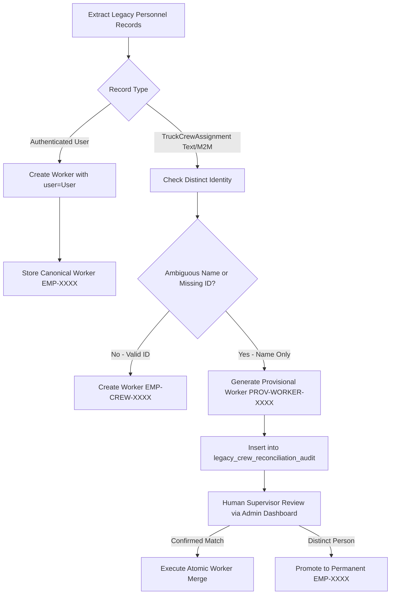
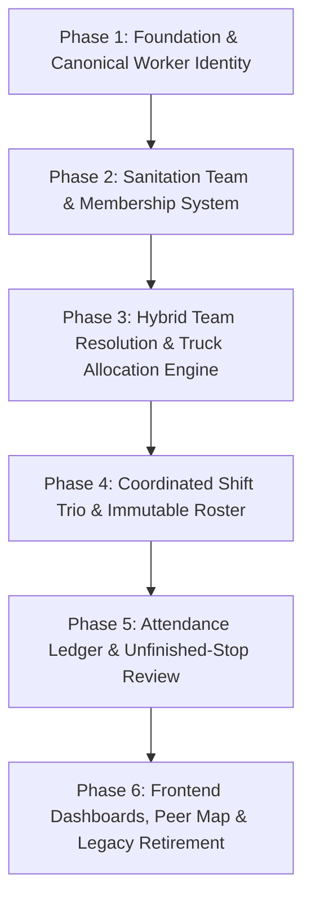

# WasteWatch — Sanitation Team Phase 1: Implementation Readiness & Migration Planning

**Document Status:** OFFICIAL PHASE 1 IMPLEMENTATION READINESS & MIGRATION SPECIFICATION  
**Target Subsystem:** WasteWatch Sanitation Team, Canonical Worker Identity, Fleet Allocation, and Dumpsite Integration  
**Lead Authority:** Senior Backend Architect, Database Migration Planner, and Technical Project Coordinator  
**Target Repository:** `D:\Coding\Waste Watch\wastewatch`  
**Baseline Architecture:** [WASTEWatch_SANITATION_TEAM_FINAL_ARCHITECTURE_BLUEPRINT.md](file:///D:/Coding/Waste%20Watch/WASTEWatch_SANITATION_TEAM_FINAL_ARCHITECTURE_BLUEPRINT.md) (Approved with Limitations, Review #4)  
**Execution Phase:** Strictly Read-Only Planning (0 Code Modifications, 0 Migrations, 0 DB Changes)  
**Iconography Policy:** Strictly 0 Emojis Across Entire Document  
**Readiness Verdict:** READY FOR IMPLEMENTATION PHASE PLANNING (Subject to 5 Binding Limitations)  

---

## 1. Executive Summary

This document translates the approved Sanitation Team Architecture Blueprint (Phase 0, Review #4) into an actionable, repository-grounded engineering implementation package. 

A rigorous, read-only forensic inspection of the existing WasteWatch repository was conducted across `wastewatch/backend/` (Django 4.2+) and `wastewatch/frontend/` (React 18+ Vite). The audit revealed that solid waste collection operations currently rely on legacy scalar assignments (`CollectionSchedule.driver`, `CollectionSchedule.truck`), ManyToMany user-truck bindings (`Truck.drivers`, `Truck.crew`), and ad-hoc shift startup logic in `driver.views._resolve_driver_today_schedule`. 

None of the 13 proposed architecture models (`Worker`, `SanitationTeam`, `SanitationTeamMembership`, `ScheduleTeamOverride`, `ScheduleTruckAllocation`, `WatcherShift`, `CrewShift`, `ShiftCrewRosterSnapshot`, `ShiftCrewRosterItem`, `CrewAttendanceRecord`, `CrewAttendanceCorrection`, `UnfinishedStopReview`, `TruckInspectionRecord`) currently exist in the database or codebase. Furthermore, 48 out of 65 historical `DriverShift` records lack a linked `schedule_id`, and 46 lack a linked `truck_id`. Shared vehicle `Truck 45` is actively utilized across multiple disparate schedules and drivers.

To prevent operational disruptions, broken weighbridge audits, or data loss, this specification establishes:
1. A forensic source-to-target migration mapping.
2. A non-destructive, 6-stage migration pipeline with provisional worker identity quarantine (`PROV-WORKER-XXXX`).
3. A 6-phase modular implementation roadmap respecting model dependencies.
4. Concurrency, security, and PostgreSQL CI validation frameworks.

---

## 2. Scope and Operational Limitations

### 2.1 Scope Boundary
- **Authorized Scope:** Repository inspection, architectural gap analysis, migration schema mapping, concurrency protocol specification, and implementation sequencing.
- **Unauthorized Actions:** Modifying Django or React source code, authoring or applying database migrations, writing to the database, altering configuration settings, or modifying Git state.

### 2.2 Binding Limitations from Independent Review #4
Implementation planning must strictly adhere to the five governing limitations mandated by Independent Review #4:
1. **Limitation 1 (Worker Migration Quarantine):** Historical personnel backfill from `TruckCrewAssignment` must NEVER automatically deduplicate or merge records based on matching full-name strings. Ambiguous names must receive provisional IDs (`PROV-WORKER-XXXX`) and be staged in an administrative quarantine table (`legacy_crew_reconciliation_audit`) for manual supervisor review.
2. **Limitation 2 (Dynamic Override Staging Validation):** At shift staging, the service must dynamically assert that `allocation.allocated_team == resolve_schedule_team(schedule, service_date)` under row lock to prevent dispatches against stale allocations caused by late overrides.
3. **Limitation 3 (Unfinished Stop Penalty Exclusion):** The resolution choice `CONFIRMED_MISSED` represents an administrative route determination and must NOT trigger automated driver penalties, deductions, or punitive fault attribution without explicit owner approval.
4. **Limitation 4 (PostgreSQL Container CI Requirement):** Because local development uses SQLite (where PL/pgSQL triggers cannot compile or execute), automated CI pipelines must execute migration scripts and trigger verification tests against a live PostgreSQL 14+ container.
5. **Limitation 5 (Strict Pre-Implementation Boundary):** This document authorizes engineering planning only. No source code or schema modifications may begin without explicit project owner sign-off.

---

## 3. Repository-Grounded Current-State Inventory

### 3.1 Existing Backend Models and Schemas

#### A. `accounts.User` (`wastewatch/backend/accounts/models.py`)
- **Table:** `accounts_user` (108 existing rows in development).
- **Key Fields:** `id`, `username`, `full_name`, `email`, `role`, `barangay_id`, `dumpsite_id`, `employee_type`.
- **Role Choices:** `ADMIN`, `BRGY_OFFICIAL`, `WATCHER`, `DRIVER`, `CITIZEN`, `DUMPSITE`.
- **EmployeeType Choices:** `NONE`, `CREW_MEMBER`.
- **Architectural Fit:** Lacks canonical decoupling from authentication. Crew members currently require a user record with `employee_type='crew_member'`.
- **Required Change:** Retain `accounts_user` as the authentication model. Add `Worker` model in `driver` app with `user = OneToOneField(User, null=True, blank=True)`.

#### B. `driver.CollectionSchedule` (`wastewatch/backend/driver/models.py`)
- **Table:** `driver_collectionschedule` (6 existing rows).
- **Key Fields:** `id`, `truck_id` (FK to Truck, null=True), `driver_id` (FK to User, null=True), `area`, `start_time`, `end_time`, `days`, `frequency`, `waypoints` (JSONField), `dumpsite_id` (FK to Dumpsite, null=True), `date` (DateField, null=True), `status`.
- **Architectural Fit:** Embeds scalar `truck` and `driver` foreign keys, enforcing a 1-driver/1-truck limitation.
- **Required Change:** Add `default_team = ForeignKey('SanitationTeam', null=True, blank=True)` to support D-10. Retain scalar `truck` and `driver` as nullable deprecated fields during the 60-day migration window.

#### C. `driver.DriverShift` (`wastewatch/backend/driver/models.py`)
- **Table:** `driver_drivershift` (65 existing rows).
- **Key Fields:** `id`, `driver_id` (FK to User), `truck_id` (FK to Truck, null=True), `schedule_id` (FK to CollectionSchedule, null=True), `status`, `duty_type`, `started_at`, `ended_at`, `duration_ms`, `is_active`, `end_reason`, `op_status`, `end_shift_phase`, `is_extended_mode`, `current_latitude`, `current_longitude`.
- **Observed Legacy State:** 48 of 65 rows have `schedule_id IS NULL`; 46 of 65 rows have `truck_id IS NULL`. Statuses include legacy strings (e.g., `'done'`) outside `PHASE_CHOICES`. Lacks `service_date` and `allocation_id`.
- **Required Change:** Add nullable `allocation = OneToOneField('ScheduleTruckAllocation', null=True, blank=True)`. Add delegated properties for `schedule`, `truck`, `assigned_team`, and `dumpsite`.

#### D. `driver.TruckCrewAssignment` (`wastewatch/backend/driver/models.py`)
- **Table:** `driver_truckcrewassignment` (0 rows in dev SQLite, but active in schema).
- **Key Fields:** `id`, `truck_id`, `driver_id`, `schedule_id`, `date`, `is_active`, `notes`, `created_at`, `created_by_id`. ManyToMany: `crew_members` (`accounts.User`).
- **Critical Dependency:** Referenced by `dumpsite.WasteDelivery.crew_assignment` (`on_delete=models.SET_NULL`).
- **Required Change:** Preserve table and relationships intact for historical weighbridge integrity. Deprecate for new shifts in favor of `ShiftCrewRosterSnapshot`.

#### E. `driver.Truck` (`wastewatch/backend/driver/models.py`)
- **Table:** `driver_truck` (3 existing rows: Truck 45, Truck 46, Truck 47).
- **Key Fields:** `id`, `plate_number`, `model`, `status` (`ACTIVE`, `MAINTENANCE`, `INACTIVE`), `max_capacity_kg`, `current_capacity`, `last_service`, `maintenance_start`, `status_reason`, `past_crew_names`. ManyToMany: `drivers`, `crew`.
- **Architectural Fit:** Conflates operational dispatch, roadworthiness, and inspection into a single `status` field.
- **Required Change:** Add three separate persisted fields: `op_status` (`AVAILABLE`, `ALLOCATED`, `DISPATCHED`, `OUT_OF_SERVICE`), `mechanical_condition` (`CLEARED`, `NEEDS_REPAIR`, `MAINTENANCE`, `DECOMMISSIONED`), and `inspection_state` (`PENDING_INSPECTION`, `INSPECTED_PASSED`, `INSPECTED_FAILED`).

#### F. `watcher.StopValidation` (`wastewatch/backend/watcher/models.py`)
- **Table:** `watcher_stopvalidation` (28 existing rows).
- **Key Fields:** `id`, `schedule_id`, `stop_order`, `collection_date`, `barangay_id`, `stop_id`, `current_status`, `pre_validation_watcher_id`, `post_validation_watcher_id`.
- **Verified Choices:** `PENDING_INSPECTION`, `READY_FOR_COLLECTION`, `EMPTY_STOP`, `COLLECTION_REPORTED`, `VERIFIED_COLLECTED`, `COLLECTION_DISPUTED`.
- **Architectural Fit:** Fully supports the required status lifecycle. Lacks linkage to `UnfinishedStopReview`.
- **Required Change:** Retain schema. Integrate post-shift validation workflow to resolve linked `UnfinishedStopReview` tickets via `RESOLVED_BY_WATCHER`.

#### G. `dumpsite.WasteDelivery` (`wastewatch/backend/dumpsite/models.py`)
- **Table:** `dumpsite_wastedelivery` (166 existing rows).
- **Key Fields:** `id`, `truck_id`, `driver_id`, `dumpsite_id`, `dumpsite_operator_id`, `schedule_id`, `crew_assignment_id`, `date`, `arrival_time`, `gross_weight`, `tare_weight`, `net_weight`.
- **Architectural Fit:** Lacks direct link to `DriverShift`.
- **Required Change:** Add nullable `driver_shift = ForeignKey('driver.DriverShift', null=True, blank=True, on_delete=models.PROTECT)`. Retain `crew_assignment` for legacy audit.

---

### 3.2 Existing Backend Workflows

1. **Shift Startup Workflow (`driver.views.DriverShiftViewSet.start_shift`):**
   - Calls `_resolve_driver_today_schedule(driver, today, requested_schedule_id)`.
   - Resolution queries `TruckCrewAssignment.objects.filter(driver=driver, date=today, is_active=True).first()`.
   - If missing, queries `CollectionSchedule.objects.get(pk=requested_schedule_id, driver=driver)` and falls back to `schedule.truck`.
   - Directly creates `DriverShift` with scalar `driver`, `truck`, and `schedule`.
   - *Gap:* No team resolution, no allocation validation, no Watcher coordination, no crew snapshot.
2. **Shift Conclusion Workflow (`driver.views.DriverShiftViewSet.end_shift`):**
   - Driver submits `missed_stop_orders` array.
   - Updates `DriverShift(is_active=False, ended_at=now)`.
   - Creates `MissedStop` records with `reason='SHIFT_ENDED_EARLY'`.
   - *Gap:* Automatically creates missed stops attributing blame, violating Decision D-12. No `UnfinishedStopReview` ticket creation. Does not coordinate with Watcher or Crew shifts.
3. **Stop Validation Workflow (`watcher.views.StopValidationViewSet`):**
   - Watchers call `pre-inspect` and `post-verify`.
   - Permissions check `IsStopValidationAuthorized`, verifying watcher's assigned barangay matches `stop_validation.barangay`.
   - *Gap:* Watchers are restricted to their home barangay. Under the Sanitation Team architecture, Watcher authority must span the entire schedule route assigned to their team.

---

### 3.3 Existing Frontend Workflows

1. **`DriverDashboard.jsx` (`wastewatch/frontend/src/pages/dashboard/DriverDashboard.jsx`):**
   - Fetches routes via `api.get('/api/driver/collection-schedules/')`.
   - Renders schedule cards based on `CollectionSchedule.driver == user.id`.
   - *Required Change:* Update query to `/api/driver/allocations/available/` displaying daily team allocations. Restrict truck selection to pre-existing allocations.
2. **`ShiftRouteModule.jsx` (`wastewatch/frontend/src/pages/driver/components/ShiftRouteModule.jsx`):**
   - Manages live turn-by-turn routing via OpenRouteService (ORS).
   - *Required Change:* Integrate peer truck telemetry into a decoupled Leaflet `LayerGroup`. Prevent peer telemetry coordinates from triggering ORS routing loops.
3. **`WatcherDashboard.jsx` (`wastewatch/frontend/src/pages/dashboard/WatcherDashboard.jsx`):**
   - Displays barangay-specific task feeds and map confirmations.
   - *Required Change:* Add team crew check-in widget. Display manifested roster from `ShiftCrewRosterSnapshot`. Block operational confirmation until attendance is recorded for 100% of crew.
4. **`ArrivalLogger.jsx` (`wastewatch/frontend/src/pages/dumpsite/ArrivalLogger.jsx`):**
   - Dumpsite operator inputs gross and tare weights to record `WasteDelivery`.
   - *Required Change:* Link delivery record to active `DriverShift`. Add post-shift truck inspection module with physical checklist booleans.

---

### 3.4 Existing Infrastructure & Configuration

| Component | Repository State | Verification Status | Implementation Implication |
| :--- | :--- | :--- | :--- |
| **Database Engine** | Development uses SQLite (`db.sqlite3`). Production requires PostgreSQL. | Verified (`settings.DATABASES`) | PL/pgSQL triggers require PostgreSQL container in CI; cannot execute on local SQLite. |
| **Timezone** | `TIME_ZONE = 'Asia/Manila'` | Verified (`settings.TIME_ZONE`) | All `service_date` calculations must localize UTC datetimes to `Asia/Manila`. |
| **Cache Store** | Default local-memory cache. No Redis in `INSTALLED_APPS` or `CACHES`. | Verified (`settings.py`) | High-frequency peer telemetry must rely on efficient HTTP polling or future Redis addition. |
| **Offline Persistence**| Custom IndexedDB utility in PWA frontend. | Verified (`hooks/useOfflineReports.js`) | Offline attendance drafts must synchronize using client transaction UUIDs and payload hashing. |
| **Authentication** | Session + CSRF via Axios client (`api/client.js`). | Verified (`accounts/models.py`) | Admin checks standardize on `user.role == 'admin' or user.is_staff`. |

---

## 4. Approved Architecture Gap Analysis

| # | Architecture Requirement | Current Repository State | Evidence (File/Model/Method) | Required Change | Dependencies | Migration Risk |
|---|---|---|---|---|---|---|
| **1** | Canonical `Worker` Identity | Absent. Personnel tied to `accounts.User` (`employee_type='crew_member'`). | `accounts/models.py:User` | Create `Worker(id, employee_id, full_name, user, is_active)`. | None | High: Legacy crew names lack employee IDs. |
| **2** | Optional Worker-to-User Link | Absent. User account mandatory for all system operations. | `accounts/models.py:User` | Add `Worker.user = OneToOneField(User, null=True, blank=True)`. | Item 1 | Low: Additive foreign key. |
| **3** | `SanitationTeam` Entity | Absent. Teams represented informally via `TruckCrewAssignment`. | `driver/models.py` | Create `SanitationTeam(name, code, description, is_active)`. | None | Low: Additive model. |
| **4** | `SanitationTeamMembership` | Absent. Crew assigned dynamically per truck/schedule. | `driver/models.py:TruckCrewAssignment` | Create `SanitationTeamMembership(team, worker, role_in_team, is_active)`. | Items 1, 3 | Medium: Must seed initial sector teams. |
| **5** | D-13 Transfer Shift Lock | Absent. No concurrency locking or active shift transfer guard. | `driver/views.py` | Implement canonical lock ordering and `fn_enforce_active_shift_transfer_lock`. | Items 1, 4 | High: Requires row locks to prevent race conditions. |
| **6** | Schedule Default Team | Absent. Schedule has scalar `driver` and `truck` fields. | `driver/models.py:CollectionSchedule` | Add `CollectionSchedule.default_team = ForeignKey(SanitationTeam)`. | Item 3 | Medium: Must populate default teams before NOT NULL. |
| **7** | `ScheduleTeamOverride` (D-10) | Absent. Schedules rely on static weekly recurrences. | `driver/models.py:CollectionSchedule` | Create `ScheduleTeamOverride(schedule, service_date, override_team)`. | Items 3, 6 | Low: Additive override model. |
| **8** | `ScheduleTruckAllocation` | Absent. Drivers select raw schedules without pre-allocated manifests. | `driver/views.py:_resolve_driver_today_schedule` | Create `ScheduleTruckAllocation(schedule, service_date, truck, allocated_team, dumpsite)`. | Items 3, 6 | High: Shared trucks (Truck 45) require discrete allocations. |
| **9** | DriverShift Allocation Link | Absent. `DriverShift` has separate `driver`, `truck`, `schedule` FKs. | `driver/models.py:DriverShift` | Add `allocation = OneToOneField(ScheduleTruckAllocation)`. Add delegated properties. | Item 8 | Critical: 48 legacy shifts lack schedule_id. |
| **10** | `WatcherShift` & `CrewShift` | Absent. No shift tracking for Watchers or Crew. | `watcher/models.py` | Create `WatcherShift` (1:1 with DriverShift) and `CrewShift` (1:1 with WatcherShift). | Item 9 | Medium: Requires coordinated creation service. |
| **11** | Shift Roster Snapshot | Absent. Crew tracked via ManyToMany `TruckCrewAssignment.crew_members`. | `driver/models.py:TruckCrewAssignment` | Create `ShiftCrewRosterSnapshot` and `ShiftCrewRosterItem(worker, assigned_role)`. | Items 1, 9 | Low: Additive snapshot tables. |
| **12** | `CrewAttendanceRecord` | Absent. No formal crew attendance tracking. | `driver/models.py` | Create `CrewAttendanceRecord(roster_item, crew_shift, worker, status)`. | Items 1, 10, 11 | High: Engine trigger required for write-once immutability. |
| **13** | Attendance Corrections | Absent. No audit ledger for attendance edits. | `driver/models.py` | Create `CrewAttendanceCorrection(attendance_record, correction_seq, corrected_status)`. | Item 12 | Medium: Sequential ordering under row lock. |
| **14** | Coordinated Shift Closure | Absent. Driver ends shift unilaterally; creates `MissedStop`. | `driver/views.py:DriverShiftViewSet.end_shift` | Atomic closure of `DriverShift`, `WatcherShift`, and `CrewShift`. | Items 9, 10 | High: Must synchronize termination states. |
| **15** | `UnfinishedStopReview` (D-12) | Absent. Unfinished stops marked missed or deleted. | `driver/models.py:MissedStop` | Create `UnfinishedStopReview`. Preserve stop status; spawn review ticket. | Items 9, 14 | Medium: Replaces punitive `MissedStop` generation. |
| **16** | Dumpsite Base Integration | Incomplete. `CollectionSchedule.dumpsite` exists but not enforced at staging. | `driver/models.py:CollectionSchedule` | Validate 150m geofence and <=50m accuracy at staging and shift conclusion. | Items 8, 9 | Low: API validation logic. |
| **17** | Truck Operational Availability | Incomplete. Single `status` field (`ACTIVE`, `MAINTENANCE`, `INACTIVE`). | `driver/models.py:Truck.status` | Add `Truck.op_status` (`AVAILABLE`, `ALLOCATED`, `DISPATCHED`, `OUT_OF_SERVICE`). | None | Medium: Requires backward-compatible migration. |
| **18** | Truck Mechanical Condition | Incomplete. Conflated in `Truck.status`. | `driver/models.py:Truck.status` | Add `Truck.mechanical_condition` (`CLEARED`, `NEEDS_REPAIR`, `MAINTENANCE`, `DECOMMISSIONED`). | None | Low: Field addition. |
| **19** | Truck Inspection State | Absent. No pre/post-shift vehicle inspection records. | `driver/models.py` | Add `Truck.inspection_state` and `TruckInspectionRecord`. | Items 9, 17 | Medium: Physical checklist validation required. |
| **20** | Truck Assignment History | Incomplete. `Truck.past_crew_names` text field. | `driver/models.py:Truck.past_crew_names` | Retain historical `TruckCrewAssignment`; track future allocations via `ScheduleTruckAllocation`. | Item 8 | Low: Historical audit preservation. |
| **21** | Peer-Truck Map Visibility | Absent. Driver sees only own GPS breadcrumbs. | `frontend/src/pages/driver/components/ShiftRouteModule.jsx` | Add `/api/driver/peer-trucks/` endpoint; render in decoupled Leaflet `LayerGroup`. | Item 9 | Low: Visual layer addition. |
| **22** | Dumpsite Operator Scoping | Incomplete. Views check role but lack strict facility tenancy. | `dumpsite/views.py:WasteDeliveryViewSet` | Enforce operator inspection authority strictly to assigned facility. | Item 19 | Medium: Authorization enforcement. |
| **23** | Admin Permission Pattern | Inconsistent. Mix of `is_staff` and `role == 'admin'`. | `accounts/permissions.py:is_admin_user` | Standardize all administrative checks on `is_admin_user(user)`. | None | Low: Permission consolidation. |
| **24** | Weighbridge Data Integrity | Present. `WasteDelivery.crew_assignment` FK to `TruckCrewAssignment`. | `dumpsite/models.py:WasteDelivery` | Preserve `TruckCrewAssignment` table and rows intact. | None | Critical: Dropping table breaks 166 deliveries. |
| **25** | Frontend Dashboard Updates | Absent. Dashboards display legacy routes and schedules. | `frontend/src/pages/dashboard/` | Update Driver, Watcher, and Dumpsite dashboards for team workflows. | Items 8, 11, 19 | Medium: Component refactoring. |
| **26** | Offline PWA Sync | Incomplete. Offline sync handles reports, not shifts/attendance. | `frontend/src/hooks/useOfflineReports.js` | Add IndexedDB queueing with client transaction UUIDs and payload hashing. | Items 12, 25 | Medium: PWA client integration. |

---

## 5. Database Migration Readiness Plan

### 5.1 Source-to-Target Data Mapping

| Existing Source | Target Architecture | Transformation Logic | Data Preservation Concern | Ambiguity Handling |
|---|---|---|---|---|
| `accounts.User` (drivers/watchers) | `driver_worker` (`Worker`) | Create `Worker(employee_id=f"EMP-{id:04d}", full_name=user.get_full_name() or user.username, user=user)`. | User account links and credentials preserved intact. | Deterministic 1:1 mapping via `user_id`. |
| `accounts.User` (`employee_type='crew_member'`) | `driver_worker` (`Worker`) | Create `Worker(employee_id=f"EMP-CREW-{id:04d}", full_name=user.get_full_name(), user=user)`. | Preserves login credentials for crew who already hold accounts. | Map existing crew users directly to `Worker`. |
| `driver.TruckCrewAssignment` (crew members) | `driver_worker` (`Worker`) | Query distinct crew names. Create provisional `Worker(employee_id=f"PROV-WORKER-{seq:04d}", user=None)`. | Must NOT assume identical names represent the same person. | Stage ambiguous names in `legacy_crew_reconciliation_audit` table. |
| `driver.Truck.crew` (M2M) | `driver_worker` (`Worker`) | Map associated user records to `Worker`. | Preserves historical truck crew associations. | Map via `Worker.user_id`. |
| `driver.Truck.drivers` (M2M) | `driver_worker` (`Worker`) | Map associated user records to `Worker`. | Preserves authorized driver lists. | Map via `Worker.user_id`. |
| `driver.CollectionSchedule` | `driver_collectionschedule` | Add `default_team_id`. Retain scalar `driver_id` and `truck_id` as deprecated nullable fields. | Zero data loss on existing schedules and route waypoints. | Assign initial sector teams based on active driver assignments. |
| `driver.DriverShift` (65 rows) | `driver_drivershift` | Add `allocation_id = NULL`. Backfill allocations for shifts possessing valid `schedule_id` and `truck_id`. | 48 legacy shifts lack `schedule_id`; 46 lack `truck_id`. | Legacy shifts remain with `allocation_id = NULL`. Log to triage report. |
| `driver.Truck` (Truck 45, 46, 47) | `driver_truck` | Add `op_status='AVAILABLE'`, `mechanical_condition='CLEARED'`, `inspection_state='INSPECTED_PASSED'`. | Preserves plate numbers, models, and maintenance logs. | Set initial operational state based on existing `status == 'active'`. |
| `dumpsite.WasteDelivery` (166 rows) | `dumpsite_wastedelivery` | Add `driver_shift_id = NULL`. Retain `crew_assignment_id` intact. | Foreign key to `TruckCrewAssignment` must never be broken. | Preserve legacy column and table indefinitely. |

---

### 5.2 Canonical Worker Migration and Quarantine Protocol



#### Detailed Rules:
1. **Zero Automated Name Deduplication:** If two records in `TruckCrewAssignment` contain "Juan Cruz", the migration script must NEVER collapse them into one `Worker`. Each record receives a unique provisional identifier (`PROV-WORKER-0001`, `PROV-WORKER-0002`).
2. **Quarantine Table Structure:**
   ```sql
   CREATE TABLE legacy_crew_reconciliation_audit (
       id SERIAL PRIMARY KEY,
       provisional_worker_id INTEGER REFERENCES driver_worker(id),
       source_assignment_id INTEGER,
       raw_name_string VARCHAR(255),
       detected_conflicts JSONB,
       reconciliation_status VARCHAR(30) DEFAULT 'PENDING_REVIEW',
       resolved_by_id INTEGER REFERENCES accounts_user(id),
       resolved_at TIMESTAMP WITH TIME ZONE
   );
   ```
3. **Surrogate Key Preservation:** All relational links target `Worker.id`. When a provisional worker is reconciled or issued an official employee ID, `Worker.employee_id` is updated under row lock without breaking any historical foreign keys.

---

### 5.3 Six-Stage Migration Execution Pipeline

```text
================================================================================
MIGRATION EXECUTION PIPELINE
================================================================================

[STAGE 1: Schema Expansion & Canonical Worker Migration]
Preconditions:
  - Full PostgreSQL/SQLite backup executed.
  - Development/staging environment verified.
Actions:
  - Create table `driver_worker` with surrogate PK `id` and unique `employee_id`.
  - Create table `legacy_crew_reconciliation_audit`.
  - Data Migration: Backfill `Worker` rows from `accounts_user` (drivers, watchers, crew).
  - Data Migration: Backfill provisional `Worker` rows from `TruckCrewAssignment`.
Rollback: Drop tables `legacy_crew_reconciliation_audit`, `driver_worker`.

[STAGE 2: Sanitation Team & Membership Management]
Preconditions:
  - Stage 1 applied. All active drivers and watchers have valid `Worker` profiles.
Actions:
  - Create table `sanitation_team`.
  - Create table `sanitation_team_membership` referencing `driver_worker`.
  - Add partial unique constraint `UniqueConstraint(fields=['worker'], condition=Q(is_active=True))`.
  - Data Migration: Seed baseline municipal teams (Team 1 through Team 6).
  - Data Migration: Assign existing drivers and watchers to their respective sector teams.
Rollback: Drop tables `sanitation_team_membership`, `sanitation_team`.

[STAGE 3: Fleet Lifecycle Dimensions & Truck Allocations]
Preconditions:
  - Stage 2 applied. Baseline teams seeded.
Actions:
  - Add columns `op_status`, `mechanical_condition`, `inspection_state` to `driver_truck`.
  - Add nullable column `default_team_id` to `driver_collectionschedule`.
  - Create table `schedule_team_override`.
  - Create table `schedule_truck_allocation`.
  - Data Migration: Populate `Truck.op_status = 'AVAILABLE'` for active trucks.
  - Data Migration: Assign `default_team_id` on existing schedules matching sector teams.
Rollback: Drop tables `schedule_truck_allocation`, `schedule_team_override`; drop added columns.

[STAGE 4: Shift Trio & Immutable Roster Infrastructure]
Preconditions:
  - Stage 3 applied. Allocations supported.
Actions:
  - Add nullable column `allocation_id` to `driver_drivershift`.
  - Create table `watcher_shift` (1:1 with `driver_drivershift`).
  - Create table `crew_shift` (1:1 with `watcher_shift`).
  - Create table `shift_crew_roster_snapshot` and `shift_crew_roster_item`.
  - Create table `crew_attendance_record` and `crew_attendance_correction`.
  - Create table `unfinished_stop_review`.
  - Create table `truck_inspection_record`.
  - Data Migration: Convert historical `DriverShift.started_at` to `Asia/Manila` date.
  - Data Migration: Backfill `ScheduleTruckAllocation` for historical shifts with valid schedules.
Rollback: Drop shift trio tables, attendance tables, review tables; drop `allocation_id`.

[STAGE 5: Native PostgreSQL Triggers & Constraints]
Preconditions:
  - Stage 4 applied. All tables populated. Executing on PostgreSQL instance.
Actions:
  - Execute `RunSQL` migration deploying PL/pgSQL functions:
      * prevent_attendance_record_mutation()
      * prevent_attendance_correction_mutation()
      * prevent_roster_snapshot_mutation()
      * prevent_membership_deletion()
      * fn_enforce_active_shift_transfer_lock()
      * prevent_table_truncation()
  - Attach `BEFORE UPDATE OR DELETE` and `BEFORE TRUNCATE` triggers.
Rollback: Execute reverse SQL dropping triggers and functions.

[STAGE 6: Feature Flag Activation & Verification]
Preconditions:
  - Stages 1-5 verified through automated test suite.
Actions:
  - Enable setting `ENABLE_SANITATION_TEAMS = True`.
  - Expose new team endpoints to frontend dashboards.
  - Monitor audit logs and triage queue.
Rollback: Toggle `ENABLE_SANITATION_TEAMS = False` (reverts API to legacy endpoints; zero data dropped).
```

---

## 6. Implementation Dependency and Execution Order



### Phase 1: Foundation & Canonical Worker Identity
- **Objective:** Establish the root physical person entity independent of authentication.
- **Backend Scope:** `Worker` model, admin serializers, `WorkerService` for atomic merges and ID updates.
- **Frontend Scope:** Admin Worker Management panel (create, list, inspect profiles).
- **Database Scope:** Stage 1 migration (`driver_worker`, `legacy_crew_reconciliation_audit`).
- **Acceptance Criteria:** Drivers and Watchers link to `Worker`; non-login crew created with `user=None`. Name-based auto-merging blocked.

### Phase 2: Sanitation Team & Membership System
- **Objective:** Establish municipal teams and single-active-membership enforcement (Decision D-13).
- **Backend Scope:** `SanitationTeam`, `SanitationTeamMembership`, `MembershipTransferService`.
- **Frontend Scope:** Admin Team Roster view, worker assignment and transfer modals.
- **Database Scope:** Stage 2 migration (`sanitation_team`, `sanitation_team_membership`).
- **Acceptance Criteria:** Canonical lock ordering enforced. Active shift transfer lock rejects transfers with HTTP 409.

### Phase 3: Hybrid Team Resolution & Truck Allocation Engine
- **Objective:** Implement Decision D-10 hybrid scheduling and pre-staged multi-truck allocations.
- **Backend Scope:** `ScheduleTeamOverride`, `ScheduleTruckAllocation`, `resolve_schedule_team` service.
- **Frontend Scope:** Admin Schedule Builder update (default team selector, date override editor).
- **Database Scope:** Stage 3 migration (`driver_truck` status split, `schedule_truck_allocation`).
- **Acceptance Criteria:** Overrides take precedence over default teams; staging validates pre-existing allocation matching driver's team. Shared trucks (Truck 45) allocated cleanly.

### Phase 4: Coordinated Shift Trio & Immutable Roster
- **Objective:** Bind Driver, Watcher, and Crew in an atomic 1:1:1 operational shift.
- **Backend Scope:** `DriverShift.allocation`, `WatcherShift`, `CrewShift`, `ShiftCrewRosterSnapshot`, `ShiftCrewRosterItem`, coordinated staging/closing services.
- **Frontend Scope:** Driver pre-start allocation picker; Watcher shift activation card.
- **Database Scope:** Stage 4 migration (shift trio, roster snapshots).
- **Acceptance Criteria:** Staging locks Team, Truck, and manifested Workers in ascending ID order. Roster snapshots are write-once.

### Phase 5: Attendance Ledger & Unfinished-Stop Review
- **Objective:** Implement Decision D-12 stop preservation and Watcher-led append-only crew attendance.
- **Backend Scope:** `CrewAttendanceRecord`, `CrewAttendanceCorrection`, `UnfinishedStopReview`, PL/pgSQL triggers.
- **Frontend Scope:** Watcher attendance check-in modal; Admin unfinished-stop audit dashboard.
- **Database Scope:** Stage 5 migration (PostgreSQL triggers, append-only constraints).
- **Acceptance Criteria:** Initial attendance write-once; corrections increment monotonic `correction_seq`. Unfinished stops retain status and generate review tickets. Subsequent Watcher post-shift validation marks tickets `RESOLVED_BY_WATCHER`.

### Phase 6: Frontend Dashboards, Peer Map & Legacy Retirement
- **Objective:** Deliver user-facing interfaces, peer-truck map layer (Decision D-11), and deprecate legacy paths.
- **Backend Scope:** `/api/driver/peer-trucks/` endpoint; deprecation notices on scalar schedule fields.
- **Frontend Scope:** `ShiftRouteModule.jsx` Leaflet peer layer, Dumpsite inspection checklist, Driver dashboard manifest.
- **Database Scope:** Stage 6 configuration (`ENABLE_SANITATION_TEAMS = True`).
- **Acceptance Criteria:** Peer truck coordinates poll every 10s without ORS routing interference; offline attendance queues in IndexedDB; legacy endpoints safely backward-compatible.

---

## 7. Security, Concurrency, and Data-Integrity Requirements

### 7.1 Single Canonical Lock Order (Decision D-13)
To eliminate deadlocks and race conditions between concurrent shift stagings and personnel transfers, all transactions must acquire row-level locks in deterministic ascending primary key order:
```text
1. SanitationTeam records:           ORDER BY id ASC FOR UPDATE
2. Truck records:                    ORDER BY id ASC FOR UPDATE
3. Worker records (Driver + Crew):   ORDER BY id ASC FOR UPDATE
4. SanitationTeamMembership records: ORDER BY id ASC FOR UPDATE
```

### 7.2 Database Invariants vs. Service Layer Guards

| Invariant | Database Engine Mechanism | Service Layer Guard | Frontend Safeguard (Non-Authoritative) |
| :--- | :--- | :--- | :--- |
| **Single Active Team Membership** | Partial unique constraint on `Worker` (`is_active=True`) | Validates existing active memberships before insert | Prevents selecting active workers in UI dropdown |
| **Write-Once Attendance** | `BEFORE UPDATE OR DELETE` trigger raises exception | Excludes `PUT`, `PATCH`, `DELETE` handlers from API | Disables edit controls once submitted |
| **Monotonic Correction Seq** | Composite unique constraint `(attendance_record, correction_seq)` | Calculates `MAX(correction_seq) + 1` under row lock | Displays read-only sequence numbers |
| **Active Shift Transfer Lock** | Trigger checks active shift trio across linked user/worker | Rejects transfer with HTTP 409 Conflict | Disables transfer button for on-duty personnel |
| **Allocation Exclusivity** | Unique constraint on `DriverShift.allocation` (1:1) | Validates allocation has no active or past shift | Filters out allocated trucks from picker |
| **Immutable Roster Snapshot** | `BEFORE UPDATE OR DELETE` trigger on snapshot/items | Viewsets are strictly read-only post-staging | Renders roster in read-only table |
| **Weighbridge Audit Preservation** | `on_delete=models.PROTECT` on truck/driver in delivery | Rejects deletion of referenced crew assignments | Hides delete actions on historical delivery logs |

---

## 8. PostgreSQL and CI Validation Plan

Because development currently runs on SQLite where PostgreSQL triggers cannot execute, a dedicated PostgreSQL validation pipeline must be established before executing Phase 1 migrations.

### Required CI Containerized Test Suite:

| Test Identifier | Validated Target & Invariant | Database Objects Involved | Expected Outcome | Concurrency Mode |
| :--- | :--- | :--- | :--- | :---: |
| **TC-PG-01** | Attendance Immutability | `crew_attendance_record`, Trigger `trg_immutable_crew_attendance` | Direct SQL `UPDATE` or `DELETE` raises `PERMISSION DENIED` exception. | Single Transaction |
| **TC-PG-02** | Correction Immutability | `crew_attendance_correction`, Trigger `trg_immutable_crew_attendance_correction` | Direct SQL `UPDATE` or `DELETE` raises exception. | Single Transaction |
| **TC-PG-03** | Roster Snapshot Immutability | `shift_crew_roster_snapshot`, `shift_crew_roster_item`, Trigger `trg_immutable_roster_snapshot` | Direct SQL mutation rejected at engine level. | Single Transaction |
| **TC-PG-04** | Membership Deletion Block | `sanitation_team_membership`, Trigger `trg_prevent_membership_delete` | Direct SQL `DELETE` raises exception; require `is_active=False`. | Single Transaction |
| **TC-PG-05** | TRUNCATE Protection | Audit tables, Trigger `trg_truncate_guard_attendance` | `TRUNCATE TABLE` aborted with security violation. | Single Statement |
| **TC-PG-06** | D-13 Concurrent Staging vs Transfer | `DriverShift`, `Worker`, `SanitationTeamMembership`, Trigger `fn_enforce_active_shift_transfer_lock` | Staging locks Worker; concurrent transfer blocks, then unblocks and raises HTTP 409 Conflict. | Dual Concurrent Transactions |
| **TC-PG-07** | Concurrent Allocation Reuse | `ScheduleTruckAllocation`, `DriverShift.allocation` | Second concurrent staging on same allocation fails on unique constraint. | Dual Concurrent Transactions |
| **TC-PG-08** | Stale Allocation Override Race | `ScheduleTeamOverride`, `ScheduleTruckAllocation`, Staging Service | Staging detects late override mismatch under row lock and refreshes allocation. | Dual Concurrent Transactions |
| **TC-PG-09** | Coordinated Trio Atomic Rollback | `DriverShift`, `WatcherShift`, `CrewShift` | Exception in WatcherShift rolls back DriverShift and CrewShift completely. | Single Atomic Transaction |

---

## 9. Unresolved Owner-Policy Decisions Register

The following operational policies remain pending explicit project owner confirmation:

| Policy ID | Policy Domain | Current Blueprint Status | Ambiguity / Question for Owner | Implementation Dependency | Impact if Deferred |
| :--- | :--- | :--- | :--- | :--- | :--- |
| **POL-1** | Unfinished Stop SLA | Recommends 24-hour default SLA for Admin review. | Is 24h the mandatory SLA, or should it vary by barangay or priority? | Phase 5 (Review Dashboard) | Low: Non-blocking; default to 24h configurable setting. |
| **POL-2** | Peer GPS Telemetry Interval | Recommends 10s poll, 45s stale fade, 120s eviction. | Is 10s acceptable for mobile cellular data consumption in Lucena City? | Phase 6 (Peer Map) | Low: Non-blocking; client setting. |
| **POL-3** | Cross-Facility Truck Loan | Recommends 1-day expiration requiring daily re-auth. | Can trucks be permanently stationed at secondary dumpsites? | Phase 3 (Allocations) | Low: Non-blocking; default to 1 day. |
| **POL-4** | Minimum Crew Headcount | Recommends minimum of 2 crew members per shift. | Are single-driver solo shifts ever permitted for small routes? | Phase 4 (Staging Service) | Medium: Blocks staging validation rules. |
| **POL-5** | `COLLECTION_REPORTED` Scope | Unresolved. Driver reports collection, but Watcher unverified at shift end. | Does `COLLECTION_REPORTED` spawn an `UnfinishedStopReview` or remain pending field inspection? | Phase 5 (Review Service) | **High:** Blocks shift conclusion stop-query filter. |
| **POL-6** | Peer Map Role Visibility | Recommends drivers only. | Should Watchers and Barangay Officials also view peer trucks live? | Phase 6 (Map Permissions) | Low: Default to Drivers only. |
| **POL-7** | Attendance Status Choices | Strictly `PRESENT` and `ABSENT`. | Are `LATE` or `EXCUSED` recognized as formal statuses or handled via remarks? | Phase 5 (Attendance API) | Medium: Affects `CrewAttendanceRecord.status` choices. |
| **POL-8** | Emergency GPS Closure | Unresolved. Mobile device hardware/GPS loss during shift. | Does GPS-failure closure require on-site dumpsite operator sign-off or Admin bypass? | Phase 4 (Shift Conclusion) | **High:** Blocks emergency closure API contract. |

---

## 10. Operational Risk and Mitigation Matrix

| Risk Event | Severity | Likelihood | Architectural & Operational Mitigation |
| :--- | :---: | :---: | :--- |
| **Legacy Shift Foreign Key Nullability** | Critical | High | 48 of 65 historical shifts lack schedules. Make `DriverShift.allocation` nullable. Enforce `NOT NULL` only on new records via model validation. |
| **Shared Truck Allocation Collisions (Truck 45)** | High | High | Generate discrete `ScheduleTruckAllocation` rows per schedule and calendar date with non-overlapping time windows. |
| **Name-Based Worker Conflation** | High | Medium | Enforce Limitation 1: Zero automated name deduplication. Quarantine all ambiguous legacy crew records into `legacy_crew_reconciliation_audit`. |
| **Stale Allocation Dispatches** | Medium | Medium | Enforce Limitation 2: Staging service dynamically re-evaluates `resolve_schedule_team` under row lock before dispatching driver. |
| **Unauthorized Driver Fault Penalization** | High | Low | Enforce Limitation 3: Label `CONFIRMED_MISSED` strictly as an administrative route review. Prohibit automated driver point deductions or demerits. |
| **Weighbridge Historical Audit Corruption** | Critical | Low | Maintain table `driver_truckcrewassignment` and foreign key `WasteDelivery.crew_assignment` indefinitely. |
| **Development vs Production Engine Drift** | High | High | Enforce Limitation 4: Require containerized PostgreSQL 14+ CI testing before applying Stage 5 trigger migrations. |

---

## 11. Recommended Next Implementation Step

### Recommendation:
**Authorize Phase 1 Foundation Implementation (Worker Identity & Quarantine Models)**

Following project owner review of this readiness specification, the recommended immediate engineering step is to execute **Phase 1 of the Implementation Roadmap**:
1. Create `driver_worker` and `legacy_crew_reconciliation_audit` models.
2. Implement `WorkerService` with atomic merge and surrogate ID update methods.
3. Author the idempotent data migration backfilling `Worker` profiles from `accounts_user` and creating quarantined provisional records (`PROV-WORKER-XXXX`) from legacy assignments.
4. Deliver unit test suite asserting zero automated name-based deduplication.

*All application modifications, migrations, and database schema mutations remain strictly paused pending explicit project owner authorization.*
