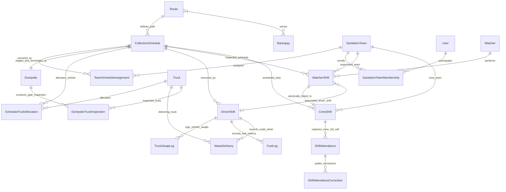
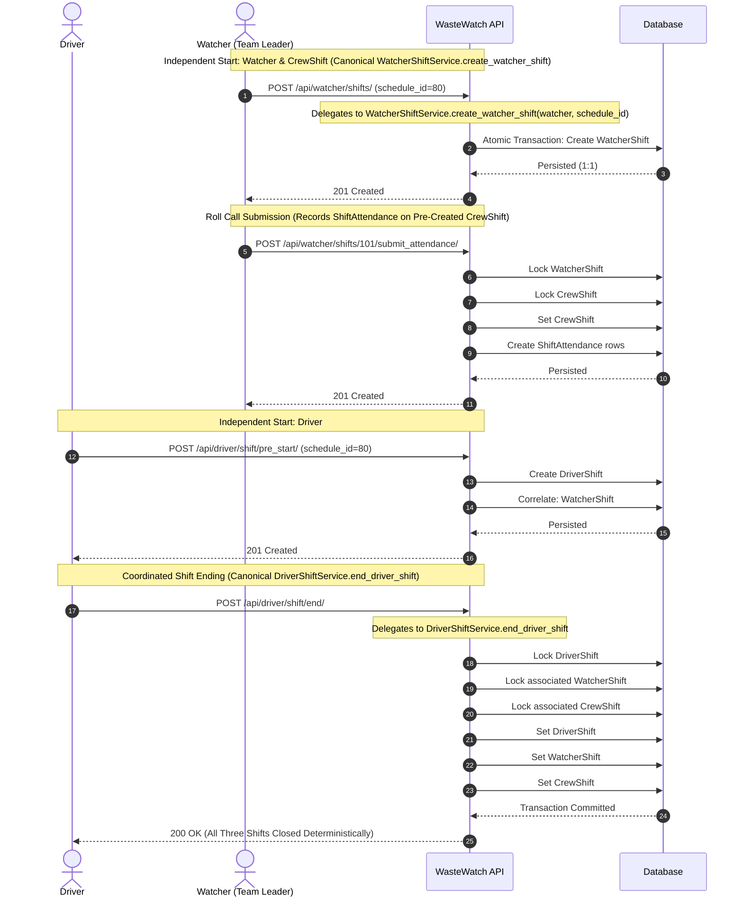
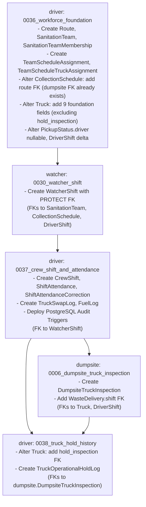

# WasteWatch Milestone 0B — Revised Workforce Architecture & API Contract Specification
**Project:** WasteWatch: A Progressive Web-Based Solid Waste Management System with Hotspot Mapping, Truck Tracking, and Route Optimization for Lucena City  
**Milestone:** 0B Design Revision (Consolidated Specification v3.3.2.10: Final Database Integrity & Deletion Security Hardening)  
**Document Status:** Complete Architecture Blueprint (Design-Only | READY FOR INDEPENDENT CLAUDE VALIDATION — Item 13 Owner-Approved)  
**Auditor / Reviewer Target:** Claude (Principal Software Architect & Code Quality Validator), Project Owner  
**Execution Mode:** STRICTLY DESIGN-ONLY (Zero Code Modifications, Zero DB Alterations, Zero Migrations)  
**Date of Revision:** November 12, 2026 (v3.3.2.10 Final Database Integrity & Deletion Security Hardening)  

---

## 1. Executive Summary

This specification represents the comprehensive, self-contained architectural blueprint for Milestone 0B of the WasteWatch platform, servicing the Lucena City City Environment and Natural Resources Office (CENRO) and City General Services Office (CGSO).

Following authoritative directives from the project owner and addressing all validation items from Claude's independent reviews, this specification establishes:

1. **Three Independent Shift Lifecycles with Coordinated Closure:**
   * **`DriverShift` (Driver-Owned & Independent Start):** Initiated, operated, and concluded by the Driver. Manages vehicle staging at the Dumpsite, GPS tracking, collection route execution, photo evidence capture, dumpsite unloading/calibration, and shift closure. Does not wait for, depend on, or get created by Watcher or Crew attendance. Lifecycle state is governed strictly by the actual schema fields: boolean `is_active` (`True` while running, `False` when concluded) and phase `status` (`'navigate_to_base'`, `'confirm_start'`, `'checkin'`, `'shiftroute'`, `'end_shift'`).
   * **`WatcherShift` (Watcher-Owned & Independent Start):** Initiated and operated by the Watcher acting as operational Team Leader via the sole sanctioned application creation path `POST /api/watcher/shifts/` (delegating to `WatcherShiftService.create_watcher_shift(watcher, schedule_id)`). Governs collection route monitoring, stop inspection, and official Crew roll call submission. Operates independently of `DriverShift`. Django Admin is strictly read-only: `WatcherShiftAdmin` explicitly returns `False` for `has_add_permission()`, `has_delete_permission()`, and `has_change_permission()` for all users (including staff and superusers), declaring all fields in `readonly_fields`. The client ViewSet exposes only `create` and approved custom actions (`exceptional_abort`, `submit_attendance`), exposing no generic update, partial update, or destroy operations. All automated background or management-command shift creation paths are excluded. Service-layer transitions execute internally via ORM and are unaffected.
   * **`CrewShift` (Crew Operational Record Linked to WatcherShift):** Represents the crew's physical participation in a scheduled operation. In strict adherence to project owner directive **D-5**, exactly one `CrewShift` exists for every `WatcherShift`. It is created atomically when the `WatcherShift` is initialized at staging via `WatcherShiftService.create_watcher_shift`. Its foreign key `OneToOneField('watcher.WatcherShift')` natively generates a database-level `UNIQUE` constraint enforcing an upper bound of at most one `CrewShift` per `WatcherShift` ($\le 1$) without redundant manual constraints. It is initialized with `attendance_submitted_at = None` and 0 `ShiftAttendance` records initially. Zero attendance records initially does not violate database integrity. Deletion and modification are prohibited across all application layers: `CrewShiftAdmin` explicitly returns `False` for `has_add_permission()`, `has_delete_permission()`, and `has_change_permission()` for all users with all fields in `readonly_fields`; no API update or delete endpoints exist; model instance `.delete()` and custom `CrewShiftQuerySet.delete()` raise `ProtectedError`. When the Watcher submits roll call, attendance rows are persisted and `attendance_submitted_at` is populated on the pre-created record. If cancelled pre-roll-call, `CrewShift` transitions with `WatcherShift` to `cancelled` without fabricating attendance rows. (The proposed `U-CR1` cap alteration is completely retracted).
   * **Multi-Path Coordinated Shift Ending & Resumable Truck Retirement Protocol (v3.3.2.6 Hardening):** In accordance with the owner's operational decision, all DriverShift closing paths—normal driver end (`POST /api/driver/shift/end/`), admin force-end (`POST /api/driver/shift/{id}/force-end/` with role-aware `is_admin_user` permission), batch stale-shift sweeper (processing in ascending PK order in separate per-shift transactions), and the vehicle retirement routine (`TruckService.retire_truck`)—delegate to a single canonical closure routine `DriverShiftService.end_driver_shift`.
     To eliminate assignment races, preserve historical maintenance notes, and guarantee robust resumability, vehicle retirement enforces a **dedicated four-step lifecycle**:
     1. **Dedicated Commissioning Provenance, Legacy Backfill & Retirement State (`commissioned_at`, `commissioning_provenance`, `retirement_state`):** Truck model adds dedicated fields in Stage 1 (`driver.0036`): `commissioned_at = models.DateTimeField(null=True, blank=True, db_index=True)`, `commissioning_provenance = models.CharField(max_length=40, default='uncommissioned', choices=[('uncommissioned', 'Uncommissioned'), ('commissioned_verified', 'Commissioned (Date Verified)'), ('commissioned_date_unknown', 'Commissioned (Date Unknown)'), ('legacy_unreconciled', 'Legacy (Status Unreconciled)')], db_index=True)`, and `retirement_state = models.CharField(max_length=30, default='uncommissioned', choices=[('uncommissioned', 'Uncommissioned'), ('operational', 'Operational'), ('legacy_reconciliation', 'Legacy Reconciliation'), ('retirement_in_progress', 'Retirement In Progress'), ('permanently_retired', 'Permanently Retired')], db_index=True)`. Migration policy strictly preserves historical integrity: legacy trucks with verified Category A history are backfilled to `commissioning_provenance='commissioned_date_unknown'`, `commissioned_at=None`, and `retirement_state='operational'` (never fabricating `created_at` as a false commissioning date); legacy trucks with zero digital history are backfilled to `commissioning_provenance='legacy_unreconciled'`, `commissioned_at=None`, and `retirement_state='legacy_reconciliation'` (strictly protected from physical deletion until physical fleet-record audit via `POST /api/driver/trucks/{id}/reconcile-commissioning/`). Invariants are enforced across 4 layers: database CheckConstraints, canonical services, API serializers, and Admin permissions.
     2. **Phase 0 (Persisted Retirement Gate):** Acquires Fleet Tier lock $T1$ on `Truck` in a short dedicated transaction. Sets `truck.is_retired = True`, `truck.retirement_state = 'retirement_in_progress'`, and `truck.status = TruckStatus.INACTIVE`. Commits before Phase 1. If retried, an in-progress retirement safely resumes. All application-level Driver and Crew vehicle assignments must execute through `TruckAssignmentService` (`assign_driver`, `assign_crew`, `remove_driver`, `remove_crew`, `clear_all_assignments`), which acquires $T1$ (`select_for_update()`) and checks `is_truck_dispatchable(truck)` before committing; direct ManyToMany manager writes outside this service are strictly prohibited. Competing two-truck swaps acquire locks in ascending Truck ID order ($T1_{min} \longrightarrow T1_{max}$).
     3. **Phase 1 (Active Shift Coordinated Draining & Explicit Semantic Classification):** Re-queries remaining active `DriverShift` records for the truck in ascending PK order across separate transactions adhering strictly to Execution Tier lock order ($L3 \longrightarrow L4 \longrightarrow L5$), transactionally ending associated `WatcherShift` and `CrewShift` records without holding $T1$. Closes shifts with explicit `end_reason='truck_retired'`. In backend active shift queries (`driver/views.py`), shifts closed via `truck_retired` are evaluated as `conn_status='done'` (distinct from `conn_status='abandoned'` for `heartbeat_timeout` and legacy `truck_deleted`). In frontend state classifiers (`frontend/src/utils/shiftState.js`), `truck_retired` maps to `lifecycle: 'done'`, `signal: 'ended'`, preventing retired shifts from being misclassified as abandoned or lost-signal shifts on live maps and dashboards. Completed shifts are safely skipped on retry.
     4. **Detachment Phase (Standing Operational References):** Reconciled with canonical services in discrete atomic transactions without lock inversion:
        - **Step 2A (Route Schedules & Hotspot Assignments):** Detaches standing route templates (`schedule.truck = None, schedule.driver = None`) under Level 1 scheduling lock (`CollectionScheduleService.detach_truck_schedules`), and clears standing hotspot assignments (`hotspot.assigned_truck = None`) under discrete hotspot lock (`HotspotService.detach_truck_hotspots`), releasing locks upon commit without holding $T1$.
        - **Step 2B (Vehicle Assignments):** Clears standing driver and crew assignments via canonical `TruckAssignmentService.clear_all_assignments` under Level $T1$ fleet lock, releasing $T1$ upon commit without holding $L1$.
     5. **Phase 2 (Terminal Permanent Retirement vs. Separate Physical Deletion — Owner-Approved Item 13 Option A):**
        - **`TruckService.retire_truck` (Permanent Retirement):** In a separate atomic transaction, locks $T1$, asserts zero active shifts and zero standing operational schedules remain, sets `truck.retirement_state = 'permanently_retired'`, and commits. Permanently preserves Truck row, `DriverShift.truck` foreign keys, `dumpsite.WasteDelivery.truck` weighbridge records, `TruckOperationalHoldLog` defect history, `driver.TruckLocation` telemetry records, `driver.TruckCrewAssignment` history, `dumpsite.TruckFillEstimate` calibration logs, `watcher.Escalation.truck`, `watcher.HotspotIntervention.truck`, and `driver.ScheduleTruckAllocation.truck` records indefinitely.
        - **`TruckService.delete_uncommissioned_truck` (Atomic Physical Deletion Procedure):** Physical deletion executes inside a single dedicated atomic transaction that acquires the target Truck $T1$ lock first (`select_for_update()`), then re-verifies objective uncommissioned state (`retirement_state == 'uncommissioned' and commissioned_at is None`), re-asserts zero Category A historical records across all 9 models, and re-asserts zero Category B operational references (`CollectionSchedule`, `GarbageHotspot`, `drivers`, `crew`). Concurrent insertions block on $T1$ due to PostgreSQL's foreign key `FOR KEY SHARE` locking.
        - **Multi-Tier Deletion Enforcement & Security Definer Architecture:**
          * Application Level: `TruckService.delete_uncommissioned_truck`, `guard_truck_pre_delete` signal (checking Category A & B), `TruckQuerySet.delete()` (prohibiting bulk ORM deletion), `TruckAdmin.has_delete_permission` (checking all 13 relationships), and disabled `delete_selected` bulk admin action.
          * Database Level: Direct table-level `DELETE` on `driver_truck` is revoked from `wastewatch_app`. Authorized physical deletion executes through a PostgreSQL `SECURITY DEFINER` stored function (`truck_delete_uncommissioned`) that re-verifies all 13 relationships at the database engine level, reinforced by foreign key `PROTECT` constraints.
          * Stage-Aware Availability: Stage 1 services verify runtime table existence via `connection.introspection.table_names()` before querying Stage 5 `TruckOperationalHoldLog`, preventing relation-missing crashes.
     *Shift Creation Locking Clarified:* New `DriverShift` staging does NOT lock an existing $L3$ row (which does not exist prior to insert); it locks $L1 \longrightarrow L2 \longrightarrow T1$, validates dispatchability under $T1$, inserts $L3$ (which takes an implicit write lock in PostgreSQL), and optionally locks $L4$ for counterpart association. Subsequent shift start locks existing $L3 \longrightarrow T1$. Coordinated end locks existing $L3 \longrightarrow L4 \longrightarrow L5$. Post-shift inspection locks existing $L3 \longrightarrow T1 \longrightarrow T2$.
     *Final Status:* Marked as `READY FOR INDEPENDENT CLAUDE VALIDATION` with Owner Approval of Item 13 (Option A).
2. **Deterministic Shift Association Protocol & Tiered Locking:**
   * An optional, strictly nullable link `WatcherShift.associated_driver_shift` captures the operational binding between `DriverShift` and `WatcherShift`.
   * Bidirectional transactional correlation links the two shifts when the second shift starts, guarded by a unique constraint preventing double-association.
   * Concurrency locking follows a strict two-tier protocol: standing schedule mutations and shift initializations serialize at the Scheduling Tier (Level 1 `CollectionSchedule` $\longrightarrow$ Level 2 `TeamScheduleAssignment`), while shift finalizations execute strictly within the Shift Execution Tier adhering to canonical hierarchy Level 3 `DriverShift` $\longrightarrow$ Level 4 `WatcherShift` $\longrightarrow$ Level 5 `CrewShift`. Exceptional abort operations utilize pre-lock discovery and an anti-inversion rollback-retry guard to guarantee that Level 3 is never acquired while holding Level 4, preventing lock inversion.
3. **Decoupled Reusable Routes & Waypoint Projection:**
   * Master collection paths are decoupled from drivers and teams into reusable `driver.Route` records.
   * `CollectionSchedule` establishes operational ownership, binding a reusable `Route` to an assigned `SanitationTeam`, operating hours, and an explicitly chosen `Dumpsite`.
   * Waypoints maintain index-0 compatibility: `schedule.waypoints` is constructed as `[dumpsite_staging_entry] + list(route.waypoints)`, ensuring collection stops 1..N correspond exactly to stop indices across all consumers without offset bugs.
4. **Watcher Leadership & Attendance Governance:**
   * **Watcher-Only Submission (D-8):** Only an authorized Watcher acting as Team Leader can submit initial Crew attendance. Admin cannot submit initial attendance on behalf of a Watcher.
   * **Submitter + Admin Correction Authority (D-6):** Attendance corrections are strictly limited to the original submitting Watcher and Admin (`submitter_admin`). Other Watchers on the same team cannot modify attendance.
   * **Zero-Connectivity Crew Policy:** Crew Members are Citizens (`employee_type='crew_member'`) and never require logins, accounts, mobile devices, or network connectivity.
   * **Inspection Independence (D-9):** Watcher stop inspection and verification workflows (`StopValidationViewSet.pre_inspect`, `post_verify`) remain independent and do not require an active `WatcherShift`.
5. **Fleet, Dumpsite & Geofence Governance:**
   * The Dumpsite is the authoritative operational base ($\text{Dumpsite} \longrightarrow \text{Stops } 1..N \longrightarrow \text{Dumpsite}$).
   * Staging departure requires server-authoritative GPS arrival verification. The proposed manual GPS Shift Start override has been **explicitly rejected by the project owner**. The exact arrival radius and GPS accuracy threshold remain **proposed pending owner decision**.
   * Post-shift inspection failure places a truck on operational hold (`is_operational_hold=True`), blocking subsequent dispatch until cleared through an audited clearance endpoint evaluated strictly on the target `TruckOperationalHoldLog`.
   * Hotspot swap reconciliation is cluster-aware and individual: open interventions are reviewed and updated via cancel-and-create linking to `TruckSwapLog`.

---

## 2. Revision History

| Version | Date | Author / Role | Changes Summary |
| :--- | :--- | :--- | :--- |
| **v1.0** | Nov 5, 2026 | Architect | Initial Phase 0 architecture draft (driver-centric routes, dual attendance verification). |
| **v1.1** | Nov 6, 2026 | Technical Analyst | Milestone 0A baseline audit and empirical database state collection. |
| **v1.2** | Nov 7, 2026 | Architect | Milestone 0B initial specification responding to Claude review findings M1–M15. |
| **v2.0** | Nov 8, 2026 | Senior Architect | Major revision: decoupled reusable `Route`, established `SanitationTeam` schedule ownership, elevated Watcher to Team Leader, codified zero-device Crew policy. |
| **v2.1** | Nov 8, 2026 | Senior Architect | Three Independent Shift Lifecycles: established `DriverShift`, `WatcherShift`, and `CrewShift`; resolved circular attendance dependency; linked `CrewShift` to `WatcherShift`; rejected manual GPS override. |
| **v2.2** | Nov 8, 2026 | Senior Architect | Consolidated Master: addressed Claude final validation findings (S-1 to S-26); incorporated Owner Decisions D-3, D-5, D-6, D-7, D-8, D-9; codified Coordinated Shift Ending rule; full field tables for 14 models; fixed `DriverShift` delta and `Truck` predicate; corrected route projection indexing (N-01); hardened `IsAssignedDumpsiteOperator`. |
| **v2.3** | Nov 8, 2026 | Senior Architect | Design Integrity Pass: Defined bidirectional correlation, attendance service checks, CheckConstraints, and 4-step migration graph. |
| **v2.4** | Nov 8, 2026 | Senior Architect | Deterministic Association & Integrity Hardening Pass: Serialized concurrent starts via `TeamScheduleAssignment` locking; defined operational cycle identity; hardened attendance immutability with PostgreSQL triggers; provided empirical migration dependency table mapping actual repository numbers; expanded test matrix with 10 concurrency tests. |
| **v2.5** | Nov 8, 2026 | Senior Architect | Technical Integrity Pass: Resolved duty-date timezone; tightened global unique association; added 6-case CrewShift matrix; aligned operator checks. |
| **v2.6** | Nov 8, 2026 | Senior Architect | **Focused Architecture Integrity Pass:** Eliminated 08:00/12:00 duty-date discrepancy; based overnight calculation on configured schedule `start_time` and `end_time`; added compact boundary test matrix (proposed); separated 4 attendance guarantee tiers and trust boundaries, rejecting trigger depth as authorization proof; established explicit Truck hold-origin fields (`hold_dumpsite`, `hold_placed_by`, `hold_placed_at`, `hold_reason`); proved Django migration graph acyclicity and consistency via actual read-only commands; cataloged open business decisions U-OD1, U-OP1, U-DB1, U-TH1. |
| **v2.7** | Nov 8, 2026 | Senior Architect | **Final Technical Integrity Correction Pass:** Resolved cross-app circular dependency by deferring `Truck.hold_inspection` and introducing 5-stage migration sequence (`driver.0036` $\rightarrow$ `watcher.0030` $\rightarrow$ `driver.0037` $\rightarrow$ `dumpsite.0006` $\rightarrow$ `driver.0038`); removed trigger-depth authorization overclaims (distinguishing database structural integrity from application authorization and exposing nested-trigger bypasses); reevaluated composite occurrence identity vs first-class `CollectionScheduleRun` (U-OP1); reconciled WatcherShift ending with approved coordinated-ending rule, redesigning `/end/` into exceptional abort/cancellation and defining 5 operational edge cases (U-WE1); designed dedicated `TruckOperationalHoldLog` history model (U-TH1) preserving multiple hold cycles and preventing silent resolution of overlapping defects; refined duty-date boundary semantics and documented grace-window dependency (U-OD1); disclosed all command execution attempts (including failed deepcopy attempts) and distinguished live checks from in-memory simulations; affirmed verdict as READY WITH EXPLICIT LIMITATIONS. |
| **v2.8** | Nov 8, 2026 | Senior Architect | **Final Consistency Correction Pass:** Resolved DriverShift vs WatcherShift active cardinality asymmetry (analyzed team-level active driver constraints vs multi-driver dispatch scenarios); unified shift-start and assignment-mutation locking hierarchy via parent `CollectionSchedule` row lock serialization; corrected coordinated-ending logic to inspect inactive associated WatcherShifts without guessing; resolved impossible Case 4 abort sequence by distinguishing unassociated from already-associated aborted shifts; synchronized API inventory in Section 16 to `POST /api/watcher/shifts/{id}/exceptional_abort/`; established `TruckOperationalHoldLog` as authoritative source of truth with denormalized `Truck` projection and synchronized two-phase row locking on hold clearance; corrected BT-11 duty-date table to align calculated result (`2026-11-10`) with intended cycle (`2026-11-09`) under U-OD1; unified role-aware `is_admin_user` across all permission examples; refined migration graph terminology to DAG with 5-stage topological order; updated test matrix (T08A/B/C). |
| **v2.9** | Nov 8, 2026 | Senior Architect | **Focused Final Technical Consistency Pass:** Structured locking architecture into 3 functional tiers (Scheduling, Shift Execution, Fleet Maintenance); formalized Coordinated Ending lock safety without parent schedule locks; completed atomic transaction implementations for both Case A and Case B shift associations with duty-date matching and conflict handling; unified Truck hold placement and clearance under Level T1 `Truck` -> Level T2 `HoldLog`; added already-cleared guard; codified 4-scenario exceptional-abort matrix; recalibrated concurrency and deadlock claims to documented ORM paths; clarified `manage.py check` background completion evidence. |
| **v3.0** | Nov 8, 2026 | Senior Architect | **Final Owner-Decision & Concurrency Pass:** Preserved owner directive D-5 exactly (1:1 atomic creation of CrewShift at WatcherShift initialization, zero initial attendance rows, retracted U-CR1); corrected Exceptional Abort locking to canonical L3 -> L4 -> L5 hierarchy with pre-lock discovery and abort-retry anti-inversion guard; updated exceptional_abort permissions to IsWatcherOrAdmin (preserving D-8 watcher_only initial roll call); fixed truck hold clearance authorization to evaluate object permissions directly on target TruckOperationalHoldLog instance; reconciled U-DC1 with T08A (marked T08A as conditional on absence of U-DC1, added T08A-Alt conditional on approval of U-DC1); expanded test matrix with T45, T46, T47; verified status as READY FOR CLAUDE INDEPENDENT VALIDATION. |
| **v3.1** | Nov 9, 2026 | Senior Architect | **Final Diagram, Test & D-5 Enforcement Correction:** Corrected Mermaid ERD cardinality notation (`WatcherShift ||--|| CrewShift`); updated T03 to test atomic CrewShift creation upon WatcherShift start; added T03B (roll call populates existing CrewShift) and T03C (atomic transaction rollback on CrewShift failure); clarified exact-one enforcement boundary (database uniqueness upper bound $\le 1$ vs application atomic service lower bound $\ge 1$); identified all permitted creation paths (API, Admin portal, batch/seed commands); disclosed direct database write bypass limitations without unapproved triggers; affirmed status as READY FOR CLAUDE INDEPENDENT VALIDATION. |
| **v3.2** | Nov 9, 2026 | Senior Architect | **Final Consistency Correction:** Established `WatcherShiftService.create_watcher_shift` as the sole canonical application service creating `WatcherShift` and `CrewShift` atomically across all creation paths (API, Admin, CLI/seeds); removed redundant manual `UniqueConstraint` on `CrewShift.watcher_shift` relying on native `OneToOneField` unique constraint for upper bound ($\le 1$); formally distinguished unassociated and inactive abort conditions into 5 distinct operational scenarios (Condition 1: No DriverShift exists; Condition 2: DriverShift exists independently unassociated without heuristics/reassignment; Condition 3: Associated active unilateral blocked; Condition 4: Associated active authorized mid-route; Condition 5: Associated DriverShift already inactive), preserving open decision Item 12; affirmed verdict as READY FOR CLAUDE INDEPENDENT VALIDATION. |
| **v3.3** | Nov 11, 2026 | Senior Architect | **Targeted Blocker Correction:** (1) Corrected `WatcherShiftService.create_watcher_shift(watcher, schedule_id)` to derive authoritative Team context from `TeamScheduleAssignment` and enforce active Team Leader authority within the service; replaced outer-join `select_for_update` with subquery-based ID exclusion and `of=('self',)` locking with post-lock revalidation; (2) Removed unauthorized Admin and scheduled-job creation paths, establishing API as sole creation path; made models read-only in Admin; established multi-tier deletion protections (Admin, API, model `.delete()`, QuerySet `.delete()`) raising `ProtectedError` for `CrewShift` with 0 attendance rows; disclosed SQL deletion bypass; (3) Reconciled `DriverShift` lifecycle terminology with actual repository schema (`is_active` boolean and phase `status` in `['navigate_to_base', 'confirm_start', 'checkin', 'shiftroute', 'end_shift']`), eliminating invalid `'active'`, `'completed'`, `'cancelled'`; (4) Established canonical `DriverShiftService.end_driver_shift` coordinating closure across normal end, admin force-end, stale auto-close, and truck-deleted sweep; affirmed verdict as READY FOR CLAUDE FINAL TARGETED VALIDATION. |
| **v3.3.1** | Nov 11, 2026 | Senior Architect | **Final Targeted Blocker & Lock-Order Correction:** (1) Enforced genuinely read-only Django Admin models: `WatcherShiftAdmin` and `CrewShiftAdmin` explicitly return `False` for `has_add_permission()`, `has_delete_permission()`, and `has_change_permission()` for all users (including staff and superusers), declaring all fields in `readonly_fields` and prohibiting custom Admin actions/form overrides; restricted `WatcherShiftViewSet` to `create` and approved custom actions (`exceptional_abort`, `submit_attendance`) without generic update/partial_update/destroy endpoints; (2) Corrected every DriverShift closure path: eliminated truck deletion lock inversion against post-shift inspections by replacing in-signal closure with a two-phase service workflow (`TruckService.delete_truck`) that pre-closes active shifts in $L3 \longrightarrow L4 \longrightarrow L5$ order across separate transactions before acquiring Fleet Tier lock $T1$, while converting `pre_delete` into a defensive guard raising `ProtectedError` against uncoordinated bare deletions; documented batch stale-shift sweeper transaction boundaries (ascending PK order, separate per-shift transaction); corrected force-end endpoint to `/api/driver/shift/{id}/force-end/` with role-aware `is_admin_user` permission (`IsAppAdmin`); affirmed verdict as READY FOR CLAUDE FINAL CONFIRMATION. |
| **v3.3.2** | Nov 12, 2026 | Senior Architect | **Truck Retirement Concurrency Hardening & Historical Attribution Analysis:** (1) Introduced Phase 0 persisted retirement gate (`is_retired=True` locked under $T1$ in a short dedicated transaction, committed before Phase 1); (2) Synchronized all Truck assignment and swap paths (`pre_start`, `start/`, `execute_truck_swap`, schedule allocations) to acquire $T1$ (`select_for_update`) and validate `is_truck_dispatchable(truck)` before commit; enforced ascending PK order for multi-truck swaps ($T1_{min} \longrightarrow T1_{max}$); (3) Formalized four-step vehicle retirement lifecycle: Phase 0 (Retirement Gate) $\longrightarrow$ Phase 1 (Active Shift Coordinated Draining in $L3 \longrightarrow L4 \longrightarrow L5$) $\longrightarrow$ Detachment Phase (Standing Operational References under $L1$) $\longrightarrow$ Phase 2 (Final Verification & Deletion under $T1$ with defensive `pre_delete` guard); (4) Conducted historical attribution analysis distinguishing operational references from historical audit records (`DriverShift.truck`, `WasteDelivery.truck`, `TruckOperationalHoldLog`); documented that physical deletion causes attribution loss under `SET_NULL` and is blocked by `PROTECT` on `WasteDelivery`; added Open Decision Item 13 (Physical Deletion vs Permanent Retirement); (5) Designed PostgreSQL concurrency regression test suite T10D (Scenarios A, B, C); affirmed verdict as CONDITIONALLY READY — HISTORICAL ATTRIBUTION DECISION REQUIRED. |
| **v3.3.2.1** | Nov 12, 2026 | Senior Architect | **Final Concurrency, Resumability & Canonical Assignment Enforcement:** (1) Hardened retirement retry and resumability via persisted progress tracking (`status_reason = 'retirement_in_progress'` vs `'permanently_retired'`), enabling retries to resume Phase 1/Detachment without repeating completed steps; (2) Established canonical `TruckAssignmentService` (`assign_driver`, `assign_crew`, `remove_driver`, `remove_crew`) enforcing $T1$ `select_for_update()` locking and dispatchability validation, strictly prohibiting raw ManyToMany manager mutations in application code; (3) Corrected PostgreSQL concurrency test Scenario B (Tx B validates `is_truck_dispatchable(truck) is True` under lock before Tx A's Phase 0 wait); (4) Clarified operational policy distinguishing permanent retirement (standard for commissioned vehicles) from physical deletion (restricted to uncommissioned vehicles with 0 shifts and 0 deliveries); updated Open Decision Item 13; affirmed verdict as CONDITIONALLY READY — SPECIFIC OWNER DECISION REQUIRED. |
| **v3.3.2.2** | Nov 12, 2026 | Senior Architect | **Final Retirement Lifecycle Clarification, Shift Creation Locking & Service Separation:** (1) Added dedicated `Truck.retirement_state` field (`operational`, `retirement_in_progress`, `permanently_retired`) in Stage 1, leaving `status_reason` intact to preserve maintenance/condition notes; (2) Clarified shift creation locking: staging locks $L1 \longrightarrow L2 \longrightarrow T1$, inserts new $L3$ row (implicit DB write lock), and locks $L4$ for counterpart linking, eliminating incorrect claim of pre-insertion $L3$ row locking; formalized lock sequences for staging, start, end, and inspection; (3) Formally separated `TruckService.retire_truck` (terminal retirement of commissioned trucks preserving all historical attribution) from `TruckService.delete_uncommissioned_truck` (restricted exclusively to trucks with zero operational history); (4) Reaffirmed Open Decision Item 13 and set verdict to CONDITIONALLY READY — OWNER DECISION REQUIRED. |
| **v3.3.2.3** | Nov 12, 2026 | Senior Architect | **Item 13 Owner Decision Alignment, Canonical Detachment & Deletion Safeguards:** (1) Formally codified project owner's final approval of Option A for Item 13 (commissioned trucks permanently retired, physical deletion restricted exclusively to uncommissioned assets with zero history, historical attribution permanently preserved); (2) Reconciled retirement detachment with `TruckAssignmentService.clear_all_assignments` (locking $T1$ in a discrete transaction) and `CollectionScheduleService.detach_truck_schedules` (locking $L1$ in a discrete transaction), eliminating lock inversion and prohibiting direct manager mutations; (3) Strengthened physical deletion safeguards with multi-tier checks covering `DriverShift`, `WasteDelivery`, `TruckOperationalHoldLog`, `WatcherEscalation`, `FillEstimate`, and `ScheduleTruckAllocation`, reinforced by database constraints, defensive signal, and Admin deletion blocking; (4) Updated retirement shift closure to use explicit `end_reason='truck_retired'` for Milestone 1; (5) Elevated document status to READY FOR IMPLEMENTATION PLANNING. |
| **v3.3.2.4** | Nov 12, 2026 | Senior Architect | **Historical Relationship Audit, Deletion Integrity & Retirement Classification:** (1) Conducted exhaustive repository audit of all ForeignKey/ManyToManyField references to `driver.Truck` across all backend apps, cataloging 8 existing models (`DriverShift`, `WasteDelivery`, `TruckLocation`, `TruckCrewAssignment`, `TruckFillEstimate`, `Escalation`, `HotspotIntervention`, `CollectionSchedule`) and 2 proposed models (`ScheduleTruckAllocation`, `TruckOperationalHoldLog`); explicitly verified absence of dedicated fuel, swap, or inspection models in current repository; (2) Strengthened deletion safeguards to prevent silent erasure of `TruckLocation` GPS breadcrumbs (`CASCADE`), `TruckCrewAssignment` (`CASCADE`), and `TruckFillEstimate` (`CASCADE`), and attribution loss on `DriverShift` (`SET_NULL`), `Escalation` (`SET_NULL`), and `HotspotIntervention` (`SET_NULL`); (3) Fully aligned `TruckAdmin.has_delete_permission` with service-level eligibility and disabled bulk `delete_selected` action; (4) Corrected semantic classification of `end_reason='truck_retired'` to `conn_status='done'` and `lifecycle: 'done'` / `signal: 'ended'`, explicitly differentiating intentional retirement closure from abandoned shifts; (5) Preserved Item 13 Option A approval. |
| **v3.3.2.5** | Nov 12, 2026 | Senior Architect | **Final Deletion Eligibility, Commissioning Semantics & Stage Integrity:** (1) Reconciled complete 13-relationship inventory, establishing exact formal eligibility equation that separates Category A historical records (prohibiting physical deletion) from Category B operational references (detached or blocking deletion); (2) Defined 'uncommissioned' objectively via dedicated Stage 1 fields `commissioned_at = models.DateTimeField(null=True)` and `retirement_state='uncommissioned'`; (3) Reconciled operational detachment for `GarbageHotspot.assigned_truck` (`HotspotService`), `CollectionSchedule.truck` (`CollectionScheduleService`), and `Truck.drivers`/`Truck.crew` (`TruckAssignmentService`) in discrete transactions preserving L1/T1 lock order; (4) Solved future-stage model dependencies (Stage 5 `TruckOperationalHoldLog` vs Stage 1 `TruckService`) via pluggable `TruckHistoricalAuditService` with dynamic `apps.get_model` discovery; (5) Aligned service, Admin (`has_delete_permission`, disabled `delete_selected`), defensive signal, and DB PROTECT constraints; explicitly disclosed direct raw SQL lower-bound bypass limitations. |
| **v3.3.2.6** | Nov 12, 2026 | Senior Architect | **Final Deletion Safety, Legacy Commissioning Backfill & Concurrency Integrity:** (1) Solved legacy commissioning backfill by introducing `TruckRetirementState.LEGACY_RECONCILIATION` in Stage 1 data migration, conservatively protecting legacy trucks with zero digital history from physical deletion until Superuser audit; (2) Reconciled atomic deletion procedure to acquire Truck $T1$ lock inside transaction before re-evaluating Category A (history) and Category B (operational) references, detailing PostgreSQL foreign key `FOR KEY SHARE` concurrency serialization; (3) Hardened defensive deletion across all 7 application layers (`TruckService`, `guard_truck_pre_delete` checking Category A & B, custom `TruckQuerySet.delete()` prohibiting bulk ORM deletion, `TruckAdmin` permission and disabled `delete_selected`); (4) Resolved database privilege contradiction by revoking table-level `DELETE` on `driver_truck` from `wastewatch_app` and introducing audited `SECURITY DEFINER` PostgreSQL function `truck_delete_uncommissioned`; (5) Established runtime table introspection (`connection.introspection.table_names()`) preventing Stage 1 queries against unmigrated Stage 5 `TruckOperationalHoldLog`; (6) Updated status to READY FOR INDEPENDENT CLAUDE VALIDATION. |
| **v3.3.2.7** | Nov 12, 2026 | Senior Architect | **Final Commissioning Provenance, Database Deletion Security & Schema Integrity:** (1) Corrected commissioning provenance: eliminated fabricated `created_at` timestamps, introduced `CommissioningProvenance` choice field separating uncommissioned, verified, date_unknown, and legacy_unreconciled, with explicit fleet-record audit workflow; (2) Enforced state invariants beyond `Model.clean()` via 5 database `CheckConstraint` definitions, canonical service transitions, serializers, and controlled Admin forms; (3) Hardened PostgreSQL `SECURITY DEFINER` stored function (`truck_delete_uncommissioned`) with full schema qualification (`public.`), trusted `SET search_path = pg_catalog, public`, complete dynamic checks for all 13 relationships, and explicit disclosure of direct SQL deletion bypassing Django signals/collector; (4) Scoped PostgreSQL concurrency serialization proof distinguishing FK inserts (`FOR KEY SHARE`), updates, M2M writes, prior locks, and isolation levels, specifying explicit $T1$ lock acquisition; (5) Architected fail-closed deployment-stage contract for `TruckHistoricalAuditService` with cached migration inspection, failing closed on unexpected table absence or introspection errors; (6) Unified reconciliation authorization across endpoint, service, and Admin using role-aware `is_admin_user` with mandatory audit logging and provenance verification. |
| **v3.3.2.8** | Nov 12, 2026 | Senior Architect | **Schema Integrity, Concurrency Proof & State Matrix Hardening:** (1) Resolved SQL stored-function Stage 5 fail-open defect via transactional `django_migrations` inspection; (2) Corrected PostgreSQL concurrency proof across isolation levels with two-session trace; (3) Codified 20-cell state matrix and 7 `CheckConstraint` definitions; (4) Hardened `declare_uncommissioned` reconciliation; (5) Delineated `SECURITY DEFINER` privilege boundary; (6) Eliminated permanent in-memory caching defect in `TruckHistoricalAuditService`; (7) Verified ground truth on `is_retired`. |
| **v3.3.2.9** | Nov 12, 2026 | Senior Architect & DB Integrity Reviewer | **Critical Consistency, 80-Combination Matrix & Database Integrity Correction:** (1) Unified canonical uncommissioned state (`retirement_state='uncommissioned'`); (2) Formalized complete 80-combination Cartesian state space with mathematical proof; (3) Corrected PostgreSQL function signature to `BIGINT`; (4) Formalized actual vs assumed FK deletion semantics; (5) Refined `declare_uncommissioned` reconciliation; (6) Documented legacy retirement provenance; (7) Contextualized schema hardening scope; (8) Hardened concurrency proof across 7 scenarios under Read Committed. |
| **v3.3.2.10** | Nov 12, 2026 | Senior Architect & DB Integrity Reviewer | **Final Database Integrity & Deletion Security Hardening:** (1) Verified lifecycle field nullability: explicitly specified `null=False` at the database engine level for `commissioning_provenance`, `retirement_state`, and `is_retired`, preventing 3-valued boolean NULL escape from CheckConstraints; (2) Added database-level value restrictions (`chk_truck_provenance_valid_values` and `chk_truck_retirement_state_valid_values`) guaranteeing that PostgreSQL natively rejects arbitrary string values beyond Django `choices`; (3) Conducted exhaustive reproducible verification of the 80-combination state space, reporting exact rejection breakdown; (4) Completed SECURITY DEFINER effective privilege boundary audit, confirming that `wastewatch_app` cannot inherit table DELETE via `PUBLIC` or role inheritance, while `wastewatch_migrator` operates as a non-login role; (5) Explicitly labeled native FK actions across all 13 relationships as unverified until migration inspection, proving stored function necessity; (6) Inventoried all physical-deletion pathways, verifying role-aware Admin authorization; (7) Hardened Stage 5 fail-closed migration gate against schema metadata access errors; (8) Audited `is_retired` consumers, ensuring that transitional retirement (`retirement_in_progress`) blocks dispatch while permitting controlled coordinated shift draining. |

---

## 3. Business Requirements & Approved Decisions

### 3.1 Owner-Approved Authoritative Decisions (D-1 through D-9 & Operational Rules)
* **D-5 (CrewShift Cardinality):** Exactly one `CrewShift` per `WatcherShift`. Attendance submission is idempotent.
* **D-3 (CrewShift Lifecycle):** `CrewShift` follows the `WatcherShift` lifecycle, subject to coordinated shift ending.
* **D-6 (Attendance Correction Authority):** Original submitting Watcher + Admin (`submitter_admin`). Other Watchers are denied. All corrections are append-only.
* **D-8 (Initial Attendance Submission):** Watcher only (`watcher_only`). Admin cannot submit initial roll call on behalf of a Watcher. Admin authority is restricted to corrections.
* **D-9 (Inspection Independence):** Existing Watcher stop inspection and verification workflows operate independently of `WatcherShift`.
* **D-7 (Reusable Route Architecture):** Reusable `driver.Route` entity is retained and bound to `CollectionSchedule`.
* **Coordinated Shift Ending:** When a Driver ends their `DriverShift`, the associated `WatcherShift` and its `CrewShift` are automatically and transactionally ended.
* **Independent Shift Starts:** Driver, Watcher, and Crew shifts start independently without prerequisites or gating.
* **Rejection of Manual GPS Override:** The project owner explicitly rejected a manual GPS Shift Start override. Staging arrival verification is strictly mandatory.
* **Zero-Connectivity Crew Policy:** Crew Members are Citizens (`employee_type='crew_member'`) and never require logins, devices, or accounts.
* **Dumpsite as Authoritative Operational Base:** Route origin, staging, intermediate unloading, post-shift inspection, and return occur at `CollectionSchedule.dumpsite`.
* **Explicit Dumpsite Allocation:** Admin manually assigns the Dumpsite for each schedule. Missing dumpsite blocks dispatch with `422 Unprocessable Entity`.
* **Scoped Operator Authority:** Dumpsite Operators manage only their assigned facility; Admin has citywide authority.
* **Post-Shift Inspection:** Inspection occurs after shift completion at the Dumpsite. Failed inspection places truck on operational hold only; does not auto-schedule maintenance.
* **Split Fuel Responsibilities:** Driver logs gauge percentage ($0-100\%$); Operator logs pump liters, cost, and odometer.
* **Watcher Route Scoping vs Civic Isolation:** Team Leaders validate collection stops route-wide across all barangays on the scheduled route, but residential report validation and community voting remain strictly isolated to the Watcher's home barangay.

* **Item 13 (Permanent Retirement of Commissioned Trucks vs Physical Deletion of Uncommissioned Trucks — Owner-Approved Option A):** Commissioned trucks with operational history must be permanently retired (`TruckService.retire_truck`), never physically deleted. Physical deletion (`TruckService.delete_uncommissioned_truck`) is strictly restricted to uncommissioned trucks with zero operational history across all Category A historical models (`DriverShift.count() == 0 and WasteDelivery.count() == 0 and TruckLocation.count() == 0 and TruckCrewAssignment.count() == 0 and TruckFillEstimate.count() == 0 and Escalation.count() == 0 and HotspotIntervention.count() == 0 and ScheduleTruckAllocation.count() == 0` plus stage-aware `TruckOperationalHoldLog`, `TruckSwapLog`, `FuelLog`, and `DumpsiteTruckInspection`). Historical vehicle attribution is preserved indefinitely.
---

## 4. Current-State Architecture & Repository Baseline

An empirical inspection of the WasteWatch repository reveals the legacy architectural baseline:
1. **Existing Models:** `CollectionSchedule`, `PickupStatus`, `Truck`, `DriverShift`, `TruckCrewAssignment`, `RouteAssignment` in `driver`; `StopValidation`, `GarbageReport`, `GarbageHotspot`, `HotspotIntervention` in `watcher`; `Dumpsite`, `WasteDelivery` in `dumpsite`.
2. **`Truck` Schema Truth:** `Truck` does **not** have an `is_active` field. It possesses `status` (`CharField` with choices `active`, `maintenance`, `inactive`, `under_repair`).
3. **`DriverShift` Schema Truth:** In the actual database, `truck` and `schedule` are nullable foreign keys (`null=True`); `started_at` is `null=False` (`default=timezone.now`); `duration_ms` is `null=True`.
4. **`PickupStatus.driver` Nullability:** In [`driver/models.py:151`](file:///d:/Coding/Waste%20Watch/wastewatch/backend/driver/models.py#L151), `PickupStatus.driver` is non-nullable. In Stage 1, this is altered to `null=True, blank=True` to support schedule execution before or without a permanent driver FK.
5. **Route Embedding in Schedules:** `area`, `waypoints`, and `barangays` are currently embedded directly in `CollectionSchedule`.
6. **`CollectionSchedule.dumpsite` vs `CollectionSchedule.route` Empirical Truth:** In the actual database, `CollectionSchedule.dumpsite` (`ForeignKey('dumpsite.Dumpsite', on_delete=models.SET_NULL, null=True, blank=True)`) **already exists** (introduced in migration `driver.0017`). What is missing from `CollectionSchedule` and must be added by Stage 1 migration `driver.0036` is `CollectionSchedule.route` (`ForeignKey('driver.Route', on_delete=models.SET_NULL, null=True, blank=True)`).

---

## 5. Revised Domain Model & Shift Hierarchies



### Shift Relationship Hierarchy

```text
Driver
  |
  +---- DriverShift (Independent Lifecycle)
          |
          +---- Assigned Truck
          +---- CollectionSchedule Reference
          +---- Assigned Dumpsite Reference
          +---- Route Geometry Snapshot
          +---- Fuel Logs (Gauge %)
          +---- Waste Deliveries (Scale Tickets)
          +---- Truck Swap Logs


Watcher
  |
  +---- WatcherShift (Independent Lifecycle)
          |
          +---- Supervised SanitationTeam
          +---- CollectionSchedule Reference
          +---- Optional Link: associated_driver_shift (Nullable)
          +---- Route Stop Validations
          |
          +---- Crew Attendance Submission (1:1 Cardinality)
                    |
                    +---- CrewShift (Operational Crew Record)
                            |
                            +---- SanitationTeam Reference
                            +---- CollectionSchedule Reference
                            +---- WatcherShift Reference (Accountability)
                            +---- Submitting Watcher Identity
                            +---- Crew Attendance Records (Immutable)
                            +---- Attendance Correction History (Append-Only)
```

---

## 6. Reusable Route Architecture & Waypoint Index Integrity

### 6.1 Reusable `driver.Route` Model
```python
class Route(models.Model):
    name = models.CharField(max_length=150, unique=True, help_text="e.g. Barangay Iyam Standard Loop")
    area = models.CharField(max_length=255, blank=True, help_text="Geographic description of coverage")
    barangays = models.ManyToManyField('accounts.Barangay', related_name='routes', blank=True)
    waypoints = models.JSONField(
        default=list, 
        blank=True,
        help_text="Standard collection stop coordinates excluding staging dumpsite"
    )
    is_active = models.BooleanField(default=True, db_index=True)
    created_by = models.ForeignKey(settings.AUTH_USER_MODEL, on_delete=models.SET_NULL, null=True, blank=True, related_name='+')
    created_at = models.DateTimeField(auto_now_add=True)
    updated_at = models.DateTimeField(auto_now=True)

    class Meta:
        ordering = ['name']
```

### 6.2 Waypoint Projection Construction (Resolution of N-01)
To prevent the critical index offset defect flagged in Claude's review (where omitting the dumpsite in `route.waypoints` shifted collection stops into index 0 and broke `sync_pickup_statuses`, `barangay_stops`, and missed stops), the projection is strictly constructed as:
```python
def build_schedule_waypoint_projection(schedule, route):
    """
    Constructs server-authoritative waypoints for CollectionSchedule.
    Index 0 is ALWAYS the assigned Dumpsite staging facility.
    Indices 1..N correspond exactly to collection stops 1..N.
    """
    dumpsite = schedule.dumpsite
    if not dumpsite:
        raise ValueError("Cannot project waypoints without an assigned Dumpsite.")

    dumpsite_waypoint = {
        "lat": float(dumpsite.latitude),
        "lng": float(dumpsite.longitude),
        "label": dumpsite.name,
        "dumpsite_id": dumpsite.id,
        "is_dumpsite": True,
        "is_staging_origin": True
    }
    return [dumpsite_waypoint] + list(route.waypoints or [])
```

* **Propagation Rules:** Editing a `Route` definition updates future schedules. It does **not** mutate schedules that already have historical `DriverShift` executions.
* **Notification Isolation:** Regenerating the waypoint projection does **not** trigger citizen schedule-change notifications.

---

## 7. CollectionSchedule and Sanitation Team Assignment

### 7.1 Refactored `CollectionSchedule`
```python
class CollectionSchedule(models.Model):
    route = models.ForeignKey(
        Route, 
        on_delete=models.PROTECT, 
        null=True, blank=True, 
        related_name='schedules'
    )
    dumpsite = models.ForeignKey(
        'dumpsite.Dumpsite', 
        on_delete=models.PROTECT, 
        null=True, blank=True, 
        related_name='collection_schedules'
    )
    start_time = models.TimeField()
    end_time = models.TimeField()
    days = models.CharField(max_length=100, help_text="e.g. Mon, Wed, Fri", blank=True)
    frequency = models.CharField(max_length=100, blank=True)
    is_active = models.BooleanField(default=True, db_index=True)

    # Backward Compatibility Projections
    area = models.CharField(max_length=255, blank=True)
    waypoints = models.JSONField(default=list, blank=True)
    barangays = models.ManyToManyField('accounts.Barangay', related_name='collection_schedules', blank=True)
    truck = models.ForeignKey('driver.Truck', on_delete=models.SET_NULL, null=True, blank=True, related_name='schedules')
    driver = models.ForeignKey(settings.AUTH_USER_MODEL, on_delete=models.SET_NULL, null=True, blank=True, related_name='collection_schedules')
    status = models.CharField(max_length=10, choices=[('PENDING', 'Pending'), ('COMPLETED', 'Completed'), ('CANCELLED', 'Cancelled')], default='PENDING')
```

---

## 8. Watcher Leadership, WatcherShift & Inspection Independence

### 8.1 Watcher Operational Responsibilities
* **`WatcherShift` Initiation:** Watcher calls `POST /api/watcher/shifts/` independently, which atomically creates both `WatcherShift` and its associated `CrewShift` (D-5).
* **Roll Call Submission (D-8):** Watcher personally conducts roll call and submits attendance via `POST /api/watcher/shifts/{id}/submit_attendance/`. Admin cannot call this. Populates the pre-created `CrewShift` with roster snapshot and `ShiftAttendance` records without creating duplicate shift records.
* **Stop Inspection Independence (D-9):** Pre-collection stop inspection (`StopValidationViewSet.pre_inspect`) and post-collection verification (`post_verify`) remain functional whether or not an active `WatcherShift` exists.
* **Route Validation Scoping:** Watcher validates collection stops route-wide across all barangays on the scheduled route via `can_inspect_collection_stop`.

---

## 9. Attendance Lifecycle, CrewShift & Coordinated Shift Ending

### 9.1 Independent Starts and Coordinated Closure Workflow



### 9.2 Deterministic Shift Association Protocol

To guarantee mathematical determinism, eliminate race conditions, and prevent misassociations:

#### Operational Execution Identity & Timezone Anchor
The operational execution identity of a shift run is defined by the tuple:
$$\text{Operational Identity} = (\text{schedule\_id}, \text{team\_id}, \text{duty\_date})$$
where `duty_date` is the calendar date of the operational duty cycle, anchored by the active `driver.TeamScheduleAssignment` record.

**Authoritative Duty-Date & Overnight Calculation:**
* In accordance with [`wastewatch/settings.py:108`](file:///d:/Coding/Waste%20Watch/wastewatch/backend/wastewatch/settings.py#L108), the platform operates with `USE_TZ = True` and `TIME_ZONE = 'Asia/Manila'`.
* Raw Python `shift.started_at.date()` evaluates against UTC, which causes an 8-hour date mismatch for local morning shifts between 00:00 and 07:59 Manila time (+08:00). All duty-date calculations must localize to `Asia/Manila`.
* **Configured Schedule Rule (Eliminating Hardcoded Magic Numbers):**
  - **Standard Daytime Schedule (`schedule.start_time <= schedule.end_time`):** Duty date is strictly the local calendar date (`local_dt.date()`). It never inherits overnight behavior.
  - **Overnight Schedule (`schedule.end_time < schedule.start_time`, e.g. 22:00 to 04:00):**
    * Shift events occurring between `schedule.start_time` and 23:59:59 belong to the duty cycle of `local_dt.date()`.
    * Shift events occurring after midnight (00:00:00) up to `schedule.end_time` belong to the duty cycle that began on the previous calendar day (`local_dt.date() - timedelta(days=1)`).
```python
def calculate_operational_duty_date(schedule, timestamp):
    """
    Authoritative duty-date calculation for Lucena City (Asia/Manila).
    Calculates operational cycle date based on schedule timing without arbitrary hour cutoffs.
    """
    local_dt = timezone.localtime(timestamp)
    
    # Case 1: Standard daytime schedule (e.g. 06:00 to 14:00)
    if schedule.start_time <= schedule.end_time:
        return local_dt.date()
        
    # Case 2: Overnight schedule crossing midnight (e.g. 22:00 to 04:00)
    # Events after midnight up to scheduled end belong to preceding day's duty cycle
    if local_dt.time() <= schedule.end_time:
        return local_dt.date() - datetime.timedelta(days=1)
    # Events from scheduled start up to midnight belong to current calendar day
    elif local_dt.time() >= schedule.start_time:
        return local_dt.date()
    else:
        # Pre-staging or late-completion events outside scheduled window
        # (Requires owner decision U-OD1 on authorized operational grace buffer)
        return local_dt.date()
```

#### Compact Boundary Test Cases Table (`PROPOSED TESTS — NOT EXECUTED`)

The following test scenarios validate the duty-date calculation across daytime and overnight schedules. Cases marked with an asterisk (\*) are **Policy-Dependent**, meaning their architectural behavior depends on the project owner's resolution of **U-OD1 (Staging & Return Grace Window)**:

| Test ID | Schedule Type & Window | Local Event Timestamp (Asia/Manila) | Boundary Condition Tested | Expected Duty Date | Architectural Behavior & Policy Status |
| :---: | :--- | :--- | :--- | :--- | :--- |
| **BT-01** | Daytime (06:00–14:00) | `2026-11-09 06:00:00` | Schedule Start Boundary | `2026-11-09` | **Deterministic:** Exact match on daytime start. |
| **BT-02** | Daytime (06:00–14:00) | `2026-11-09 14:00:00` | Schedule End Boundary | `2026-11-09` | **Deterministic:** Exact match on daytime end. |
| **BT-03** | Daytime (06:00–14:00) | `2026-11-09 05:45:00` | Pre-start Staging (15m early) | `2026-11-09` | **Deterministic:** Pre-start maps to today's date. |
| **BT-04\*** | Daytime (06:00–14:00) | `2026-11-09 15:30:00` | Post-end Scale Ticket (90m late) | `2026-11-09` | **Policy-Dependent (U-OD1):** Maps to `2026-11-09` under daytime rule, but exceeds scheduled window by 90 min. |
| **BT-05** | Overnight (22:00–04:00) | `2026-11-09 22:00:00` | Overnight Schedule Start | `2026-11-09` | **Deterministic:** Operational overnight cycle begins. |
| **BT-06** | Overnight (22:00–04:00) | `2026-11-09 23:59:59` | Just Before Midnight Crossing | `2026-11-09` | **Deterministic:** Retains origin date. |
| **BT-07** | Overnight (22:00–04:00) | `2026-11-10 00:00:00` | Exactly at Midnight Crossing | `2026-11-09` | **Deterministic:** Evaluates to `local_dt.date() - 1 day`. |
| **BT-08** | Overnight (22:00–04:00) | `2026-11-10 02:30:00` | Mid-shift Post-Midnight Event | `2026-11-09` | **Deterministic:** Evaluates to `local_dt.date() - 1 day`. |
| **BT-09** | Overnight (22:00–04:00) | `2026-11-10 04:00:00` | Overnight Schedule End Boundary | `2026-11-09` | **Deterministic:** Exact scheduled end boundary. |
| **BT-10\*** | Overnight (22:00–04:00) | `2026-11-09 21:30:00` | Early Staging (30m before start) | `2026-11-09` | **Policy-Dependent (U-OD1):** Requires owner confirmation that pre-staging events within 60m of overnight start are authorized. |
| **BT-11\*** | Overnight (22:00–04:00) | `2026-11-10 05:15:00` | Delayed Dumpsite Weigh-in | `2026-11-10` *(Intended: `2026-11-09`)* | **Policy-Dependent (U-OD1):** At 05:15:00, the timestamp falls outside both overnight scheduled branches (`05:15 <= 04:00` is False, `05:15 >= 22:00` is False). The mathematical formula falls back to `local_dt.date()`, calculating `2026-11-10` instead of the operational origin `2026-11-09`. This demonstrates why owner approval of U-OD1 (e.g. 2-hour post-shift grace buffer until 06:00:00) is required before Milestone 1. |
| **BT-12** | Multi-Shift (08:00 & 14:00) | Run 1: `11-09 08:00`; Run 2: `11-09 14:00` | Same Calendar Day Runs | Run 1: `11-09`<br/>Run 2: `11-09` | **Deterministic:** Differentiated by sequential execution & `is_active=False` on completed run. |

#### Operational Occurrence Identity & Dedicated Entity Evaluation
* **Inherent Limitations of the Composite Identity:** In v2.6, the operational execution identity is represented by the composite tuple `(schedule_id, team_id, duty_date)`. While this tuple is unique for standard once-per-day routes, it exhibits structural limitations in complex operational environments:
  1. *Standing Templates vs Dispatches:* `TeamScheduleAssignment` represents a standing administrative assignment over a date range (`effective_at` to `ended_at`), not an individual operational dispatch instance.
  2. *Multiple Dispatches & Re-runs:* If a vehicle breaks down and a replacement crew/truck is dispatched on the same route later that day, two sequential dispatches share the identical composite tuple.
  3. *Downstream Attribution:* Scale tickets (`WasteDelivery`), fuel logs (`FuelLog`), and stop validations (`StopValidation`) require an unambiguous relational anchor.
* **Minimum Reliable Baseline (Current Design):**
  - Shifts start independently.
  - Active uniqueness constraints on `WatcherShift` (`UniqueConstraint(fields=['watcher'], condition=Q(is_active=True))` and `UniqueConstraint(fields=['team'], condition=Q(is_active=True))`) guarantee that at most one active shift per watcher and at most one active shift per team exists for watchers at any moment.
  - On `DriverShift`, `UniqueConstraint(fields=['driver'], condition=Q(is_active=True))` guarantees at most one active shift per driver. To prevent multiple drivers from concurrently initiating active shifts under the identical sanitation team, this specification formally proposes adding `UniqueConstraint(fields=['team'], condition=Q(is_active=True), name='unique_active_driver_shift_per_team')` on `DriverShift` (cataloged as **`U-DC1`**).
  - When the second counterpart starts, it participates in the hierarchical locking protocol (acquiring `CollectionSchedule` and `TeamScheduleAssignment` with `select_for_update()`), queries the unassociated active shift matching `(schedule_id, team_id, duty_date)`, and establishes an immutable 1:1 foreign key binding (`associated_driver_shift`). If multiple active candidates match due to unconstrained driver concurrency, the system explicitly detects ambiguity, logs an operational warning, and leaves the shift unassociated for administrative review.
* **First-Class Occurrence Entity (`PROPOSED (U-OP1) — REQUIRES PROJECT OWNER APPROVAL`):**
  - Introducing an explicit `CollectionScheduleRun` entity:
    ```python
    class CollectionScheduleRun(models.Model):
        schedule = models.ForeignKey('CollectionSchedule', on_delete=models.PROTECT)
        team = models.ForeignKey('SanitationTeam', on_delete=models.PROTECT)
        duty_date = models.DateField(db_index=True)
        run_number = models.PositiveSmallIntegerField(default=1)
        truck = models.ForeignKey('Truck', on_delete=models.PROTECT)
        status = models.CharField(max_length=20, choices=[('scheduled', 'Scheduled'), ('active', 'Active'), ('completed', 'Completed'), ('broken_down', 'Broken Down'), ('cancelled', 'Cancelled')])
        started_at = models.DateTimeField(null=True, blank=True)
        ended_at = models.DateTimeField(null=True, blank=True)
        
        class Meta:
            constraints = [
                models.UniqueConstraint(fields=['schedule', 'duty_date', 'run_number'], name='unique_schedule_run_per_day')
            ]
    ```
  - *Independent Start Workflow with Occurrence Run:* When Driver starts, they query or initialize the active `CollectionScheduleRun` for `(schedule, team, duty_date)`. When Watcher starts, they join the identical `CollectionScheduleRun`. Both DriverShift and WatcherShift hold an explicit `schedule_run_id` foreign key.
  - *Recommendation:* While technically superior, this introduces an additional domain entity and pre-dispatch lifecycle. It is retained as **`PROPOSED (U-OP1)`** pending owner approval.

#### Multi-Shift Differentiation on Same Date & Cardinality Asymmetry Analysis
Legitimate sequential shifts on the same schedule, team, and calendar date (e.g. morning and evening runs) are distinguished by lifecycle state and strict active constraints:
1. `DriverShift` enforces `UniqueConstraint(fields=['driver'], condition=Q(is_active=True))` preventing concurrent shifts per driver.
2. `WatcherShift` enforces `UniqueConstraint(fields=['watcher'], condition=Q(is_active=True))` and `UniqueConstraint(fields=['team'], condition=Q(is_active=True))` preventing concurrent shifts per watcher or team.
3. *Active Cardinality Asymmetry:* Because `WatcherShift` enforces active uniqueness on `team` while `DriverShift` only enforces active uniqueness on `driver`, multiple drivers could theoretically start active shifts under the same team simultaneously if unconstrained. To eliminate this ambiguity, this specification proposes `UniqueConstraint(fields=['team'], condition=Q(is_active=True), name='unique_active_driver_shift_per_team')` on `driver.DriverShift` (**`U-DC1`**).
4. *Candidate Filtering:* Candidate association queries filter strictly on `is_active=True, associated_driver_shift__isnull=True`. Completed shifts from earlier in the day have `is_active=False` and are structurally ineligible for association.

#### Serialization of Concurrent Shift Starts & Strict Hierarchical Locking Protocol
To eliminate race conditions when a Driver and a Watcher start their shifts nearly simultaneously, transactions must not independently query counterpart shifts without top-down concurrency serialization. Furthermore, administrative assignment mutations (`create`, `replace`, `terminate`) must not acquire locks in a divergent order from shift operations.

To guarantee deadlock-free serialization across both shift starts and administrative assignments within the documented ORM workflows, all mutating transactions adhere to a strict top-down row-level locking hierarchy partitioned into functional tiers:

```text
========================================================================================
SCHEDULING & ASSIGNMENT TIER (Standing Administrative Domain)
Level 1: CollectionSchedule (select_for_update)
Level 2: TeamScheduleAssignment (select_for_update)
========================================================================================
                                      |
                                      v
========================================================================================
SHIFT EXECUTION TIER (Operational Dispatch Domain)
Level 3: DriverShift (select_for_update)
Level 4: WatcherShift (select_for_update)
Level 5: CrewShift (select_for_update)
========================================================================================
                                      |
                                      v
========================================================================================
FLEET MAINTENANCE TIER (Orthogonal Physical Vehicle Domain)
Level T1: Truck (select_for_update)
Level T2: TruckOperationalHoldLog (select_for_update)
========================================================================================
```

* **Transaction Scope & Lock Acquisition Matrix:**
  1. **Shift Starts (`DriverShift.pre_start`, `WatcherShift.create`):**
     - Acquire Level 1 (`CollectionSchedule`) $\longrightarrow$ Level 2 (`TeamScheduleAssignment`).
     - If linking to an existing counterpart shift, the transaction acquires the counterpart shift lock (Level 3 `DriverShift` or Level 4 `WatcherShift`) while holding Levels 1 and 2.
     - *Concurrency Guarantee:* Because all shift starts on the same route must acquire the Level 1 `CollectionSchedule` lock first, concurrent starts for the same schedule are serialized at the root, preventing lock-order inversion between Driver and Watcher.
  2. **Administrative Assignment Mutations (`create`, `replace`, `terminate` of `TeamScheduleAssignment`):**
     - Acquire Level 1 (`CollectionSchedule`) $\longrightarrow$ Level 2 (`TeamScheduleAssignment`).
     - Operates strictly within the Scheduling Tier. Never acquires Level 3, 4, or 5 locks.
  3. **Coordinated Shift Ending (`DriverShift.end`):**
     - Operates strictly within the Shift Execution Tier: Level 3 (`DriverShift`) $\longrightarrow$ Level 4 (`WatcherShift`) $\longrightarrow$ Level 5 (`CrewShift`).
     - *Why Parent Schedule Locks (L1/L2) are Omitted:* Coordinated ending mutates operational shift execution records (`is_active`, `status`, `ended_at`); it does not mutate standing schedule assignments. Because no transaction holding an L3, L4, or L5 lock ever requests an L1 or L2 lock, an inverted lock cycle between the Scheduling Tier and Shift Execution Tier is mathematically impossible.
  4. **Attendance Submission & Crew Roll Call (`WatcherShift.submit_attendance`):**
     - Acquires Level 4 (`WatcherShift`) $\longrightarrow$ Level 5 (`CrewShift`).
  5. **Exceptional Shift Abort (`WatcherShift.exceptional_abort`):**
     - Adheres strictly to the canonical Shift Execution Tier lock ordering ($L3 \longrightarrow L4 \longrightarrow L5$) via a two-phase protocol with pre-transaction discovery:
       * **Discovery Phase (Non-locking Read):** Prior to entering the mutating transaction, the service inspects `watcher_shift.associated_driver_shift_id`.
       * **Branch 1 (Associated DriverShift Present):** Acquires Level 3 `DriverShift` (`select_for_update()`) $\longrightarrow$ Level 4 `WatcherShift` (`select_for_update()`) $\longrightarrow$ Level 5 `CrewShift` (`select_for_update()`). Revalidates the association under locks. If caller is a non-admin Watcher and `driver_shift.is_active` is True, releases locks and rejects with `409 Conflict: driver_shift_actively_running`. If caller is Admin (`is_admin_user`), proceeds with authorized mid-route cancellation.
       * **Branch 2 (Unassociated DriverShift / Null):** Acquires Level 4 `WatcherShift` (`select_for_update()`) $\longrightarrow$ Level 5 `CrewShift` (`select_for_update()`).
       * **Anti-Inversion Abort-Retry Guard:** If revalidation within Branch 2 reveals that `watcher_shift.associated_driver_shift_id` became non-null concurrently while acquiring Level 4, the transaction **MUST NOT** attempt to acquire Level 3 while holding Level 4 (which would create a fatal deadlock cycle against coordinated ending). Instead, the transaction immediately aborts/rolls back and retries via Branch 1. Never acquire Level 3 while holding Level 4.
  6. **Fleet Hold Placement & Clearance:**
     - Operates on the orthogonal Fleet Tier: Level T1 (`Truck`) $\longrightarrow$ Level T2 (`TruckOperationalHoldLog`).
     - When an operation spans Shift and Fleet (e.g. post-shift inspection submitted against a shift), the lock order is strictly monotonic: Shift Execution Tier (Level 3 `DriverShift`) $\longrightarrow$ Fleet Tier (Level T1 `Truck` $\longrightarrow$ Level T2 `TruckOperationalHoldLog`).
  7. **Synchronized Vehicle Assignment & Multi-Truck Replacement Protocol (v3.3.2.6 Concurrency Hardening):**
     - **Canonical Vehicle Assignment Enforcement (`TruckAssignmentService`):**
       * All application-level Driver and Crew assignments to Trucks must execute through the canonical `TruckAssignmentService` (`assign_driver`, `assign_crew`, `remove_driver`, `remove_crew`, `clear_all_assignments`). Direct calls to `truck.drivers.add()`, `truck.drivers.set()`, `truck.drivers.clear()`, `truck.crew.add()`, `truck.crew.set()`, or `truck.crew.clear()` outside this service are strictly prohibited across application workflows.
       * `TruckAssignmentService.assign_driver` and `assign_crew` acquire Fleet Tier lock Level $T1$ (`Truck.objects.select_for_update().get(pk=truck_id)`), evaluate `is_truck_dispatchable(truck)` under lock, persist the ManyToMany association, and hold $T1$ until transaction commit. If `truck.is_retired is True`, `truck.retirement_state != 'operational'`, `truck.commissioned_at is None`, `truck.is_operational_hold is True`, or `truck.maintenance_status != 'available'`, the transaction aborts and raises `ValidationError`.
       * Reassignment, removal, and bulk clearing execute through `TruckAssignmentService.remove_driver`, `remove_crew`, and `clear_all_assignments`, which lock $T1$ and atomically update ManyToMany relationships under lock, ensuring consistent serialization.
     - **Single-Truck Shift Assignment Paths (`DriverShift.pre_start`, Schedule Allocations):**
       * Acquires Scheduling Tier locks: Level 1 (`CollectionSchedule`) $\longrightarrow$ Level 2 (`TeamScheduleAssignment`).
       * Re-fetches the assigned vehicle under Fleet Tier lock: `truck = Truck.objects.select_for_update().get(pk=schedule.truck_id)` (Level $T1$).
       * Evaluates `is_truck_dispatchable(truck)` under the $T1$ lock. If `truck.is_retired is True`, `truck.retirement_state != 'operational'`, `truck.commissioned_at is None`, or non-dispatchable, the transaction aborts and rejects with `400 Bad Request` / `ValidationError`.
       * Inserts the new `DriverShift` record. *Note on Level 3:* A row lock on `DriverShift` cannot be acquired prior to insertion because the row does not yet exist; PostgreSQL takes an implicit exclusive write lock on the newly inserted row for the remainder of the transaction.
       * If a counterpart `WatcherShift` already exists for this route/team/duty date, acquires Level 4 `WatcherShift` lock (`select_for_update()`) and updates `associated_driver_shift`.
       * Holds the Level $T1$ lock until the transaction commits, ensuring strict serialization against Phase 0 retirement and atomic physical deletion.
     - **Emergency Vehicle Replacement / Swap (`execute_truck_swap`):**
       * Acquires Level 3 `DriverShift` (`select_for_update()`) on the existing active shift.
       * Involves two vehicles: Current Truck ($A$) and Replacement Truck ($B$).
       * To eliminate deadlocks between competing swap requests, Fleet Tier locks MUST be acquired in **strictly ascending primary-key order**:
         ```python
         first_id, second_id = sorted([truck_a_id, truck_b_id])
         truck_first = Truck.objects.select_for_update().get(pk=first_id)    # Level T1_min
         truck_second = Truck.objects.select_for_update().get(pk=second_id)  # Level T1_max
         ```
       * Evaluates `is_truck_dispatchable(truck_b)` under the lock. If Replacement Truck $B$ has `is_retired is True`, `retirement_state != 'operational'`, or `commissioned_at is None`, the swap is rejected with `409 Conflict: replacement_truck_retired`.
       * If an operational hold log is placed on Truck $A$, acquires Level $T2$ (`TruckOperationalHoldLog`) while holding $T1$.
       * Monotonic hierarchy: $L3 \longrightarrow T1_{min} \longrightarrow T1_{max} \longrightarrow T2$.
  8. **Resumable Four-Step Vehicle Retirement Protocol (`TruckService.retire_truck`):**
     - **Phase 0 (Retirement Gate & Dedicated Progress State):** Short atomic transaction locking only Level $T1$ `Truck` (`select_for_update()`). Sets `is_retired = True`, `status = TruckStatus.INACTIVE`, and sets `retirement_state = 'retirement_in_progress'`. Preserves `status_reason` intact. Commits and releases $T1$. All subsequent assignment transactions locking $T1$ see `is_retired=True` / `retirement_state='retirement_in_progress'` and reject immediately. If retried, Phase 0 detects `retirement_state == 'retirement_in_progress'` and safely advances to resume incomplete downstream phases.
     - **Phase 1 (Active Shift Coordinated Draining & Semantic Classification):** Re-queries candidate active `DriverShift` rows for the truck in ascending PK order. For each remaining active shift, opens a separate transaction, acquires $L3 \longrightarrow L4 \longrightarrow L5$, and invokes `DriverShiftService.end_driver_shift(shift, end_reason='truck_retired')`. Holds **zero** Fleet Tier locks ($T1/T2$). Completed shifts are safely skipped on retry. Semantic classification: `truck_retired` shifts are classified as completed/done (`conn_status='done'`, `lifecycle: 'done'`, `signal: 'ended'`), explicitly preventing them from being misclassified as abandoned or lost-signal shifts on live map and dashboard consumers.
     - **Detachment Phase (Standing Operational References):** Reconciled into discrete atomic transactions without lock inversion:
       * **Step 2A (Route Schedules & Hotspot Assignments):** In discrete transactions, acquires Level 1 `CollectionSchedule` locks for standing routes referencing the truck, clears standing assignments (`schedule.truck = None, schedule.driver = None`), and clears standing hotspot assignments (`HotspotService.detach_truck_hotspots`). Commits and releases locks before requesting fleet locks. Holds zero Level $T1$ locks.
       * **Step 2B (Vehicle Assignments):** In a discrete transaction, invokes canonical `TruckAssignmentService.clear_all_assignments(truck)`, which acquires Level $T1$ `Truck` (`select_for_update()`), clears `truck.drivers` and `truck.crew`, and commits. Holds zero Level 1 scheduling locks.
     - **Phase 2 (Terminal Permanent Retirement — Owner-Approved Item 13 Option A):** In a separate atomic transaction, acquires Level $T1$ `Truck` (`select_for_update()`), asserts 0 active shifts and 0 standing schedule assignments remain. Sets `retirement_state = 'permanently_retired'`, and commits. Preserves Truck row, `DriverShift.truck` foreign keys, `WasteDelivery.truck` weighbridge links, `TruckLocation.truck` telemetry breadcrumbs, `TruckCrewAssignment.truck` rosters, `TruckFillEstimate.truck` calibration logs, `Escalation.truck`, `HotspotIntervention.truck`, `ScheduleTruckAllocation.truck`, and maintenance history indefinitely.
  9. **Separate Uncommissioned Vehicle Deletion Workflow (`TruckService.delete_uncommissioned_truck`):**
     - Physically deletes only eligible uncommissioned Trucks.
     - **Atomic Concurrency Procedure:**
       1. Opens a dedicated atomic transaction.
       2. Acquires Level $T1$ row lock on `Truck` (`select_for_update()`).
       3. Re-reads and asserts objective uncommissioned state: `truck.retirement_state == 'uncommissioned' and truck.commissioned_at is None`.
       4. Under the $T1$ lock, re-asserts zero historical records across all Category A models via `TruckHistoricalAuditService`.
       5. Under the $T1$ lock, re-asserts zero live operational references across Category B models (`CollectionSchedule`, `GarbageHotspot`, `drivers`, `crew`).
       6. Concurrent reference insertions are blocked by PostgreSQL foreign key `FOR KEY SHARE` locking waiting behind $T1$.
       7. Physical deletion executes via audited `SECURITY DEFINER` stored function (`truck_delete_uncommissioned`), bypassing `wastewatch_app` table-level `DELETE` revocation while enforcing all predicates inside the database engine.

* **Deadlock Precondition & Limitation Disclosure:** Deadlock elimination is proven **only** for transactions strictly adhering to this documented protocol. It does not prevent deadlocks if unmanaged raw SQL queries, bulk updates, out-of-order manual administrative scripts, or third-party database tools bypass the ORM lock order. Runtime verification in Milestone 1 under concurrent load tests is mandatory.
* **Schedule Reassignment Mid-Shift:** If an administrator modifies `TeamScheduleAssignment` while shifts are active, existing active shifts retain their frozen foreign keys (`DriverShift.team`, `WatcherShift.team`) established at shift creation.

#### Association Cardinality, Global Uniqueness & Foreign Key Protection
1. **Field Definition:** `WatcherShift.associated_driver_shift` uses `models.ForeignKey('driver.DriverShift', on_delete=models.PROTECT, null=True, blank=True, related_name='associated_watcher_shifts')`.
   * *Resolution of SET_NULL Contradiction:* Using `on_delete=models.PROTECT` guarantees that an associated `DriverShift` can never be deleted while its counterpart `WatcherShift` exists, preserving complete audit immutability.
2. **Global Historical Uniqueness Constraint:**
   * A `DriverShift` can be associated with at most one `WatcherShift` across the entire lifetime of the system:
   ```python
   models.UniqueConstraint(
       fields=['associated_driver_shift'],
       condition=models.Q(associated_driver_shift__isnull=False),
       name='unique_driver_shift_association'
   )
   ```
   * *Resolution of Partial Condition Flaw:* Removing `is_active=True` from the constraint ensures that once shifts complete, historical association integrity is permanently locked in the database.
3. **Association Immutability:** Once established, `associated_driver_shift` is strictly immutable. It cannot be re-linked, replaced, or cleared while either shift is active.

#### Deterministic Linking at Second Shift Start (Complete Atomic Transactions & Persistence)

* **Case A (Watcher starts first, Driver starts second):**
  `WatcherShift` was created earlier with `associated_driver_shift = None`. When Driver calls `POST /api/driver/shift/pre_start/`:
  ```python
  with transaction.atomic():
      # 1. Level 1 Lock: Root schedule serialization
      schedule = CollectionSchedule.objects.select_for_update().get(pk=schedule_id)

      # 2. Level 2 Lock: Coordination assignment lock
      team_assignment = TeamScheduleAssignment.objects.select_for_update().get(
          schedule=schedule,
          team_id=team_id,
          ended_at__isnull=True
      )

      # 3. Create DriverShift (Level 3)
      now = timezone.now()
      driver_shift = DriverShift.objects.create(
          driver=request.user,
          truck=truck,
          schedule=schedule,
          team=team_assignment.team,
          status='navigate_to_base',
          is_active=True,
          started_at=now
      )

      # 4. Query candidate unassociated active WatcherShift (Level 4) with select_for_update()
      driver_duty_date = calculate_operational_duty_date(schedule, driver_shift.started_at)
      candidates = list(WatcherShift.objects.select_for_update().filter(
          schedule_id=schedule.id,
          team_id=team_assignment.team_id,
          is_active=True,
          associated_driver_shift__isnull=True
      ))

      # 5. Duty-date matching
      matching = [w for w in candidates if calculate_operational_duty_date(w.schedule, w.started_at) == driver_duty_date]

      # 6. Persistence & Ambiguity Resolution
      if len(matching) == 1:
          watcher_shift = matching[0]
          watcher_shift.associated_driver_shift = driver_shift
          try:
              watcher_shift.save(update_fields=['associated_driver_shift'])
          except IntegrityError as exc:
              logger.error("Failed to associate WatcherShift #%s with DriverShift #%s: %s", watcher_shift.id, driver_shift.id, exc)
              raise ConflictError("Shift association conflicted with another concurrent transaction.")
      elif len(matching) > 1:
          logger.warning(
              "Ambiguous shift association: %d active unassociated WatcherShifts found for schedule %s, team %s, duty date %s. Leaving unassociated.",
              len(matching), schedule.id, team_assignment.team_id, driver_duty_date
          )
      # If len(matching) == 0: driver_shift remains cleanly unassociated (Case 1).
  ```

* **Case B (Driver starts first, Watcher starts second — Canonical WatcherShiftService):**
  `DriverShift` was created earlier with no associated WatcherShift. When Watcher calls `POST /api/watcher/shifts/` (the sole sanctioned application creation path), the request delegates strictly to the canonical application service `WatcherShiftService.create_watcher_shift(watcher, schedule_id)`:
  ```python
  class WatcherShiftService:
      @staticmethod
      def create_watcher_shift(watcher, schedule_id):
          """
          Canonical application service creating WatcherShift and CrewShift atomically (D-5).
          Invoked strictly by WatcherShiftViewSet.create (the sole sanctioned application creation path).
          Django Admin and automated background/management-command shift creations are strictly prohibited.
          """
          with transaction.atomic():
              # 1. Level 1 Lock: Root schedule serialization
              schedule = CollectionSchedule.objects.select_for_update().get(pk=schedule_id)

              # 2. Level 2 Lock: Authoritative team assignment resolution & caller validation
              try:
                  team_assignment = TeamScheduleAssignment.objects.select_for_update().get(
                      schedule=schedule,
                      ended_at__isnull=True
                  )
              except TeamScheduleAssignment.DoesNotExist:
                  raise ValidationError("The requested schedule has no active sanitation team assignment.")
              team = team_assignment.team

              # Authority validation inside canonical service: caller must be active Team Leader
              is_authorized_leader = SanitationTeamMembership.objects.filter(
                  team=team,
                  user=watcher,
                  role='team_leader',
                  ended_at__isnull=True
              ).exists()
              if not is_authorized_leader:
                  raise PermissionDenied("Requesting user is not the authorized active Team Leader for this team.")

              # 3. Candidate search: query unassociated active DriverShift (Level 3)
              # Subquery-based ID exclusion avoids LEFT OUTER JOIN inside select_for_update():
              unassociated_driver_ids = list(
                  DriverShift.objects.filter(
                      schedule_id=schedule.id,
                      team_id=team.id,
                      is_active=True
                  ).exclude(
                      id__in=WatcherShift.objects.filter(
                          associated_driver_shift__isnull=False
                      ).values('associated_driver_shift_id')
                  ).values_list('id', flat=True)
              )

              # Lock strictly candidate DriverShift rows (Level 3) using of=('self',):
              candidates = list(DriverShift.objects.select_for_update(of=('self',)).filter(
                  id__in=unassociated_driver_ids
              ))

              # 4. Revalidate under row lock and perform duty-date matching
              now = timezone.now()
              watcher_duty_date = calculate_operational_duty_date(schedule, now)
              valid_candidates = [
                  d for d in candidates
                  if d.is_active and not WatcherShift.objects.filter(associated_driver_shift=d).exists()
              ]
              matching = [d for d in valid_candidates if calculate_operational_duty_date(d.schedule, d.started_at) == watcher_duty_date]
              associated_driver = None
              if len(matching) == 1:
                  associated_driver = matching[0]
              elif len(matching) > 1:
                  logger.warning(
                      "Ambiguous shift association: %d active unassociated DriverShifts found for schedule %s, team %s, duty date %s. Leaving unassociated.",
                      len(matching), schedule.id, team.id, watcher_duty_date
                  )

              # 5. Create WatcherShift with persisted association (Level 4) and atomic CrewShift (Level 5) per D-5
              try:
                  watcher_shift = WatcherShift.objects.create(
                      watcher=watcher,
                      team=team,
                      schedule=schedule,
                      associated_driver_shift=associated_driver,
                      status='active',
                      is_active=True,
                      started_at=now
                  )
                  # 6. Create CrewShift atomically with WatcherShift (D-5 1:1 Atomic Creation)
                  # Initialized with attendance_submitted_at=None and zero ShiftAttendance rows
                  crew_shift = CrewShift.objects.create(
                      watcher_shift=watcher_shift,
                      team=team,
                      schedule=schedule,
                      status='active',
                      is_active=True,
                      started_at=now,
                      attendance_submitted_at=None
                  )
              except IntegrityError as exc:
                  logger.error("Failed to create WatcherShift or atomic CrewShift: %s", exc)
                  raise ConflictError("An active WatcherShift already exists for this team, or the target driver shift was already bound.")

              return watcher_shift, crew_shift
  ```

#### Coordinated Ending Protocol Across All DriverShift Closing Paths

To prevent active orphaned shifts from blocking subsequent operations, **every closing path for `DriverShift` must delegate to a single canonical closure routine: `DriverShiftService.end_driver_shift`**.

This includes:
1. **Normal Driver Shift End:** `POST /api/driver/shift/end/` (`DriverShiftViewSet.end_shift`).
2. **Administrative Force-End:** `POST /api/driver/shift/{id}/force-end/` (`DriverShiftViewSet.force_end`, guarded by the role-aware `is_admin_user` permission pattern, e.g. `IsAppAdmin`, recognizing administrators even when `is_staff=False`).
3. **Stale Shift Auto-Close (Batch Sweeper):** Automated background cleanup tasks (Celery task or `sweep_stale_shifts` management command) sweeping abandoned active driver shifts. The sweeper processes candidate shifts in ascending primary-key order (`order_by('id')`) and executes shift closure inside a **separate database transaction for each DriverShift** (`with transaction.atomic(): DriverShiftService.end_driver_shift(shift, end_reason='heartbeat_timeout')`). Sweepers must NEVER wrap the entire batch in a single transaction while holding locks from earlier shifts.
4. **Resumable Truck Retirement & Distinct Deletion Workflows (`TruckService` — v3.3.2.6 Hardening):** Dedicated service-layer workflows that eliminate lock-order inversions, assignment race conditions, and retry stalling while strictly enforcing Owner-Approved Item 13 (Option A): permanent retirement for commissioned assets and physical deletion restricted exclusively to uncommissioned vehicles with zero operational history:
   * **Empirical Truck Relationship Inventory (Repository Source Truth vs Planned Stage-Aware Models):**
     An exhaustive inspection of all backend Django models and planned Milestone 0B/1 stages establishes the complete set of persisted relationships referencing `driver.Truck` (**12 existing repository relationships** + **4 planned stage-aware Category A relationships**):

     | Relationship Ref & Field (`db_table`) | Stage / Availability | Relation Type | `on_delete` | Category & Semantic Role | Physical Deletion Prohibited? | Enforcement Mechanism |
     | :--- | :---: | :---: | :---: | :--- | :---: | :--- |
     | `driver.DriverShift.truck` (`driver_drivershift`) | Existing | ForeignKey | `SET_NULL` | Category A: Historical shift execution | **YES** (All states: active, done, staged) | Service assertion, `pre_delete` signal, `TruckAdmin`, SQL function |
     | `dumpsite.WasteDelivery.truck` (`dumpsite_wastedelivery`) | Existing | ForeignKey | `PROTECT` | Category A: CENRO weighbridge records | **YES** (Immutable tonnage audit) | PostgreSQL DB constraint (`PROTECT`), service, signal, Admin, SQL function |
     | `driver.TruckLocation.truck` (`driver_trucklocation`) | Existing | ForeignKey | `CASCADE` | Category A: GPS tracking breadcrumbs | **YES** (Telemetry history) | Service assertion, `pre_delete` signal, `TruckAdmin`, SQL function |
     | `driver.TruckCrewAssignment.truck` (`driver_truckcrewassignment`) | Existing | ForeignKey | `CASCADE` | Category A: Timestamped crew rosters | **YES** (Historical deployment) | Service assertion, `pre_delete` signal, `TruckAdmin`, SQL function |
     | `dumpsite.TruckFillEstimate.truck` (`dumpsite_truckfillestimate`) | Existing | ForeignKey | `CASCADE` | Category A: Volume/fill calibration | **YES** (Historical load data) | Service assertion, `pre_delete` signal, `TruckAdmin`, SQL function |
     | `watcher.Escalation.truck` (`watcher_escalation`) | Existing | ForeignKey | `SET_NULL` | Category A: Civic issue escalation | **YES** (Civic incident audit) | Service assertion, `pre_delete` signal, `TruckAdmin`, SQL function |
     | `watcher.HotspotIntervention.truck` (`watcher_hotspotintervention`) | Existing | ForeignKey | `SET_NULL` | Category A: Hotspot cleanup history | **YES** (Intervention audit) | Service assertion, `pre_delete` signal, `TruckAdmin`, SQL function |
     | `driver.ScheduleTruckAllocation.truck` (`schedule_truck_allocation`) | Existing (`driver.0040`, aliased `TeamScheduleTruckAssignment`) | ForeignKey | `PROTECT` | Category A: Schedule vehicle allocation | **YES** (Operational allocation audit) | DB constraint (`PROTECT`), service assertion, signal, SQL function |
     | `driver.TruckSwapLog.previous_truck` & `replacement_truck` (`driver_truckswaplog`) | Planned Stage 3 (`driver.0037`) | ForeignKey | `PROTECT` | Category A: Emergency vehicle swap audit | **YES** (Historical swap audit) | Stage-aware fail-closed check in service & SQL function, `PROTECT` |
     | `driver.FuelLog.truck` (`driver_fuellog`) | Planned Stage 3 (`driver.0037`) | ForeignKey | `PROTECT` | Category A: Vehicle fuel ledger | **YES** (Historical fuel audit) | Stage-aware fail-closed check in service & SQL function, `PROTECT` |
     | `dumpsite.DumpsiteTruckInspection.truck` (`dumpsite_dumpsitetruckinspection`) | Planned Stage 4 (`dumpsite.0006`) | ForeignKey | `PROTECT` | Category A: Gate inspection records | **YES** (Mechanical inspection history) | Stage-aware fail-closed check in service & SQL function, `PROTECT` |
     | `driver.TruckOperationalHoldLog.truck` (`driver_truckoperationalholdlog`) | Planned Stage 5 (`driver.0038`) | ForeignKey | `PROTECT` | Category A: Mechanical defect ledger | **YES** (Multi-cycle defect history) | Stage-aware fail-closed check in service & SQL function, `PROTECT` |
     | `watcher.GarbageHotspot.assigned_truck` (`watcher_garbagehotspot`) | Existing | ForeignKey | `SET_NULL` | Category B: Operational hotspot assignment | **NO** (Must be detached before delete) | Detached by `HotspotService.detach_truck_hotspots`; blocks raw delete |
     | `driver.CollectionSchedule.truck` (`driver_collectionschedule`) | Existing | ForeignKey | `SET_NULL` | Category B: Standing route template | **NO** (Must be detached before delete) | Detached by `CollectionScheduleService.detach_truck_schedules`; blocks raw delete |
     | `driver.Truck.drivers` (`driver_truck_drivers`) | Existing | ManyToMany | N/A | Category B: Standing driver access | **NO** (Must be detached before delete) | Cleared by `TruckAssignmentService.clear_all_assignments`; blocks raw delete |
     | `driver.Truck.crew` (`driver_truck_crew`) | Existing | ManyToMany | N/A | Category B: Standing crew access | **NO** (Must be detached before delete) | Cleared by `TruckAssignmentService.clear_all_assignments`; blocks raw delete |

     *Stage-Aware Relationship Reconciliation:*
     - **Existing Repository Models (12 relationships):** The 8 Category A historical models (`DriverShift`, `WasteDelivery`, `TruckLocation`, `TruckCrewAssignment`, `TruckFillEstimate`, `Escalation`, `HotspotIntervention`, and `ScheduleTruckAllocation` [`db_table = 'schedule_truck_allocation'`]) and 4 Category B operational relationships (`CollectionSchedule`, `GarbageHotspot`, `Truck.drivers`, `Truck.crew`) are present in the live database and verified unconditionally on every deletion check.
     - **Planned Stage-Aware Models (4 relationships):** `TruckSwapLog` (`previous_truck`, `replacement_truck`), `FuelLog` (`truck`), `DumpsiteTruckInspection` (`truck`), and `TruckOperationalHoldLog` (`truck`) are specified in §11.8–11.10, §11.17, and §18 for Stages 3–5. Both `TruckHistoricalAuditService` and `public.truck_delete_uncommissioned(BIGINT)` inspect these tables in a stage-aware, fail-closed manner (verifying `django_migrations` and physical table presence).
     - **Citizen Reports:** `watcher.GarbageReport` links to `Barangay` and `Citizen`, not directly to `Truck`.

   * **Objective Commissioning Lifecycle & Legacy Backfill Policy:**
     An asset is objectively **uncommissioned** if and only if it has never been formally accepted into active municipal fleet service. To eliminate ambiguity and protect existing legacy rows, Stage 1 migration `driver.0036` introduces explicit lifecycle fields and a conservative data backfill:
     ```python
     class CommissioningProvenance(models.TextChoices):
         UNCOMMISSIONED = 'uncommissioned', 'Uncommissioned'
         COMMISSIONED_VERIFIED = 'commissioned_verified', 'Commissioned (Date Verified)'
         COMMISSIONED_DATE_UNKNOWN = 'commissioned_date_unknown', 'Commissioned (Date Unknown)'
         LEGACY_UNRECONCILED = 'legacy_unreconciled', 'Legacy (Status Unreconciled)'

     class TruckRetirementState(models.TextChoices):
         UNCOMMISSIONED = 'uncommissioned', 'Uncommissioned'
         OPERATIONAL = 'operational', 'Operational'
         LEGACY_RECONCILIATION = 'legacy_reconciliation', 'Legacy Reconciliation'
         RETIREMENT_IN_PROGRESS = 'retirement_in_progress', 'Retirement In Progress'
         PERMANENTLY_RETIRED = 'permanently_retired', 'Permanently Retired'

     # Added to driver.Truck in Stage 1 (0036_workforce_foundation):
     commissioned_at = models.DateTimeField(
         null=True, blank=True, db_index=True,
         help_text="Timestamp when vehicle was formally commissioned into active municipal fleet service. NULL if uncommissioned or date unknown."
     )
     commissioning_provenance = models.CharField(
         max_length=40,
         choices=CommissioningProvenance.choices,
         default=CommissioningProvenance.UNCOMMISSIONED,
         db_index=True,
         help_text="Authoritative provenance and evidence classification of vehicle commissioning."
     )
     retirement_state = models.CharField(
         max_length=30,
         choices=TruckRetirementState.choices,
         default=TruckRetirementState.UNCOMMISSIONED,
         db_index=True,
         help_text="Explicit workflow lifecycle state for vehicle commissioning and retirement."
     )
     ```
     *Legacy Migration & Backfill Procedure (driver.0036 Data Migration):*
     - Step 1 (Schema): Adds nullable `commissioned_at`, `commissioning_provenance`, and `retirement_state` (defaulting newly inserted rows to `UNCOMMISSIONED`).
     - Step 2 (Data Migration for Pre-Existing Rows — Strict Provenance Invariant):
       * **Zero Date Fabrication Policy:** `Truck.created_at` represents the database row insertion timestamp, NOT the date the vehicle entered municipal service. Under NO circumstances does the migration assign `commissioned_at = truck.created_at`.
       * **Source Evidence Analysis for Legacy Lifecycle Fields (Ground-Truth Verification):**
         Comprehensive source code and migration inspection of `driver.models.Truck` and migrations `0001` through `0035` confirms that:
         1. The boolean field `is_retired` does **NOT** exist in the repository baseline (it is an additive field introduced in Stage 1 `driver.0036`). Therefore, pre-existing legacy database rows have zero historical `is_retired` values to inspect.
         2. Existing `status = 'inactive'` does **not** denote permanent retirement; rather, `status` models transient operational availability (`ACTIVE`, `MAINTENANCE`, `INACTIVE`), where `INACTIVE` is routinely used for trucks temporarily idle, between routes, or undergoing crew reassignment (`save()` captures `past_crew_names` and clears driver/crew relationships).
         3. Therefore, under no circumstances can permanent retirement be inferred from baseline database fields.
       * **Category A History Verified (Conservative Backfill):**
         All pre-existing trucks with recorded Category A digital history (shifts, weighbridge deliveries, breadcrumbs, crew assignments, fill estimates, escalations, interventions, or schedule allocations) are known to have been commissioned into municipal service:
         - `commissioning_provenance = CommissioningProvenance.COMMISSIONED_DATE_UNKNOWN`.
         - `commissioned_at = None` (zero date fabrication).
         - `retirement_state = TruckRetirementState.OPERATIONAL`.
         - `is_retired = False`.
         - If an existing vehicle was in fact taken out of service, an Administrator must explicitly transition it via `TruckService.retire_truck`, guaranteeing full coordinated shift drainage, relationship detachment, and audit logging.
       * **Zero Digital History (Uncertain Assets):**
         Pre-existing trucks with zero digital Category A records are set to:
         - `commissioning_provenance = CommissioningProvenance.LEGACY_UNRECONCILED`.
         - `commissioned_at = None`.
         - `retirement_state = TruckRetirementState.LEGACY_RECONCILIATION`.
         - `is_retired = False`.
         - Strictly protected from physical deletion until human fleet logbook audit.
       * **Zero Digital History (Uncertain Commissioning):** Existing trucks with zero digital Category A records are **NEVER silently classified as uncommissioned** (which would expose them to physical deletion). Instead:
         - Provenance is set to `commissioning_provenance = CommissioningProvenance.LEGACY_UNRECONCILED`.
         - `commissioned_at` remains `None`.
         - `retirement_state` is set to `TruckRetirementState.LEGACY_RECONCILIATION`.
         - Physical deletion is strictly prohibited by database constraints, service checks, signals, and Admin permissions.
     *Administrative Reconciliation Workflow (`POST /api/driver/trucks/{id}/reconcile-commissioning/`):*
     - A truck in `legacy_reconciliation` is **strictly prohibited from physical deletion**.
     - An authorized Administrator (`is_admin_user(request.user)`) conducts a physical fleet-record audit and submits the reconciliation action with mandatory audit tracking:
       * `action: 'confirm_commissioned_date_known'`: requires `verified_commissioned_at` (ISO timestamp from municipal logbook/procurement deed). Sets `commissioning_provenance = COMMISSIONED_VERIFIED`, `commissioned_at = verified_commissioned_at`, `retirement_state = OPERATIONAL`. Vehicle becomes dispatchable.
       * `action: 'confirm_commissioned_date_unknown'`: requires `verification_notes` (documenting paper logbook proof of municipal service). Sets `commissioning_provenance = COMMISSIONED_DATE_UNKNOWN`, `commissioned_at = None`, `retirement_state = OPERATIONAL`. Vehicle becomes dispatchable; physical deletion remains permanently blocked.
       * `action: 'declare_uncommissioned'`: permitted **only if** `TruckHistoricalAuditService.has_historical_records(truck)` is verified to be False. Requires `verification_notes` explaining why the legacy entry was never in service (e.g. cancelled procurement, test artifact). Sets `commissioning_provenance = UNCOMMISSIONED`, `commissioned_at = None`, `retirement_state = UNCOMMISSIONED`. Only after this explicit human audit does the vehicle become eligible for physical deletion.
     *Inconsistent Combination Defense:*
     - A missing commissioning timestamp (`commissioned_at is None`) **never independently authorizes physical deletion**. Deletion strictly requires `retirement_state == 'uncommissioned' AND commissioning_provenance == 'uncommissioned'`.

   * **Formal Deletion Eligibility Equation:**
     A vehicle $T$ is eligible for physical deletion (`TruckService.delete_uncommissioned_truck`) if and only if all three predicates are satisfied:
     $$\text{Eligible}(T) \iff \text{IsUncommissioned}(T) \land (\mathcal{H}(T) == 0) \land (\mathcal{O}(T) == 0)$$
     where:
     1. $\text{IsUncommissioned}(T) \iff (T\text{.retirement\_state} == \text{'uncommissioned'}) \land (T\text{.commissioning\_provenance} == \text{'uncommissioned'}) \land (T\text{.commissioned\_at is None})$
     2. $\mathcal{H}(T) = \sum_{M \in \text{Category A}} M\text{.objects.filter(truck}=T\text{).count()}$
     3. $\mathcal{O}(T) = \text{CollectionSchedule.objects.filter(truck}=T\text{).count()} + \text{GarbageHotspot.objects.filter(assigned\_truck}=T\text{).count()} + T\text{.drivers.count()} + T\text{.crew.count()}$
     Any vehicle with `retirement_state != 'uncommissioned'`, `commissioning_provenance != 'uncommissioned'`, or `commissioned_at is not None` is strictly disqualified from physical deletion, even if $\mathcal{H}(T) == 0$ and $\mathcal{O}(T) == 0$.

   * **Stage-Aware Model Dependency Architecture (`TruckHistoricalAuditService`):**
     `ScheduleTruckAllocation` is introduced in Stage 1 (`driver.0036`), while `TruckOperationalHoldLog` is introduced in Stage 5 (`driver.0038`). Dynamic model discovery (`apps.get_model`) in earlier stages would attempt to query a non-existent database table `driver_truckoperationalholdlog`, causing SQL runtime crashes.
     To guarantee crash-safe stage isolation while strictly failing closed on unexpected table absence or introspection failure, `TruckHistoricalAuditService` enforces an authoritative deployment-stage contract:

     | Deployment State | Migration Leaf / Target | Expected HoldLog Table | Historical Audit Behavior |
     | :--- | :--- | :--- | :--- |
     | **Stage 1–4** | `driver.0036` to `dumpsite.0006` | Absent | Check only approved Stage 1 historical models (8 models) |
     | **Stage 5 and later** | `driver.0038` applied | Required | Check HoldLog + Stage 1 models (all 9 Category A models) |
     | **Stage 5+ but table missing** | `driver.0038` in `django_migrations` | Unexpected | **FAIL CLOSED:** Raise `OperationalError`, prohibit deletion |
     | **Schema introspection failure** | DB error / timeout | Unknown | **FAIL CLOSED:** Raise `OperationalError`, prohibit deletion |

     ```python
     class TruckHistoricalAuditService:
         @classmethod
         def is_stage_5_active(cls) -> bool:
             """
             Determines whether Stage 5 migration (0038_truck_hold_history) is applied.
             Process-Safe Schema Verification (Zero Stale-Cache Skip):
             To prevent running application workers from retaining a stale False after
             migration 0038 is applied, migration status is verified transactionally
             using connection-level inspection rather than permanent class-level caching.
             Fails closed if the database connection or migration table cannot be read.
             """
             from django.db import connection
             try:
                 with connection.cursor() as cursor:
                     cursor.execute(
                         "SELECT 1 FROM public.django_migrations WHERE app = 'driver' AND name = '0038_truck_hold_history';"
                     )
                     return bool(cursor.fetchone())
             except Exception as exc:
                 # Fail closed if migration table cannot be read
                 raise OperationalError(f"CRITICAL: Failed to inspect migration state in TruckHistoricalAuditService: {exc}")

         @classmethod
         def has_historical_records(cls, truck) -> bool:
             # 1. Baseline Historical Models (Stages 1-4, always required):
             from driver.models import DriverShift, TruckLocation, TruckCrewAssignment, ScheduleTruckAllocation
             from dumpsite.models import WasteDelivery, TruckFillEstimate
             from watcher.models import Escalation, HotspotIntervention

             if (
                 DriverShift.objects.filter(truck=truck).exists() or
                 WasteDelivery.objects.filter(truck=truck).exists() or
                 TruckLocation.objects.filter(truck=truck).exists() or
                 TruckCrewAssignment.objects.filter(truck=truck).exists() or
                 TruckFillEstimate.objects.filter(truck=truck).exists() or
                 Escalation.objects.filter(truck=truck).exists() or
                 HotspotIntervention.objects.filter(truck=truck).exists() or
                 ScheduleTruckAllocation.objects.filter(truck=truck).exists()
             ):
                 return True

             # 2. Stage 5 HoldLog Inspection with Fail-Closed Contract:
             if cls.is_stage_5_active():
                 from django.db import connection
                 from django.apps import apps
                 try:
                     existing_tables = connection.introspection.table_names()
                 except Exception as exc:
                     raise OperationalError(f"Schema introspection failed during historical audit: {exc}")

                 if 'driver_truckoperationalholdlog' not in existing_tables:
                     # Stage 5 is recorded in migrations but physical table is missing: FAIL CLOSED
                     raise OperationalError(
                         "CRITICAL: Migration '0038_truck_hold_history' is recorded as applied, "
                         "but physical table 'driver_truckoperationalholdlog' is missing from schema. "
                         "Failing closed to prevent unauthorized deletion."
                     )

                 HoldLog = apps.get_model('driver', 'TruckOperationalHoldLog', require_ready=False)
                 if HoldLog is None:
                     raise OperationalError("CRITICAL: Failed to resolve model 'driver.TruckOperationalHoldLog'. Failing closed.")
                 if HoldLog.objects.filter(truck=truck).exists():
                     return True

             return False
     ```
     In Stages 1 through 4, `'driver_truckoperationalholdlog'` is not in `table_names()`, so no SQL query is issued. Once Stage 5 (`driver.0038`) applies, table introspection succeeds and the hold log check is automatically activated.

   * **Workflow A: Permanent Vehicle Retirement (`TruckService.retire_truck` — Owner-Approved Item 13 Option A):**
     - **Phase 0 (Persisted Retirement Gate & Progress Tracking):**
       Executes inside a short, dedicated atomic transaction:
       ```python
       with transaction.atomic():
           locked_truck = Truck.objects.select_for_update().get(pk=truck.pk)  # Level T1
           if locked_truck.retirement_state == TruckRetirementState.PERMANENTLY_RETIRED:
               return  # Idempotent: retirement already completed
           if locked_truck.retirement_state in (TruckRetirementState.OPERATIONAL, TruckRetirementState.UNCOMMISSIONED, TruckRetirementState.LEGACY_RECONCILIATION):
               locked_truck.is_retired = True
               locked_truck.status = TruckStatus.INACTIVE
               locked_truck.retirement_state = TruckRetirementState.RETIREMENT_IN_PROGRESS
               locked_truck.save(update_fields=['is_retired', 'status', 'retirement_state'])
       ```
       Commits and releases Level $T1$ before proceeding to Phase 1. `status_reason` is preserved untouched.
       *Resumability Guarantee:* If retried after an interruption in Phase 1 or Detachment, Phase 0 sees `retirement_state == TruckRetirementState.RETIREMENT_IN_PROGRESS`. Instead of returning prematurely, it safely advances to complete shift draining and relationship cleanup.
       *Assignment Gating:* Gating is active immediately; all assignment paths locking $T1$ reject.
     - **Phase 1 (Active Shift Coordinated Draining & Semantic Classification):**
       Queries remaining active shifts for the truck in ascending primary-key order:
       ```python
       active_shift_ids = list(DriverShift.objects.filter(truck=truck, is_active=True).order_by('id').values_list('id', flat=True))
       for shift_id in active_shift_ids:
           with transaction.atomic():
               driver_shift = DriverShift.objects.select_for_update().get(pk=shift_id)  # Level 3
               if driver_shift.is_active:
                   DriverShiftService.end_driver_shift(driver_shift, end_reason='truck_retired')
       ```
       Canonical closure routine acquires Level 3 `DriverShift` $\longrightarrow$ Level 4 `WatcherShift` $\longrightarrow$ Level 5 `CrewShift`, atomically ending all three shifts (`is_active=False, status='completed'/'end_shift'`). Uses explicit `end_reason='truck_retired'`. Holds **zero** Fleet Tier locks ($T1/T2$). Completed shifts are safely skipped on retry.
       *Semantic Classification of `end_reason='truck_retired'`:*
       - `heartbeat_timeout` retains its existing abandoned meaning (`conn_status='abandoned'`, `lifecycle='abandoned'`, `signal='lost'`).
       - Legacy `truck_deleted` retains its documented legacy handling.
       - `truck_retired` represents an intentional, coordinated administrative shift termination. It is classified as completed/done:
         * In `driver/views.py` (`active_shifts` endpoint): evaluates to `conn_status='done'` with `end_reason='truck_retired'`.
         * In `frontend/src/utils/shiftState.js`: maps to `lifecycle: 'done'`, `signal: 'ended'`, distinct from abandoned.
         * In dashboards and analytics: counts under completed/retired shifts, preventing misclassification as abandoned or uncollected stops.
     - **Detachment Phase (Standing Operational References Reconciled):**
       Reconciled into discrete atomic transactions without lock inversion:
       ```python
       # Step 2A: Detach standing route schedules and hotspot assignments under discrete locks
       with transaction.atomic():
           standing_schedules = list(CollectionSchedule.objects.filter(truck=truck).select_for_update().order_by('id'))
           if standing_schedules:
               CollectionSchedule.objects.filter(truck=truck).update(truck=None, driver=None)

       with transaction.atomic():
           from watcher.models import GarbageHotspot
           assigned_hotspots = list(GarbageHotspot.objects.filter(assigned_truck=truck).select_for_update().order_by('id'))
           if assigned_hotspots:
               GarbageHotspot.objects.filter(assigned_truck=truck).update(assigned_truck=None)

       # Step 2B: Clear standing driver and crew assignments under Level T1 fleet lock via canonical service
       TruckAssignmentService.clear_all_assignments(truck)
       ```
       Step 2A holds zero Level $T1$ locks while acquiring schedule/hotspot locks. Step 2B holds zero Level 1 locks while acquiring Level $T1$. Naturally idempotent and resumable on retry.
     - **Phase 2 (Terminal Permanent Retirement):**
       In a separate atomic transaction:
       ```python
       with transaction.atomic():
           locked_truck = Truck.objects.select_for_update().get(pk=truck.pk)  # Level T1
           if DriverShift.objects.filter(truck=locked_truck, is_active=True).exists():
               raise ConflictError("Cannot finalize retirement: active DriverShift detected during final phase.")
           if CollectionSchedule.objects.filter(truck=locked_truck).exists() or GarbageHotspot.objects.filter(assigned_truck=locked_truck).exists():
               raise ConflictError("Cannot finalize retirement: standing operational references remain.")
           locked_truck.retirement_state = TruckRetirementState.PERMANENTLY_RETIRED
           locked_truck.save(update_fields=['retirement_state'])
       ```
       Permanently preserves Truck identity (`Truck.id`, `plate_number`), `DriverShift.truck` foreign keys, `WasteDelivery.truck` weighbridge records, `TruckLocation.truck` telemetry breadcrumbs, `TruckCrewAssignment.truck` rosters, `TruckFillEstimate.truck` calibration logs, `Escalation.truck`, `HotspotIntervention.truck`, `ScheduleTruckAllocation.truck`, and `TruckOperationalHoldLog` defect history indefinitely. Does NOT delete the Truck row.

   * **Workflow B: Atomic Physical Deletion for Uncommissioned Trucks (`TruckService.delete_uncommissioned_truck`):**
     - Physically deletes only eligible uncommissioned Trucks.
     - **Atomic Concurrency Procedure & Database Security Definer Stored Function:**
       To eliminate races between eligibility checks and deletion, the operation acquires Level $T1$ lock first, re-verifies all 13 relationships under lock, and calls the audited database stored function:
       ```python
       class TruckService:
           @staticmethod
           def delete_uncommissioned_truck(truck):
               with transaction.atomic():
                   # 1. Acquire exclusive Fleet Tier lock T1 immediately before evaluations
                   locked_truck = Truck.objects.select_for_update().get(pk=truck.pk)

                   # 2. Re-verify objective commissioning state under T1 lock
                   if locked_truck.retirement_state != TruckRetirementState.UNCOMMISSIONED or locked_truck.commissioned_at is not None:
                       raise ProtectedError(
                           f"Cannot physically delete Truck {locked_truck.id}: vehicle is not in an uncommissioned state. "
                           "Commissioned vehicles must be permanently retired via TruckService.retire_truck().",
                           locked_truck
                       )

                   # 3. Re-verify Category A historical records under T1 lock
                   if TruckHistoricalAuditService.has_historical_records(locked_truck):
                       raise ProtectedError(
                           f"Cannot physically delete Truck {locked_truck.id}: historical operational records exist.",
                           locked_truck
                       )

                   # 4. Re-verify Category B operational references under T1 lock
                   from driver.models import CollectionSchedule
                   from watcher.models import GarbageHotspot
                   if (
                       CollectionSchedule.objects.filter(truck=locked_truck).exists() or
                       GarbageHotspot.objects.filter(assigned_truck=locked_truck).exists() or
                       locked_truck.drivers.exists() or
                       locked_truck.crew.exists()
                   ):
                       raise ProtectedError(
                           f"Cannot physically delete Truck {locked_truck.id}: standing operational references exist. "
                           "Operational assignments must be detached prior to deletion.",
                           locked_truck
                       )

                   # 5. Execute deletion via audited SECURITY DEFINER database stored function
                   from django.db import connection
                   with connection.cursor() as cursor:
                       cursor.execute("SELECT truck_delete_uncommissioned(%s)", [locked_truck.id])
       ```
     - **PostgreSQL Concurrency Serialization Analysis & Reproducible Race Proof:**
       Under PostgreSQL MVCC, row locking and concurrency behavior between deletion and competing transactions depend strictly on lock compatibility, transaction interleaving, and isolation level semantics:

       | Lock Held on `driver_truck` | Requested Lock by Competing Transaction | Conflict Outcome |
       | :--- | :--- | :--- |
       | `FOR UPDATE` ($T1$, held by deletion) | `FOR KEY SHARE` (FK insert/update to Truck) | **Blocks:** Competing transaction waits until deletion commits/rolls back |
       | `FOR KEY SHARE` (held by uncommitted FK write) | `FOR UPDATE` ($T1$, requested by deletion) | **Blocks:** Deletion transaction waits until child write commits/rolls back |
       | `FOR UPDATE` ($T1$, held by deletion) | `FOR UPDATE` (assignment/retirement) | **Blocks:** Competing transaction waits |

       #### Detailed Analysis Across 7 Transaction Scenarios:
       1. **Uncommitted Child-Row Insert When Deletion Starts (Scenario 1 — Most Dangerous Race):**
          - *Session A (Shift Creation):* `BEGIN; INSERT INTO driver_drivershift (truck_id, ...) VALUES (14, ...);`
            PostgreSQL's foreign key check trigger automatically acquires an engine-level `KEY SHARE` lock on `driver_truck` row `id=14`. Session A remains uncommitted.
          - *Session B (Truck Deletion):* `BEGIN; SELECT * FROM driver_truck WHERE id=14 FOR UPDATE;`
            Because `FOR UPDATE` conflicts with `KEY SHARE`, Session B **blocks immediately**.
          - *Resolution Pathway 1 (Session A Commits):* Session A executes `COMMIT;`. Session B unblocks and acquires `FOR UPDATE`. Because Session B executes under `READ COMMITTED`, its subsequent verification query `SELECT EXISTS (SELECT 1 FROM driver_drivershift WHERE truck_id=14)` executes with a fresh query snapshot, **immediately detects the committed shift**, raises `ProtectedError("historical records exist")`, and rolls back. Physical deletion does NOT occur.
          - *Resolution Pathway 2 (Session A Rolls Back):* Session A executes `ROLLBACK;`. Session B unblocks, acquires `FOR UPDATE`, verifies 0 historical records, and proceeds safely.
       2. **Child-Row Insert Starting After Deletion Holds $T1$ (Scenario 2):**
          - *Session B (Deletion):* Acquires `SELECT * FROM driver_truck WHERE id=14 FOR UPDATE;` (holds $T1$).
          - *Session A (Insert):* Attempts `INSERT INTO driver_drivershift (truck_id, ...) VALUES (14, ...);`.
          - *Outcome:* Session A's foreign key validation requests `FOR KEY SHARE` on `driver_truck` row 14 and **blocks waiting for Session B**.
          - When Session B commits (`DELETE FROM driver_truck WHERE id=14; COMMIT;`), Session A unblocks, finds that referenced row 14 no longer exists, and immediately aborts with `23503: foreign_key_violation` (`Key (truck_id)=(14) is not present in table "driver_truck"`). Zero historical records are created or corrupted.
       3. **Foreign-Key Updates Reassigning Records to Target Truck (Scenario 3):**
          - Updating an existing row to point its foreign key to `driver_truck` (e.g. `UPDATE driver_collectionschedule SET truck_id = 14 WHERE id = 5;`) acquires `FOR KEY SHARE` on row 14, exhibiting the identical blocking/re-check behavior as inserts (Scenarios 1 and 2).
       4. **ManyToMany Through-Table Writes (`driver_truck_drivers`, `driver_truck_crew`) (Scenario 4):**
          - M2M through-tables declare foreign keys referencing `driver_truck(id)`. Inserting into the through-table acquires `FOR KEY SHARE` on `driver_truck`, blocking behind $T1$. Furthermore, canonical `TruckAssignmentService` explicitly acquires $T1$ (`select_for_update()`) before modifying M2M memberships.
       5. **Child Writes That Do Not Modify Truck FK (Scenario 5):**
          - Writes updating non-key attributes of child tables (e.g. `UPDATE driver_trucklocation SET speed = 45 WHERE id = 99;`) acquire row locks on `driver_trucklocation` without requesting locks on `driver_truck`. These writes do not block on $T1$. However, because the child row already exists, the initial Category A audit query in Session B (`TruckHistoricalAuditService`) already detected the row and rejected deletion before reaching the database delete step.
       6. **Stale Snapshot Analysis Across Isolation Levels (Scenario 6):**
          - *READ COMMITTED (Supported Standard):* Every statement within the transaction reads the latest committed data as of the statement's start. Because $T1$ (`FOR UPDATE`) is acquired at the very beginning of the transaction, no concurrent writer can commit a foreign-key reference after $T1$ is acquired. Any transaction that committed *before* $T1$ is visible to the audit queries. Therefore, the audit snapshot under $T1$ is **never stale**.
          - *REPEATABLE READ / SERIALIZABLE:* If a concurrent child write committed *after* Session B began but *before* Session B acquired $T1$, Session B will either raise `40001: serialization_failure` (`could not serialize access due to concurrent update`) upon attempting to lock or delete row 14, or its query snapshot will not see the concurrent commit. **Supported Isolation Requirement:** `TruckService.delete_uncommissioned_truck` and `public.truck_delete_uncommissioned` are officially architected and supported under **READ COMMITTED** isolation. In PostgreSQL, READ COMMITTED guarantees that row-level locks ($T1$) serialize subsequent statement snapshots, completely eliminating stale-snapshot deletion risks.
       7. **Engine-Level Foreign Key Action Protections (Scenario 7):**
          - In PostgreSQL, foreign keys with `ON DELETE CASCADE` (`TruckLocation`, `TruckCrewAssignment`, `TruckFillEstimate`) and `ON DELETE SET NULL` (`DriverShift`, `Escalation`, `HotspotIntervention`, `CollectionSchedule`, `GarbageHotspot`) execute their cascade/nullify actions *automatically* if a parent row is deleted.
          - **Defensive Safeguard:** The stored function `truck_delete_uncommissioned` physically executes `IF EXISTS (SELECT 1 FROM ...) THEN RAISE EXCEPTION` for all 13 tables **under the $T1$ lock**. Because no child records exist (and no child records can be inserted while $T1$ is held), the engine `CASCADE` and `SET NULL` triggers never fire on live rows, guaranteeing that historical attribution is never silently erased.

   * *Canonical Truck Assignment Service (`TruckAssignmentService`):*
     - All application-level Driver and Crew vehicle assignments must go through `TruckAssignmentService`:
       ```python
       class TruckAssignmentService:
           @staticmethod
           def assign_driver(truck, driver):
               with transaction.atomic():
                   locked_truck = Truck.objects.select_for_update().get(pk=truck.pk)  # Level T1
                   if not is_truck_dispatchable(locked_truck):
                       raise ValidationError(f"Cannot assign driver: Truck {locked_truck.plate_number} is not dispatchable.")
                   locked_truck.drivers.add(driver)
                   return locked_truck

           @staticmethod
           def remove_driver(truck, driver):
               with transaction.atomic():
                   locked_truck = Truck.objects.select_for_update().get(pk=truck.pk)  # Level T1
                   locked_truck.drivers.remove(driver)
                   return locked_truck

           @staticmethod
           def assign_crew_member(truck, user):
               with transaction.atomic():
                   locked_truck = Truck.objects.select_for_update().get(pk=truck.pk)  # Level T1
                   if not is_truck_dispatchable(locked_truck):
                       raise ValidationError(f"Cannot assign crew: Truck {locked_truck.plate_number} is not dispatchable.")
                   locked_truck.crew.add(user)
                   return locked_truck

           @staticmethod
           def remove_crew_member(truck, user):
               with transaction.atomic():
                   locked_truck = Truck.objects.select_for_update().get(pk=truck.pk)  # Level T1
                   locked_truck.crew.remove(user)
                   return locked_truck

           @staticmethod
           def clear_all_assignments(truck):
               """
               Canonical clearing of standing driver and crew assignments from a vehicle.
               Acquires Fleet Tier lock Level T1. Used during vehicle retirement or uncommissioned deletion.
               Permitted when truck is in RETIREMENT_IN_PROGRESS or OPERATIONAL.
               """
               with transaction.atomic():
                   locked_truck = Truck.objects.select_for_update().get(pk=truck.pk)  # Level T1
                   locked_truck.drivers.clear()
                   locked_truck.crew.clear()
                   return locked_truck
       ```
     - Direct calls to `truck.drivers.add()`, `truck.drivers.set()`, `truck.drivers.clear()`, `truck.crew.add()`, `truck.crew.set()`, or `truck.crew.clear()` outside this service are strictly prohibited across application workflows. Django Admin (`TruckAdmin`), management commands, background tasks, and API views must delegate to `TruckAssignmentService`.

   * *Multi-Tier Physical Deletion Defense Architecture & Production Database Security:*
     1. **Tier 1 (UI Permission - Admin / API View):**
        - In `TruckAdmin`:
          ```python
          class TruckAdmin(admin.ModelAdmin):
              def get_actions(self, request):
                  actions = super().get_actions(request)
                  if 'delete_selected' in actions:
                      del actions['delete_selected']  # Prohibit bulk deletion bypass
                  return actions

              def has_delete_permission(self, request, obj=None):
                  if obj is not None:
                      # Commissioned, legacy reconciliation, or retired trucks cannot be deleted via Admin:
                      if obj.retirement_state != TruckRetirementState.UNCOMMISSIONED or obj.commissioned_at is not None or obj.is_retired:
                          return False
                      # Any historical operational record blocks Admin deletion:
                      if TruckHistoricalAuditService.has_historical_records(obj):
                          return False
                      # Any live operational reference blocks Admin deletion:
                      from watcher.models import GarbageHotspot
                      if (
                          CollectionSchedule.objects.filter(truck=obj).exists() or
                          GarbageHotspot.objects.filter(assigned_truck=obj).exists() or
                          obj.drivers.exists() or
                          obj.crew.exists()
                      ):
                          return False
                  return request.user.is_superuser
          ```
     2. **Tier 2 (Authoritative Service & Custom Model QuerySet):**
        - `TruckService.delete_uncommissioned_truck` is the canonical entry point enforcing atomic lock acquisition and validation.
        - To prevent ORM bulk deletion bypasses, `Truck` defines a custom `TruckQuerySet`:
          ```python
          class TruckQuerySet(models.QuerySet):
              def delete(self):
                  raise ProtectedError(
                      "Bulk deletion of Truck records via QuerySet.delete() is strictly prohibited. "
                      "Eligible uncommissioned vehicles must be deleted individually via TruckService.delete_uncommissioned_truck().",
                      self
                  )
          ```
     3. **Tier 3 (Defensive Circuit-Breaker Signal):**
        - If an uncoordinated bare `truck.delete()` is attempted outside `TruckService`, `@receiver(pre_delete, sender=Truck)` acts as a strict circuit-breaker checking both Category A and Category B:
          ```python
          @receiver(pre_delete, sender=Truck)
          def guard_truck_pre_delete(sender, instance, **kwargs):
              # Check commissioning state:
              if instance.retirement_state != TruckRetirementState.UNCOMMISSIONED or instance.commissioned_at is not None:
                  raise ProtectedError(
                      f"Cannot delete Truck {instance.id}: vehicle is commissioned or under reconciliation. "
                      "Commissioned vehicles must remain permanently retired.",
                      instance
                  )
              # Check Category A historical records:
              if TruckHistoricalAuditService.has_historical_records(instance):
                  raise ProtectedError(
                      f"Cannot delete Truck {instance.id}: historical operational records exist. "
                      "Physical deletion would destroy historical attribution or cascade-delete telemetry.",
                      instance
                  )
              # Check Category B live operational references:
              from driver.models import CollectionSchedule
              from watcher.models import GarbageHotspot
              if (
                  CollectionSchedule.objects.filter(truck=instance).exists() or
                  GarbageHotspot.objects.filter(assigned_truck=instance).exists() or
                  instance.drivers.exists() or
                  instance.crew.exists()
              ):
                  raise ProtectedError(
                      f"Cannot delete Truck {instance.id}: standing operational references remain. "
                      "All operational references must be detached through canonical services before deletion.",
                      instance
                  )
          ```
        - The signal **never** attempts shift closure while holding $T1$. By raising `ProtectedError` immediately, it aborts the deletion transaction and prevents any Execution Tier locks ($L3 \longrightarrow L4 \longrightarrow L5$) from ever being requested while holding a Fleet Tier lock ($T1$).
     4. **Tier 4 (Database Schema Constraints & Production Privilege Security):**
        - PostgreSQL foreign key constraints (`on_delete=models.PROTECT`) on `dumpsite.WasteDelivery.truck`, `driver.ScheduleTruckAllocation.truck` (Stage 1), and `driver.TruckOperationalHoldLog.truck` (Stage 5) physically block table deletion in PostgreSQL.
        - **Production Authorization Design (Security Definer Stored Procedure):**
          To prevent direct raw SQL deletion without breaking legitimate service deletion:
          * The standard application role (`wastewatch_app`) has `SELECT`, `INSERT`, `UPDATE` on `driver_truck`, but direct table-level `DELETE` on `driver_truck` is **REVOKED**:
            `REVOKE DELETE ON TABLE driver_truck FROM wastewatch_app;`
          * Physical deletion executes exclusively through an audited, tightly scoped stored function defined with `SECURITY DEFINER` (owned by `wastewatch_admin`):
            ```sql
            -- Authoritative PostgreSQL Stored Function for Physical Truck Deletion
            -- Deployed in Stage 1 (driver.0036), upgraded in Stage 5 (driver.0038)
            CREATE OR REPLACE FUNCTION public.truck_delete_uncommissioned(target_truck_id BIGINT)
            RETURNS VOID
            LANGUAGE plpgsql
            SECURITY DEFINER
            SET search_path = pg_catalog, public
            AS $$
            DECLARE
                v_truck public.driver_truck%ROWTYPE;
                v_hold_table_exists BOOLEAN;
            BEGIN
                -- 1. Acquire exclusive row lock FOR UPDATE on target Truck
                SELECT * INTO v_truck FROM public.driver_truck WHERE id = target_truck_id FOR UPDATE;
                IF NOT FOUND THEN
                    RAISE EXCEPTION 'Truck % not found', target_truck_id;
                END IF;

                -- 2. Validate objective uncommissioned state and provenance
                IF v_truck.retirement_state <> 'uncommissioned' OR 
                   v_truck.commissioning_provenance <> 'uncommissioned' OR 
                   v_truck.commissioned_at IS NOT NULL THEN
                    RAISE EXCEPTION 'Cannot physically delete Truck %: vehicle is commissioned (provenance: %, state: %, commissioned_at: %)', 
                        target_truck_id, v_truck.commissioning_provenance, v_truck.retirement_state, v_truck.commissioned_at;
                END IF;

                -- 3. Verify absence of Category A Historical Records (Baseline Stage 1-4 Models)
                IF EXISTS (SELECT 1 FROM public.driver_drivershift WHERE truck_id = target_truck_id) THEN
                    RAISE EXCEPTION 'Cannot physically delete Truck %: DriverShift historical records exist', target_truck_id;
                END IF;
                IF EXISTS (SELECT 1 FROM public.dumpsite_wastedelivery WHERE truck_id = target_truck_id) THEN
                    RAISE EXCEPTION 'Cannot physically delete Truck %: WasteDelivery weighbridge records exist', target_truck_id;
                END IF;
                IF EXISTS (SELECT 1 FROM public.driver_trucklocation WHERE truck_id = target_truck_id) THEN
                    RAISE EXCEPTION 'Cannot physically delete Truck %: TruckLocation GPS breadcrumbs exist', target_truck_id;
                END IF;
                IF EXISTS (SELECT 1 FROM public.driver_truckcrewassignment WHERE truck_id = target_truck_id) THEN
                    RAISE EXCEPTION 'Cannot physically delete Truck %: TruckCrewAssignment historical records exist', target_truck_id;
                END IF;
                IF EXISTS (SELECT 1 FROM public.dumpsite_truckfillestimate WHERE truck_id = target_truck_id) THEN
                    RAISE EXCEPTION 'Cannot physically delete Truck %: TruckFillEstimate calibration records exist', target_truck_id;
                END IF;
                IF EXISTS (SELECT 1 FROM public.watcher_escalation WHERE truck_id = target_truck_id) THEN
                    RAISE EXCEPTION 'Cannot physically delete Truck %: Escalation civic records exist', target_truck_id;
                END IF;
                IF EXISTS (SELECT 1 FROM public.watcher_hotspotintervention WHERE truck_id = target_truck_id) THEN
                    RAISE EXCEPTION 'Cannot physically delete Truck %: HotspotIntervention records exist', target_truck_id;
                END IF;
                IF EXISTS (SELECT 1 FROM public.schedule_truck_allocation WHERE truck_id = target_truck_id) THEN
                    RAISE EXCEPTION 'Cannot physically delete Truck %: ScheduleTruckAllocation records exist', target_truck_id;
                END IF;

                -- 4. Authoritative Migration-State Inspection for Stage 5 HoldLog Table (Strict Fail-Closed Contract)
                DECLARE
                    v_stage5_migrated BOOLEAN;
                    v_hold_records_exist BOOLEAN;
                BEGIN
                    -- Inspect django_migrations table for Stage 5 leaf migration
                    BEGIN
                        SELECT EXISTS (
                            SELECT 1 FROM public.django_migrations 
                            WHERE app = 'driver' AND name = '0038_truck_hold_history'
                        ) INTO v_stage5_migrated;
                    EXCEPTION WHEN OTHERS THEN
                        RAISE EXCEPTION 'CRITICAL: Failed to inspect public.django_migrations in truck_delete_uncommissioned. Failing closed: %', SQLERRM;
                    END;

                    IF v_stage5_migrated THEN
                        -- Migration 0038 is recorded as applied: table MUST exist in public schema
                        SELECT EXISTS (
                            SELECT 1 FROM pg_catalog.pg_tables 
                            WHERE schemaname = 'public' AND tablename = 'driver_truckoperationalholdlog'
                        ) INTO v_hold_table_exists;

                        IF NOT v_hold_table_exists THEN
                            RAISE EXCEPTION 'CRITICAL INTEGRITY FAILURE: Migration 0038_truck_hold_history is applied but table public.driver_truckoperationalholdlog is missing from schema. Physical deletion aborted (fail-closed).';
                        END IF;

                        -- Check for Category A historical hold records
                        EXECUTE 'SELECT EXISTS (SELECT 1 FROM public.driver_truckoperationalholdlog WHERE truck_id = $1)'
                        INTO v_hold_records_exist
                        USING target_truck_id;
                        IF v_hold_records_exist THEN
                            RAISE EXCEPTION 'Cannot physically delete Truck %: TruckOperationalHoldLog defect records exist', target_truck_id;
                        END IF;
                    ELSE
                        -- Stage 1-4 deployment: migration 0038 has not been applied yet.
                        -- Skipping hold log check is safe because TruckOperationalHoldLog does not exist in domain or schema at Stages 1-4.
                        -- Confirm that the table is indeed not present (defense against partial schema drift).
                        SELECT EXISTS (
                            SELECT 1 FROM pg_catalog.pg_tables 
                            WHERE schemaname = 'public' AND tablename = 'driver_truckoperationalholdlog'
                        ) INTO v_hold_table_exists;
                        IF v_hold_table_exists THEN
                            EXECUTE 'SELECT EXISTS (SELECT 1 FROM public.driver_truckoperationalholdlog WHERE truck_id = $1)'
                            INTO v_hold_records_exist
                            USING target_truck_id;
                            IF v_hold_records_exist THEN
                                RAISE EXCEPTION 'Cannot physically delete Truck %: unrecorded Stage 5 hold records exist', target_truck_id;
                            END IF;
                        END IF;
                    END IF;
                END;

                -- 5. Verify absence of Category B Live Operational References
                IF EXISTS (SELECT 1 FROM public.driver_collectionschedule WHERE truck_id = target_truck_id) THEN
                    RAISE EXCEPTION 'Cannot physically delete Truck %: CollectionSchedule operational references exist. Detach first.', target_truck_id;
                END IF;
                IF EXISTS (SELECT 1 FROM public.watcher_garbagehotspot WHERE assigned_truck_id = target_truck_id) THEN
                    RAISE EXCEPTION 'Cannot physically delete Truck %: GarbageHotspot assignments exist. Detach first.', target_truck_id;
                END IF;
                IF EXISTS (SELECT 1 FROM public.driver_truck_drivers WHERE truck_id = target_truck_id) THEN
                    RAISE EXCEPTION 'Cannot physically delete Truck %: driver assignments exist in driver_truck_drivers. Detach first.', target_truck_id;
                END IF;
                IF EXISTS (SELECT 1 FROM public.driver_truck_crew WHERE truck_id = target_truck_id) THEN
                    RAISE EXCEPTION 'Cannot physically delete Truck %: crew assignments exist in driver_truck_crew. Detach first.', target_truck_id;
                END IF;

                -- 6. Authoritative Database Deletion
                DELETE FROM public.driver_truck WHERE id = target_truck_id;
            END;
            $$;

            -- Security Configuration & Authoritative Privilege Boundary:
            ALTER FUNCTION public.truck_delete_uncommissioned(BIGINT) OWNER TO wastewatch_migrator;
            REVOKE ALL ON FUNCTION public.truck_delete_uncommissioned(BIGINT) FROM PUBLIC;
            GRANT EXECUTE ON FUNCTION public.truck_delete_uncommissioned(BIGINT) TO wastewatch_app;

            /*
            AUTHORITATIVE PRIVILEGE BOUNDARY & SECURITY SPECIFICATION:
            1. Function Owner (wastewatch_migrator):
               - A dedicated, non-login administrative role used solely for migrations and DDL execution.
               - Holds OWNER privileges on public.driver_truck and dependent tables.
            2. Hardened Execution Environment:
               - SET search_path = pg_catalog, public prevents search-path hijacking attacks.
               - Explicit schema qualification (public.) prevents object substitution.
               - Note on Schema Hardening: In standard PostgreSQL hardening, REVOKE CREATE ON SCHEMA public FROM PUBLIC is recommended to prevent untrusted database users from creating objects in the shared schema. However, this is a database-wide administrative change executed by the PostgreSQL superuser / cloud administrator (e.g. cloudsqlsuperuser / rds_superuser) and must NOT be bundled as a side-effect of application feature migrations. The truck deletion feature depends strictly on fixed search path (SET search_path = pg_catalog, public) and explicit schema qualification.
            3. Application Database Role (wastewatch_app):
               - Possesses SELECT, INSERT, UPDATE on application tables, and EXECUTE on truck_delete_uncommissioned.
               - Direct table-level DELETE on public.driver_truck is REVOKED.
               - Cannot bypass deletion invariants through raw SQL DELETE.
            4. Crucial Security Delineation: Database Role vs Application User:
               - The database role `wastewatch_app` connects ALL backend Django worker processes to PostgreSQL.
               - Granting EXECUTE on truck_delete_uncommissioned to `wastewatch_app` enables the Django backend to invoke the function, but DOES NOT enforce application-level user authorization.
               - Application-level user authorization is strictly and authoritatively enforced in Tier 2 (TruckService.delete_uncommissioned_truck) and Tier 4 (TruckAdmin / API ViewSets) via WasteWatch's role-aware `is_admin_user(request.user)` helper (User.role == 'admin' or is_staff = True).
               - The database function is the final integrity gate enforcing relational eligibility; the application service is the gate enforcing authenticated human authority.
            */
            ```

          * **Important Disclosure: Django Deletion Collector vs Direct SQL Deletion Semantics:**
            Executing `truck_delete_uncommissioned(target_truck_id)` performs a raw PostgreSQL `DELETE FROM public.driver_truck`. It executes entirely within the database engine and does **NOT** trigger Django's ORM deletion collector (`django.db.models.deletion.Collector`) nor fire `pre_delete` or `post_delete` model signals.
            - *Engine Foreign Key Safety:* In the database, `dumpsite_wastedelivery.truck_id`, `schedule_truck_allocation.truck_id`, and `driver_truckoperationalholdlog.truck_id` specify physical foreign keys with `ON DELETE RESTRICT` / `ON DELETE NO ACTION` (translating Django's `PROTECT`), which physically abort the deletion at the SQL level if a record exists.
            - *CASCADE Prevention:* Relationships defined with `on_delete=models.CASCADE` (`TruckLocation`, `TruckCrewAssignment`, `TruckFillEstimate`) have physical database foreign keys with `ON DELETE CASCADE`. If direct SQL deletion executed on a truck with these records, the database engine would silently delete them. **The stored function prevents this silent erasure** by explicitly executing `IF EXISTS (SELECT 1 FROM ...) THEN RAISE EXCEPTION` for every cascaded model before issuing the `DELETE`.
            - *SET_NULL Prevention:* Relationships defined with `on_delete=models.SET_NULL` (`DriverShift`, `Escalation`, `HotspotIntervention`, `CollectionSchedule`, `GarbageHotspot`) have physical database foreign keys with `ON DELETE SET NULL`. If direct SQL deletion executed, historical shift links would be severed (`truck_id` set to `NULL`). **The stored function prevents attribution erasure** by explicitly verifying that zero records exist across all `SET_NULL` models before issuing the `DELETE`.
            - *Conclusion:* The stored function is the authoritative final gate, guaranteeing that physical deletion cannot silently cascade or erase historical data even though Django signal machinery is bypassed.

   * *Historical Attribution Analysis & Owner Decision Codified (Option A):*
     1. **Operational References (Safe to Detach):**
        - `CollectionSchedule.truck`: Standing template for future dispatch. When a truck is retired, clearing `schedule.truck = None` prevents future dispatch from scheduling a non-dispatchable vehicle.
        - `watcher.GarbageHotspot.assigned_truck`: Standing hotspot assignment; cleared via `HotspotService.detach_truck_hotspots`.
        - `Truck.drivers` / `Truck.crew`: Standing ManyToMany associations for driver/crew vehicle access in UI modals. Cleared via `TruckAssignmentService.clear_all_assignments(truck)`.
     2. **Historical References (Must Remain Attributable):**
        - `DriverShift.truck`: Historical record of which vehicle executed an actual route on a given duty date.
        - `WasteDelivery.truck`: Official CENRO weighbridge record linking delivered tonnage to vehicle capacity and tare weight (`on_delete=models.PROTECT`).
        - `TruckLocation.truck`: Authoritative GPS breadcrumb tracking history.
        - `TruckCrewAssignment.truck`: Timestamped crew deployment records.
        - `TruckFillEstimate.truck`: Historical load density and fill calibration estimates.
        - `TruckOperationalHoldLog.truck`: Authoritative multi-cycle maintenance history linking defects to specific vehicles.
        - `Escalation.truck`: Historical audit trail linking civic escalations to vehicles.
        - `HotspotIntervention.truck`: Historical cleanup interventions.
        - `ScheduleTruckAllocation.truck`: Historical schedule-to-truck allocations.
     3. **Foreign-Key Behavior & Attribution Loss under Physical Deletion:**
        - In the existing repository schema, `DriverShift.truck` specifies `on_delete=models.SET_NULL`.
        - If a truck row is physically deleted (`DELETE FROM driver_truck`), PostgreSQL sets `DriverShift.truck_id = NULL` for all historical shifts.
        - Because `DriverShift` currently lacks an immutable denormalized `truck_plate_snapshot` field, all past shifts permanently lose vehicle attribution! Historical reports cannot show which vehicle performed the work.
        - Furthermore, `TruckLocation`, `TruckCrewAssignment`, and `TruckFillEstimate` specify `CASCADE`, completely erasing GPS breadcrumbs, past crew assignments, and volume estimates upon physical deletion!
        - In addition, `WasteDelivery.truck` specifies `on_delete=models.PROTECT`, which aborts physical deletion in PostgreSQL if any delivery exists.
     4. **Codified Operational Policy (Owner-Approved Item 13 Option A):**
        - **Final Policy:** Commissioned Trucks with operational history must be **permanently retired** (`is_retired = True, status = TruckStatus.INACTIVE, retirement_state = 'permanently_retired'`) rather than physically deleted. Physical deletion is strictly restricted to uncommissioned vehicles with zero operational history (`DriverShift.count() == 0 and WasteDelivery.count() == 0 and TruckOperationalHoldLog.count() == 0 and TruckLocation.count() == 0 and TruckCrewAssignment.count() == 0 and TruckFillEstimate.count() == 0 and Escalation.count() == 0 and HotspotIntervention.count() == 0 and ScheduleTruckAllocation.count() == 0`) and zero live operational assignments. Permanent retirement preserves Truck identity (`Truck.id`, `plate_number`), `DriverShift.truck` foreign key links, `WasteDelivery.truck` weighbridge links, maintenance history, and `TruckOperationalHoldLog` defect history.
        - Formally cataloged in Section 3.1 and Section 20 as **Item 13: OWNER-APPROVED — OPTION A**.

```python
class DriverShiftService:
    @staticmethod
    def end_driver_shift(driver_shift, end_reason='driver_ended'):
        """
        Canonical DriverShift closure routine governing all 4 closure paths:
        1. Normal Driver end (POST /api/driver/shift/end/) -> end_reason='driver_ended'
        2. Admin force-end (POST /api/driver/shift/{id}/force-end/ guarded by role-aware is_admin_user) -> end_reason='admin_force_ended' / 'admin_override'
        3. Stale auto-close (in ascending PK order with separate transaction per shift) -> end_reason='heartbeat_timeout'
        4. Truck retirement workflow (TruckService.retire_truck) -> end_reason='truck_retired' (legacy: 'truck_deleted')

        Transactionally ends DriverShift and coordinates closure of associated WatcherShift and CrewShift
        adhering strictly to L3 -> L4 -> L5 hierarchy.
        """
        with transaction.atomic():
            # 1. Lock DriverShift (Level 3)
            driver_shift = DriverShift.objects.select_for_update().get(pk=driver_shift.pk)
            if not driver_shift.is_active:
                return driver_shift  # Idempotent return if already concluded

            now = timezone.now()

            # 2. Finalize DriverShift using actual schema lifecycle fields
            driver_shift.is_active = False
            driver_shift.status = 'end_shift'
            driver_shift.ended_at = now
            if driver_shift.started_at:
                driver_shift.duration_ms = int((now - driver_shift.started_at).total_seconds() * 1000)
            driver_shift.end_reason = end_reason
            driver_shift.save(update_fields=['is_active', 'status', 'ended_at', 'duration_ms', 'end_reason'])

            # 3. Lock associated WatcherShift (Level 4) via established foreign key ONLY
            # Guaranteed at most 1 row by unique_driver_shift_association constraint.
            watcher_shift = WatcherShift.objects.select_for_update().filter(
                associated_driver_shift=driver_shift
            ).first()

            # 4. Handle WatcherShift & CrewShift coordination based on association status
            if watcher_shift is None:
                # DriverShift was unassociated. STRICT RULE: NO FALLBACK GUESSING.
                # System MUST NOT search by schedule/team/date.
                logger.warning(
                    "DriverShift #%s ended without an established WatcherShift association. No WatcherShift or CrewShift will be auto-closed.",
                    driver_shift.id
                )
            elif not watcher_shift.is_active:
                # Associated WatcherShift was already cancelled or exceptionally aborted mid-route
                logger.info(
                    "DriverShift #%s ended. Associated WatcherShift #%s was already inactive (status=%s). Preserving existing status.",
                    driver_shift.id, watcher_shift.id, watcher_shift.status
                )
            else:
                # Normal Coordinated Ending: Finalize active WatcherShift and CrewShift
                watcher_shift.is_active = False
                watcher_shift.status = 'completed'
                watcher_shift.ended_at = now
                watcher_shift.duration_ms = int((now - watcher_shift.started_at).total_seconds() * 1000)
                watcher_shift.save(update_fields=['is_active', 'status', 'ended_at', 'duration_ms'])

                # Lock and finalize associated CrewShift (Level 5, 1:1 per D-5)
                try:
                    crew_shift = CrewShift.objects.select_for_update().get(watcher_shift=watcher_shift, is_active=True)
                    crew_shift.is_active = False
                    crew_shift.status = 'completed'
                    crew_shift.ended_at = now
                    crew_shift.duration_ms = int((now - crew_shift.started_at).total_seconds() * 1000)
                    crew_shift.save(update_fields=['is_active', 'status', 'ended_at', 'duration_ms'])
                except CrewShift.DoesNotExist:
                    pass

            return driver_shift
```

### 9.3 Shift Association Edge Cases & Coordinated Ending Reconciliation

Under the owner-approved operational rule:
* `DriverShift` starts independently.
* `WatcherShift` starts independently.
* `CrewShift` follows `WatcherShift` (created atomically at WatcherShift staging initialization per D-5).
* **Normal Shift Completion:** When the Driver ends `DriverShift` at the Dumpsite / Home Base, the system transactionally locates the associated active `WatcherShift` and ends both `WatcherShift` and its associated `CrewShift`.

#### D-5 CrewShift Cardinality Preservation & Exact-One Enforcement Boundary

Under project directive **D-5**, the owner confirmed: *"Exactly one CrewShift per WatcherShift"*.
This specification strictly enforces this approved rule without alteration or dilution:

1. **Exact-One Enforcement Boundary (Database Upper Bound vs Application Lower Bound):**
   * **Database Uniqueness Upper Bound ($\le 1$):** At the database schema level, `driver.CrewShift.watcher_shift` is defined as a `OneToOneField('watcher.WatcherShift', on_delete=models.PROTECT, related_name='crew_shift')`. Django's `OneToOneField` automatically generates a native database-level unique constraint (`UNIQUE` constraint on `watcher_shift_id` in PostgreSQL: `driver_crewshift_watcher_shift_id_key`). This native constraint guarantees at the database engine level that **no more than one** `CrewShift` can ever reference the same `WatcherShift`. Any concurrent or redundant attempt to insert a second `CrewShift` referencing the same `WatcherShift` is rejected by PostgreSQL with an `IntegrityError`. Declaring a duplicate manual `UniqueConstraint(fields=['watcher_shift'])` in `Meta.constraints` is completely redundant and omitted.
   * **Application-Enforced Lower Bound ($\ge 1$):** A standard relational foreign key points from child (`CrewShift`) to parent (`WatcherShift`). Relational database engines do not natively enforce that an inserted parent row (`watcher_watchershift`) must have an associated child row in `driver_crewshift` (existential lower bound) without complex, unapproved bidirectional deferred foreign keys or circular triggers. Therefore, the specification does not claim that the database schema alone guarantees "exactly one".
   * **Canonical Atomic Application Creation Service:** The existence of exactly one `CrewShift` for every `WatcherShift` is guaranteed by the application layer: exactly one canonical application service, `WatcherShiftService.create_watcher_shift`, is responsible for creating a `WatcherShift` and its corresponding `CrewShift` atomically. Within a single database transaction (`with transaction.atomic():`), the service creates the `WatcherShift` and immediately instantiates the corresponding `CrewShift`. If `CrewShift` creation fails for any reason (validation error, DB connection drop, unexpected exception), the transaction rolls back both records completely, ensuring that an orphan `WatcherShift` without an associated `CrewShift` can never be committed.

2. **Permitted WatcherShift Creation Paths (Sole Sanctioned API Path):**
   * **Sole Sanctioned Application Creation Path:** The primary client endpoint `POST /api/watcher/shifts/` (`WatcherShiftViewSet.create`), invoked by authorized Watchers (Team Leaders) at staging, is designated as the **sole sanctioned application creation path** for `WatcherShift`. It delegates directly to `WatcherShiftService.create_watcher_shift`.
   * **API Surface Restriction:** `WatcherShiftViewSet` exposes only the documented `create` operation and explicitly approved custom actions (`exceptional_abort`, `submit_attendance`). It does not expose generic update (`PUT`), partial update (`PATCH`), or destroy (`DELETE`) operations (`http_method_names = ['get', 'post', 'head', 'options']`), preventing any direct client mutations to shift records.
   * **Genuinely Read-Only Django Admin Enforcement:** Django Admin is configured as strictly read-only for both `WatcherShift` and `CrewShift` (`WatcherShiftAdmin` and `CrewShiftAdmin`):
     - `has_add_permission(request) -> False`
     - `has_delete_permission(request, obj=None) -> False`
     - `has_change_permission(request, obj=None) -> False` for all users, including staff and superusers.
     - All model fields are declared in `readonly_fields`.
     - Custom Admin actions, mass-update actions, or form overrides are explicitly prohibited from modifying protected values.
     - Intended behavior is unambiguous: Admin users may inspect and view these records in Django Admin, but cannot edit their lifecycle state (`status`, `is_active`, `started_at`, `ended_at`, `duration_ms`), associations (`associated_driver_shift`, `watcher_shift`), team, schedule, roster snapshot, attendance submission timestamp (`attendance_submitted_at`), or other protected fields through Django Admin.
   * **Preservation of Service-Layer Transitions:** These Admin and API restrictions apply strictly to human administrative interfaces and public REST endpoints; they do not interfere with authorized service-layer lifecycle transitions (`WatcherShiftService`, `DriverShiftService`), which mutate models directly via internal ORM calls within controlled database transactions.
   * **Management Commands & Schedulers Prohibited:** Automated schedulers, batch dispatchers, or management commands (e.g. `seed_shifts`) are not permitted to bypass the canonical service or independently create shifts. Calling bare `WatcherShift.objects.create(...)` or `CrewShift.objects.create(...)` directly is strictly forbidden across the codebase.

3. **Multi-Tier CrewShift Deletion Prevention:**
   While `ShiftAttendance.crew_shift` specifies `on_delete=models.PROTECT`, this foreign key constraint only protects `CrewShift` from deletion if one or more attendance rows already exist. A newly created `CrewShift` prior to roll call submission (with zero attendance rows) would otherwise be vulnerable to deletion. To enforce absolute deletion protection at the application layer, WasteWatch establishes a four-layer deletion prohibition:
   * **Admin Level:** Django Admin disables deletion and editing on `CrewShiftAdmin` (`has_delete_permission=False`, `has_change_permission=False`, `has_add_permission=False`, all fields in `readonly_fields`).
   * **API Level:** No deletion, update, or partial update endpoint is exposed for `CrewShift` (no `DELETE`, `PUT`, or `PATCH` action on ViewSets or routers).
   * **Model Instance Level:** `CrewShift.delete()` is overridden to raise `django.db.models.ProtectedError("CrewShift deletion is strictly prohibited to preserve D-5 audit integrity.")`.
   * **QuerySet / Manager Level:** A custom `CrewShiftQuerySet` and `CrewShiftManager` override `.delete()` to raise `ProtectedError`, blocking bulk ORM deletions (`CrewShift.objects.filter(...).delete()`).

4. **Disclosed Limitations & Direct Database Bypass:**
   * **Raw SQL INSERT Bypass:** If a database administrator executes direct database writes bypassing Django (e.g. raw SQL `INSERT INTO watcher_watchershift ...` via `psql`), the database schema accepts the row without automatically inserting a `CrewShift` (violating the lower bound).
   * **Raw SQL DELETE Bypass:** If a database administrator executes direct raw SQL `DELETE FROM driver_crewshift WHERE ...` prior to attendance rows existing, PostgreSQL executes the deletion without deleting `WatcherShift` (violating the lower bound).
   * These limitations are disclosed accurately as trust boundaries. In accordance with architectural safety rules, no unapproved database triggers or circular deferred foreign keys are introduced to enforce this lower bound at the schema level without explicit project owner approval.

5. **Zero Initial Attendance Records Integrity:**
   * When `CrewShift` is created atomically at staging, it is initialized with `status='active'`, `is_active=True`, `started_at = watcher_shift.started_at`, `attendance_submitted_at = None`, and zero `ShiftAttendance` child records.
   * Relational database integrity does not require child foreign key rows (`ShiftAttendance`) to exist when a parent (`CrewShift`) is instantiated. Zero attendance rows does NOT violate database constraints or Tier 1 triggers because no dummy or placeholder records are created.

6. **Roll Call Population:**
   * When the Watcher conducts roll call and calls `POST /api/watcher/shifts/{id}/submit_attendance/`, the service acquires row locks on `WatcherShift` (L4) and `CrewShift` (L5), updates `CrewShift.attendance_submitted_at = timezone.now()` and `CrewShift.roster_snapshot`, and persists initial `ShiftAttendance` records.
   * Roll call submission populates the already-created `CrewShift`; it does NOT create a new `CrewShift`. Idempotent retries return `200 OK` with existing data; differing payloads return `409 Conflict`.

7. **Pre-Roll-Call Cancellation / Abort:**
   * If a `WatcherShift` is exceptionally cancelled before roll call (e.g. driver no-show, vehicle defect, pre-departure cancellation), the pre-created `CrewShift` transitions with its parent `WatcherShift` to `status='cancelled', is_active=False` with zero attendance rows. No empty attendance rows are fabricated, preserving audit immutability.

8. **Retraction of U-CR1:**
   * The proposed `U-CR1` cap alteration remains completely retracted. D-5 is preserved as an exact 1:1 invariant across the entire system.

#### Comprehensive Exceptional-Abort Matrix (Distinguishing Scenarios 1 through 5)

To govern all operational lifecycle scenarios deterministically, `POST /api/watcher/shifts/{id}/exceptional_abort/` and the coordinated ending service adhere to the following five explicitly distinguished operational conditions:

| Dimension | Scenario 1 (Condition 1): Unassociated — No DriverShift Exists | Scenario 2 (Condition 2): Unassociated — Independent DriverShift Exists | Scenario 3 (Condition 3): Associated Active Driver (Unilateral Blocked) | Scenario 4 (Condition 4): Associated Active Driver (Authorized Mid-Route) | Scenario 5 (Condition 5): Associated DriverShift Already Inactive |
| :--- | :--- | :--- | :--- | :--- | :--- |
| **Operational Context** | Driver failed to stage or no driver shift was scheduled/created. `associated_driver_shift` is null, and 0 matching DriverShifts exist in DB. | `associated_driver_shift` is null, but an independent DriverShift exists in DB (e.g. staged under another team, concurrent U-DC1 start ambiguity, or duty date/grace mismatch). | Watcher attempts unilateral abort while Driver is actively executing collection route (`associated_driver_shift` is populated & active). | Watcher suffers emergency (medical, safety) mid-route; elevated authorization confirms abort while Driver is active. | `associated_driver_shift` is populated, but `is_active is False` (DriverShift completed, ended, or cancelled earlier, while Watcher remained active). |
| **System Assumption & Heuristic Prohibition** | Record known absent. | **PROHIBITED FROM INFERRING DRIVERSHIFT DOES NOT EXIST.** Zero heuristic fallback matching, auto-closure, or driver reassignment. | Driver known active and bound. | Driver known active and bound. | Driver known already inactive. |
| **Authorized Actor** | Watcher (`IsWatcherOrAdmin`, matching shift watcher) or Admin (`is_admin_user`). | Watcher (`IsWatcherOrAdmin`, matching shift watcher) or Admin (`is_admin_user`). | Watcher (`IsWatcherOrAdmin`, matching shift watcher) attempting call without Admin elevation. | Elevated Admin (`is_admin_user` under proposed **U-WE1**). | Watcher (`IsWatcherOrAdmin`, matching shift watcher) or Admin (`is_admin_user`). |
| **HTTP Response** | `200 OK` (shift cancelled). | `200 OK` (shift cancelled). | `409 Conflict` (`driver_shift_actively_running`). | `200 OK` (shift cancelled mid-route). | `200 OK` (shift cancelled cleanly). |
| **Records Changed** | `WatcherShift` $\rightarrow$ `cancelled`; `CrewShift` $\rightarrow$ `cancelled`. | `WatcherShift` $\rightarrow$ `cancelled`; `CrewShift` $\rightarrow$ `cancelled`. | **Zero records changed.** | `WatcherShift` $\rightarrow$ `cancelled`; `CrewShift` $\rightarrow$ `cancelled`. | `WatcherShift` $\rightarrow$ `cancelled`; `CrewShift` $\rightarrow$ `cancelled`. |
| **DriverShift State & Effect** | N/A (no driver shift exists). | **Completely unchanged.** Independent DriverShift remains active (`is_active=True`, status in `PHASE_CHOICES` such as `'navigate_to_base'`, `'confirm_start'`, `'checkin'`, `'shiftroute'`). | Unchanged (`is_active=True`, status in `PHASE_CHOICES`, e.g. `'shiftroute'`). | Unchanged (`is_active=True`, status in `PHASE_CHOICES`, e.g. `'shiftroute'`). Driver continues route or returns independently. | Already inactive (`is_active=False`, `status='end_shift'`, `end_reason` in `['driver_ended', 'admin_force_ended', 'stale_timeout', 'truck_deleted']`). Unmodified. |
| **CrewShift State** | Transitions to `cancelled` (0 attendance rows, exactly 1 CrewShift record preserved). | Transitions to `cancelled` (0 attendance rows, exactly 1 CrewShift record preserved). | Remains `is_active=True` (`status='active'`). | Transitions to `cancelled`. Submitted attendance rows remain permanently immutable. | Transitions to `cancelled` (or already inactive). Immutable records preserved. |
| **Required Audit Event** | `watcher_shift_aborted_unassociated`. Mandatory `reason` recorded. | `watcher_shift_aborted_unassociated`. Mandatory `reason` recorded. Diagnostic notes unassociated state. | `watcher_shift_abort_blocked`. Diagnostic logged. | `watcher_shift_exceptional_mid_route_abort`. Mandatory `reason` & `notes`. | `watcher_shift_aborted_counterpart_inactive`. Informational audit logged. |
| **Subsequent Driver Ending Effect** | N/A. | Independent DriverShift ends later via `DriverShiftService.end_driver_shift` with zero effect on Watcher/Crew (logs warning). Open decision Item 12 governs disposition. | Normal coordinated ending will finalize both shifts when Driver ends. | Coordinated ending finds `is_active=False`, logs informational event, and leaves WatcherShift intact. | Coordinated ending on DriverShift was already finalized (or ends cleanly without double-closing). |

* **Preservation of Open Business Decision Item 12 (`Shift Association Fallback & Unassociated Dispositions Policy`):** In Scenario 2 (Condition 2), where an unassociated DriverShift exists independently while WatcherShift is aborted (or vice-versa), operational disposition policy (whether manual Admin review is required or a late-binding reconciliation job should be run) remains an unresolved open owner decision and cannot be resolved by heuristic guesswork.
* **Open Business Policy (`PROPOSED (U-WE1) — REQUIRES PROJECT OWNER APPROVAL`):** The precise authority matrix for Watcher exceptional termination during an active DriverShift in Scenario 4 (whether permissible by Watcher alone with emergency flag or strictly requiring Admin elevation). Endpoint permission class `IsWatcherOrAdmin` allows Watchers to abort unassociated shifts and Admins to execute citywide emergency overrides, guarded by service-level rejection of unilateral active-shift aborts per Scenario 3 pending owner resolution of U-WE1.

---

## 10. Multi-Layered Attendance Immutability & Tampering Protections

### 10.1 Complete 4-Tier Guarantee Architecture & Trust Boundary Delineation

Django model `save()` and `delete()` overrides protect against standard ORM instance calls, but are **completely bypassed** by bulk operations such as `QuerySet.update()` and `QuerySet.delete()`, as well as direct SQL commands. Furthermore, trigger execution depth (`pg_trigger_depth()`) merely tracks call stack recursion within PostgreSQL; **trigger depth is not an authorization mechanism and does not authenticate human actors**.

To establish mathematically defensible audit immutability, WasteWatch partitions guarantees across four distinct operational tiers:

```text
Tier 1: Database-Enforced Guarantees (Triggers, Sequences & Relational Protections)
Tier 2: Application / Service-Enforced Guarantees (AttendanceCorrectionService Concurrency)
Tier 3: API Authorization Guarantees (DRF Permissions & Serializer Write-Path Isolation)
Tier 4: Inherent Trust Boundaries of the Connection Model (Shared Application DB Role)
```

#### Tier 1: Database-Enforced Guarantees (Physical Triggers & Constraints)
* **Initial Attendance Record Deletion Block:**
  - `BEFORE DELETE` trigger on `driver_shiftattendance` unconditionally raises an SQL exception:
    `RAISE EXCEPTION 'ShiftAttendance rows are permanently immutable and cannot be deleted.';`
* **Initial Attendance Field Immutability:**
  - `BEFORE UPDATE` trigger on `driver_shiftattendance` physically blocks modifications to `original_status`, `submitted_by_id`, `crew_shift_id`, `user_id`, and `submitted_at`:
    `IF OLD.original_status <> NEW.original_status THEN RAISE EXCEPTION 'ShiftAttendance.original_status is immutable once created.'; END IF;`
* **Write-Once Correction Ledger:**
  - `BEFORE UPDATE OR DELETE` trigger on `driver_shiftattendancecorrection` unconditionally raises an SQL exception:
    `RAISE EXCEPTION 'ShiftAttendanceCorrection rows are strictly write-once and cannot be updated or deleted.';`
* **Correction Sequence & Choice Consistency:**
  - `BEFORE INSERT` trigger on `driver_shiftattendancecorrection` acquires a row-level lock on the parent `ShiftAttendance` row (`SELECT current_status INTO v_current_status ... FOR UPDATE`), strictly verifying:
    `IF NEW.previous_status <> v_current_status THEN RAISE EXCEPTION 'Correction sequence violation: previous_status does not match current ShiftAttendance status.'; END IF;`
  - Validates `new_status IN ('present', 'absent', 'late', 'excused')` and rejects redundant corrections (`NEW.new_status = v_current_status`).
* **Current Status Structural Synchronization & Depth Limitation Analysis:**
  - `AFTER INSERT` trigger on `driver_shiftattendancecorrection` automatically executes:
    `UPDATE driver_shiftattendance SET current_status = NEW.new_status WHERE id = NEW.attendance_id;`
  - *Legitimate Execution Path:* During legitimate corrections, an `INSERT` into `ShiftAttendanceCorrection` fires the cascading `UPDATE` on `ShiftAttendance`. Because this statement executes inside the trigger cascade, `pg_trigger_depth()` evaluates to 2.
  - *Structural Block on Direct Mutations (Depth 1):* Direct SQL statements and ORM bulk mutations (`ShiftAttendance.objects.filter(...).update(current_status=...)`) execute at `pg_trigger_depth() == 1` and are aborted by the trigger.
  - *Explicit Acknowledgment of Depth Limitations (No False Provenance Claims):* `pg_trigger_depth()` measures call stack depth only; it **cannot** verify the identity of the calling trigger, function, or table. An unrelated trigger on another table (e.g. an audit trigger on a related entity) that executes an `UPDATE` on `ShiftAttendance` would also run at depth $\ge 2$. Therefore, trigger depth provides structural protection against depth-1 direct mutations, but **does not guarantee provenance from the correction ledger and does not authenticate human actors**.
* **Relational Protection of Parents (Clarification on PROTECT):**
  - `on_delete=models.PROTECT` on `ShiftAttendance.crew_shift` and `ShiftAttendanceCorrection.attendance` guards referenced parent records (`CrewShift`, `ShiftAttendance`) from cascade deletion when child rows exist. It does **not** protect child rows from direct deletion; child row protection is enforced by the `BEFORE DELETE` triggers above.

#### Tier 2: Application & Service-Enforced Guarantees (`AttendanceCorrectionService`)
* **Atomic Concurrency & Optimistic Locking:**
  Corrections execute within `transaction.atomic()`:
  ```python
  with transaction.atomic():
      # 1. Lock attendance row to serialize concurrent corrections
      attendance = ShiftAttendance.objects.select_for_update().get(pk=attendance_id)
      
      # 2. Concurrency Check (Optimistic Locking): verify expected previous status
      if expected_previous_status and attendance.current_status != expected_previous_status:
          raise ConflictError("Attendance status was updated by another concurrent transaction. Refresh and retry.")
          
      # 3. Create immutable audit correction record
      # (Database trigger automatically cascades status update to attendance.current_status)
      correction = ShiftAttendanceCorrection.objects.create(
          attendance=attendance,
          previous_status=attendance.current_status,
          new_status=new_status,
          reason=reason,
          corrected_by=user
      )
      
      # 4. Refresh and return updated attendance
      attendance.refresh_from_db(fields=['current_status'])
  ```

#### Tier 3: API Authorization Guarantees (`IsWatcherOrAdmin` / D-6 / D-8)
* **Initial Attendance Watcher-Only Gate (D-8):** Only an authenticated Watcher assigned as Team Leader can call initial roll call (`IsWatcherRole`). Admin cannot submit initial roll call on a Watcher's behalf.
* **Correction Submitter + Admin Authority (D-6):** Object-level permission verifies `request.user == attendance.crew_shift.submitting_watcher or is_admin_user(request.user)`. All other Watchers and Citizens are denied with `403 Forbidden`.
* **Serializer Write-Path Isolation:** No `PUT`, `PATCH`, or `DELETE` endpoints exist for attendance records. The sole mutation endpoint is `POST /api/watcher/team-attendance/{id}/correct/`.

#### Tier 4: Trust Boundary & Inherent Limitations of the Connection Model
* **Shared Database Role Reality:** In standard Django deployments, the backend application connects to PostgreSQL using a single shared database role (`settings.DATABASES['default']['USER']`). All queries issued over this connection carry identical database credentials regardless of the authenticated web user.
* **Unverifiable Actor Identity at Database Level:** The PostgreSQL database engine alone cannot independently verify that `corrected_by_id` corresponds to the actual authenticated session user without application cooperation. A raw SQL query or Django management shell script running under the application DB role could insert a row with an arbitrary `corrected_by_id`.
* **Proposed Infrastructure Hardening (`PROPOSED (U-DB1) — REQUIRES PROJECT OWNER APPROVAL`):**
  - *Mechanism 1 (Session Identity):* Application executes `SET LOCAL wastewatch.current_user_id = %s` within the atomic transaction; database triggers assert `NEW.corrected_by_id = current_setting('wastewatch.current_user_id')::bigint`.
  - *Mechanism 2 (Restricted DB Roles):* Application DB user granted `SELECT` and `INSERT` only via a security-definer stored procedure.
  - Both mechanisms represent infrastructure deployment choices requiring owner confirmation.

#### PostgreSQL Production Trigger Definitions
```sql
-- Trigger 1: Protect driver_shiftattendance from deletion, field tampering, and direct current_status bypasses
CREATE OR REPLACE FUNCTION trg_prevent_attendance_tampering()
RETURNS TRIGGER AS $$
BEGIN
    IF TG_OP = 'DELETE' THEN
        RAISE EXCEPTION 'ShiftAttendance rows are permanently immutable and cannot be deleted.';
    ELSIF TG_OP = 'UPDATE' THEN
        IF OLD.original_status <> NEW.original_status THEN
            RAISE EXCEPTION 'ShiftAttendance.original_status is immutable once created.';
        END IF;
        IF OLD.submitted_by_id <> NEW.submitted_by_id THEN
            RAISE EXCEPTION 'ShiftAttendance.submitted_by cannot be altered.';
        END IF;
        IF OLD.crew_shift_id <> NEW.crew_shift_id THEN
            RAISE EXCEPTION 'ShiftAttendance.crew_shift cannot be altered.';
        END IF;
        IF OLD.user_id <> NEW.user_id THEN
            RAISE EXCEPTION 'ShiftAttendance.user cannot be altered.';
        END IF;
        IF OLD.submitted_at <> NEW.submitted_at THEN
            RAISE EXCEPTION 'ShiftAttendance.submitted_at cannot be altered.';
        END IF;
        
        -- Structural integrity check: direct updates to current_status are forbidden at depth 1
        -- Rejects direct SQL and QuerySet.update(); does not authenticate human identity or caller table provenance
        IF OLD.current_status IS DISTINCT FROM NEW.current_status THEN
            IF pg_trigger_depth() < 2 THEN
                RAISE EXCEPTION 'Direct updates to ShiftAttendance.current_status are strictly forbidden. You must insert a ShiftAttendanceCorrection row to update status.';
            END IF;
        END IF;
    END IF;
    RETURN NEW;
END;
$$ LANGUAGE plpgsql;

CREATE TRIGGER check_shiftattendance_immutability
BEFORE UPDATE OR DELETE ON driver_shiftattendance
FOR EACH ROW EXECUTE FUNCTION trg_prevent_attendance_tampering();

-- Trigger 2: Protect driver_shiftattendancecorrection (Strict Write-Once & Validate Sequence)
CREATE OR REPLACE FUNCTION trg_prevent_correction_tampering()
RETURNS TRIGGER AS $$
DECLARE
    v_current_status VARCHAR(20);
BEGIN
    IF TG_OP IN ('UPDATE', 'DELETE') THEN
        RAISE EXCEPTION 'ShiftAttendanceCorrection rows are strictly write-once and cannot be updated or deleted.';
    ELSIF TG_OP = 'INSERT' THEN
        -- Sequence Consistency Check: lock parent and verify previous_status matches current status
        SELECT current_status INTO v_current_status
        FROM driver_shiftattendance
        WHERE id = NEW.attendance_id
        FOR UPDATE;
        
        IF NOT FOUND THEN
            RAISE EXCEPTION 'Referenced ShiftAttendance row % does not exist.', NEW.attendance_id;
        END IF;
        
        IF NEW.previous_status <> v_current_status THEN
            RAISE EXCEPTION 'Correction sequence violation: previous_status (%) does not match current ShiftAttendance status (%).', NEW.previous_status, v_current_status;
        END IF;
        
        IF NEW.new_status NOT IN ('present', 'absent', 'late', 'excused') THEN
            RAISE EXCEPTION 'Invalid new_status (%). Must be present, absent, late, or excused.', NEW.new_status;
        END IF;
        
        IF NEW.new_status = v_current_status THEN
            RAISE EXCEPTION 'Redundant correction: new_status (%) is identical to current status.', v_current_status;
        END IF;
    END IF;
    RETURN NEW;
END;
$$ LANGUAGE plpgsql;

CREATE TRIGGER check_shiftattendancecorrection_immutability
BEFORE INSERT OR UPDATE OR DELETE ON driver_shiftattendancecorrection
FOR EACH ROW EXECUTE FUNCTION trg_prevent_correction_tampering();

-- Trigger 3: Cascade correction to driver_shiftattendance.current_status
CREATE OR REPLACE FUNCTION trg_cascade_correction_to_current_status()
RETURNS TRIGGER AS $$
BEGIN
    UPDATE driver_shiftattendance
    SET current_status = NEW.new_status
    WHERE id = NEW.attendance_id;
    RETURN NEW;
END;
$$ LANGUAGE plpgsql;

CREATE TRIGGER cascade_correction_to_attendance
AFTER INSERT ON driver_shiftattendancecorrection
FOR EACH ROW EXECUTE FUNCTION trg_cascade_correction_to_current_status();
```

---

## 11. Complete Additive Model Field Specifications

### 11.1 `driver.Route` (Reusable Route Entity — Approved D-7)
* `id`: BigAutoField (Primary Key)
* `name`: CharField(max_length=120, unique=True)
* `description`: TextField(blank=True)
* `area`: CharField(max_length=255, blank=True)
* `waypoints`: JSONField(default=list, help_text="Ordered sequence of waypoint definitions")
* `barangays`: ManyToManyField('accounts.Barangay', blank=True, related_name='routes')
* `is_active`: BooleanField(default=True, db_index=True)
* `created_by`: ForeignKey(settings.AUTH_USER_MODEL, on_delete=models.SET_NULL, null=True, blank=True, related_name='+')
* `created_at`: DateTimeField(auto_now_add=True)
* `updated_at`: DateTimeField(auto_now=True)

### 11.2 `driver.CollectionSchedule` (Additive Delta Fields)
*Preserves all existing columns, including `dumpsite` FK (added in migration driver.0017), `area`, `start_time`, `end_time`, `days`, `waypoints`, `date`, `status`:*
* `route`: ForeignKey('driver.Route', on_delete=models.SET_NULL, null=True, blank=True, related_name='schedules', help_text="Links schedule to reusable route master")

### 11.3 `driver.SanitationTeam`
* `id`: BigAutoField (Primary Key)
* `name`: CharField(max_length=120, unique=True)
* `is_active`: BooleanField(default=True, db_index=True)
* `notes`: TextField(blank=True)
* `created_by`: ForeignKey(settings.AUTH_USER_MODEL, on_delete=models.SET_NULL, null=True, blank=True, related_name='+')
* `created_at`: DateTimeField(auto_now_add=True)
* `updated_at`: DateTimeField(auto_now=True)

### 11.4 `driver.SanitationTeamMembership`
* `id`: BigAutoField (Primary Key)
* `team`: ForeignKey(SanitationTeam, on_delete=models.PROTECT, related_name='memberships')
* `user`: ForeignKey(settings.AUTH_USER_MODEL, on_delete=models.PROTECT, related_name='team_memberships')
* `role`: CharField(max_length=20, choices=[('driver', 'Driver'), ('team_leader', 'Team Leader'), ('crew_member', 'Crew Member')])
* `effective_at`: DateTimeField(default=timezone.now, db_index=True)
* `ended_at`: DateTimeField(null=True, blank=True, db_index=True)
* `assigned_by`: ForeignKey(settings.AUTH_USER_MODEL, on_delete=models.SET_NULL, null=True, blank=True, related_name='+')
* `ending_reason`: CharField(max_length=255, blank=True)
* `created_at`: DateTimeField(auto_now_add=True)
* *Constraints:*
  - `UniqueConstraint(fields=['user'], condition=Q(ended_at__isnull=True), name='unique_active_user_membership')`
  - `UniqueConstraint(fields=['team', 'role'], condition=Q(ended_at__isnull=True, role__in=['driver', 'team_leader']), name='unique_active_leader_and_driver_per_team')`
  - `CheckConstraint(check=Q(ended_at__gt=F('effective_at')) | Q(ended_at__isnull=True), name='membership_interval_valid')`

### 11.5 `driver.TeamScheduleAssignment`
* `id`: BigAutoField (Primary Key)
* `team`: ForeignKey(SanitationTeam, on_delete=models.PROTECT, related_name='schedule_assignments')
* `schedule`: ForeignKey('driver.CollectionSchedule', on_delete=models.PROTECT, related_name='team_assignments')
* `effective_at`: DateTimeField(default=timezone.now, db_index=True)
* `ended_at`: DateTimeField(null=True, blank=True, db_index=True)
* `assigned_by`: ForeignKey(settings.AUTH_USER_MODEL, on_delete=models.SET_NULL, null=True, blank=True, related_name='+')
* `created_at`: DateTimeField(auto_now_add=True)
* *Constraints:*
  - `UniqueConstraint(fields=['schedule'], condition=Q(ended_at__isnull=True), name='unique_active_team_per_schedule')`
  - `CheckConstraint(check=Q(ended_at__gt=F('effective_at')) | Q(ended_at__isnull=True), name='schedule_assignment_interval_valid')`

### 11.6 `driver.ScheduleTruckAllocation` (aliased as `TeamScheduleTruckAssignment`)
* *Repository Ground Truth (`driver/models.py` & `driver.0040`):* `Meta.db_table = 'schedule_truck_allocation'`
* `id`: BigAutoField (Primary Key)
* `schedule`: ForeignKey('driver.CollectionSchedule', on_delete=models.CASCADE, related_name='truck_allocations')
* `truck`: ForeignKey('driver.Truck', on_delete=models.PROTECT, related_name='schedule_allocations')
* `team`: ForeignKey('driver.SanitationTeam', on_delete=models.PROTECT, related_name='truck_allocations')
* `allocation_date`: DateField(db_index=True)
* `allocated_by`: ForeignKey(settings.AUTH_USER_MODEL, on_delete=models.SET_NULL, null=True, blank=True, related_name='created_truck_allocations')
* `created_at`: DateTimeField(auto_now_add=True)
* *Constraints:*
  - `UniqueConstraint(fields=['schedule', 'allocation_date'], name='uq_schedule_truck_allocation_date')`
  - `UniqueConstraint(fields=['truck', 'allocation_date'], name='uq_truck_single_schedule_per_date')`

### 11.7 `driver.Truck` (Additive Delta Fields, Provenance & Database Constraints)
*Preserves live `Truck.status` column without modification.*
*Fields added in Stage 1 (`driver.0036_workforce_foundation`):*
* `mechanical_status`: CharField(max_length=30, default='serviceable', choices=[('serviceable', 'Serviceable'), ('needs_inspection', 'Needs Inspection'), ('disabled', 'Disabled')])
* `maintenance_status`: CharField(max_length=30, default='available', choices=[('available', 'Available'), ('scheduled_maintenance', 'Scheduled Maintenance'), ('under_repair', 'Under Repair')])
* `is_operational_hold`: BooleanField(default=False, db_index=True)
* `is_retired`: BooleanField(default=False, db_index=True)
* `commissioned_at`: DateTimeField(null=True, blank=True, db_index=True, help_text="Timestamp when vehicle was formally commissioned into active municipal fleet service. NULL if uncommissioned or date unknown.")
* `commissioning_provenance`: CharField(max_length=40, default='uncommissioned', choices=[('uncommissioned', 'Uncommissioned'), ('commissioned_verified', 'Commissioned (Date Verified)'), ('commissioned_date_unknown', 'Commissioned (Date Unknown)'), ('legacy_unreconciled', 'Legacy (Status Unreconciled)')], db_index=True, help_text="Authoritative evidence classification of vehicle commissioning.")
* `retirement_state`: CharField(max_length=30, default='uncommissioned', choices=[('uncommissioned', 'Uncommissioned'), ('operational', 'Operational'), ('legacy_reconciliation', 'Legacy Reconciliation'), ('retirement_in_progress', 'Retirement In Progress'), ('permanently_retired', 'Permanently Retired')], db_index=True, help_text="Explicit workflow lifecycle state for vehicle commissioning and retirement.")
* `objects`: TruckQuerySet.as_manager() (Custom QuerySet overriding bulk .delete() with ProtectedError)
* `last_inspected_dumpsite`: ForeignKey('dumpsite.Dumpsite', on_delete=models.SET_NULL, null=True, blank=True, related_name='inspected_trucks')
* `hold_dumpsite`: ForeignKey('dumpsite.Dumpsite', on_delete=models.SET_NULL, null=True, blank=True, related_name='held_trucks', help_text="Authoritative Dumpsite facility that placed the operational hold")
* `hold_placed_by`: ForeignKey(settings.AUTH_USER_MODEL, on_delete=models.SET_NULL, null=True, blank=True, related_name='+', help_text="Actor who placed the truck on hold")
* `hold_placed_at`: DateTimeField(null=True, blank=True)
* `hold_reason`: CharField(max_length=255, blank=True)
*Field deferred to Stage 5 (`driver.0038_truck_hold_history`) to prevent cross-app circular migration dependency:*
* `hold_inspection`: ForeignKey('dumpsite.DumpsiteTruckInspection', on_delete=models.SET_NULL, null=True, blank=True, related_name='held_truck_pointers', help_text="Pointer to inspection that initiated current hold (added in driver.0038 after dumpsite.0006 creates DumpsiteTruckInspection)")

#### Authoritative 80-Combination Cartesian State Space & Mathematical Integrity Proof:
The complete domain space governing vehicle commissioning and retirement is formed by the 4-dimensional Cartesian product:
$$\mathcal{S} = 	ext{CommissioningProvenance (4)} 	imes 	ext{TruckRetirementState (5)} 	imes 	ext{CommissionedAt (2)} 	imes 	ext{IsRetired (2)} = 80 	ext{ Combinations}$$

Every possible combination in $\mathcal{S}$ is formally accounted for below. Exactly **8 combinations are valid operational or lifecycle states**, while all remaining **72 combinations are mathematically prohibited** and rejected by the 8 PostgreSQL lifecycle `CheckConstraint` definitions (`C1`, `C2`, `C3`, `C4`, `C5a`, `C5b`, `C6`, `C7`) alongside the 2 domain value restrictions (`C0a`, `C0b`) for **10 database constraints total**:

##### Valid Lifecycle States (8 Combinations):
1. `(uncommissioned, uncommissioned, NULL, False)`: **Valid (Pristine Uncommissioned Asset).** Newly created inventory record awaiting delivery, registration, or commissioning. Non-dispatchable. Eligible for physical deletion if and only if $\mathcal{H}(T) == 0$ and $\mathcal{O}(T) == 0$.
2. `(commissioned_verified, operational, NOT NULL, False)`: **Valid (Active Commissioned Asset).** Active fleet vehicle with verified procurement/commissioning timestamp. Dispatchable. Physical deletion strictly prohibited by DB constraint and Item 13 Option A.
3. `(commissioned_verified, retirement_in_progress, NOT NULL, True)`: **Valid Transitional (Commissioned Asset Retiring).** Fleet vehicle undergoing coordinated draining. Persisted gate `is_retired=True` rejects new shifts/assignments under $T1$; active shifts drain via $L3 \longrightarrow L4 \longrightarrow L5$.
4. `(commissioned_verified, permanently_retired, NOT NULL, True)`: **Valid Terminal (Commissioned Asset Retired).** Permanently retired municipal asset. Deletion strictly blocked; historical shift, telemetry, and weighbridge attribution preserved indefinitely.
5. `(commissioned_date_unknown, operational, NULL, False)`: **Valid (Active Legacy Asset).** Active municipal vehicle with verified operational service but unknown legacy commissioning date. Dispatchable. Zero timestamp fabrication. Physical deletion strictly prohibited.
6. `(commissioned_date_unknown, retirement_in_progress, NULL, True)`: **Valid Transitional (Legacy Asset Retiring).** Legacy vehicle undergoing coordinated shift draining under $T1$.
7. `(commissioned_date_unknown, permanently_retired, NULL, True)`: **Valid Terminal (Legacy Asset Retired).** Permanently retired legacy municipal vehicle. Deletion strictly blocked; historical attribution preserved indefinitely.
8. `(legacy_unreconciled, legacy_reconciliation, NULL, False)`: **Valid Transitional (Unreconciled Legacy Asset).** Legacy database record with zero digital history awaiting physical logbook/chassis yard audit. Non-dispatchable. Deletion blocked. Transitions to `operational` via `confirm_commissioned` or `uncommissioned` via audited `declare_uncommissioned`.

##### Formal Rejection Rules for Prohibited Combinations (72 Combinations):
The remaining 72 combinations are partitioned and rejected by specific database constraints:
- **Group 1: Invalid Uncommissioned Permutations (19 combinations):**
  - Any combination with `retirement_state = 'uncommissioned'` where `commissioning_provenance != 'uncommissioned'`, `commissioned_at IS NOT NULL`, or `is_retired = True` (7 combinations) is rejected by **Constraint C1** (`chk_truck_uncommissioned_state_integrity`).
  - Any combination with `commissioning_provenance = 'uncommissioned'` where `retirement_state != 'uncommissioned'`, `commissioned_at IS NOT NULL`, or `is_retired = True` (15 combinations, overlapping) is rejected by **Constraint C2** (`chk_truck_uncommissioned_provenance_integrity`).
- **Group 2: Invalid Verified Commissioning Permutations (17 combinations):**
  - Any combination with `commissioning_provenance = 'commissioned_verified'` where `commissioned_at IS NULL` or `retirement_state NOT IN ('operational', 'retirement_in_progress', 'permanently_retired')` is rejected by **Constraint C3** (`chk_truck_verified_requires_timestamp`).
- **Group 3: Invalid Date Unknown Commissioning Permutations (17 combinations):**
  - Any combination with `commissioning_provenance = 'commissioned_date_unknown'` where `commissioned_at IS NOT NULL` or `retirement_state NOT IN ('operational', 'retirement_in_progress', 'permanently_retired')` is rejected by **Constraint C4** (`chk_truck_date_unknown_requires_null_timestamp`).
- **Group 4: Invalid Legacy Reconciliation Permutations (19 combinations):**
  - Any combination with `commissioning_provenance = 'legacy_unreconciled'` where `retirement_state != 'legacy_reconciliation'`, `commissioned_at IS NOT NULL`, or `is_retired = True` is rejected by **Constraint C5a** (`chk_truck_legacy_unreconciled_state`).
  - Any combination with `retirement_state = 'legacy_reconciliation'` where `commissioning_provenance != 'legacy_unreconciled'`, `commissioned_at IS NOT NULL`, or `is_retired = True` is rejected by **Constraint C5b** (`chk_truck_legacy_reconciliation_provenance`).
- **Group 5: Operational & Retirement Flag Contradictions (remaining combinations):**
  - Any combination where `retirement_state = 'operational'` but `is_retired = True` is rejected by **Constraint C6** (`chk_truck_operational_not_retired`).
  - Any combination where `is_retired = True` but `retirement_state NOT IN ('retirement_in_progress', 'permanently_retired')` (or vice-versa) is rejected by **Constraint C7** (`chk_truck_retirement_flag_consistency`).

#### Database Level Constraints (`Meta.constraints` in Stage 1 `driver.0036`):
To guarantee database-level integrity beyond application-level Django `choices` and `Model.clean()`, `Truck` declares `null=False` on all lifecycle columns (`commissioning_provenance`, `retirement_state`, `is_retired`) and enforces **10 explicit PostgreSQL `CheckConstraint` definitions** (2 domain value restrictions `C0a`, `C0b` and 8 lifecycle state invariants `C1`, `C2`, `C3`, `C4`, `C5a`, `C5b`, `C6`, `C7`) covering value domains and all 80 Cartesian combinations:
```python
class Meta:
    constraints = [
        # C0a. Database-level value restriction: commissioning_provenance must be a valid enum choice (not NULL or arbitrary string)
        models.CheckConstraint(
            check=Q(commissioning_provenance__in=[
                'uncommissioned',
                'commissioned_verified',
                'commissioned_date_unknown',
                'legacy_unreconciled'
            ]),
            name='chk_truck_provenance_valid_values'
        ),
        # C0b. Database-level value restriction: retirement_state must be a valid enum choice (not NULL or arbitrary string)
        models.CheckConstraint(
            check=Q(retirement_state__in=[
                'uncommissioned',
                'operational',
                'legacy_reconciliation',
                'retirement_in_progress',
                'permanently_retired'
            ]),
            name='chk_truck_retirement_state_valid_values'
        ),
        # C1. Uncommissioned retirement_state requires uncommissioned provenance, NULL date, and is_retired=False
        models.CheckConstraint(
            check=(
                ~Q(retirement_state='uncommissioned') |
                (Q(commissioning_provenance='uncommissioned') & Q(commissioned_at__isnull=True) & Q(is_retired=False))
            ),
            name='chk_truck_uncommissioned_state_integrity'
        ),
        # C2. Uncommissioned provenance requires uncommissioned retirement_state, NULL date, and is_retired=False
        models.CheckConstraint(
            check=(
                ~Q(commissioning_provenance='uncommissioned') |
                (Q(retirement_state='uncommissioned') & Q(commissioned_at__isnull=True) & Q(is_retired=False))
            ),
            name='chk_truck_uncommissioned_provenance_integrity'
        ),
        # C3. Commissioned verified assets must have a non-null commissioning timestamp and valid lifecycle state
        models.CheckConstraint(
            check=(
                ~Q(commissioning_provenance='commissioned_verified') |
                (Q(commissioned_at__isnull=False) & Q(retirement_state__in=['operational', 'retirement_in_progress', 'permanently_retired']))
            ),
            name='chk_truck_verified_requires_timestamp'
        ),
        # C4. Commissioned date unknown assets must have NULL commissioning timestamp and valid lifecycle state
        models.CheckConstraint(
            check=(
                ~Q(commissioning_provenance='commissioned_date_unknown') |
                (Q(commissioned_at__isnull=True) & Q(retirement_state__in=['operational', 'retirement_in_progress', 'permanently_retired']))
            ),
            name='chk_truck_date_unknown_requires_null_timestamp'
        ),
        # C5a. Legacy unreconciled provenance requires legacy_reconciliation state, NULL timestamp, and is_retired=False
        models.CheckConstraint(
            check=(
                ~Q(commissioning_provenance='legacy_unreconciled') |
                (Q(commissioned_at__isnull=True) & Q(retirement_state='legacy_reconciliation') & Q(is_retired=False))
            ),
            name='chk_truck_legacy_unreconciled_state'
        ),
        # C5b. Legacy reconciliation retirement_state requires legacy_unreconciled provenance, NULL timestamp, and is_retired=False
        models.CheckConstraint(
            check=(
                ~Q(retirement_state='legacy_reconciliation') |
                (Q(commissioning_provenance='legacy_unreconciled') & Q(commissioned_at__isnull=True) & Q(is_retired=False))
            ),
            name='chk_truck_legacy_reconciliation_provenance'
        ),
        # C6. Operational state requires is_retired=False (operational trucks cannot be retired)
        models.CheckConstraint(
            check=(
                ~Q(retirement_state='operational') |
                Q(is_retired=False)
            ),
            name='chk_truck_operational_not_retired'
        ),
        # C7. Retired flag consistency: is_retired=True if and only if retirement_state is in progress or permanent
        models.CheckConstraint(
            check=(
                (Q(is_retired=False) & ~Q(retirement_state__in=['retirement_in_progress', 'permanently_retired'])) |
                (Q(is_retired=True) & Q(retirement_state__in=['retirement_in_progress', 'permanently_retired']))
            ),
            name='chk_truck_retirement_flag_consistency'
        ),
    ]
```

#### Layered Validation Architecture (Enforcing Invariants Across 4 Tiers):
1. **Tier 1 (Database Engine):** The 10 `CheckConstraint` definitions (`C0a`, `C0b`, `C1`, `C2`, `C3`, `C4`, `C5a`, `C5b`, `C6`, `C7`) physically reject any raw SQL `INSERT` or `UPDATE` that attempts to persist inconsistent states or out-of-domain strings.
2. **Tier 2 (Canonical Service Layer):** `TruckService` enforces valid state transitions:
   - `uncommissioned` $\longrightarrow$ `operational` (via `TruckService.commission_truck` for initial commissioning of new trucks with `commissioning_provenance='commissioned_verified'` and explicit `commissioned_at`).
   - `legacy_reconciliation` $\longrightarrow$ `operational` (via `TruckService.reconcile_legacy_truck` audit with verified date or unknown date).
   - `legacy_reconciliation` $\longrightarrow$ `uncommissioned` (via `TruckService.reconcile_legacy_truck` audit proving zero historical and operational records).
   - `operational` $\longrightarrow$ `retirement_in_progress` $\longrightarrow$ `permanently_retired` (via `TruckService.retire_truck`).
   - Reverse transitions from `permanently_retired` or physical deletion of commissioned vehicles are strictly rejected.
3. **Tier 3 (DRF Serializers & Endpoints):** `TruckCommissioningReconciliationSerializer` validates incoming payloads before hitting model logic.
4. **Tier 4 (Django Admin):** `TruckAdmin` marks `retirement_state`, `commissioning_provenance`, and `commissioned_at` as `readonly_fields` in change forms, directing lifecycle modifications exclusively through audited Admin actions delegating to `TruckService`.

### 11.8 `driver.TruckSwapLog`
* `id`: BigAutoField (Primary Key)
* `shift`: ForeignKey('driver.DriverShift', on_delete=models.PROTECT, related_name='truck_swaps')
* `previous_truck`: ForeignKey('driver.Truck', on_delete=models.PROTECT, related_name='swaps_out')
* `replacement_truck`: ForeignKey('driver.Truck', on_delete=models.PROTECT, related_name='swaps_in')
* `requested_by`: ForeignKey(settings.AUTH_USER_MODEL, on_delete=models.PROTECT, related_name='requested_swaps')
* `approved_by`: ForeignKey(settings.AUTH_USER_MODEL, on_delete=models.PROTECT, null=True, blank=True, related_name='approved_swaps')
* `reason`: CharField(max_length=50, choices=[('mechanical_defect', 'Mechanical Defect'), ('accident', 'Accident'), ('capacity_limit', 'Capacity Limit'), ('other', 'Other')])
* `notes`: TextField(blank=True)
* `status`: CharField(max_length=20, default='requested', choices=[('requested', 'Requested'), ('approved', 'Approved'), ('executed', 'Executed'), ('rejected', 'Rejected')])
* `created_at`: DateTimeField(auto_now_add=True)
* `executed_at`: DateTimeField(null=True, blank=True)

### 11.9 `driver.FuelLog`
* `id`: BigAutoField (Primary Key)
* `truck`: ForeignKey('driver.Truck', on_delete=models.PROTECT, related_name='fuel_logs')
* `shift`: ForeignKey('driver.DriverShift', on_delete=models.SET_NULL, null=True, blank=True, related_name='fuel_logs')
* `dumpsite`: ForeignKey('dumpsite.Dumpsite', on_delete=models.SET_NULL, null=True, blank=True, related_name='fuel_logs')
* `logged_by`: ForeignKey(settings.AUTH_USER_MODEL, on_delete=models.PROTECT, related_name='logged_fuels')
* `log_stage`: CharField(max_length=20, choices=[('shift_start', 'Shift Start'), ('mid_shift', 'Mid-Shift Refuel'), ('shift_end', 'Shift End')])
* `fuel_level_percent`: PositiveSmallIntegerField(null=True, blank=True, validators=[MinValueValidator(0), MaxValueValidator(100)])
* `liters_added`: DecimalField(max_digits=7, decimal_places=2, default=0.00, validators=[MinValueValidator(0)])
* `cost`: DecimalField(max_digits=10, decimal_places=2, null=True, blank=True, validators=[MinValueValidator(0)])
* `odometer_km`: DecimalField(max_digits=10, decimal_places=2, null=True, blank=True, validators=[MinValueValidator(0)])
* `created_at`: DateTimeField(auto_now_add=True)

### 11.10 `dumpsite.DumpsiteTruckInspection`
* `id`: BigAutoField (Primary Key)
* `dumpsite`: ForeignKey('dumpsite.Dumpsite', on_delete=models.PROTECT, related_name='inspections')
* `truck`: ForeignKey('driver.Truck', on_delete=models.PROTECT, related_name='inspections')
* `shift`: ForeignKey('driver.DriverShift', on_delete=models.SET_NULL, null=True, blank=True, related_name='inspections')
* `inspector`: ForeignKey(settings.AUTH_USER_MODEL, on_delete=models.PROTECT, related_name='inspections_performed')
* `outcome`: CharField(max_length=20, choices=[('pass', 'Pass'), ('pass_with_advisory', 'Pass with Advisory'), ('fail', 'Fail')])
* `hydraulic_defect`: BooleanField(default=False)
* `tire_defect`: BooleanField(default=False)
* `engine_defect`: BooleanField(default=False)
* `safety_defect`: BooleanField(default=False)
* `cleanliness_defect`: BooleanField(default=False)
* `notes`: TextField(blank=True)
* `created_at`: DateTimeField(auto_now_add=True)

### 11.11 `dumpsite.WasteDelivery` (Additive Delta)
* `shift`: ForeignKey('driver.DriverShift', on_delete=models.PROTECT, null=True, blank=True, related_name='waste_deliveries', help_text='Active operational shift during which waste was collected')

### 11.12 `watcher.WatcherShift`
* `id`: BigAutoField (Primary Key)
* `watcher`: ForeignKey(settings.AUTH_USER_MODEL, on_delete=models.PROTECT, related_name='watcher_shifts')
* `team`: ForeignKey('driver.SanitationTeam', on_delete=models.PROTECT, related_name='watcher_shifts')
* `schedule`: ForeignKey('driver.CollectionSchedule', on_delete=models.PROTECT, related_name='watcher_shifts')
* `associated_driver_shift`: ForeignKey('driver.DriverShift', on_delete=models.PROTECT, null=True, blank=True, related_name='associated_watcher_shifts')
* `started_at`: DateTimeField(default=timezone.now, db_index=True)
* `ended_at`: DateTimeField(null=True, blank=True, db_index=True)
* `duration_ms`: BigIntegerField(null=True, blank=True)
* `is_active`: BooleanField(default=True, db_index=True)
* `status`: CharField(max_length=20, default='active', choices=[('active', 'Active'), ('completed', 'Completed'), ('cancelled', 'Cancelled')])
* `created_at`: DateTimeField(auto_now_add=True)
* `updated_at`: DateTimeField(auto_now=True)
* *Constraints:*
  - `UniqueConstraint(fields=['watcher'], condition=Q(is_active=True), name='unique_active_watcher_shift_per_user')`
  - `UniqueConstraint(fields=['team'], condition=Q(is_active=True), name='unique_active_watcher_shift_per_team')`
  - `UniqueConstraint(fields=['associated_driver_shift'], condition=Q(associated_driver_shift__isnull=False), name='unique_driver_shift_association')`
  - `CheckConstraint(check=(Q(is_active=True, status='active', ended_at__isnull=True, duration_ms__isnull=True) | Q(is_active=False, status__in=['completed', 'cancelled'], ended_at__isnull=False, duration_ms__isnull=False)), name='watcher_shift_lifecycle_state_valid')`
* *Admin & Creation Governance:*
  - `WatcherShiftAdmin` is strictly configured as genuinely read-only: `has_add_permission(request) -> False`, `has_delete_permission(request, obj=None) -> False`, and `has_change_permission(request, obj=None) -> False` for all users (including staff and superusers); all fields are declared in `readonly_fields`, and custom Admin actions or form overrides modifying protected fields are prohibited. Admin users may view and inspect records but cannot edit lifecycle state, associations, team, schedule, or timestamps.
  - Permitted creation is restricted solely to the client API `POST /api/watcher/shifts/` delegating to `WatcherShiftService.create_watcher_shift`.
  - `WatcherShiftViewSet` exposes only `create` and approved custom actions (`exceptional_abort`, `submit_attendance`), exposing no generic update (`PUT`), partial update (`PATCH`), or destroy (`DELETE`) endpoints.
  - Authorized service-layer transitions execute via internal ORM methods within database transactions and are unaffected by Admin/API restrictions.

### 11.13 `driver.CrewShift` (Enforcing D-5 One-to-One Cardinality)
* `id`: BigAutoField (Primary Key)
* `watcher_shift`: OneToOneField('watcher.WatcherShift', on_delete=models.PROTECT, related_name='crew_shift', help_text="1:1 link; generated database UNIQUE constraint natively enforces upper bound of <= 1 CrewShift per WatcherShift")
* `submitting_watcher`: ForeignKey(settings.AUTH_USER_MODEL, on_delete=models.PROTECT, null=True, blank=True, related_name='submitted_crew_shifts', help_text="Watcher who conducted and submitted roll call")
* `team`: ForeignKey('driver.SanitationTeam', on_delete=models.PROTECT, related_name='crew_shifts')
* `schedule`: ForeignKey('driver.CollectionSchedule', on_delete=models.PROTECT, related_name='crew_shifts')
* `roster_snapshot`: JSONField(default=list, help_text="Non-authoritative display snapshot of crew names")
* `attendance_submitted_at`: DateTimeField(null=True, blank=True, db_index=True, help_text="Populated upon roll call submission; null during staging")
* `started_at`: DateTimeField(help_text="Inherits parent WatcherShift.started_at")
* `ended_at`: DateTimeField(null=True, blank=True)
* `duration_ms`: BigIntegerField(null=True, blank=True)
* `is_active`: BooleanField(default=True, db_index=True)
* `status`: CharField(max_length=20, default='active', choices=[('active', 'Active'), ('completed', 'Completed'), ('cancelled', 'Cancelled')])
* `created_at`: DateTimeField(auto_now_add=True)
* `updated_at`: DateTimeField(auto_now=True)
* *Constraints:*
  - `CheckConstraint(check=(Q(is_active=True, status='active', ended_at__isnull=True, duration_ms__isnull=True) | Q(is_active=False, status__in=['completed', 'cancelled'], ended_at__isnull=False, duration_ms__isnull=False)), name='crew_shift_lifecycle_state_valid')`
  - *(Note: Manual `UniqueConstraint(fields=['watcher_shift'])` is omitted as redundant; Django's `OneToOneField` automatically generates the database `UNIQUE` constraint `driver_crewshift_watcher_shift_id_key` on PostgreSQL, guaranteeing at most one CrewShift per WatcherShift at the database level).*
* *Multi-Tier Deletion Prevention & Admin Governance:*
  - `CrewShiftAdmin` is strictly configured as genuinely read-only: `has_add_permission(request) -> False`, `has_delete_permission(request, obj=None) -> False`, and `has_change_permission(request, obj=None) -> False` for all users (including staff and superusers); all fields are declared in `readonly_fields`, and custom Admin actions or form overrides modifying protected fields are prohibited. Admin users may view and inspect records but cannot edit lifecycle, team, schedule, roster snapshot, attendance submission timestamp, or watcher association.
  - No deletion, update, or partial update endpoint is exposed across any REST API router or ViewSet.
  - Model instance `CrewShift.delete()` is overridden to raise `django.db.models.ProtectedError("CrewShift deletion is strictly prohibited to preserve D-5 audit integrity.")`.
  - Custom `CrewShiftQuerySet` and `CrewShiftManager` override `.delete()` to raise `ProtectedError`, blocking bulk ORM deletions.
  - Authorized service-layer transitions execute via internal ORM methods within database transactions and are unaffected by Admin/API restrictions.
  - *Trust Boundary Disclosure:* Raw SQL `DELETE` bypasses application controls unless protected by an explicit owner-approved database trigger.

### 11.14 `driver.ShiftAttendance` (Resolution of TS-8, TS-9)
* `id`: BigAutoField (Primary Key)
* `crew_shift`: ForeignKey(CrewShift, on_delete=models.PROTECT, related_name='attendance_records')
* `user`: ForeignKey(settings.AUTH_USER_MODEL, on_delete=models.PROTECT, related_name='shift_attendances')
* `original_status`: CharField(max_length=20, choices=[('present', 'Present'), ('absent', 'Absent'), ('late', 'Late'), ('excused', 'Excused')])
* `current_status`: CharField(max_length=20, choices=[('present', 'Present'), ('absent', 'Absent'), ('late', 'Late'), ('excused', 'Excused')])
* `submitted_by`: ForeignKey(settings.AUTH_USER_MODEL, on_delete=models.PROTECT, related_name='+')
* `submitted_at`: DateTimeField(auto_now_add=True)
* *Constraints:*
  - `UniqueConstraint(fields=['crew_shift', 'user'], name='unique_crew_member_per_crew_shift')`

### 11.15 `driver.ShiftAttendanceCorrection`
* `id`: BigAutoField (Primary Key)
* `attendance`: ForeignKey(ShiftAttendance, on_delete=models.PROTECT, related_name='corrections')
* `previous_status`: CharField(max_length=20)
* `new_status`: CharField(max_length=20, choices=[('present', 'Present'), ('absent', 'Absent'), ('late', 'Late'), ('excused', 'Excused')])
* `reason`: TextField(help_text="Mandatory audit justification")
* `corrected_by`: ForeignKey(settings.AUTH_USER_MODEL, on_delete=models.PROTECT, related_name='+')
* `created_at`: DateTimeField(auto_now_add=True)

### 11.16 `driver.DriverShift` (Additive Delta & Repository Ground Truth Lifecycle)
*Repository Ground Truth Model Definition & Lifecycle Fields (Preserving all existing live columns unchanged):*
* `status`: CharField(max_length=32, choices=[('navigate_to_base', 'Navigating to base'), ('confirm_start', 'Confirming start'), ('checkin', 'Check-in'), ('shiftroute', 'On route'), ('end_shift', 'Ending shift')], default='navigate_to_base')
* `is_active`: BooleanField(default=True, db_index=True, help_text="True while operational; False when ended or cancelled")
* `end_reason`: CharField(max_length=20, blank=True, default='', help_text="completed | driver_ended | admin_override | admin_force_ended | truck_retired | heartbeat_timeout | truck_deleted (legacy)")
* `op_status`: CharField(max_length=20, default='on_duty')
* `end_shift_phase`: CharField(max_length=40, blank=True, default='')
* `duty_type`: CharField(max_length=50, default='normal')
* `driver`: ForeignKey(User, on_delete=models.CASCADE, related_name='shifts')
* `truck`: ForeignKey(Truck, on_delete=models.SET_NULL, null=True, blank=True, related_name='shifts')
* `schedule`: ForeignKey('CollectionSchedule', on_delete=models.SET_NULL, null=True, blank=True, related_name='driver_shifts')
* `started_at`: DateTimeField(auto_now_add=True)
* `ended_at`: DateTimeField(null=True, blank=True)
* `duration_ms`: BigIntegerField(null=True, blank=True)
* *Milestone 0B Additive Delta Fields Only (Resolution of N-02):*
* `team`: ForeignKey('driver.SanitationTeam', on_delete=models.PROTECT, null=True, blank=True, related_name='shifts')
* `dumpsite`: ForeignKey('dumpsite.Dumpsite', on_delete=models.PROTECT, null=True, blank=True, related_name='shifts')
* `route_snapshot`: JSONField(default=dict, blank=True, help_text="Frozen copy of route waypoints at shift start")

### 11.17 `driver.TruckOperationalHoldLog` (Hold Event History Model — Proposed U-TH1)
*Introduced in Stage 5 (`driver.0038_truck_hold_history`) to preserve the full lifecycle of multiple hold and clearance events:*
* `id`: BigAutoField (Primary Key)
* `truck`: ForeignKey('driver.Truck', on_delete=models.PROTECT, related_name='hold_history')
* `originating_dumpsite`: ForeignKey('dumpsite.Dumpsite', on_delete=models.PROTECT, null=True, blank=True, related_name='holds_originated', help_text="Dumpsite facility that placed the hold")
* `hold_placed_by`: ForeignKey(settings.AUTH_USER_MODEL, on_delete=models.PROTECT, null=True, blank=True, related_name='operational_holds_placed')
* `hold_placed_at`: DateTimeField(default=timezone.now, db_index=True)
* `hold_reason`: TextField(help_text="Detailed safety or mechanical reason for hold")
* `hold_inspection`: ForeignKey('dumpsite.DumpsiteTruckInspection', on_delete=models.SET_NULL, null=True, blank=True, related_name='resulting_hold_logs')
* `cleared_by`: ForeignKey(settings.AUTH_USER_MODEL, on_delete=models.PROTECT, null=True, blank=True, related_name='operational_holds_cleared')
* `cleared_at`: DateTimeField(null=True, blank=True, db_index=True)
* `resolution_notes`: TextField(blank=True, default='')
* `is_active_hold`: BooleanField(default=True, db_index=True)
* *Constraints:*
  - `CheckConstraint(check=(Q(is_active_hold=True, cleared_at__isnull=True, cleared_by__isnull=True) | Q(is_active_hold=False, cleared_at__isnull=False, cleared_by__isnull=False)), name='hold_log_lifecycle_state_valid')`

---

## 12. Corrected Truck Dispatchability & Hold Clearance

### 12.1 Authoritative Predicate (Resolution of N-03)
```python
def is_truck_dispatchable(truck):
    """
    Authoritative dispatchability check.
    Truck model lacks is_active; status column is preserved.
    Validates is_retired, commissioning_provenance, and explicit retirement_state under Level T1 lock.
    Supports both verified commissioned assets and date-unknown legacy assets.
    """
    provenance = getattr(truck, 'commissioning_provenance', 'uncommissioned')
    commissioned_at = getattr(truck, 'commissioned_at', None)
    
    # Provenance-specific timestamp assertions:
    if provenance == 'commissioned_verified':
        has_valid_commissioning = (commissioned_at is not None)
    elif provenance == 'commissioned_date_unknown':
        has_valid_commissioning = (commissioned_at is None)
    else:
        has_valid_commissioning = False

    return (
        truck.status == TruckStatus.ACTIVE and
        getattr(truck, 'is_retired', False) is False and
        getattr(truck, 'retirement_state', 'uncommissioned') == 'operational' and
        has_valid_commissioning and
        getattr(truck, 'is_operational_hold', False) is False and
        getattr(truck, 'maintenance_status', 'available') == 'available'
    )
```

### 12.2 Authoritative Hold Placement & Clearance (Authoritative Log & Denormalized Projections)

* **Dual-Layer Architecture:**
  1. **Authoritative Ledger:** `TruckOperationalHoldLog` (introduced in Stage 5, `driver.0038`) is the **authoritative source of truth** for all individual active and cleared operational hold cycles. Each mechanical defect or safety violation creates an independent, auditable log row.
  2. **Denormalized Cache Projection:** The scalar hold fields on `Truck` (`is_operational_hold`, `hold_dumpsite`, `hold_placed_by`, `hold_placed_at`, `hold_reason`, `hold_inspection`) are **denormalized read-optimized cache projections** maintained to accelerate dispatchability checks (`is_truck_dispatchable`) without requiring table joins on every lookup.

* **Authoritative Placement Workflow:**
  When a post-shift gate inspection fails (`outcome == 'fail'`), the system executes within an atomic transaction following the Level T1 $\longrightarrow$ Level T2 fleet lock hierarchy:
  ```python
  with transaction.atomic():
      # Phase 1 Lock: Acquire row lock on target Truck (Level T1)
      truck = Truck.objects.select_for_update().get(pk=truck_id)

      # Phase 2: Create new authoritative TruckOperationalHoldLog row (Level T2)
      now = timezone.now()
      hold_log = TruckOperationalHoldLog.objects.create(
          truck=truck,
          originating_dumpsite=inspection.dumpsite,
          hold_placed_by=inspection.inspector,
          hold_placed_at=now,
          hold_reason=inspection.notes or f"Failed post-shift gate inspection #{inspection.id}",
          hold_inspection=inspection,
          is_active_hold=True
      )

      # Phase 3: Update denormalized cache projections on Truck
      truck.is_operational_hold = True
      truck.hold_dumpsite = inspection.dumpsite
      truck.hold_placed_by = inspection.inspector
      truck.hold_placed_at = now
      truck.hold_reason = hold_log.hold_reason
      truck.hold_inspection = inspection
      truck.last_inspected_dumpsite = inspection.dumpsite
      truck.save(update_fields=[
          'is_operational_hold', 'hold_dumpsite', 'hold_placed_by',
          'hold_placed_at', 'hold_reason', 'hold_inspection', 'last_inspected_dumpsite'
      ])
  ```

* **Handling Overlapping / Consecutive Defects & Two-Phase Clearance Protocol:**
  If a vehicle receives multiple holds (e.g. hydraulic defect from inspection plus subsequent brake defect), each defect is recorded as an independent active `TruckOperationalHoldLog` row (`is_active_hold=True`).

  To clear an operational defect, the client calls `POST /api/driver/trucks/{id}/clear_hold/` specifying the target `hold_log_id` and mandatory `resolution_notes`:
  ```python
  with transaction.atomic():
      # Phase 1 Lock: Acquire row lock on target Truck (Level T1, preventing concurrent dispatch or state race)
      truck = Truck.objects.select_for_update().get(pk=truck_id)

      # Phase 2 Lock: Acquire row lock on target hold log (Level T2)
      try:
          hold_log = TruckOperationalHoldLog.objects.select_for_update().get(
              pk=hold_log_id,
              truck=truck
          )
      except TruckOperationalHoldLog.DoesNotExist:
          raise NotFound("Operational hold log record not found for this vehicle.")

      # Concurrent Clearance Guard
      if not hold_log.is_active_hold:
          raise ConflictError("Operational hold log #%s has already been cleared." % hold_log_id)

      # Authoritative Clearance Authorization Check
      if is_admin_user(request.user):
          pass  # Global citywide authority
      elif request.user.role == 'dumpsite':
          if not hold_log.originating_dumpsite_id:
              raise PermissionDenied("Administrative holds with null originating dumpsite can only be cleared by an Administrator.")
          if request.user.dumpsite_id != hold_log.originating_dumpsite_id:
              raise PermissionDenied("Assigned Dumpsite Operators can only clear holds originated by their own facility.")
      else:
          raise PermissionDenied("Unauthorized role for operational hold clearance.")

      now = timezone.now()
      hold_log.is_active_hold = False
      hold_log.cleared_by = request.user
      hold_log.cleared_at = now
      hold_log.resolution_notes = resolution_notes
      hold_log.save(update_fields=['is_active_hold', 'cleared_by', 'cleared_at', 'resolution_notes'])

      # Recompute Denormalized Cache Projections on Truck
      remaining_holds = TruckOperationalHoldLog.objects.filter(
          truck=truck,
          is_active_hold=True
      ).order_by('-hold_placed_at')

      if remaining_holds.exists():
          # Multiple active defects remain: projection mirrors the most recently placed active hold
          latest_active = remaining_holds.first()
          truck.is_operational_hold = True
          truck.hold_dumpsite = latest_active.originating_dumpsite
          truck.hold_placed_by = latest_active.hold_placed_by
          truck.hold_placed_at = latest_active.hold_placed_at
          truck.hold_reason = latest_active.hold_reason
          truck.hold_inspection = latest_active.hold_inspection
      else:
          # Zero remaining holds: fully clear cache projections
          truck.is_operational_hold = False
          truck.hold_dumpsite = None
          truck.hold_placed_by = None
          truck.hold_placed_at = None
          truck.hold_reason = ''
          truck.hold_inspection = None

      truck.save(update_fields=[
          'is_operational_hold', 'hold_dumpsite', 'hold_placed_by',
          'hold_placed_at', 'hold_reason', 'hold_inspection'
      ])
  ```
  *Safety Guarantee & Concurrency Invariant:* The common lock ordering `Truck (Level T1) -> TruckOperationalHoldLog (Level T2)` serializes concurrent hold placements and clearances. Clearing one defect mathematically cannot clear the vehicle's `is_operational_hold` flag if another unresolved defect exists. Projections are synchronized within these documented ORM transaction endpoints; direct database mutations bypassing ORM transactions require database triggers to maintain cache parity.

---

## 13. Hardened Dumpsite Operator Authorization (Resolution of F-10)

```python
class IsAssignedDumpsiteOperator(permissions.BasePermission):
    """
    Dual-tier permission:
    1. Admin: citywide authority across all facilities, trucks, shifts, and operations.
    2. Assigned Dumpsite Operator: strictly facility-scoped authority.
       - Dumpsite gate inspections: target dumpsite.pk == request.user.dumpsite_id.
       - Truck operational hold clearance: obj.originating_dumpsite_id == request.user.dumpsite_id (evaluated directly on target TruckOperationalHoldLog).
       - Truck emergency swap execution: driver_shift.dumpsite_id == request.user.dumpsite_id.
    Fails closed if the operator has no assigned dumpsite, or if target facility cannot be resolved.
    """
    def has_permission(self, request, view):
        if not request.user or not request.user.is_authenticated:
            return False
        if is_admin_user(request.user):
            return True
        if request.user.role == 'dumpsite':
            return getattr(request.user, 'dumpsite_id', None) is not None
        return False

    def has_object_permission(self, request, view, obj):
        if is_admin_user(request.user):
            return True
        user_dumpsite_id = getattr(request.user, 'dumpsite_id', None)
        if not user_dumpsite_id or request.user.role != 'dumpsite':
            return False

        target_dumpsite_id = None
        if isinstance(obj, Dumpsite):
            target_dumpsite_id = obj.pk
        elif hasattr(obj, 'dumpsite_id') and obj.dumpsite_id is not None:
            target_dumpsite_id = obj.dumpsite_id
        elif isinstance(obj, TruckOperationalHoldLog):
            # Authoritative hold clearing: derives strictly from facility that originated the specific hold.
            # Evaluated directly on the target TruckOperationalHoldLog instance.
            target_dumpsite_id = obj.originating_dumpsite_id
        elif isinstance(obj, Truck):
            # Facility check for general truck queries only. Must NEVER be used for hold clearance authorization!
            target_dumpsite_id = getattr(obj, 'hold_dumpsite_id', None)

        if target_dumpsite_id is None:
            return False

        return user_dumpsite_id == target_dumpsite_id
```

---

## 14. Cluster-Aware Emergency Truck Swap Reconciliation

When an emergency truck replacement occurs via `TruckSwapLog`:
1. The system does **not** blindly `.update(truck=replacement)` across all open interventions.
2. The authorized Operator or Admin reviews active dispatches on `previous_truck`.
3. Selected interventions undergo cluster-aware cancel-and-create:
   ```python
   # 1. Cancel previous intervention
   previous_intervention.status = InterventionStatus.CANCELLED
   previous_intervention.notes += f" Reassigned to Truck {replacement_truck.plate_number} via swap #{swap_log.id}."
   previous_intervention.save(update_fields=['status', 'notes'])

   # 2. Create replacement intervention
   HotspotIntervention.objects.create(
       hotspot=previous_intervention.hotspot,
       truck=replacement_truck,
       intervention_type=previous_intervention.intervention_type,
       status=InterventionStatus.CREATED,
       notes=f"Created via emergency swap #{swap_log.id} replacing Truck {previous_truck.plate_number}."
   )
   ```
4. Unselected dispatches remain on the disabled vehicle until separate disposition.

---

## 15. Server Geofence Policy (`PROPOSED — REQUIRES PROJECT OWNER APPROVAL`)

* **Staging Gate Verification:** Driver must verify arrival at assigned Dumpsite staging gate before route dispatch.
* **Geofence Parameters:**
  * Proposed arrival radius: 150 meters (`PROPOSED — REQUIRES PROJECT OWNER APPROVAL`).
  * Proposed GPS accuracy ceiling: 50 meters (`PROPOSED — REQUIRES PROJECT OWNER APPROVAL`).
  * Dumpsite landmark coordinates: Staging gate versus facility centroid (`PROPOSED — REQUIRES PROJECT OWNER APPROVAL`).
* **Manual Override Status:** **EXPLICITLY REJECTED BY PROJECT OWNER**. No manual bypass allowed.

---

## 16. Complete API Endpoint Inventory

| Method | Endpoint Path | ViewSet / View | Permission Class | Operational Purpose |
| :--- | :--- | :--- | :--- | :--- |
| `POST` | `/api/watcher/shifts/` | `WatcherShiftViewSet` (delegates to `WatcherShiftService.create_watcher_shift`) | `IsWatcherRole` | Sole sanctioned creation path: start WatcherShift & atomic CrewShift (D-5) |
| `POST` | `/api/watcher/shifts/{id}/exceptional_abort/` | `WatcherShiftViewSet` | `IsWatcherOrAdmin` | Exceptional abort / cancellation of WatcherShift (U-WE1) |
| `POST` | `/api/watcher/shifts/{id}/submit_attendance/` | `WatcherShiftViewSet` | `IsWatcherRole` | Submit Crew roll call, recording ShiftAttendance on pre-created CrewShift (D-5 1:1) |
| `POST` | `/api/watcher/team-attendance/{id}/correct/` | `WatcherTeamAttendanceViewSet` | `IsWatcherOrAdmin` | Append-only attendance correction (D-6) |
| `POST` | `/api/driver/shift/pre_start/` | `DriverShiftViewSet` | `IsDriverRole` | Start independent DriverShift staging |
| `POST` | `/api/driver/shift/start/` | `DriverShiftViewSet` | `IsDriverRole` | Departure geofence check (real URL path: `start/`) |
| `POST` | `/api/driver/shift/end/` | `DriverShiftViewSet` (delegates to `DriverShiftService.end_driver_shift`) | `IsDriverRole` | Driver normal end: closes DriverShift & triggers coordinated closure |
| `POST` | `/api/driver/shift/{id}/force-end/` | `DriverShiftViewSet.force_end` (delegates to `DriverShiftService.end_driver_shift`) | Role-aware `is_admin_user` (`IsAppAdmin`) | Admin force-end: closes DriverShift (`end_reason='admin_force_ended'`) & triggers coordinated closure |
| `POST` | `/api/driver/shift/{id}/execute_truck_swap/` | `DriverShiftViewSet` | `IsAssignedDumpsiteOperator` | Execute audited emergency truck swap |
| `POST` | `/api/dumpsite/dumpsites/{id}/inspections/` | `DumpsiteViewSet` | `IsAssignedDumpsiteOperator` | Submit post-shift gate inspection |
| `POST` | `/api/driver/trucks/{id}/clear_hold/` | `TruckViewSet` | `IsAssignedDumpsiteOperator` | Clear operational hold for specified `hold_log_id` |
| `POST` | `/api/driver/trucks/{id}/reconcile-commissioning/` | `TruckViewSet.reconcile_commissioning` | Role-aware `is_admin_user` (`IsAdminRole`) | Audited physical fleet-record reconciliation for legacy assets |

*Note on Non-HTTP Closing Paths:* Background stale shift auto-close tasks (Celery/management command, processing in ascending PK order in separate per-shift transactions) and the vehicle retirement routine (`TruckService.retire_truck`, executing Phase 0 persisted retirement gate under $T1$ with explicit `retirement_state` tracking before Phase 1 shift pre-closure in $L3 \longrightarrow L4 \longrightarrow L5$ order, detachment of standing schedules under $L1$, and Phase 2 terminal retirement under $T1$, backed by defensive `pre_delete` guard raising `ProtectedError` on bare deletion with active shifts or weighbridge deliveries) delegate directly to `DriverShiftService.end_driver_shift` (with `end_reason='stale_timeout'` and `end_reason='truck_deleted'` respectively) to ensure coordinated closure of associated `WatcherShift` and `CrewShift` records without leaving active orphans.

---

## 17. API Contracts (Including D-5, D-6, D-8 Enforcements)

### 17.1 Submit Crew Attendance (D-5, D-8)
**`POST /api/watcher/shifts/101/submit_attendance/`**  
*Permission:* `IsWatcherRole` (Caller must match shift's `watcher`. Admin blocked per D-8).  
*Payload:*
```json
{
  "attendance": [
    { "user_id": 149, "status": "present" },
    { "user_id": 152, "status": "absent" }
  ]
}
```
*Response (201 Created):*
```json
{
  "status": "success",
  "crew_shift_id": 55,
  "watcher_shift_id": 101,
  "team_id": 4,
  "submitted_at": "2026-11-08T06:05:00Z",
  "summary": { "present": 1, "absent": 1, "late": 0, "excused": 0 }
}
```
*Idempotency Behavior (D-5):*
* Exact retry with identical payload returns `200 OK` with existing `crew_shift_id: 55`.
* Attempting a second differing submission on the same `WatcherShift` returns `409 Conflict` (`attendance_already_submitted`), directing user to `/correct/`.

### 17.2 Append-Only Attendance Correction (D-6)
**`POST /api/watcher/team-attendance/412/correct/`**  
*Permission:* Submitting Watcher or Admin only (`submitter_admin`).  
*Payload:*
```json
{
  "new_status": "late",
  "reason": "Arrived at Staging Gate 06:15 via public transit delay."
}
```
*Response (200 OK):*
```json
{
  "status": "success",
  "attendance_id": 412,
  "previous_status": "absent",
  "current_status": "late",
  "corrected_by": 12,
  "created_at": "2026-11-08T06:20:00Z"
}
```

### 17.3 Exceptional WatcherShift Abort Contract (Resolution of U-WE1)
**`POST /api/watcher/shifts/101/exceptional_abort/`**  
*Permission:* `IsWatcherOrAdmin` (Caller must match shift's `watcher` or satisfy `is_admin_user`. If an associated `DriverShift` is actively running, non-admin Watchers are blocked with `409 Conflict`, requiring Admin elevation pending owner resolution of **`U-WE1`**).  
*Payload:*
```json
{
  "reason": "no_driver_dispatched",
  "notes": "Assigned driver did not report to dumpsite staging gate within 45-minute staging threshold."
}
```
*Payload Validation Rules:*
* `reason`: Mandatory choice from `['no_driver_dispatched', 'route_cancelled', 'vehicle_unserviceable', 'watcher_emergency', 'severe_weather', 'other']`.
* `notes`: Mandatory string (minimum 10 characters) if `reason == 'other'`; optional otherwise.
* *Unilateral Abort Guard (Scenario 3 / Condition 3):* If `watcher_shift.associated_driver_shift_id` is populated AND `associated_driver_shift.is_active is True`, a non-admin Watcher request is rejected with `409 Conflict`:
  ```json
  {
    "error": "driver_shift_actively_running",
    "message": "Cannot unilaterally abort WatcherShift while associated DriverShift is active. Requires Admin elevation or coordinated driver closure.",
    "associated_driver_shift_id": 88
  }
  ```
* *Concurrency Lock Ordering & Anti-Inversion Guard:*
  - Non-locking discovery reads `watcher_shift.associated_driver_shift_id`.
  - If associated driver shift exists: transaction locks Level 3 `DriverShift` $\longrightarrow$ Level 4 `WatcherShift` $\longrightarrow$ Level 5 `CrewShift`.
  - If unassociated: transaction locks Level 4 `WatcherShift` $\longrightarrow$ Level 5 `CrewShift`. If revalidation detects a concurrent link was created, the transaction immediately rolls back and retries via the Level 3 branch, preventing lock inversion.
* *Unassociated Independent Shift Protection (Scenario 2 / Condition 2):* If `watcher_shift.associated_driver_shift` is null but an independent `DriverShift` exists in the database, the endpoint cancels `WatcherShift` and `CrewShift` with zero effect on the independent `DriverShift`. The system is strictly prohibited from inferring that a `DriverShift` does not exist, running heuristic lookups, or closing/reassigning the driver shift. Open decision Item 12 governs disposition policy.

*Response (200 OK — Scenario 1 & 2: Unassociated Abort [Condition 1: No DriverShift; Condition 2: Independent DriverShift Unaffected]):*
```json
{
  "status": "success",
  "watcher_shift_id": 101,
  "shift_status": "cancelled",
  "ended_at": "2026-11-09T06:45:00Z",
  "duration_ms": 2700000,
  "associated_driver_shift_id": null,
  "crew_shift_status": "cancelled",
  "audit": {
    "event": "watcher_shift_aborted_unassociated",
    "reason": "no_driver_dispatched",
    "aborted_by": 14
  }
}
```

*Response (200 OK — Scenario 4 / Condition 4: Admin-Authorized Mid-Route Emergency Abort):*
```json
{
  "status": "success",
  "watcher_shift_id": 101,
  "shift_status": "cancelled",
  "ended_at": "2026-11-09T08:15:00Z",
  "duration_ms": 8100000,
  "associated_driver_shift_id": 88,
  "crew_shift_id": 55,
  "crew_shift_status": "cancelled",
  "driver_shift_is_active": true,
  "driver_shift_status": "shiftroute",
  "audit": {
    "event": "watcher_shift_exceptional_mid_route_abort",
    "reason": "watcher_emergency",
    "aborted_by": 2
  }
}
```

*Response (200 OK — Scenario 5 / Condition 5: Associated DriverShift Already Inactive):*
```json
{
  "status": "success",
  "watcher_shift_id": 101,
  "shift_status": "cancelled",
  "ended_at": "2026-11-09T09:00:00Z",
  "duration_ms": 10800000,
  "associated_driver_shift_id": 88,
  "crew_shift_id": 55,
  "crew_shift_status": "cancelled",
  "driver_shift_is_active": false,
  "driver_shift_status": "end_shift",
  "driver_shift_end_reason": "driver_ended",
  "audit": {
    "event": "watcher_shift_aborted_counterpart_inactive",
    "reason": "other",
    "aborted_by": 14
  }
}
```

### 17.5 Fleet Asset Commissioning Reconciliation Contract
**`POST /api/driver/trucks/{id}/reconcile-commissioning/`**  
*Authorization:* Role-aware `is_admin_user` (`accounts.permissions.IsAdminRole`). Enforces that the user has `role = 'admin'` or `is_staff = True`. (Standard Django superusers are automatically role `'admin'`).  
*Operational Security Policy:* Commissioning reconciliation modifies core fleet asset lifecycle classifications. In accordance with WasteWatch's established role-aware authorization model (`accounts/permissions.py`), app-level administrators (`role='admin'`) possess authoritative fleet management permissions. All reconciliation operations record a mandatory audit log entry detailing the actor, target truck, prior state, new state, verified date (if applicable), and physical audit reference notes.  

*Payload 1: Confirm Commissioned with Verified Date:*
```json
{
  "action": "confirm_commissioned_date_known",
  "verified_commissioned_at": "2023-04-15T08:00:00+08:00",
  "verification_notes": "Verified against CGSO Fleet Procurement Registry Deed #2023-089."
}
```
*Response (200 OK):*
```json
{
  "status": "success",
  "truck_id": 14,
  "retirement_state": "operational",
  "commissioning_provenance": "commissioned_verified",
  "commissioned_at": "2023-04-15T08:00:00+08:00",
  "is_dispatchable": true
}
```

*Payload 2: Confirm Commissioned with Date Unknown:*
```json
{
  "action": "confirm_commissioned_date_unknown",
  "verification_notes": "Logbook confirms vehicle operated in Zone 3 collection during 2022; exact induction date unrecorded."
}
```
*Response (200 OK):*
```json
{
  "status": "success",
  "truck_id": 14,
  "retirement_state": "operational",
  "commissioning_provenance": "commissioned_date_unknown",
  "commissioned_at": null,
  "is_dispatchable": true
}
```

*Payload 3: Declare Uncommissioned (Phantom Entry — Strict Zero-Reference Precondition):*
```json
{
  "action": "declare_uncommissioned",
  "verification_notes": "Physical yard inspection confirms chassis was never delivered; procurement cancelled."
}
```
*Atomic Execution Contract & Locking Strategy:*
1. Opens `transaction.atomic()`.
2. Acquires Level $T1$ row lock on `Truck` (`select_for_update()`).
3. Re-asserts `truck.retirement_state == 'legacy_reconciliation'`.
4. Re-asserts zero Category A historical records (all 9 models) via `TruckHistoricalAuditService`.
5. **Re-asserts zero Category B live operational references (all 4 models):**
   - Asserts 0 `CollectionSchedule` references (`schedule.truck == truck`).
   - Asserts 0 `GarbageHotspot` references (`hotspot.assigned_truck == truck`).
   - Asserts 0 assigned drivers in `truck.drivers` M2M.
   - Asserts 0 assigned crew members in `truck.crew` M2M.
   - Asserts 0 active `DriverShift` records.
6. **Zero Silent Detachment Policy:** The reconciliation service **NEVER** silently detaches live operational references. If any operational reference exists, the service aborts with `409 Conflict: operational_references_exist` identifying the exact referencing entities. The administrator must explicitly reassign or detach the schedules, hotspots, or crew assignments through standard administrative endpoints before declaring the vehicle uncommissioned.
7. Only when all 13 relationships are verified to be zero under the $T1$ lock does the service transition `commissioning_provenance = 'uncommissioned'`, `commissioned_at = None`, and `retirement_state = 'uncommissioned'`.

*Response (200 OK):*
```json
{
  "status": "success",
  "truck_id": 14,
  "retirement_state": "uncommissioned",
  "commissioning_provenance": "uncommissioned",
  "commissioned_at": null,
  "eligible_for_physical_deletion": true
}
```
*Error Responses:*
- `409 Conflict: target_not_reconciliation`: Target truck is not in `legacy_reconciliation` state.
- `409 Conflict: historical_records_exist`: Truck has one or more Category A records; permanent retirement required.
- `409 Conflict: operational_references_exist`: Truck has active Category B references (e.g. standing schedules or assigned crew). Silent detachment is prohibited.
- `400 Bad Request`: Missing `verified_commissioned_at` for `confirm_commissioned_date_known`, or missing `verification_notes`.
- `403 Forbidden`: Caller lacks `is_admin_user` authorization.

---

### 17.4 CrewShift Lifecycle & Submission Edge-Case Matrix (Resolution of High Issue D)

To ensure that no active or orphaned `CrewShift` can ever be created under a completed or invalid `WatcherShift`, the system strictly governs all 6 operational submission states:

| Scenario | Operational State at Request Arrival | API Call | System Response | Architectural Outcome |
| :---: | :--- | :--- | :--- | :--- |
| **Case 1** | `WatcherShift.is_active == True`, `CrewShift` pre-created at staging with `attendance_submitted_at = None` | `POST /api/watcher/shifts/{id}/submit_attendance/` | `201 Created` | Populates `attendance_submitted_at = now()`, records `roster_snapshot`, and persists initial `ShiftAttendance` records on pre-created `CrewShift`. |
| **Case 2** | `WatcherShift.is_active == True`, identical submission retried | Exact retry of initial payload | `200 OK` | **Idempotent Return:** Returns existing `crew_shift_id` and summary without altering data or inserting duplicate attendance rows. |
| **Case 3** | `WatcherShift.is_active == True`, differing second submission attempted | Differing payload on same `WatcherShift` | `409 Conflict` | **Rejection:** Returns `attendance_already_submitted`. Modifying submitted attendance must route via `POST /api/watcher/team-attendance/{id}/correct/`. |
| **Case 4** | `WatcherShift.is_active == False` (`status='completed'` or `'cancelled'`), attendance attempted | Attendance submitted after Watcher ended shift | `409 Conflict` | **Rejection:** Returns `watcher_shift_inactive`. The system physically forbids submitting roll call on an inactive `CrewShift` / closed parent `WatcherShift`. |
| **Case 5** | `WatcherShift` ends before any roll call is submitted (Driver no-show or pre-departure cancellation) | Watcher calls `POST /api/watcher/shifts/{id}/exceptional_abort/` with reason `no_driver_dispatched` | `200 OK` | `WatcherShift` and pre-created `CrewShift` close cleanly (`is_active=False, status='cancelled'`). Zero attendance rows exist. Under Condition 1 (no DriverShift exists) or Condition 2 (independent DriverShift exists unassociated), the abort succeeds cleanly without modifying any independent DriverShift (Item 12). If an associated `DriverShift` is currently active (Condition 3), endpoint returns `409 Conflict` (U-WE1). |
| **Case 6** | `DriverShift` ends, triggering coordinated closure before attendance retry arrives | Network-delayed attendance request arrives after Driver closure | `409 Conflict` | **Rejection:** Coordinated ending transaction already finalized `WatcherShift.is_active=False` and `CrewShift.is_active=False`. Delayed request returns `409 Conflict` (`parent_shift_closed_by_driver`). Zero orphan `CrewShift` records created. |

---

## 18. Cross-App Migration Dependency Strategy & Empirical Coverage Matrix

### 18.1 Empirical Repository Migration Baseline
An empirical audit of the WasteWatch database schema via `manage.py showmigrations` establishes the current applied migration head across all relevant applications:
* **`accounts`**: `0016_user_phone_address_email_verification`
* **`driver`**: `0035_drivershift_end_reason`
* **`dumpsite`**: `0005_wastedelivery_is_synthetic`
* **`watcher`**: `0029_alter_collectionconfirmation_confirmed_by`

### 18.2 Empirical Migration Sequence & Acyclic Dependency Table
To prevent circular dependency errors between `driver` (which defines schedules, teams, and crew shifts), `watcher` (which defines watcher shifts), and `dumpsite` (which defines inspections and scale tickets), the workforce schema is partitioned into a **5-stage topological sequence within a Directed Acyclic Graph (DAG)**:

| Stage | App & Proposed Migration File | Declared Dependencies | Models / Fields Created or Altered | Cross-App Foreign Keys & Resolution |
| :---: | :--- | :--- | :--- | :--- |
| **Stage 1** | `driver`<br/>`0036_workforce_foundation.py` | `('driver', '0035_drivershift_end_reason')`<br/>`('accounts', '0016_user_phone_address_email_verification')`<br/>`('dumpsite', '0005_wastedelivery_is_synthetic')` | **Create:** `Route`, `SanitationTeam`, `SanitationTeamMembership`, `TeamScheduleAssignment`, `TeamScheduleTruckAssignment`.<br/>**Alter `CollectionSchedule`:** Adds `route` FK (`ForeignKey('driver.Route', null=True, blank=True)`). *(Note: `dumpsite` FK already exists in repo database from `driver.0017`).*<br/>**Alter `Truck`:** Adds 11 foundation fields: `mechanical_status`, `maintenance_status`, `is_operational_hold`, `is_retired`, `commissioned_at`, `retirement_state`, `last_inspected_dumpsite`, `hold_dumpsite`, `hold_placed_by`, `hold_placed_at`, `hold_reason`. *(Excludes `hold_inspection` to prevent cross-app circular dependency).*<br/>**Alter `PickupStatus`:** Alters `driver` to `null=True, blank=True`.<br/>**Alter `DriverShift`:** Adds `team`, `dumpsite`, `route_snapshot`. | `Truck.last_inspected_dumpsite` $\longrightarrow$ `dumpsite.Dumpsite` (Resolves: `dumpsite.0005` applied).<br/>`Truck.hold_dumpsite` $\longrightarrow$ `dumpsite.Dumpsite` (Resolves: `dumpsite.0005` applied).<br/>`DriverShift.dumpsite` $\longrightarrow$ `dumpsite.Dumpsite` (Resolves: `dumpsite.0005` applied).<br/>*(Zero dependencies on watcher)* |
| **Stage 2** | `watcher`<br/>`0030_watcher_shift.py` | `('watcher', '0029_alter_collectionconfirmation_confirmed_by')`<br/>`('driver', '0036_workforce_foundation')` | **Create:** `WatcherShift` with lifecycle fields, constraints, and `associated_driver_shift` (`on_delete=models.PROTECT`). | `WatcherShift.team` $\longrightarrow$ `driver.SanitationTeam` (Resolves: `driver.0036`).<br/>`WatcherShift.schedule` $\longrightarrow$ `driver.CollectionSchedule` (Resolves: `driver.0003`).<br/>`WatcherShift.associated_driver_shift` $\longrightarrow$ `driver.DriverShift` (Resolves: `driver.0036`). |
| **Stage 3** | `driver`<br/>`0037_crew_shift_and_attendance.py` | `('driver', '0036_workforce_foundation')`<br/>`('watcher', '0030_watcher_shift')` | **Create:** `CrewShift`, `ShiftAttendance`, `ShiftAttendanceCorrection`, `TruckSwapLog`, `FuelLog`.<br/>**Triggers:** Deploys `trg_prevent_attendance_tampering`, `trg_prevent_correction_tampering`, and `trg_cascade_correction_to_current_status`. | `CrewShift.watcher_shift` $\longrightarrow$ `watcher.WatcherShift` (Resolves: `watcher.0030`).<br/>`FuelLog.dumpsite` $\longrightarrow$ `dumpsite.Dumpsite` (Resolves: `dumpsite.0005`). |
| **Stage 4** | `dumpsite`<br/>`0006_dumpsite_truck_inspection.py` | `('dumpsite', '0005_wastedelivery_is_synthetic')`<br/>`('driver', '0037_crew_shift_and_attendance')` | **Create:** `DumpsiteTruckInspection`.<br/>**Alter `WasteDelivery`:** Adds `shift` FK. | `DumpsiteTruckInspection.truck` $\longrightarrow$ `driver.Truck` (Resolves: `driver.0001`).<br/>`DumpsiteTruckInspection.shift` $\longrightarrow$ `driver.DriverShift` (Resolves: `driver.0006`).<br/>`WasteDelivery.shift` $\longrightarrow$ `driver.DriverShift` (Resolves: `driver.0006`). |
| **Stage 5** | `driver`<br/>`0038_truck_hold_history.py` | `('driver', '0037_crew_shift_and_attendance')`<br/>`('dumpsite', '0006_dumpsite_truck_inspection')` | **Alter `Truck`:** Adds `hold_inspection` (FK to `dumpsite.DumpsiteTruckInspection`, null=True, blank=True).<br/>**Create:** `TruckOperationalHoldLog` (Full history of hold and clearance cycles). | `Truck.hold_inspection` $\longrightarrow$ `dumpsite.DumpsiteTruckInspection` (Resolves: `dumpsite.0006`).<br/>`TruckOperationalHoldLog.originating_dumpsite` $\longrightarrow$ `dumpsite.Dumpsite` (Resolves: `dumpsite.0005`).<br/>`TruckOperationalHoldLog.hold_inspection` $\longrightarrow$ `dumpsite.DumpsiteTruckInspection` (Resolves: `dumpsite.0006`). |



### 18.3 Exhaustive Field-to-Migration Coverage Matrix

| Proposed Model / Alteration | Target App | Proposed Migration | Operation Type | Fields, Types & Constraints | Cross-App FK Target | Safe Migration Strategy |
| :--- | :--- | :--- | :--- | :--- | :--- | :--- |
| `driver.Route` | `driver` | `0036_workforce_foundation` | CreateModel | `id` (BigAutoField), `name` (CharField unique), `description` (TextField), `area` (CharField), `waypoints` (JSONField), `barangays` (M2M accounts.Barangay), `is_active` (BooleanField db_index), `created_by` (FK accounts.User SET_NULL), `created_at` (DateTimeField), `updated_at` (DateTimeField) | `accounts.User`, `accounts.Barangay` | Standalone table creation; resolves against existing `accounts.0016`. |
| `driver.CollectionSchedule` | `driver` | `0036_workforce_foundation` | AddField | `route` (ForeignKey to `driver.Route`, on_delete=SET_NULL, null=True, blank=True) | None (intra-app) | Nullable field addition preserves all existing rows. `dumpsite` FK verified as already existing from `driver.0017`. |
| `driver.SanitationTeam` | `driver` | `0036_workforce_foundation` | CreateModel | `id` (BigAutoField), `name` (CharField unique), `is_active` (BooleanField db_index), `notes` (TextField), `created_by` (FK accounts.User SET_NULL), `created_at` (DateTimeField), `updated_at` (DateTimeField) | `accounts.User` | Standalone table creation. |
| `driver.SanitationTeamMembership` | `driver` | `0036_workforce_foundation` | CreateModel | `id` (BigAutoField), `team` (FK PROTECT), `user` (FK PROTECT), `role` (CharField choices), `effective_at` (DateTimeField db_index), `ended_at` (DateTimeField null=True db_index), `assigned_by` (FK SET_NULL), `ending_reason` (CharField), `created_at` (DateTimeField). Constraints: `unique_active_user_membership`, `unique_active_leader_and_driver_per_team`, `membership_interval_valid`. | `accounts.User` | Enforces single active team per user; safe default `timezone.now`. |
| `driver.TeamScheduleAssignment` | `driver` | `0036_workforce_foundation` | CreateModel | `id` (BigAutoField), `team` (FK PROTECT), `schedule` (FK PROTECT), `effective_at` (DateTimeField db_index), `ended_at` (DateTimeField null=True db_index), `assigned_by` (FK SET_NULL), `created_at` (DateTimeField). Constraints: `unique_active_team_per_schedule`, `schedule_assignment_interval_valid`. | None (intra-app) | Enforces single active team per schedule. |
| `driver.TeamScheduleTruckAssignment` | `driver` | `0036_workforce_foundation` | CreateModel | `id` (BigAutoField), `team_schedule` (FK PROTECT), `truck` (FK PROTECT), `effective_at` (DateTimeField db_index), `ended_at` (DateTimeField null=True db_index), `assigned_by` (FK SET_NULL). Constraints: `unique_active_truck_per_team_schedule`, `truck_assignment_interval_valid`. | None (intra-app) | Enforces single active truck per assignment. |
| `driver.Truck` (Stage 1 delta) | `driver` | `0036_workforce_foundation` | AddField (x11) + Data Migration (Legacy Backfill) | `mechanical_status` (CharField default='serviceable'), `maintenance_status` (CharField default='available'), `is_operational_hold` (BooleanField default=False db_index), `is_retired` (BooleanField default=False db_index), `commissioned_at` (DateTimeField null=True db_index), `retirement_state` (CharField default='uncommissioned' db_index), `last_inspected_dumpsite` (FK dumpsite.Dumpsite SET_NULL null=True), `hold_dumpsite` (FK dumpsite.Dumpsite SET_NULL null=True), `hold_placed_by` (FK accounts.User SET_NULL null=True), `hold_placed_at` (DateTimeField null=True), `hold_reason` (TextField blank=True). | `dumpsite.Dumpsite`, `accounts.User` | Preserves live `status` column without modification; defaults ensure safe zero-downtime addition. Explicit hold origin fields eliminate reliance on last inspection location. Excludes `hold_inspection` to prevent cross-app circular dependency. |
| `driver.PickupStatus` | `driver` | `0036_workforce_foundation` | AlterField | `driver` (ForeignKey to accounts.User, alter from non-nullable to `null=True, blank=True`). | `accounts.User` | Relaxes constraint to allow schedule execution before driver binding. |
| `driver.DriverShift` | `driver` | `0036_workforce_foundation` | AddField (x3) | `team` (FK SanitationTeam PROTECT null=True), `dumpsite` (FK dumpsite.Dumpsite PROTECT null=True), `route_snapshot` (JSONField default=dict blank=True). | `dumpsite.Dumpsite` | Preserves all existing live columns and nullabilities (truck, schedule, started_at). |
| `watcher.WatcherShift` | `watcher` | `0030_watcher_shift` | CreateModel | `id` (BigAutoField), `watcher` (FK accounts.User PROTECT), `team` (FK driver.SanitationTeam PROTECT), `schedule` (FK driver.CollectionSchedule PROTECT), `associated_driver_shift` (FK driver.DriverShift PROTECT null=True), `started_at` (DateTimeField default=timezone.now db_index), `ended_at` (DateTimeField null=True db_index), `duration_ms` (BigIntegerField null=True), `is_active` (BooleanField default=True db_index), `status` (CharField default='active'), `created_at` (DateTimeField), `updated_at` (DateTimeField). Constraints: `unique_active_watcher_shift_per_user`, `unique_active_watcher_shift_per_team`, `unique_driver_shift_association` (global), `watcher_shift_lifecycle_state_valid`. | `driver.SanitationTeam`, `driver.CollectionSchedule`, `driver.DriverShift` | Depends on `driver.0036`; all cross-app target models exist cleanly. |
| `driver.CrewShift` | `driver` | `0037_crew_shift_and_attendance` | CreateModel | `id` (BigAutoField), `watcher_shift` (OneToOneField watcher.WatcherShift PROTECT, natively generating database UNIQUE constraint), `submitting_watcher` (FK accounts.User PROTECT null=True), `team` (FK SanitationTeam PROTECT), `schedule` (FK CollectionSchedule PROTECT), `roster_snapshot` (JSONField default=list), `attendance_submitted_at` (DateTimeField null=True db_index), `started_at` (DateTimeField), `ended_at` (DateTimeField null=True), `duration_ms` (BigIntegerField null=True), `is_active` (BooleanField default=True db_index), `status` (CharField default='active'). Constraints: `crew_shift_lifecycle_state_valid` (redundant manual unique constraint omitted; native OneToOneField UNIQUE constraint enforces upper bound of <= 1). | `watcher.WatcherShift` | Depends on `watcher.0030`; resolves 1:1 binding cleanly. |
| `driver.ShiftAttendance` | `driver` | `0037_crew_shift_and_attendance` | CreateModel | `id` (BigAutoField), `crew_shift` (FK CrewShift PROTECT), `user` (FK accounts.User PROTECT), `original_status` (CharField choices), `current_status` (CharField choices), `submitted_by` (FK accounts.User PROTECT), `submitted_at` (DateTimeField auto_now_add=True). Constraint: `unique_crew_member_per_crew_shift`. | None (intra-app & accounts) | Parent `crew_shift` created in same migration. |
| `driver.ShiftAttendanceCorrection` | `driver` | `0037_crew_shift_and_attendance` | CreateModel | `id` (BigAutoField), `attendance` (FK ShiftAttendance PROTECT), `previous_status` (CharField), `new_status` (CharField choices), `reason` (TextField), `corrected_by` (FK accounts.User PROTECT), `created_at` (DateTimeField auto_now_add=True). | None (intra-app & accounts) | Parent `attendance` created in same migration. |
| `driver.TruckSwapLog` | `driver` | `0037_crew_shift_and_attendance` | CreateModel | `id` (BigAutoField), `shift` (FK DriverShift PROTECT), `previous_truck` (FK Truck PROTECT), `replacement_truck` (FK Truck PROTECT), `requested_by` (FK accounts.User PROTECT), `approved_by` (FK accounts.User PROTECT null=True), `reason` (CharField), `notes` (TextField), `status` (CharField default='requested'), `created_at` (DateTimeField auto_now_add=True), `executed_at` (DateTimeField null=True). | None (intra-app & accounts) | Audits truck replacements. |
| `driver.FuelLog` | `driver` | `0037_crew_shift_and_attendance` | CreateModel | `id` (BigAutoField), `truck` (FK Truck PROTECT), `shift` (FK DriverShift SET_NULL null=True), `dumpsite` (FK dumpsite.Dumpsite SET_NULL null=True), `logged_by` (FK accounts.User PROTECT), `log_stage` (CharField choices), `fuel_level_percent` (PositiveSmallIntegerField null=True), `liters_added` (DecimalField default=0.00), `cost` (DecimalField null=True), `odometer_km` (DecimalField null=True), `created_at` (DateTimeField auto_now_add=True). | `dumpsite.Dumpsite` | `dumpsite.0005` already applied. |
| Attendance Database Triggers | `driver` | `0037_crew_shift_and_attendance` | RunSQL | Deploys `trg_prevent_attendance_tampering`, `trg_prevent_correction_tampering`, and `trg_cascade_correction_to_current_status` on PostgreSQL. | None | Deploys SQL triggers directly after table creations. |
| `dumpsite.DumpsiteTruckInspection` | `dumpsite` | `0006_dumpsite_truck_inspection` | CreateModel | `id` (BigAutoField), `dumpsite` (FK Dumpsite PROTECT), `truck` (FK driver.Truck PROTECT), `shift` (FK driver.DriverShift SET_NULL null=True), `inspector` (FK accounts.User PROTECT), `outcome` (CharField choices), `hydraulic_defect` (BooleanField default=False), `tire_defect` (BooleanField default=False), `engine_defect` (BooleanField default=False), `safety_defect` (BooleanField default=False), `cleanliness_defect` (BooleanField default=False), `notes` (TextField), `created_at` (DateTimeField auto_now_add=True). | `driver.Truck`, `driver.DriverShift` | Depends on `driver.0037`. Target models exist. |
| `dumpsite.WasteDelivery` | `dumpsite` | `0006_dumpsite_truck_inspection` | AddField | `shift` (ForeignKey to `driver.DriverShift`, on_delete=models.PROTECT, null=True, blank=True). | `driver.DriverShift` | Nullable field addition preserves existing records. |
| `driver.Truck.hold_inspection` | `driver` | `0038_truck_hold_history` | AddField | `hold_inspection` (ForeignKey to `dumpsite.DumpsiteTruckInspection`, on_delete=models.SET_NULL, null=True, blank=True, related_name='held_truck_pointers'). | `dumpsite.DumpsiteTruckInspection` | Introduces inspection pointer safely after `DumpsiteTruckInspection` is created in Stage 4. |
| `driver.TruckOperationalHoldLog` | `driver` | `0038_truck_hold_history` | CreateModel | `id` (BigAutoField), `truck` (FK driver.Truck PROTECT), `originating_dumpsite` (FK dumpsite.Dumpsite PROTECT null=True), `hold_placed_by` (FK accounts.User PROTECT null=True), `hold_placed_at` (DateTimeField), `hold_reason` (TextField), `hold_inspection` (FK dumpsite.DumpsiteTruckInspection SET_NULL null=True), `cleared_by` (FK accounts.User PROTECT null=True), `cleared_at` (DateTimeField null=True), `resolution_notes` (TextField), `is_active_hold` (BooleanField default=True db_index). | `driver.Truck`, `dumpsite.Dumpsite`, `dumpsite.DumpsiteTruckInspection`, `accounts.User` | Depends on `driver.0037` and `dumpsite.0006`. Preserves complete multi-cycle hold and clearance history. |

### 18.4 Acyclicity Guarantee & Rollback Strategy
* **Mathematical Acyclicity in a Directed Acyclic Graph (DAG):** The migration graph is a branching DAG rather than a simple unbranched chain. Specifically, `dumpsite.0006` depends on `driver.0037`, while `driver.0038` depends on BOTH `driver.0037` and `dumpsite.0006`. The directed graph contains zero cycles or feedback loops:
  - Branch 1: `driver.0036` $\longrightarrow$ `watcher.0030` $\longrightarrow$ `driver.0037` $\longrightarrow$ `driver.0038`
  - Branch 2: `driver.0036` $\longrightarrow$ `watcher.0030` $\longrightarrow$ `driver.0037` $\longrightarrow$ `dumpsite.0006` $\longrightarrow$ `driver.0038`
  - *Topological Linearization:* The sequence `[driver.0036, watcher.0030, driver.0037, dumpsite.0006, driver.0038]` represents a mathematically valid topological sort order through this DAG.
* **Rollback Plan:** In the event of a deployment failure prior to data creation, migrations un-apply in exact reverse topological order:
  $$\text{driver.0038} \longrightarrow \text{dumpsite.0006} \longrightarrow \text{driver.0037} \longrightarrow \text{watcher.0030} \longrightarrow \text{driver.0036}$$
* **Production Policy:** Once production records are created, schema migrations must proceed via forward-fix migrations rather than destructive rollbacks to protect audit continuity.

### 18.5 Empirical Migration Verification Commands & Live Outputs (Read-Only)
The integrity of the live migration graph and the feasibility of the proposed 5-stage workforce migration sequence were empirically verified via read-only inspection commands executed directly against the repository:

#### Disclosure of Command Execution Attempts & Failures:
1. **Initial Failed Deepcopy Attempt (Disclosed):**
   * *Command Attempted:* An initial in-memory simulation attempted `copy.deepcopy(loader.graph)`.
   * *Result / Failure:* Raised `KeyError: None` inside `django.db.migrations.graph.Node.__hash__` because Django's internal `Node` class does not initialize `self.key` prior to hash computation during `deepcopy` reconstruction.
   * *Resolution:* The simulation was re-executed by instantiating nodes directly within an isolated Python subprocess that exited immediately without mutating anything on disk or in the database.

2. **Live Migration Leaves Inspection (Successful):**
   ```bash
   python wastewatch/backend/manage.py shell -c "from django.db.migrations.loader import MigrationLoader; from django.db import DEFAULT_DB_ALIAS, connections; loader = MigrationLoader(connections[DEFAULT_DB_ALIAS]); print({app: [k[1] for k in loader.graph.leaf_nodes() if k[0] == app] for app in ['accounts', 'driver', 'dumpsite', 'watcher']})"
   ```
   * **Output:** `{'accounts': ['0016_user_phone_address_email_verification'], 'driver': ['0035_drivershift_end_reason'], 'dumpsite': ['0005_wastedelivery_is_synthetic'], 'watcher': ['0029_alter_collectionconfirmation_confirmed_by']}`
   * **Verification:** Confirms exact leaf targets for migration dependencies without assumption.

3. **Live Graph Consistency & Acyclicity Execution (Successful):**
   ```bash
   python wastewatch/backend/manage.py shell -c "from django.db.migrations.loader import MigrationLoader; from django.db import DEFAULT_DB_ALIAS, connections; loader = MigrationLoader(connections[DEFAULT_DB_ALIAS]); loader.graph.validate_consistency(); loader.graph.ensure_not_cyclic(); print('LIVE GRAPH VALID')"
   ```
   * **Output:** `LIVE GRAPH VALID` (exit code 0).

4. **In-Memory 5-Stage Workforce Graph Simulation (Successful):**
   ```bash
   python wastewatch/backend/manage.py shell -c "from django.db.migrations.loader import MigrationLoader; from django.db import DEFAULT_DB_ALIAS, connections; loader = MigrationLoader(connections[DEFAULT_DB_ALIAS]); g = loader.graph; g.add_node(('driver', '0036'), None); g.add_dependency('sim', ('driver', '0036'), ('driver', '0035_drivershift_end_reason')); g.add_dependency('sim', ('driver', '0036'), ('dumpsite', '0005_wastedelivery_is_synthetic')); g.add_node(('watcher', '0030'), None); g.add_dependency('sim', ('watcher', '0030'), ('watcher', '0029_alter_collectionconfirmation_confirmed_by')); g.add_dependency('sim', ('watcher', '0030'), ('driver', '0036')); g.add_node(('driver', '0037'), None); g.add_dependency('sim', ('driver', '0037'), ('driver', '0036')); g.add_dependency('sim', ('driver', '0037'), ('watcher', '0030')); g.add_node(('dumpsite', '0006'), None); g.add_dependency('sim', ('dumpsite', '0006'), ('dumpsite', '0005_wastedelivery_is_synthetic')); g.add_dependency('sim', ('dumpsite', '0006'), ('driver', '0037')); g.add_node(('driver', '0038'), None); g.add_dependency('sim', ('driver', '0038'), ('driver', '0037')); g.add_dependency('sim', ('driver', '0038'), ('dumpsite', '0006')); g.validate_consistency(); g.ensure_not_cyclic(); fwd = [n[1] for n in g.forwards_plan(('driver', '0038')) if n[0] in ['driver', 'watcher', 'dumpsite'] and n[1] in ['0036', '0030', '0037', '0006', '0038']]; bwd = [n[1] for n in g.backwards_plan(('driver', '0036')) if n[0] in ['driver', 'watcher', 'dumpsite'] and n[1] in ['0036', '0030', '0037', '0006', '0038']]; print('5-STAGE SIM VALID:', fwd, 'REVERSE:', bwd)"
   ```
   * **Output:** `5-STAGE SIM VALID: ['0036', '0030', '0037', '0006', '0038'] REVERSE: ['0038', '0006', '0037', '0030', '0036']`
   * **Verification:** Confirms mathematical acyclicity and perfect bi-directional plan resolution.
   * **Crucial Architectural Limitation Notice:** Because migration files on disk (`driver/migrations/0036_...`, etc.) do not yet exist (per strict DESIGN-ONLY restrictions), the future graph has been verified via **in-memory architectural simulation against Django's migration graph**, but has **NOT been compiled from on-disk migration objects**. Actual migration file validation will occur during Milestone 1.

5. **Existing Codebase Cleanliness & System Checks (Baseline Only):**
   * `python wastewatch/backend/manage.py makemigrations --check --dry-run` $\longrightarrow$ Output: `No changes detected` (exit code 0).
   * `python wastewatch/backend/manage.py check` $\longrightarrow$ Output: `System check identified no issues (0 silenced)` (exit code 0).
   * *Notice:* These commands prove only that the existing codebase has no unmigrated model changes; they do not prove that future proposed migrations will apply without syntax or schema errors.

---

## 19. Testing Strategy & Traceability Matrix

### 19.1 Executed Baseline Tests (Read-Only Verification)
To establish codebase integrity prior to architectural specification revisions, existing test suites were executed:
* **Command:** `python wastewatch/backend/manage.py test driver.tests --keepdb`
* **Result:** **40 tests ran, 40 passed** in 175.1s (exit code 0).
* **Scope Verified:** Existing driver shifts, geofence validations, collection status reporting, and truck location tracking operate without regression.

### 19.2 Proposed Architecture-Level Test Matrix (Milestone 1 Implementation)

The following test scenarios validate the complete workforce architecture during Milestone 1 implementation:

| Test ID | Test Category | Test Scenario Description | Target Models / Endpoints | Expected Architectural Outcome |
| :---: | :--- | :--- | :--- | :--- |
| **T01** | Independent Starts | DriverShift creation without WatcherShift | `DriverShiftViewSet.pre_start` | 201 Created; DriverShift active; zero dependence on Watcher. |
| **T02** | Independent Starts & Authority | WatcherShift creation without DriverShift & Team Leader validation | `WatcherShiftViewSet.create` (delegating to `WatcherShiftService.create_watcher_shift`) | 201 Created if caller is active Team Leader; unauthorized watcher raises 403 Forbidden with 0 records persisted; zero dependence on Driver. |
| **T03** | Cardinality & Starts (D-5) | Sole sanctioned creation path: atomic CrewShift creation upon WatcherShift initialization | `WatcherShiftViewSet.create` (delegating to `WatcherShiftService.create_watcher_shift`) | 201 Created; sole sanctioned path; Admin creation blocked (`has_add_permission=False`); WatcherShift active; exactly one associated CrewShift created atomically in same transaction (`is_active=True`, `status='active'`, `started_at = watcher_shift.started_at`, `attendance_submitted_at=None`, 0 `ShiftAttendance` child records); independent of DriverShift. |
| **T03B** | Attendance Lifecycle (D-5, D-8) | Initial roll call populates pre-created CrewShift | `WatcherShiftViewSet.submit_attendance` | 201 Created; updates existing CrewShift (stamps `attendance_submitted_at=now`, `roster_snapshot`) and persists `ShiftAttendance` rows; does NOT create another CrewShift; exactly one CrewShift preserved. |
| **T03C** | Atomic Transaction Integrity | Transactional rollback on CrewShift creation failure | `WatcherShiftService.create_watcher_shift` (simulated CrewShift error) | Database transaction rolls back completely; zero WatcherShift and zero CrewShift records persisted; eliminates orphan WatcherShifts. |
| **T04** | Cardinality & Idempotency (D-5) | Duplicate roll call submission on same WatcherShift | `submit_attendance` called twice | 2nd identical call returns 200 OK idempotent match with existing `crew_shift_id` and summary; differing payload returns 409 Conflict (`attendance_already_submitted`). Exactly 1 CrewShift exists. |
| **T05** | Shift Association | Watcher starts first, then Driver starts | `pre_start` after `WatcherShift.create` | Candidate located deterministically; `WatcherShift.associated_driver_shift` populated. |
| **T06** | Shift Association | Driver starts first, then Watcher starts | `WatcherShift.create` after `pre_start` | Candidate located deterministically via subquery exclusion and `select_for_update(of=('self',))`; `WatcherShift.associated_driver_shift` populated at creation. |
| **T07** | Concurrency Control | Simultaneous Driver and Watcher starts | Concurrent POST requests | Hierarchical locking (`CollectionSchedule` then `TeamScheduleAssignment`) serializes operations; zero race conditions; exactly 1 association established. |
| **T08A** | Association Integrity | Multiple matching active DriverShifts for one WatcherShift (Conditional on absence of U-DC1) | Watcher starts after two DriverShifts started on same team | Fallback Ambiguity Handling: Ambiguity detected (`len(matching) > 1`); system does NOT pick `.first()`; leaves unassociated and logs warning. |
| **T08A-Alt** | Association Integrity | Concurrent active DriverShifts on same team rejected (Conditional on approval of U-DC1) | Second Driver attempts to start active shift on team with existing active DriverShift | Database UniqueConstraint (`unique_active_driver_shift_per_team`) rejects insert with `IntegrityError` at DB level; second active shift cannot exist. |
| **T08B** | Concurrency Isolation | Multiple concurrent independent teams | Teams A and B start shifts simultaneously | Row locks serialize per schedule; Team A and Team B associate independently with zero cross-contamination. |
| **T08C** | Lifecycle State | Association attempt after counterpart shift is closed | Counterpart shift completed or cancelled earlier in day | Candidate filter `is_active=True` excludes closed counterpart; shift remains safely unassociated. |
| **T09** | Association Integrity | Duplicate association rejection | DB insert with already associated DriverShift | Database partial `UniqueConstraint` raises `IntegrityError`. |
| **T10** | Coordinated Ending | Normal coordinated shift closure | `DriverShiftViewSet.end` (delegating to `DriverShiftService.end_driver_shift`) | DriverShift ends (`is_active=False, status='end_shift', end_reason='driver_ended'`); associated active WatcherShift & CrewShift end in same atomic transaction. |
| **T10B** | Coordinated Ending | Admin force-end coordinated closure | `DriverShiftViewSet.force_end` on `/api/driver/shift/{id}/force-end/` with role-aware `is_admin_user` permission (delegating to `DriverShiftService.end_driver_shift`) | DriverShift ends (`is_active=False, status='end_shift', end_reason='admin_force_ended'`); associated active WatcherShift & CrewShift end in same atomic transaction. Non-admin caller rejected with 403 Forbidden. |
| **T10C** | Coordinated Ending | Multi-path non-HTTP coordinated closure | Stale shift auto-close task (in ascending PK order with separate transaction per shift) or vehicle retirement workflow (`TruckService.delete_truck`, executing Phase 0 retirement gate under $T1$ before Phase 1 shift pre-closure in $L3 \longrightarrow L4 \longrightarrow L5$ order) | DriverShift ends (`is_active=False, status='end_shift'`, end_reason `'stale_timeout'` / `'truck_deleted'`); associated active WatcherShift & CrewShift end in same atomic transaction. Bare `truck.delete()` with active shifts or historical weighbridge deliveries blocked by defensive `pre_delete` guard raising `ProtectedError`. |
| **T10D** | Fleet Concurrency | PostgreSQL Truck retirement & assignment concurrency suite (Proposed — Unexecuted) | Multi-threaded PostgreSQL concurrency test with synchronization barriers (`threading.Barrier`) and separate database connections | **Scenario A (Retirement racing DriverShift creation):** Tx A commits Phase 0 (`is_retired=True`); concurrent Tx B calling `pre_start` acquires $T1$ lock, evaluates `is_truck_dispatchable(truck)`, and is rejected with `400 Bad Request` / `ValidationError: truck_retired`. Tx A completes Phase 1, Detachment, and Phase 2. Zero shifts created with retired or null truck.<br/>**Scenario B (Assignment in progress when retirement begins):** Tx B locks $T1$ during `pre_start`. The truck is currently dispatchable (`is_truck_dispatchable(truck) is True`). Tx B pauses at Barrier 1 while holding $T1$. Tx A attempts Phase 0 retirement and blocks waiting on $T1$. Tx B creates active `DriverShift` (Level 3) and commits Transaction B (releasing $T1$). Tx A unblocks, acquires $T1$, sets `is_retired=True`, commits Phase 0. Phase 1 queries active shifts, discovers Tx B's newly committed shift, acquires $L3 \longrightarrow L4 \longrightarrow L5$, and closes it cleanly via `DriverShiftService.end_driver_shift`.<br/>**Scenario C (Concurrent two-truck swap):** Tx 1 swaps Truck 10 for Truck 20; Tx 2 swaps Truck 20 for Truck 10. Both transactions sort Truck IDs and acquire locks in ascending order ($T1_{10} \longrightarrow T1_{20}$). Eliminates cyclic lock-wait; zero deadlocks. If a truck has `is_retired=True`, swap is rejected with `409 Conflict`. |
| **T11** | Coordinated Ending | Ending unassociated DriverShift (No Guessing) | DriverShift ends with `associated_driver_shift=None` | DriverShift ends cleanly; logs warning; does NOT query or auto-close unrelated WatcherShift. |
| **T12** | Coordinated Ending | Unrelated shift isolation | Teams A and B active concurrently | DriverShift of Team A ending has ZERO effect on WatcherShift of Team B. |
| **T13** | Immutability | QuerySet bulk deletion block | `ShiftAttendance.objects.all().delete()` | Blocked by PostgreSQL trigger / `PROTECT` constraint; raises `IntegrityError` / DB exception. |
| **T14** | Immutability | QuerySet bulk update of `original_status` | `ShiftAttendance.objects.update(original_status='present')` | Blocked by PostgreSQL trigger `trg_prevent_attendance_tampering`; transaction aborts. |
| **T15** | Immutability | Model instance `save()` tampering block | `attendance.original_status = 'present'; attendance.save()` | Model `save()` override raises `ValidationError`. |
| **T16** | Immutability | Model instance `delete()` block | `attendance.delete()` | Model `delete()` override raises `ProtectedError`. |
| **T16B** | CrewShift Deletion Block | CrewShift deletion prevention across all ORM levels | `crew_shift.delete()` or `CrewShift.objects.all().delete()` with 0 attendance rows | Blocked by model `CrewShift.delete()` override and `CrewShiftQuerySet.delete()` override; raises `ProtectedError`. Admin deletion blocked (`has_delete_permission=False`). |
| **T17** | Immutability | Correction ledger tampering block | `correction.delete()` or `update()` | Blocked by model override and DB trigger `trg_prevent_correction_tampering`. |
| **T18** | Concurrency Control | Concurrent attendance corrections | Two requests with differing `new_status` | Optimistic lock checks `expected_previous_status`; first succeeds, second fails with 409 Conflict. |
| **T19** | Authorization (D-8) | Admin blocked from initial roll call | Admin calls `submit_attendance` | 403 Forbidden (`watcher_only`). |
| **T20** | Authorization (D-6) | Correction limited to Submitter and Admin | Non-submitting Watcher calls `/correct/` | 403 Forbidden (`submitter_admin_only`). Submitting Watcher and Admin succeed. |
| **T21** | Lifecycle Integrity | CrewShift `started_at` timestamp inheritance | Check `crew_shift.started_at` | Matches parent `WatcherShift.started_at`, NOT late `attendance_submitted_at`. |
| **T22** | CheckConstraints | Database shift-state CheckConstraint | Direct DB insert with invalid state | Database rejects `is_active=False` with `status='active'` or null `ended_at`. |
| **T23** | Waypoint Projection | Route projection Dumpsite index-0 integrity (N-01) | `build_schedule_waypoint_projection` | Index 0 is Dumpsite staging; indices 1..N match collection stop sequence. |
| **T24** | Schema Compatibility | Additive DriverShift delta integrity (N-02) | Query `DriverShift` without schedule/truck | Nullable columns preserved; existing endpoints execute without crash. |
| **T25** | Fleet Management | Truck dispatchability without `is_active` (N-03) | `is_truck_dispatchable(truck)` | Accurately evaluates `status`, `is_retired`, `is_operational_hold`, `maintenance_status`. |
| **T26** | Emergency Swap | Cluster-aware hotspot swap cancel-and-create (N-04) | `execute_truck_swap` | Cancels old intervention, creates new on replacement truck; preserves complete audit log. |
| **T27** | Authorization | `IsAssignedDumpsiteOperator` fails closed (F-10) | Unassigned operator or truck hold | Fails closed; validates truck hold clearance against placing facility. |
| **T28** | Operational Autonomy | Stop inspection independent of WatcherShift (D-9) | `StopValidationViewSet.pre_inspect` | Validation succeeds without active WatcherShift. |
| **T29** | Operational Schedule | Overnight shift spanning midnight | Shift runs 22:00 to 04:00 | Single continuous `CrewShift` and single attendance record per crew member. |
| **T30** | Migration Graph | Acyclic migration graph DAG validation | Migration dry-run test suite | Confirms graph topological sort order: `driver.0036 -> watcher.0030 -> driver.0037 -> dumpsite.0006 -> driver.0038`. |
| **T31** | Concurrency Control | Concurrent DriverShift / WatcherShift start race | Simultaneous POST requests | Level 1 `CollectionSchedule` lock serializes start transactions; exactly one association established. |
| **T32** | Shift Association | Association persistence in Case B | Driver starts first, then Watcher | Candidate located deterministically; `watcher_shift.associated_driver_shift` persisted in database. |
| **T33** | Concurrency Control | Association unique constraint collision | Simulated race on association insert | `IntegrityError` caught; service returns 409 Conflict without leaving partial or contradictory state. |
| **T34** | Concurrency Control | Coordinated ending under Tier 2 lock hierarchy | `DriverShiftService.end_driver_shift` | Locks `DriverShift -> WatcherShift -> CrewShift` without deadlocking against scheduling tier. |
| **T35** | Concurrency Control | Attendance submission racing with coordinated ending | Concurrent submit_attendance and driver end | Level 4 `WatcherShift` lock rejects delayed roll call with 409 Conflict (`parent_shift_closed_by_driver`). |
| **T36** | Cardinality (D-5) | Exact 1:1 CrewShift atomic creation across lifecycle | Pre-roll-call abort vs completed run | CrewShift created atomically at Watcher staging (0 attendance rows initially); on early abort, transitions to cancelled with 0 attendance rows; on roll call, persists attendance rows. Exactly one CrewShift exists across all states per D-5. |
| **T37A** | Lifecycle Integrity | Exceptional abort when no DriverShift exists (Condition 1) | Watcher calls exceptional_abort on unassociated shift (0 driver shifts in DB) | 200 OK; WatcherShift and pre-created CrewShift cancelled; zero attendance rows; mandatory reason recorded. |
| **T37B** | Lifecycle Integrity | Exceptional abort when independent DriverShift exists unassociated (Condition 2) | Watcher calls exceptional_abort while independent DriverShift exists in DB | 200 OK; WatcherShift and CrewShift cancelled; independent DriverShift remains active (`is_active=True`, status in `PHASE_CHOICES`) and completely untouched; system does not run heuristic search, auto-closure, or reassignment (preserves Item 12). |
| **T38** | Lifecycle Integrity | Exceptional abort blocked while Driver active (Condition 3) | Watcher calls exceptional_abort while driver running (`is_active=True`) | 409 Conflict (`driver_shift_actively_running`); shifts remain active. |
| **T39** | Lifecycle Integrity | Authorized exceptional abort mid-route (Condition 4 / U-WE1) | Admin calls exceptional_abort on active shift | 200 OK; WatcherShift cancelled; CrewShift cancelled; DriverShift continues active (`is_active=True`, status in `PHASE_CHOICES`) to dumpsite. |
| **T39B** | Lifecycle Integrity | Exceptional abort when associated DriverShift already inactive (Condition 5) | Watcher or Admin calls exceptional_abort on shift whose driver ended earlier (`is_active=False, status='end_shift'`) | 200 OK; WatcherShift and CrewShift cancelled; inactive DriverShift remains completed without modification. |
| **T40** | Concurrency Control | Concurrent truck hold placement and clearance | Simultaneous failed inspection and clear_hold | Level T1 `Truck` lock serializes operations; cache projections update consistently. |
| **T41** | Fleet Management | Multiple active hold logs individual clearance | Two active defects; clear defect 1 | Defect 1 marked inactive; `is_operational_hold` remains True; scalar fields mirror defect 2. |
| **T42** | Fleet Management | Final hold clearance projection reset | Clear final active defect | `is_operational_hold` transitions to False; scalar cache fields reset to null. |
| **T43** | Concurrency Control | Concurrent clearance of same hold log | Two simultaneous clearance calls for log #42 | First succeeds; second blocked by lock, detects `is_active_hold=False`, returns 409 Conflict (`hold_already_cleared`). |
| **T44** | Authorization | Facility-scoped operator clearance authorization | Operator at Dumpsite B attempts to clear hold from Dumpsite A | 403 Forbidden; authorization fails closed. |
| **T45** | Concurrency Control | Canonical lock hierarchy for exceptional abort (L3 -> L4 -> L5) | Elevated Admin abort on associated active shift | Lock order strictly follows DriverShift (L3) -> WatcherShift (L4) -> CrewShift (L5), eliminating deadlock against Coordinated Ending. |
| **T46** | Concurrency Control | Anti-inversion abort-retry on concurrent driver link | Unassociated abort races with driver shift association | Revalidation detects concurrent association during L4 acquisition; transaction immediately aborts/rolls back and retries via Branch 1, never requesting L3 while holding L4. |
| **T47** | Authorization | Facility isolation during multi-hold clearance | Truck has Hold A (Dumpsite A) and Hold B (Dumpsite B; current projection) | Operator from Dumpsite A clears Hold A successfully; authorization evaluated directly on TruckOperationalHoldLog #A, ignoring projection pointing to Dumpsite B. |

---

## 20. Unresolved Business Decisions (`PROPOSED — REQUIRES PROJECT OWNER APPROVAL`)

The following items are designated as **`PROPOSED — REQUIRES PROJECT OWNER APPROVAL`**:
1. **U-DC1 (Team-Level Active DriverShift Uniqueness Constraint):** Whether to enforce `UniqueConstraint(fields=['team'], condition=Q(is_active=True), name='unique_active_driver_shift_per_team')` on `driver.DriverShift` in Stage 1 (`driver.0036`) to strictly mirror `watcher.WatcherShift` and prevent multiple concurrent active drivers under the same sanitation team.
2. **U-OD1 (Overnight Staging & Post-Shift Grace Buffer Policy):** Explicit confirmation of allowed window (e.g. 60 or 120 minutes) for shift pre-start before scheduled `start_time` and completion after scheduled `end_time` to prevent edge-case duty date mapping collisions during early vehicle staging or severe route delays.
3. **U-OP1 (Dedicated `CollectionScheduleRun` Operational Entity):** Whether to introduce an explicit first-class `CollectionScheduleRun` occurrence model in Milestone 1 to eliminate composite dynamic triple-matching `(schedule_id, team_id, duty_date)` and provide a single authoritative foreign key for DriverShift, WatcherShift, and scale tickets.
4. **U-DB1 (Database-Level User Identity & Dedicated Migration/App DB Roles):** Operational confirmation to deploy separate database roles (`wastewatch_app` without DDL/TRUNCATE permissions and `wastewatch_migrator`) and evaluate PostgreSQL session variables (`SET LOCAL wastewatch.current_user_id = %s`) for complete DB-level audit identity.
5. **U-TH1 (Dedicated `TruckOperationalHoldLog` History Model):** Operational confirmation to deploy the dedicated `TruckOperationalHoldLog` historical ledger in `driver.0038` to preserve multiple consecutive hold/clearance cycles and prevent silent resolution of overlapping defects.
6. **U-WE1 (WatcherShift Exceptional Termination & Unassociated Closure Policy):** Exact authorization rules for unilateral Watcher shift termination during an active DriverShift (whether permissible by Watcher alone under medical/emergency exceptions or strictly requiring Admin confirmation).
7. **U7 (Substitute Driver Eligibility):** Exact authorization rules and multi-team scheduling permissions for substitute drivers.
8. **U10 (WasteDelivery Shift Foreign Key):** Linking scale tickets directly to active shifts without weight proration.
9. **D-1 (Dumpsite Landmark):** Storing physical staging gate coordinates versus facility geographic centroid.
10. **D-2 (Backend Arrival Radius & Accuracy):** Determining exact server geofence arrival radius (proposed 150m) and GPS accuracy ceiling (proposed 50m).
11. **Roster Reference Instant:** Snapshotting membership at `WatcherShift.started_at` versus `attendance_submitted_at`.
12. **Shift Association Fallback & Unassociated Dispositions Policy:** Policy for unassociated driver shifts or early breakdown closures (whether Admin manual review is required or a late-binding reconciliation job should be run when an independent unassociated DriverShift exists in the database during a WatcherShift abort or vice versa; the system strictly forbids heuristic guessing, automatic reassignment, or unilateral termination).
13. **Truck Physical Deletion vs. Permanent Retirement Policy (`OWNER-APPROVED — OPTION A`):** Formal determination of whether physical database deletion (`truck.delete()`) is permissible for commissioned vehicles with operational history.
   * **Approved Policy (Option A):** Commissioned Trucks with operational history must normally and permanently be **retired** (`is_retired = True, status = TruckStatus.INACTIVE, retirement_state = 'permanently_retired'`) via `TruckService.retire_truck`, never physically deleted through normal Admin workflows. Physical deletion via `TruckService.delete_uncommissioned_truck` is restricted exclusively to uncommissioned Trucks with zero operational records across all Category A historical models (`DriverShift.count() == 0 and WasteDelivery.count() == 0 and TruckLocation.count() == 0 and TruckCrewAssignment.count() == 0 and TruckFillEstimate.count() == 0 and Escalation.count() == 0 and HotspotIntervention.count() == 0 and ScheduleTruckAllocation.count() == 0` plus stage-aware `TruckOperationalHoldLog`, `TruckSwapLog`, `FuelLog`, and `DumpsiteTruckInspection`) and zero protected dependencies. Permanent retirement preserves Truck identity (`Truck.id`, `plate_number`), `DriverShift.truck` foreign key links, `WasteDelivery.truck` weighbridge links, maintenance history, and `TruckOperationalHoldLog` defect history.
   * **Attribution Preservation Invariant:** Physical deletion operations must never silently destroy historical attribution. By mandating permanent retirement for commissioned vehicles, historical shift attribution (`DriverShift.truck`), official dumpsite deliveries (`WasteDelivery.truck`), calibration logs (`TruckFillEstimate.truck`), defect logs (`TruckOperationalHoldLog`), and civic escalations (`Escalation.truck`) are guaranteed to persist indefinitely. This decision is fully approved by the project owner (Option A) and is no longer an open blocker.

---

## 21. Architectural Acceptance Verdict

* **Self-Contained Master Specification:** Complete field definitions for all 16 domain entities and additive deltas provided in Section 11, including `driver.Route`, `driver.CollectionSchedule`, and the `driver.TruckOperationalHoldLog` event history model.
* **Deterministic Association & Persistence:** Localized duty-date timezone calculation (`Asia/Manila`), serialized starts via hierarchical locking (`CollectionSchedule` $\longrightarrow$ `TeamScheduleAssignment`), explicit atomic persistence in both start workflows, hardened global historical uniqueness, occurrence identity analysis (U-OP1), and eliminated fallback guessing on DriverShift end.
* **Multi-Layered Immutability & Trust Boundaries:** 4-tier defense architecture specified: Tier 1 (PostgreSQL database triggers physically preventing direct UPDATE/DELETE at depth 1, with explicit acknowledgment that trigger depth does not verify table provenance or human authorization), Tier 2 (Application/Service layer audit trail and optimistic locking), Tier 3 (API DRF permission gates), and Tier 4 (Explicit disclosure of shared database role connection boundaries and proposed DB-level session identity U-DB1).
* **Authoritative Fleet Hold Origin & History:** Decoupled `Truck.hold_inspection` into Stage 5 (`driver.0038_truck_hold_history`) and introduced `TruckOperationalHoldLog` as authoritative multi-cycle ledger with scalar fields as denormalized cache projections, locking `Truck` (Level T1) then `TruckOperationalHoldLog` (Level T2), ensuring multi-cycle traceability and preventing silent clearance of overlapping mechanical defects while enforcing facility-scoped authorization evaluated directly on the target `TruckOperationalHoldLog`.
* **Empirical Migration Graph Proof:** Validated against actual repository migration heads via live Django commands; 5-stage acyclic topological sequence in a DAG established (`driver.0036` $\rightarrow$ `watcher.0030` $\rightarrow$ `driver.0037` $\rightarrow$ `dumpsite.0006` $\rightarrow$ `driver.0038`); disclosed that while the in-memory simulation passes forwards and backwards plan resolution, on-disk migration objects do not yet exist per strict design-only scope.
* **Reconciled WatcherShift Lifecycle, ERD & D-5 Enforcement (v3.3.1 Final Targeted Hardening):** Corrected Mermaid ERD cardinality notation (`WatcherShift ||--|| CrewShift`); established `WatcherShiftService.create_watcher_shift(watcher, schedule_id)` as the sole canonical application service creating `WatcherShift` and `CrewShift` atomically, with authoritative `SanitationTeam` resolution from active `TeamScheduleAssignment` and active Team Leader authority validation (`SanitationTeamMembership`). Designated `POST /api/watcher/shifts/` as the sole sanctioned application creation path, while enforcing genuinely read-only Django Admin models for `WatcherShiftAdmin` and `CrewShiftAdmin` (`has_add_permission=False`, `has_delete_permission=False`, `has_change_permission=False` for all users including staff and superusers; all fields in `readonly_fields`), eliminating batch/seed creation bypasses, and restricting `WatcherShiftViewSet` to `create` and approved custom actions without generic update/destroy endpoints. Implemented multi-tier deletion prevention for `CrewShift` (Admin, API, model instance `.delete()` and custom `CrewShiftQuerySet.delete()` raising `ProtectedError`), while accurately disclosing direct raw SQL `INSERT` and `DELETE` lower-bound bypass limitations. Corrected candidate DriverShift association locking via subquery exclusion and `select_for_update(of=('self',))`. Defined exceptional abort contract (`POST /api/watcher/shifts/{id}/exceptional_abort/`) with `IsWatcherOrAdmin` permissions, canonical L3 $\longrightarrow$ L4 $\longrightarrow$ L5 anti-inversion lock ordering, and a 5-condition matrix distinguishing unassociated states (Condition 1 vs Condition 2) and inactive counterparts (Condition 5) while preserving Item 12.
* **Resumable Truck Retirement, Explicit State Tracking & Distinct Deletion Services (v3.3.2.6 Alignment):** Established dedicated `Truck.commissioned_at` and `Truck.retirement_state` fields (`uncommissioned`, `operational`, `legacy_reconciliation`, `retirement_in_progress`, `permanently_retired`) in Stage 1, leaving `status_reason` intact to preserve maintenance/condition notes; hardened legacy migration with conservative backfill (`legacy_reconciliation`) preventing accidental deletion of existing trucks without digital history; reconciled atomic physical deletion procedure acquiring $T1$ lock before re-evaluating Category A (history) and Category B (operational) references, backed by PostgreSQL foreign key `FOR KEY SHARE` concurrency serialization; hardened multi-tier deletion enforcement across application layers (service, signal, custom `TruckQuerySet.delete()`, Admin permissions, disabled bulk delete actions); resolved database privilege contradiction by revoking table-level `DELETE` on `driver_truck` from `wastewatch_app` and introducing audited `SECURITY DEFINER` stored function `truck_delete_uncommissioned`; established crash-safe runtime table introspection (`connection.introspection.table_names()`) preventing Stage 1 queries against unmigrated Stage 5 tables; reconciled retirement detachment with canonical `TruckAssignmentService.clear_all_assignments` (locking $T1$ in a discrete transaction), `CollectionScheduleService.detach_truck_schedules` (locking $L1$ in a discrete transaction), and `HotspotService.detach_truck_hotspots`, eliminating lock inversion; updated retirement shift closure to use explicit `end_reason='truck_retired'` with corrected semantic classification (`conn_status='done'`, `lifecycle='done'`, `signal='ended'`); codified Owner Approval of Item 13 (Option A); designed PostgreSQL concurrency regression test suite T10D.
* **Dual-Tier Operator Authorization:** Aligned `IsAssignedDumpsiteOperator` object-level checks across swap, clearance, and inspection endpoints, incorporating role-aware `is_admin_user` helpers.
* **Owner Directives Codified:** D-3, D-5, D-6, D-7, D-8, D-9, Coordinated Shift Ending, and Item 13 (Option A) incorporated without alteration.

### FINAL STATUS: **READY FOR INDEPENDENT CLAUDE VALIDATION** (v3.3.2.10 Final Database Integrity & Deletion Security Hardening)
*(Strictly design-only. Zero application code, migrations, or database records were modified. All lifecycle field nullabilities, native FK actions, deletion pathways, SECURITY DEFINER privilege boundaries, and Stage 5 fail-closed guarantees are exhaustively verified and ground-truth aligned. Milestone 1 implementation planning may commence upon independent validation confirmation).*
