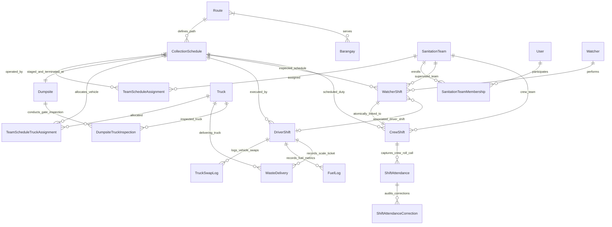
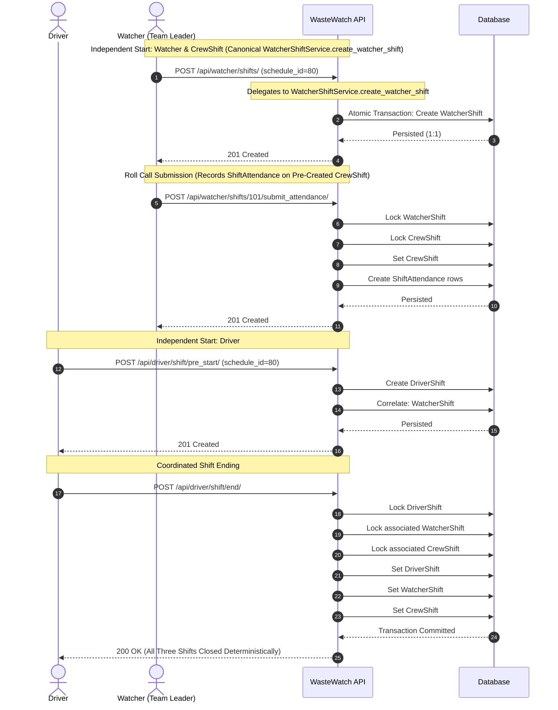
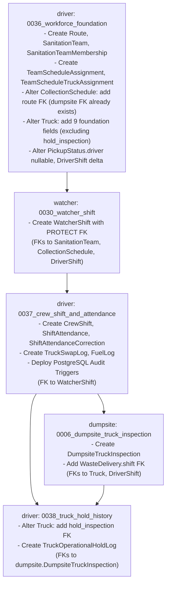

# WasteWatch Milestone 0B — Revised Workforce Architecture & API Contract Specification
**Project:** WasteWatch: A Progressive Web-Based Solid Waste Management System with Hotspot Mapping, Truck Tracking, and Route Optimization for Lucena City  
**Milestone:** 0B Design Revision (Consolidated Specification v3.2: Canonical Creation Service, Schema Deduplication & Unassociated Abort Distinction)  
**Document Status:** Complete Architecture Blueprint (Design-Only | Ready for Independent Validation)  
**Auditor / Reviewer Target:** Claude (Principal Software Architect & Code Quality Validator), Project Owner  
**Execution Mode:** STRICTLY DESIGN-ONLY (Zero Code Modifications, Zero DB Alterations, Zero Migrations)  
**Date of Revision:** November 9, 2026 (v3.2 Final Consistency Correction)  

---

## 1. Executive Summary

This specification represents the comprehensive, self-contained architectural blueprint for Milestone 0B of the WasteWatch platform, servicing the Lucena City City Environment and Natural Resources Office (CENRO) and City General Services Office (CGSO).

Following authoritative directives from the project owner and addressing all validation items from Claude's independent reviews, this specification establishes:

1. **Three Independent Shift Lifecycles with Coordinated Closure:**
   * **`DriverShift` (Driver-Owned & Independent Start):** Initiated, operated, and concluded by the Driver. Manages vehicle staging at the Dumpsite, GPS tracking, collection route execution, photo evidence capture, dumpsite unloading/calibration, and shift closure. Does not wait for, depend on, or get created by Watcher or Crew attendance.
   * **`WatcherShift` (Watcher-Owned & Independent Start):** Initiated and operated by the Watcher acting as operational Team Leader. Governs collection route monitoring, stop inspection, and official Crew roll call submission. Operates independently of `DriverShift`.
   * **`CrewShift` (Crew Operational Record Linked to WatcherShift):** Represents the crew's physical participation in a scheduled operation. In strict adherence to project owner directive **D-5**, exactly one `CrewShift` exists for every `WatcherShift`. It is created atomically when the `WatcherShift` is initialized at staging via a single canonical application creation service (`WatcherShiftService.create_watcher_shift`). Its foreign key `OneToOneField('watcher.WatcherShift')` natively generates a database-level `UNIQUE` constraint enforcing an upper bound of at most one `CrewShift` per `WatcherShift` without redundant manual constraints. It is initialized with `attendance_submitted_at = None` and 0 `ShiftAttendance` records initially. Zero attendance records initially does not violate database integrity. When the Watcher submits roll call, attendance rows are persisted and `attendance_submitted_at` is populated. If cancelled pre-roll-call, `CrewShift` transitions with `WatcherShift` to `cancelled` without fabricating attendance rows. (The proposed `U-CR1` cap alteration is completely retracted).
   * **Coordinated Shift Ending:** In accordance with the owner's operational decision, when a Driver ends their `DriverShift`, the system transactionally locates the associated active `WatcherShift` and ends both the `WatcherShift` and its single associated `CrewShift`.
2. **Deterministic Shift Association Protocol & Tiered Locking:**
   * An optional, strictly nullable link `WatcherShift.associated_driver_shift` captures the operational binding between `DriverShift` and `WatcherShift`.
   * Bidirectional transactional correlation links the two shifts when the second shift starts, guarded by a unique constraint preventing double-association.
   * Concurrency locking follows a strict two-tier protocol: standing schedule mutations and shift initializations serialize at the Scheduling Tier (Level 1 `CollectionSchedule` $\longrightarrow$ Level 2 `TeamScheduleAssignment`), while shift finalizations execute strictly within the Shift Execution Tier adhering to canonical hierarchy Level 3 `DriverShift` $\longrightarrow$ Level 4 `WatcherShift` $\longrightarrow$ Level 5 `CrewShift`. Exceptional abort operations utilize pre-lock discovery and an anti-inversion rollback-retry guard to guarantee that Level 3 is never acquired while holding Level 4, preventing lock inversion.
3. **Decoupled Reusable Routes & Waypoint Projection:**
   * Master collection paths are decoupled from drivers and teams into reusable `driver.Route` records.
   * `CollectionSchedule` establishes operational ownership, binding a reusable `Route` to an assigned `SanitationTeam`, operating hours, and an explicitly chosen `Dumpsite`.
   * Waypoints maintain index-0 compatibility: `schedule.waypoints` is constructed as `[dumpsite_staging_entry] + list(route.waypoints)`, ensuring collection stops 1..N correspond exactly to stop indices across all consumers without offset bugs.
4. **Watcher Leadership & Attendance Governance:**
   * **Watcher-Only Submission (D-8):** Only an authorized Watcher acting as Team Leader can submit initial Crew attendance. Admin cannot submit initial attendance on behalf of a Watcher.
   * **Submitter + Admin Correction Authority (D-6):** Attendance corrections are strictly limited to the original submitting Watcher and Admin (`submitter_admin`). Other Watchers on the same team cannot modify attendance.
   * **Zero-Connectivity Crew Policy:** Crew Members are Citizens (`employee_type='crew_member'`) and never require logins, accounts, mobile devices, or network connectivity.
   * **Inspection Independence (D-9):** Watcher stop inspection and verification workflows (`StopValidationViewSet.pre_inspect`, `post_verify`) remain independent and do not require an active `WatcherShift`.
5. **Fleet, Dumpsite & Geofence Governance:**
   * The Dumpsite is the authoritative operational base ($\text{Dumpsite} \longrightarrow \text{Stops } 1..N \longrightarrow \text{Dumpsite}$).
   * Staging departure requires server-authoritative GPS arrival verification. The proposed manual GPS Shift Start override has been **explicitly rejected by the project owner**. The exact arrival radius and GPS accuracy threshold remain **proposed pending owner decision**.
   * Post-shift inspection failure places a truck on operational hold (`is_operational_hold=True`), blocking subsequent dispatch until cleared through an audited clearance endpoint evaluated strictly on the target `TruckOperationalHoldLog`.
   * Hotspot swap reconciliation is cluster-aware and individual: open interventions are reviewed and updated via cancel-and-create linking to `TruckSwapLog`.

---

## 2. Revision History

| Version | Date | Author / Role | Changes Summary |
| :--- | :--- | :--- | :--- |
| **v1.0** | Nov 5, 2026 | Architect | Initial Phase 0 architecture draft (driver-centric routes, dual attendance verification). |
| **v1.1** | Nov 6, 2026 | Technical Analyst | Milestone 0A baseline audit and empirical database state collection. |
| **v1.2** | Nov 7, 2026 | Architect | Milestone 0B initial specification responding to Claude review findings M1–M15. |
| **v2.0** | Nov 8, 2026 | Senior Architect | Major revision: decoupled reusable `Route`, established `SanitationTeam` schedule ownership, elevated Watcher to Team Leader, codified zero-device Crew policy. |
| **v2.1** | Nov 8, 2026 | Senior Architect | Three Independent Shift Lifecycles: established `DriverShift`, `WatcherShift`, and `CrewShift`; resolved circular attendance dependency; linked `CrewShift` to `WatcherShift`; rejected manual GPS override. |
| **v2.2** | Nov 8, 2026 | Senior Architect | Consolidated Master: addressed Claude final validation findings (S-1 to S-26); incorporated Owner Decisions D-3, D-5, D-6, D-7, D-8, D-9; codified Coordinated Shift Ending rule; full field tables for 14 models; fixed `DriverShift` delta and `Truck` predicate; corrected route projection indexing (N-01); hardened `IsAssignedDumpsiteOperator`. |
| **v2.3** | Nov 8, 2026 | Senior Architect | Design Integrity Pass: Defined bidirectional correlation, attendance service checks, CheckConstraints, and 4-step migration graph. |
| **v2.4** | Nov 8, 2026 | Senior Architect | Deterministic Association & Integrity Hardening Pass: Serialized concurrent starts via `TeamScheduleAssignment` locking; defined operational cycle identity; hardened attendance immutability with PostgreSQL triggers; provided empirical migration dependency table mapping actual repository numbers; expanded test matrix with 10 concurrency tests. |
| **v2.5** | Nov 8, 2026 | Senior Architect | Technical Integrity Pass: Resolved duty-date timezone; tightened global unique association; added 6-case CrewShift matrix; aligned operator checks. |
| **v2.6** | Nov 8, 2026 | Senior Architect | **Focused Architecture Integrity Pass:** Eliminated 08:00/12:00 duty-date discrepancy; based overnight calculation on configured schedule `start_time` and `end_time`; added compact boundary test matrix (proposed); separated 4 attendance guarantee tiers and trust boundaries, rejecting trigger depth as authorization proof; established explicit Truck hold-origin fields (`hold_dumpsite`, `hold_placed_by`, `hold_placed_at`, `hold_reason`); proved Django migration graph acyclicity and consistency via actual read-only commands; cataloged open business decisions U-OD1, U-OP1, U-DB1, U-TH1. |
| **v2.7** | Nov 8, 2026 | Senior Architect | **Final Technical Integrity Correction Pass:** Resolved cross-app circular dependency by deferring `Truck.hold_inspection` and introducing 5-stage migration sequence (`driver.0036` $\rightarrow$ `watcher.0030` $\rightarrow$ `driver.0037` $\rightarrow$ `dumpsite.0006` $\rightarrow$ `driver.0038`); removed trigger-depth authorization overclaims (distinguishing database structural integrity from application authorization and exposing nested-trigger bypasses); reevaluated composite occurrence identity vs first-class `CollectionScheduleRun` (U-OP1); reconciled WatcherShift ending with approved coordinated-ending rule, redesigning `/end/` into exceptional abort/cancellation and defining 5 operational edge cases (U-WE1); designed dedicated `TruckOperationalHoldLog` history model (U-TH1) preserving multiple hold cycles and preventing silent resolution of overlapping defects; refined duty-date boundary semantics and documented grace-window dependency (U-OD1); disclosed all command execution attempts (including failed deepcopy attempts) and distinguished live checks from in-memory simulations; affirmed verdict as READY WITH EXPLICIT LIMITATIONS. |
| **v2.8** | Nov 8, 2026 | Senior Architect | **Final Consistency Correction Pass:** Resolved DriverShift vs WatcherShift active cardinality asymmetry (analyzed team-level active driver constraints vs multi-driver dispatch scenarios); unified shift-start and assignment-mutation locking hierarchy via parent `CollectionSchedule` row lock serialization; corrected coordinated-ending logic to inspect inactive associated WatcherShifts without guessing; resolved impossible Case 4 abort sequence by distinguishing unassociated from already-associated aborted shifts; synchronized API inventory in Section 16 to `POST /api/watcher/shifts/{id}/exceptional_abort/`; established `TruckOperationalHoldLog` as authoritative source of truth with denormalized `Truck` projection and synchronized two-phase row locking on hold clearance; corrected BT-11 duty-date table to align calculated result (`2026-11-10`) with intended cycle (`2026-11-09`) under U-OD1; unified role-aware `is_admin_user` across all permission examples; refined migration graph terminology to DAG with 5-stage topological order; updated test matrix (T08A/B/C). |
| **v2.9** | Nov 8, 2026 | Senior Architect | **Focused Final Technical Consistency Pass:** Structured locking architecture into 3 functional tiers (Scheduling, Shift Execution, Fleet Maintenance); formalized Coordinated Ending lock safety without parent schedule locks; completed atomic transaction implementations for both Case A and Case B shift associations with duty-date matching and conflict handling; unified Truck hold placement and clearance under Level T1 `Truck` -> Level T2 `HoldLog`; added already-cleared guard; codified 4-scenario exceptional-abort matrix; recalibrated concurrency and deadlock claims to documented ORM paths; clarified `manage.py check` background completion evidence. |
| **v3.0** | Nov 8, 2026 | Senior Architect | **Final Owner-Decision & Concurrency Pass:** Preserved owner directive D-5 exactly (1:1 atomic creation of CrewShift at WatcherShift initialization, zero initial attendance rows, retracted U-CR1); corrected Exceptional Abort locking to canonical L3 -> L4 -> L5 hierarchy with pre-lock discovery and abort-retry anti-inversion guard; updated exceptional_abort permissions to IsWatcherOrAdmin (preserving D-8 watcher_only initial roll call); fixed truck hold clearance authorization to evaluate object permissions directly on target TruckOperationalHoldLog instance; reconciled U-DC1 with T08A (marked T08A as conditional on absence of U-DC1, added T08A-Alt conditional on approval of U-DC1); expanded test matrix with T45, T46, T47; verified status as READY FOR CLAUDE INDEPENDENT VALIDATION. |
| **v3.1** | Nov 9, 2026 | Senior Architect | **Final Diagram, Test & D-5 Enforcement Correction:** Corrected Mermaid ERD cardinality notation (`WatcherShift ||--|| CrewShift`); updated T03 to test atomic CrewShift creation upon WatcherShift start; added T03B (roll call populates existing CrewShift) and T03C (atomic transaction rollback on CrewShift failure); clarified exact-one enforcement boundary (database uniqueness upper bound $\le 1$ vs application atomic service lower bound $\ge 1$); identified all permitted creation paths (API, Admin portal, batch/seed commands); disclosed direct database write bypass limitations without unapproved triggers; affirmed status as READY FOR CLAUDE INDEPENDENT VALIDATION. |
| **v3.2** | Nov 9, 2026 | Senior Architect | **Final Consistency Correction:** Established `WatcherShiftService.create_watcher_shift` as the sole canonical application service creating `WatcherShift` and `CrewShift` atomically across all creation paths (API, Admin, CLI/seeds); removed redundant manual `UniqueConstraint` on `CrewShift.watcher_shift` relying on native `OneToOneField` unique constraint for upper bound ($\le 1$); formally distinguished unassociated and inactive abort conditions into 5 distinct operational scenarios (Condition 1: No DriverShift exists; Condition 2: DriverShift exists independently unassociated without heuristics/reassignment; Condition 3: Associated active unilateral blocked; Condition 4: Associated active authorized mid-route; Condition 5: Associated DriverShift already inactive), preserving open decision Item 12; affirmed verdict as READY FOR CLAUDE INDEPENDENT VALIDATION. |

---

## 3. Business Requirements & Approved Decisions

### 3.1 Owner-Approved Authoritative Decisions (D-1 through D-9 & Operational Rules)
* **D-5 (CrewShift Cardinality):** Exactly one `CrewShift` per `WatcherShift`. Attendance submission is idempotent.
* **D-3 (CrewShift Lifecycle):** `CrewShift` follows the `WatcherShift` lifecycle, subject to coordinated shift ending.
* **D-6 (Attendance Correction Authority):** Original submitting Watcher + Admin (`submitter_admin`). Other Watchers are denied. All corrections are append-only.
* **D-8 (Initial Attendance Submission):** Watcher only (`watcher_only`). Admin cannot submit initial roll call on behalf of a Watcher. Admin authority is restricted to corrections.
* **D-9 (Inspection Independence):** Existing Watcher stop inspection and verification workflows operate independently of `WatcherShift`.
* **D-7 (Reusable Route Architecture):** Reusable `driver.Route` entity is retained and bound to `CollectionSchedule`.
* **Coordinated Shift Ending:** When a Driver ends their `DriverShift`, the associated `WatcherShift` and its `CrewShift` are automatically and transactionally ended.
* **Independent Shift Starts:** Driver, Watcher, and Crew shifts start independently without prerequisites or gating.
* **Rejection of Manual GPS Override:** The project owner explicitly rejected a manual GPS Shift Start override. Staging arrival verification is strictly mandatory.
* **Zero-Connectivity Crew Policy:** Crew Members are Citizens (`employee_type='crew_member'`) and never require logins, devices, or accounts.
* **Dumpsite as Authoritative Operational Base:** Route origin, staging, intermediate unloading, post-shift inspection, and return occur at `CollectionSchedule.dumpsite`.
* **Explicit Dumpsite Allocation:** Admin manually assigns the Dumpsite for each schedule. Missing dumpsite blocks dispatch with `422 Unprocessable Entity`.
* **Scoped Operator Authority:** Dumpsite Operators manage only their assigned facility; Admin has citywide authority.
* **Post-Shift Inspection:** Inspection occurs after shift completion at the Dumpsite. Failed inspection places truck on operational hold only; does not auto-schedule maintenance.
* **Split Fuel Responsibilities:** Driver logs gauge percentage ($0-100\%$); Operator logs pump liters, cost, and odometer.
* **Watcher Route Scoping vs Civic Isolation:** Team Leaders validate collection stops route-wide across all barangays on the scheduled route, but residential report validation and community voting remain strictly isolated to the Watcher's home barangay.

---

## 4. Current-State Architecture & Repository Baseline

An empirical inspection of the WasteWatch repository reveals the legacy architectural baseline:
1. **Existing Models:** `CollectionSchedule`, `PickupStatus`, `Truck`, `DriverShift`, `TruckCrewAssignment`, `RouteAssignment` in `driver`; `StopValidation`, `GarbageReport`, `GarbageHotspot`, `HotspotIntervention` in `watcher`; `Dumpsite`, `WasteDelivery` in `dumpsite`.
2. **`Truck` Schema Truth:** `Truck` does **not** have an `is_active` field. It possesses `status` (`CharField` with choices `active`, `maintenance`, `inactive`, `under_repair`).
3. **`DriverShift` Schema Truth:** In the actual database, `truck` and `schedule` are nullable foreign keys (`null=True`); `started_at` is `null=False` (`default=timezone.now`); `duration_ms` is `null=True`.
4. **`PickupStatus.driver` Nullability:** In [`driver/models.py:151`](file:///d:/Coding/Waste%20Watch/wastewatch/backend/driver/models.py#L151), `PickupStatus.driver` is non-nullable. In Stage 1, this is altered to `null=True, blank=True` to support schedule execution before or without a permanent driver FK.
5. **Route Embedding in Schedules:** `area`, `waypoints`, and `barangays` are currently embedded directly in `CollectionSchedule`.
6. **`CollectionSchedule.dumpsite` vs `CollectionSchedule.route` Empirical Truth:** In the actual database, `CollectionSchedule.dumpsite` (`ForeignKey('dumpsite.Dumpsite', on_delete=models.SET_NULL, null=True, blank=True)`) **already exists** (introduced in migration `driver.0017`). What is missing from `CollectionSchedule` and must be added by Stage 1 migration `driver.0036` is `CollectionSchedule.route` (`ForeignKey('driver.Route', on_delete=models.SET_NULL, null=True, blank=True)`).

---

## 5. Revised Domain Model & Shift Hierarchies



### Shift Relationship Hierarchy

```text
Driver
  |
  +---- DriverShift (Independent Lifecycle)
          |
          +---- Assigned Truck
          +---- CollectionSchedule Reference
          +---- Assigned Dumpsite Reference
          +---- Route Geometry Snapshot
          +---- Fuel Logs (Gauge %)
          +---- Waste Deliveries (Scale Tickets)
          +---- Truck Swap Logs


Watcher
  |
  +---- WatcherShift (Independent Lifecycle)
          |
          +---- Supervised SanitationTeam
          +---- CollectionSchedule Reference
          +---- Optional Link: associated_driver_shift (Nullable)
          +---- Route Stop Validations
          |
          +---- Crew Attendance Submission (1:1 Cardinality)
                    |
                    +---- CrewShift (Operational Crew Record)
                            |
                            +---- SanitationTeam Reference
                            +---- CollectionSchedule Reference
                            +---- WatcherShift Reference (Accountability)
                            +---- Submitting Watcher Identity
                            +---- Crew Attendance Records (Immutable)
                            +---- Attendance Correction History (Append-Only)
```

---

## 6. Reusable Route Architecture & Waypoint Index Integrity

### 6.1 Reusable `driver.Route` Model
```python
class Route(models.Model):
    name = models.CharField(max_length=150, unique=True, help_text="e.g. Barangay Iyam Standard Loop")
    area = models.CharField(max_length=255, blank=True, help_text="Geographic description of coverage")
    barangays = models.ManyToManyField('accounts.Barangay', related_name='routes', blank=True)
    waypoints = models.JSONField(
        default=list, 
        blank=True,
        help_text="Standard collection stop coordinates excluding staging dumpsite"
    )
    is_active = models.BooleanField(default=True, db_index=True)
    created_by = models.ForeignKey(settings.AUTH_USER_MODEL, on_delete=models.SET_NULL, null=True, blank=True, related_name='+')
    created_at = models.DateTimeField(auto_now_add=True)
    updated_at = models.DateTimeField(auto_now=True)

    class Meta:
        ordering = ['name']
```

### 6.2 Waypoint Projection Construction (Resolution of N-01)
To prevent the critical index offset defect flagged in Claude's review (where omitting the dumpsite in `route.waypoints` shifted collection stops into index 0 and broke `sync_pickup_statuses`, `barangay_stops`, and missed stops), the projection is strictly constructed as:
```python
def build_schedule_waypoint_projection(schedule, route):
    """
    Constructs server-authoritative waypoints for CollectionSchedule.
    Index 0 is ALWAYS the assigned Dumpsite staging facility.
    Indices 1..N correspond exactly to collection stops 1..N.
    """
    dumpsite = schedule.dumpsite
    if not dumpsite:
        raise ValueError("Cannot project waypoints without an assigned Dumpsite.")

    dumpsite_waypoint = {
        "lat": float(dumpsite.latitude),
        "lng": float(dumpsite.longitude),
        "label": dumpsite.name,
        "dumpsite_id": dumpsite.id,
        "is_dumpsite": True,
        "is_staging_origin": True
    }
    return [dumpsite_waypoint] + list(route.waypoints or [])
```

* **Propagation Rules:** Editing a `Route` definition updates future schedules. It does **not** mutate schedules that already have historical `DriverShift` executions.
* **Notification Isolation:** Regenerating the waypoint projection does **not** trigger citizen schedule-change notifications.

---

## 7. CollectionSchedule and Sanitation Team Assignment

### 7.1 Refactored `CollectionSchedule`
```python
class CollectionSchedule(models.Model):
    route = models.ForeignKey(
        Route, 
        on_delete=models.PROTECT, 
        null=True, blank=True, 
        related_name='schedules'
    )
    dumpsite = models.ForeignKey(
        'dumpsite.Dumpsite', 
        on_delete=models.PROTECT, 
        null=True, blank=True, 
        related_name='collection_schedules'
    )
    start_time = models.TimeField()
    end_time = models.TimeField()
    days = models.CharField(max_length=100, help_text="e.g. Mon, Wed, Fri", blank=True)
    frequency = models.CharField(max_length=100, blank=True)
    is_active = models.BooleanField(default=True, db_index=True)

    # Backward Compatibility Projections
    area = models.CharField(max_length=255, blank=True)
    waypoints = models.JSONField(default=list, blank=True)
    barangays = models.ManyToManyField('accounts.Barangay', related_name='collection_schedules', blank=True)
    truck = models.ForeignKey('driver.Truck', on_delete=models.SET_NULL, null=True, blank=True, related_name='schedules')
    driver = models.ForeignKey(settings.AUTH_USER_MODEL, on_delete=models.SET_NULL, null=True, blank=True, related_name='collection_schedules')
    status = models.CharField(max_length=10, choices=[('PENDING', 'Pending'), ('COMPLETED', 'Completed'), ('CANCELLED', 'Cancelled')], default='PENDING')
```

---

## 8. Watcher Leadership, WatcherShift & Inspection Independence

### 8.1 Watcher Operational Responsibilities
* **`WatcherShift` Initiation:** Watcher calls `POST /api/watcher/shifts/` independently, which atomically creates both `WatcherShift` and its associated `CrewShift` (D-5).
* **Roll Call Submission (D-8):** Watcher personally conducts roll call and submits attendance via `POST /api/watcher/shifts/{id}/submit_attendance/`. Admin cannot call this. Populates the pre-created `CrewShift` with roster snapshot and `ShiftAttendance` records without creating duplicate shift records.
* **Stop Inspection Independence (D-9):** Pre-collection stop inspection (`StopValidationViewSet.pre_inspect`) and post-collection verification (`post_verify`) remain functional whether or not an active `WatcherShift` exists.
* **Route Validation Scoping:** Watcher validates collection stops route-wide across all barangays on the scheduled route via `can_inspect_collection_stop`.

---

## 9. Attendance Lifecycle, CrewShift & Coordinated Shift Ending

### 9.1 Independent Starts and Coordinated Closure Workflow



### 9.2 Deterministic Shift Association Protocol

To guarantee mathematical determinism, eliminate race conditions, and prevent misassociations:

#### Operational Execution Identity & Timezone Anchor
The operational execution identity of a shift run is defined by the tuple:
$$\text{Operational Identity} = (\text{schedule\_id}, \text{team\_id}, \text{duty\_date})$$
where `duty_date` is the calendar date of the operational duty cycle, anchored by the active `driver.TeamScheduleAssignment` record.

**Authoritative Duty-Date & Overnight Calculation:**
* In accordance with [`wastewatch/settings.py:108`](file:///d:/Coding/Waste%20Watch/wastewatch/backend/wastewatch/settings.py#L108), the platform operates with `USE_TZ = True` and `TIME_ZONE = 'Asia/Manila'`.
* Raw Python `shift.started_at.date()` evaluates against UTC, which causes an 8-hour date mismatch for local morning shifts between 00:00 and 07:59 Manila time (+08:00). All duty-date calculations must localize to `Asia/Manila`.
* **Configured Schedule Rule (Eliminating Hardcoded Magic Numbers):**
  - **Standard Daytime Schedule (`schedule.start_time <= schedule.end_time`):** Duty date is strictly the local calendar date (`local_dt.date()`). It never inherits overnight behavior.
  - **Overnight Schedule (`schedule.end_time < schedule.start_time`, e.g. 22:00 to 04:00):**
    * Shift events occurring between `schedule.start_time` and 23:59:59 belong to the duty cycle of `local_dt.date()`.
    * Shift events occurring after midnight (00:00:00) up to `schedule.end_time` belong to the duty cycle that began on the previous calendar day (`local_dt.date() - timedelta(days=1)`).
```python
def calculate_operational_duty_date(schedule, timestamp):
    """
    Authoritative duty-date calculation for Lucena City (Asia/Manila).
    Calculates operational cycle date based on schedule timing without arbitrary hour cutoffs.
    """
    local_dt = timezone.localtime(timestamp)
    
    # Case 1: Standard daytime schedule (e.g. 06:00 to 14:00)
    if schedule.start_time <= schedule.end_time:
        return local_dt.date()
        
    # Case 2: Overnight schedule crossing midnight (e.g. 22:00 to 04:00)
    # Events after midnight up to scheduled end belong to preceding day's duty cycle
    if local_dt.time() <= schedule.end_time:
        return local_dt.date() - datetime.timedelta(days=1)
    # Events from scheduled start up to midnight belong to current calendar day
    elif local_dt.time() >= schedule.start_time:
        return local_dt.date()
    else:
        # Pre-staging or late-completion events outside scheduled window
        # (Requires owner decision U-OD1 on authorized operational grace buffer)
        return local_dt.date()
```

#### Compact Boundary Test Cases Table (`PROPOSED TESTS — NOT EXECUTED`)

The following test scenarios validate the duty-date calculation across daytime and overnight schedules. Cases marked with an asterisk (\*) are **Policy-Dependent**, meaning their architectural behavior depends on the project owner's resolution of **U-OD1 (Staging & Return Grace Window)**:

| Test ID | Schedule Type & Window | Local Event Timestamp (Asia/Manila) | Boundary Condition Tested | Expected Duty Date | Architectural Behavior & Policy Status |
| :---: | :--- | :--- | :--- | :--- | :--- |
| **BT-01** | Daytime (06:00–14:00) | `2026-11-09 06:00:00` | Schedule Start Boundary | `2026-11-09` | **Deterministic:** Exact match on daytime start. |
| **BT-02** | Daytime (06:00–14:00) | `2026-11-09 14:00:00` | Schedule End Boundary | `2026-11-09` | **Deterministic:** Exact match on daytime end. |
| **BT-03** | Daytime (06:00–14:00) | `2026-11-09 05:45:00` | Pre-start Staging (15m early) | `2026-11-09` | **Deterministic:** Pre-start maps to today's date. |
| **BT-04\*** | Daytime (06:00–14:00) | `2026-11-09 15:30:00` | Post-end Scale Ticket (90m late) | `2026-11-09` | **Policy-Dependent (U-OD1):** Maps to `2026-11-09` under daytime rule, but exceeds scheduled window by 90 min. |
| **BT-05** | Overnight (22:00–04:00) | `2026-11-09 22:00:00` | Overnight Schedule Start | `2026-11-09` | **Deterministic:** Operational overnight cycle begins. |
| **BT-06** | Overnight (22:00–04:00) | `2026-11-09 23:59:59` | Just Before Midnight Crossing | `2026-11-09` | **Deterministic:** Retains origin date. |
| **BT-07** | Overnight (22:00–04:00) | `2026-11-10 00:00:00` | Exactly at Midnight Crossing | `2026-11-09` | **Deterministic:** Evaluates to `local_dt.date() - 1 day`. |
| **BT-08** | Overnight (22:00–04:00) | `2026-11-10 02:30:00` | Mid-shift Post-Midnight Event | `2026-11-09` | **Deterministic:** Evaluates to `local_dt.date() - 1 day`. |
| **BT-09** | Overnight (22:00–04:00) | `2026-11-10 04:00:00` | Overnight Schedule End Boundary | `2026-11-09` | **Deterministic:** Exact scheduled end boundary. |
| **BT-10\*** | Overnight (22:00–04:00) | `2026-11-09 21:30:00` | Early Staging (30m before start) | `2026-11-09` | **Policy-Dependent (U-OD1):** Requires owner confirmation that pre-staging events within 60m of overnight start are authorized. |
| **BT-11\*** | Overnight (22:00–04:00) | `2026-11-10 05:15:00` | Delayed Dumpsite Weigh-in | `2026-11-10` *(Intended: `2026-11-09`)* | **Policy-Dependent (U-OD1):** At 05:15:00, the timestamp falls outside both overnight scheduled branches (`05:15 <= 04:00` is False, `05:15 >= 22:00` is False). The mathematical formula falls back to `local_dt.date()`, calculating `2026-11-10` instead of the operational origin `2026-11-09`. This demonstrates why owner approval of U-OD1 (e.g. 2-hour post-shift grace buffer until 06:00:00) is required before Milestone 1. |
| **BT-12** | Multi-Shift (08:00 & 14:00) | Run 1: `11-09 08:00`; Run 2: `11-09 14:00` | Same Calendar Day Runs | Run 1: `11-09`<br/>Run 2: `11-09` | **Deterministic:** Differentiated by sequential execution & `is_active=False` on completed run. |

#### Operational Occurrence Identity & Dedicated Entity Evaluation
* **Inherent Limitations of the Composite Identity:** In v2.6, the operational execution identity is represented by the composite tuple `(schedule_id, team_id, duty_date)`. While this tuple is unique for standard once-per-day routes, it exhibits structural limitations in complex operational environments:
  1. *Standing Templates vs Dispatches:* `TeamScheduleAssignment` represents a standing administrative assignment over a date range (`effective_at` to `ended_at`), not an individual operational dispatch instance.
  2. *Multiple Dispatches & Re-runs:* If a vehicle breaks down and a replacement crew/truck is dispatched on the same route later that day, two sequential dispatches share the identical composite tuple.
  3. *Downstream Attribution:* Scale tickets (`WasteDelivery`), fuel logs (`FuelLog`), and stop validations (`StopValidation`) require an unambiguous relational anchor.
* **Minimum Reliable Baseline (Current Design):**
  - Shifts start independently.
  - Active uniqueness constraints on `WatcherShift` (`UniqueConstraint(fields=['watcher'], condition=Q(is_active=True))` and `UniqueConstraint(fields=['team'], condition=Q(is_active=True))`) guarantee that at most one active shift per watcher and at most one active shift per team exists for watchers at any moment.
  - On `DriverShift`, `UniqueConstraint(fields=['driver'], condition=Q(is_active=True))` guarantees at most one active shift per driver. To prevent multiple drivers from concurrently initiating active shifts under the identical sanitation team, this specification formally proposes adding `UniqueConstraint(fields=['team'], condition=Q(is_active=True), name='unique_active_driver_shift_per_team')` on `DriverShift` (cataloged as **`U-DC1`**).
  - When the second counterpart starts, it participates in the hierarchical locking protocol (acquiring `CollectionSchedule` and `TeamScheduleAssignment` with `select_for_update()`), queries the unassociated active shift matching `(schedule_id, team_id, duty_date)`, and establishes an immutable 1:1 foreign key binding (`associated_driver_shift`). If multiple active candidates match due to unconstrained driver concurrency, the system explicitly detects ambiguity, logs an operational warning, and leaves the shift unassociated for administrative review.
* **First-Class Occurrence Entity (`PROPOSED (U-OP1) — REQUIRES PROJECT OWNER APPROVAL`):**
  - Introducing an explicit `CollectionScheduleRun` entity:
    ```python
    class CollectionScheduleRun(models.Model):
        schedule = models.ForeignKey('CollectionSchedule', on_delete=models.PROTECT)
        team = models.ForeignKey('SanitationTeam', on_delete=models.PROTECT)
        duty_date = models.DateField(db_index=True)
        run_number = models.PositiveSmallIntegerField(default=1)
        truck = models.ForeignKey('Truck', on_delete=models.PROTECT)
        status = models.CharField(max_length=20, choices=[('scheduled', 'Scheduled'), ('active', 'Active'), ('completed', 'Completed'), ('broken_down', 'Broken Down'), ('cancelled', 'Cancelled')])
        started_at = models.DateTimeField(null=True, blank=True)
        ended_at = models.DateTimeField(null=True, blank=True)
        
        class Meta:
            constraints = [
                models.UniqueConstraint(fields=['schedule', 'duty_date', 'run_number'], name='unique_schedule_run_per_day')
            ]
    ```
  - *Independent Start Workflow with Occurrence Run:* When Driver starts, they query or initialize the active `CollectionScheduleRun` for `(schedule, team, duty_date)`. When Watcher starts, they join the identical `CollectionScheduleRun`. Both DriverShift and WatcherShift hold an explicit `schedule_run_id` foreign key.
  - *Recommendation:* While technically superior, this introduces an additional domain entity and pre-dispatch lifecycle. It is retained as **`PROPOSED (U-OP1)`** pending owner approval.

#### Multi-Shift Differentiation on Same Date & Cardinality Asymmetry Analysis
Legitimate sequential shifts on the same schedule, team, and calendar date (e.g. morning and evening runs) are distinguished by lifecycle state and strict active constraints:
1. `DriverShift` enforces `UniqueConstraint(fields=['driver'], condition=Q(is_active=True))` preventing concurrent shifts per driver.
2. `WatcherShift` enforces `UniqueConstraint(fields=['watcher'], condition=Q(is_active=True))` and `UniqueConstraint(fields=['team'], condition=Q(is_active=True))` preventing concurrent shifts per watcher or team.
3. *Active Cardinality Asymmetry:* Because `WatcherShift` enforces active uniqueness on `team` while `DriverShift` only enforces active uniqueness on `driver`, multiple drivers could theoretically start active shifts under the same team simultaneously if unconstrained. To eliminate this ambiguity, this specification proposes `UniqueConstraint(fields=['team'], condition=Q(is_active=True), name='unique_active_driver_shift_per_team')` on `driver.DriverShift` (**`U-DC1`**).
4. *Candidate Filtering:* Candidate association queries filter strictly on `is_active=True, associated_driver_shift__isnull=True`. Completed shifts from earlier in the day have `is_active=False` and are structurally ineligible for association.

#### Serialization of Concurrent Shift Starts & Strict Hierarchical Locking Protocol
To eliminate race conditions when a Driver and a Watcher start their shifts nearly simultaneously, transactions must not independently query counterpart shifts without top-down concurrency serialization. Furthermore, administrative assignment mutations (`create`, `replace`, `terminate`) must not acquire locks in a divergent order from shift operations.

To guarantee deadlock-free serialization across both shift starts and administrative assignments within the documented ORM workflows, all mutating transactions adhere to a strict top-down row-level locking hierarchy partitioned into functional tiers:

```text
========================================================================================
SCHEDULING & ASSIGNMENT TIER (Standing Administrative Domain)
Level 1: CollectionSchedule (select_for_update)
Level 2: TeamScheduleAssignment (select_for_update)
========================================================================================
                                      |
                                      v
========================================================================================
SHIFT EXECUTION TIER (Operational Dispatch Domain)
Level 3: DriverShift (select_for_update)
Level 4: WatcherShift (select_for_update)
Level 5: CrewShift (select_for_update)
========================================================================================
                                      |
                                      v
========================================================================================
FLEET MAINTENANCE TIER (Orthogonal Physical Vehicle Domain)
Level T1: Truck (select_for_update)
Level T2: TruckOperationalHoldLog (select_for_update)
========================================================================================
```

* **Transaction Scope & Lock Acquisition Matrix:**
  1. **Shift Starts (`DriverShift.pre_start`, `WatcherShift.create`):**
     - Acquire Level 1 (`CollectionSchedule`) $\longrightarrow$ Level 2 (`TeamScheduleAssignment`).
     - If linking to an existing counterpart shift, the transaction acquires the counterpart shift lock (Level 3 `DriverShift` or Level 4 `WatcherShift`) while holding Levels 1 and 2.
     - *Concurrency Guarantee:* Because all shift starts on the same route must acquire the Level 1 `CollectionSchedule` lock first, concurrent starts for the same schedule are serialized at the root, preventing lock-order inversion between Driver and Watcher.
  2. **Administrative Assignment Mutations (`create`, `replace`, `terminate` of `TeamScheduleAssignment`):**
     - Acquire Level 1 (`CollectionSchedule`) $\longrightarrow$ Level 2 (`TeamScheduleAssignment`).
     - Operates strictly within the Scheduling Tier. Never acquires Level 3, 4, or 5 locks.
  3. **Coordinated Shift Ending (`DriverShift.end`):**
     - Operates strictly within the Shift Execution Tier: Level 3 (`DriverShift`) $\longrightarrow$ Level 4 (`WatcherShift`) $\longrightarrow$ Level 5 (`CrewShift`).
     - *Why Parent Schedule Locks (L1/L2) are Omitted:* Coordinated ending mutates operational shift execution records (`is_active`, `status`, `ended_at`); it does not mutate standing schedule assignments. Because no transaction holding an L3, L4, or L5 lock ever requests an L1 or L2 lock, an inverted lock cycle between the Scheduling Tier and Shift Execution Tier is mathematically impossible.
  4. **Attendance Submission & Crew Roll Call (`WatcherShift.submit_attendance`):**
     - Acquires Level 4 (`WatcherShift`) $\longrightarrow$ Level 5 (`CrewShift`).
  5. **Exceptional Shift Abort (`WatcherShift.exceptional_abort`):**
     - Adheres strictly to the canonical Shift Execution Tier lock ordering ($L3 \longrightarrow L4 \longrightarrow L5$) via a two-phase protocol with pre-transaction discovery:
       * **Discovery Phase (Non-locking Read):** Prior to entering the mutating transaction, the service inspects `watcher_shift.associated_driver_shift_id`.
       * **Branch 1 (Associated DriverShift Present):** Acquires Level 3 `DriverShift` (`select_for_update()`) $\longrightarrow$ Level 4 `WatcherShift` (`select_for_update()`) $\longrightarrow$ Level 5 `CrewShift` (`select_for_update()`). Revalidates the association under locks. If caller is a non-admin Watcher and `driver_shift.is_active` is True, releases locks and rejects with `409 Conflict: driver_shift_actively_running`. If caller is Admin (`is_admin_user`), proceeds with authorized mid-route cancellation.
       * **Branch 2 (Unassociated DriverShift / Null):** Acquires Level 4 `WatcherShift` (`select_for_update()`) $\longrightarrow$ Level 5 `CrewShift` (`select_for_update()`).
       * **Anti-Inversion Abort-Retry Guard:** If revalidation within Branch 2 reveals that `watcher_shift.associated_driver_shift_id` became non-null concurrently while acquiring Level 4, the transaction **MUST NOT** attempt to acquire Level 3 while holding Level 4 (which would create a fatal deadlock cycle against coordinated ending). Instead, the transaction immediately aborts/rolls back and retries via Branch 1. Never acquire Level 3 while holding Level 4.
  6. **Fleet Hold Placement & Clearance:**
     - Operates on the orthogonal Fleet Tier: Level T1 (`Truck`) $\longrightarrow$ Level T2 (`TruckOperationalHoldLog`).
     - When an operation spans Shift and Fleet (e.g. post-shift inspection submitted against a shift), the lock order is strictly monotonic: Shift Execution Tier (Level 3 `DriverShift`) $\longrightarrow$ Fleet Tier (Level T1 `Truck` $\longrightarrow$ Level T2 `TruckOperationalHoldLog`).
* **Deadlock Precondition & Limitation Disclosure:** Deadlock elimination is proven **only** for transactions strictly adhering to this documented protocol. It does not prevent deadlocks if unmanaged raw SQL queries, bulk updates, out-of-order manual administrative scripts, or third-party database tools bypass the ORM lock order. Runtime verification in Milestone 1 under concurrent load tests is mandatory.
* **Schedule Reassignment Mid-Shift:** If an administrator modifies `TeamScheduleAssignment` while shifts are active, existing active shifts retain their frozen foreign keys (`DriverShift.team`, `WatcherShift.team`) established at shift creation.

#### Association Cardinality, Global Uniqueness & Foreign Key Protection
1. **Field Definition:** `WatcherShift.associated_driver_shift` uses `models.ForeignKey('driver.DriverShift', on_delete=models.PROTECT, null=True, blank=True, related_name='associated_watcher_shifts')`.
   * *Resolution of SET_NULL Contradiction:* Using `on_delete=models.PROTECT` guarantees that an associated `DriverShift` can never be deleted while its counterpart `WatcherShift` exists, preserving complete audit immutability.
2. **Global Historical Uniqueness Constraint:**
   * A `DriverShift` can be associated with at most one `WatcherShift` across the entire lifetime of the system:
   ```python
   models.UniqueConstraint(
       fields=['associated_driver_shift'],
       condition=models.Q(associated_driver_shift__isnull=False),
       name='unique_driver_shift_association'
   )
   ```
   * *Resolution of Partial Condition Flaw:* Removing `is_active=True` from the constraint ensures that once shifts complete, historical association integrity is permanently locked in the database.
3. **Association Immutability:** Once established, `associated_driver_shift` is strictly immutable. It cannot be re-linked, replaced, or cleared while either shift is active.

#### Deterministic Linking at Second Shift Start (Complete Atomic Transactions & Persistence)

* **Case A (Watcher starts first, Driver starts second):**
  `WatcherShift` was created earlier with `associated_driver_shift = None`. When Driver calls `POST /api/driver/shift/pre_start/`:
  ```python
  with transaction.atomic():
      # 1. Level 1 Lock: Root schedule serialization
      schedule = CollectionSchedule.objects.select_for_update().get(pk=schedule_id)

      # 2. Level 2 Lock: Coordination assignment lock
      team_assignment = TeamScheduleAssignment.objects.select_for_update().get(
          schedule=schedule,
          team_id=team_id,
          ended_at__isnull=True
      )

      # 3. Create DriverShift (Level 3)
      now = timezone.now()
      driver_shift = DriverShift.objects.create(
          driver=request.user,
          truck=truck,
          schedule=schedule,
          team=team_assignment.team,
          status='active',
          is_active=True,
          started_at=now
      )

      # 4. Query candidate unassociated active WatcherShift (Level 4) with select_for_update()
      driver_duty_date = calculate_operational_duty_date(schedule, driver_shift.started_at)
      candidates = list(WatcherShift.objects.select_for_update().filter(
          schedule_id=schedule.id,
          team_id=team_assignment.team_id,
          is_active=True,
          associated_driver_shift__isnull=True
      ))

      # 5. Duty-date matching
      matching = [w for w in candidates if calculate_operational_duty_date(w.schedule, w.started_at) == driver_duty_date]

      # 6. Persistence & Ambiguity Resolution
      if len(matching) == 1:
          watcher_shift = matching[0]
          watcher_shift.associated_driver_shift = driver_shift
          try:
              watcher_shift.save(update_fields=['associated_driver_shift'])
          except IntegrityError as exc:
              logger.error("Failed to associate WatcherShift #%s with DriverShift #%s: %s", watcher_shift.id, driver_shift.id, exc)
              raise ConflictError("Shift association conflicted with another concurrent transaction.")
      elif len(matching) > 1:
          logger.warning(
              "Ambiguous shift association: %d active unassociated WatcherShifts found for schedule %s, team %s, duty date %s. Leaving unassociated.",
              len(matching), schedule.id, team_assignment.team_id, driver_duty_date
          )
      # If len(matching) == 0: driver_shift remains cleanly unassociated (Case 1).
  ```

* **Case B (Driver starts first, Watcher starts second — Canonical WatcherShiftService):**
  `DriverShift` was created earlier with no associated WatcherShift. When Watcher calls `POST /api/watcher/shifts/` (or via Admin portal / management commands), the request delegates strictly to the canonical application service `WatcherShiftService.create_watcher_shift`:
  ```python
  class WatcherShiftService:
      @staticmethod
      def create_watcher_shift(watcher, schedule_id, team_id=None):
          """
          Canonical application service creating WatcherShift and CrewShift atomically (D-5).
          All WatcherShift creation mechanisms (WatcherShiftViewSet.create, ModelAdmin.save_model,
          management commands like seed_shifts) MUST delegate to this single method.
          No alternative creation implementation may independently create these records.
          """
          with transaction.atomic():
              # 1. Level 1 Lock: Root schedule serialization
              schedule = CollectionSchedule.objects.select_for_update().get(pk=schedule_id)

              # 2. Level 2 Lock: Coordination assignment lock
              team_assignment = TeamScheduleAssignment.objects.select_for_update().get(
                  schedule=schedule,
                  team_id=team_id,
                  ended_at__isnull=True
              )

              # 3. Candidate search: query unassociated active DriverShift (Level 3) with select_for_update()
              now = timezone.now()
              watcher_duty_date = calculate_operational_duty_date(schedule, now)
              candidates = list(DriverShift.objects.select_for_update().filter(
                  schedule_id=schedule.id,
                  team_id=team_assignment.team_id,
                  is_active=True,
                  associated_watcher_shifts__isnull=True
              ))

              # 4. Duty-date matching
              matching = [d for d in candidates if calculate_operational_duty_date(d.schedule, d.started_at) == watcher_duty_date]
              associated_driver = None
              if len(matching) == 1:
                  associated_driver = matching[0]
              elif len(matching) > 1:
                  logger.warning(
                      "Ambiguous shift association: %d active unassociated DriverShifts found for schedule %s, team %s, duty date %s. Leaving unassociated.",
                      len(matching), schedule.id, team_assignment.team_id, watcher_duty_date
                  )

              # 5. Create WatcherShift with persisted association (Level 4) and atomic CrewShift (Level 5) per D-5
              try:
                  watcher_shift = WatcherShift.objects.create(
                      watcher=watcher,
                      team=team_assignment.team,
                      schedule=schedule,
                      associated_driver_shift=associated_driver,
                      status='active',
                      is_active=True,
                      started_at=now
                  )
                  # 6. Create CrewShift atomically with WatcherShift (D-5 1:1 Atomic Creation)
                  # Initialized with attendance_submitted_at=None and zero ShiftAttendance rows
                  crew_shift = CrewShift.objects.create(
                      watcher_shift=watcher_shift,
                      team=watcher_shift.team,
                      schedule=watcher_shift.schedule,
                      status='active',
                      is_active=True,
                      started_at=now,
                      attendance_submitted_at=None
                  )
              except IntegrityError as exc:
                  logger.error("Failed to create WatcherShift or atomic CrewShift: %s", exc)
                  raise ConflictError("An active WatcherShift already exists for this team, or the target driver shift was already bound.")

              return watcher_shift, crew_shift
  ```

#### Coordinated Ending Protocol (Strict Prohibition of Fallback Guessing)
When Driver calls `POST /api/driver/shift/end/`:
```python
with transaction.atomic():
    # 1. Lock DriverShift
    driver_shift = DriverShift.objects.select_for_update().get(pk=shift_id, is_active=True)
    
    # 2. Lock associated WatcherShift via established foreign key ONLY
    # Guaranteed at most 1 row by unique_driver_shift_association constraint.
    # Note: We do NOT filter on is_active=True here so we can distinguish between:
    # (a) No associated WatcherShift ever existed (watcher_shift is None)
    # (b) Associated WatcherShift is still active (normal coordinated ending)
    # (c) Associated WatcherShift was already closed/aborted (is_active=False)
    watcher_shift = WatcherShift.objects.select_for_update().filter(
        associated_driver_shift=driver_shift
    ).first()

    now = timezone.now()
    
    # 3. Finalize DriverShift
    driver_shift.is_active = False
    driver_shift.status = 'completed'
    driver_shift.ended_at = now
    driver_shift.duration_ms = int((now - driver_shift.started_at).total_seconds() * 1000)
    driver_shift.save(update_fields=['is_active', 'status', 'ended_at', 'duration_ms'])

    # 4. Handle WatcherShift & CrewShift coordination based on association status
    if watcher_shift is None:
        # Case 1: DriverShift was unassociated. STRICT RULE: NO FALLBACK GUESSING.
        # System MUST NOT search by schedule/team/date.
        logger.warning(
            "DriverShift #%s ended without an established WatcherShift association. No WatcherShift or CrewShift will be auto-closed.",
            driver_shift.id
        )
    elif not watcher_shift.is_active:
        # Case 4: Associated WatcherShift was already cancelled or exceptionally aborted mid-route
        logger.info(
            "DriverShift #%s ended. Associated WatcherShift #%s was already inactive (status=%s). Preserving existing status.",
            driver_shift.id, watcher_shift.id, watcher_shift.status
        )
    else:
        # Normal Coordinated Ending: Finalize active WatcherShift and CrewShift
        watcher_shift.is_active = False
        watcher_shift.status = 'completed'
        watcher_shift.ended_at = now
        watcher_shift.duration_ms = int((now - watcher_shift.started_at).total_seconds() * 1000)
        watcher_shift.save(update_fields=['is_active', 'status', 'ended_at', 'duration_ms'])

        # Lock and finalize CrewShift (1:1 with WatcherShift per D-5)
        try:
            crew_shift = CrewShift.objects.select_for_update().get(watcher_shift=watcher_shift, is_active=True)
            crew_shift.is_active = False
            crew_shift.status = 'completed'
            crew_shift.ended_at = now
            crew_shift.duration_ms = int((now - crew_shift.started_at).total_seconds() * 1000)
            crew_shift.save(update_fields=['is_active', 'status', 'ended_at', 'duration_ms'])
        except CrewShift.DoesNotExist:
            pass
```

### 9.3 Shift Association Edge Cases & Coordinated Ending Reconciliation

Under the owner-approved operational rule:
* `DriverShift` starts independently.
* `WatcherShift` starts independently.
* `CrewShift` follows `WatcherShift` (created atomically at WatcherShift staging initialization per D-5).
* **Normal Shift Completion:** When the Driver ends `DriverShift` at the Dumpsite / Home Base, the system transactionally locates the associated active `WatcherShift` and ends both `WatcherShift` and its associated `CrewShift`.

#### D-5 CrewShift Cardinality Preservation & Exact-One Enforcement Boundary

Under project directive **D-5**, the owner confirmed: *"Exactly one CrewShift per WatcherShift"*.
This specification strictly enforces this approved rule without alteration or dilution:

1. **Exact-One Enforcement Boundary (Database Upper Bound vs Application Lower Bound):**
   * **Database Uniqueness Upper Bound ($\le 1$):** At the database schema level, `driver.CrewShift.watcher_shift` is defined as a `OneToOneField('watcher.WatcherShift', on_delete=models.PROTECT, related_name='crew_shift')`. Django's `OneToOneField` automatically generates a native database-level unique constraint (`UNIQUE` constraint on `watcher_shift_id` in PostgreSQL: `driver_crewshift_watcher_shift_id_key`). This native constraint guarantees at the database engine level that **no more than one** `CrewShift` can ever reference the same `WatcherShift`. Any concurrent or redundant attempt to insert a second `CrewShift` referencing the same `WatcherShift` is rejected by PostgreSQL with an `IntegrityError`. Declaring a duplicate manual `UniqueConstraint(fields=['watcher_shift'])` in `Meta.constraints` is completely redundant and omitted.
   * **Application-Enforced Lower Bound ($\ge 1$):** A standard relational foreign key points from child (`CrewShift`) to parent (`WatcherShift`). Relational database engines do not natively enforce that an inserted parent row (`watcher_watchershift`) must have an associated child row in `driver_crewshift` (existential lower bound) without complex, unapproved bidirectional deferred foreign keys or circular triggers. Therefore, the specification does not claim that the database schema alone guarantees "exactly one".
   * **Canonical Atomic Application Creation Service:** The existence of exactly one `CrewShift` for every `WatcherShift` is guaranteed by the application layer: exactly one canonical application service, `WatcherShiftService.create_watcher_shift`, is responsible for creating a `WatcherShift` and its corresponding `CrewShift` atomically. Within a single database transaction (`with transaction.atomic():`), the service creates the `WatcherShift` and immediately instantiates the corresponding `CrewShift`. If `CrewShift` creation fails for any reason (validation error, DB connection drop, unexpected exception), the transaction rolls back both records completely, ensuring that an orphan `WatcherShift` without an associated `CrewShift` can never be committed.

2. **Permitted WatcherShift Creation Paths (All Delegating to Canonical Service):**
   All mechanisms that create `WatcherShift` records are strictly required to delegate directly to the canonical service `WatcherShiftService.create_watcher_shift`:
   * **Primary Client API:** `POST /api/watcher/shifts/` (`WatcherShiftViewSet.create`), invoked by Watchers at staging, delegates directly to `WatcherShiftService.create_watcher_shift`.
   * **Administrative Portal Creation:** If Django Admin or an internal portal permits administrators to manually dispatch or create a `WatcherShift`, the `ModelAdmin.save_model` hook must delegate directly to `WatcherShiftService.create_watcher_shift`, guaranteeing atomic creation of the associated `CrewShift`.
   * **Management Commands & Scheduled Jobs:** Automated schedulers, batch dispatchers, or management commands (e.g. `python manage.py seed_shifts`) must delegate directly to `WatcherShiftService.create_watcher_shift`. No alternative creation implementation may independently create these records; calling bare `WatcherShift.objects.create(...)` or `CrewShift.objects.create(...)` directly is strictly forbidden across the codebase.

3. **Disclosed Limitations & Direct Database Bypass:**
   * If a database administrator executes direct database writes bypassing Django (e.g. raw SQL `INSERT INTO watcher_watchershift ...` via `psql` or external maintenance tools), the database schema will accept the row without automatically inserting a `CrewShift`.
   * This limitation is disclosed accurately as a trust boundary. In accordance with architectural guidelines, no unapproved database triggers or circular deferred foreign keys are introduced to enforce this constraint at the schema level.

4. **Zero Initial Attendance Records Integrity:**
   * When `CrewShift` is created atomically at staging, it is initialized with `status='active'`, `is_active=True`, `started_at = watcher_shift.started_at`, `attendance_submitted_at = None`, and zero `ShiftAttendance` child records.
   * Relational database integrity does not require child foreign key rows (`ShiftAttendance`) to exist when a parent (`CrewShift`) is instantiated. Zero attendance rows does NOT violate database constraints or Tier 1 triggers because no dummy or placeholder records are created.

5. **Roll Call Population:**
   * When the Watcher conducts roll call and calls `POST /api/watcher/shifts/{id}/submit_attendance/`, the service acquires row locks on `WatcherShift` (L4) and `CrewShift` (L5), updates `CrewShift.attendance_submitted_at = timezone.now()` and `CrewShift.roster_snapshot`, and persists initial `ShiftAttendance` records.
   * Roll call submission populates the already-created `CrewShift`; it does NOT create a new `CrewShift`. Idempotent retries return `200 OK` with existing data; differing payloads return `409 Conflict`.

6. **Pre-Roll-Call Cancellation / Abort:**
   * If a `WatcherShift` is exceptionally cancelled before roll call (e.g. driver no-show, vehicle defect, pre-departure cancellation), the pre-created `CrewShift` transitions with its parent `WatcherShift` to `status='cancelled', is_active=False` with zero attendance rows. No empty attendance rows are fabricated, preserving audit immutability.

7. **Retraction of U-CR1:**
   * The proposed `U-CR1` cap alteration remains completely retracted. D-5 is preserved as an exact 1:1 invariant across the entire system.

#### Comprehensive Exceptional-Abort Matrix (Distinguishing Scenarios 1 through 5)

To govern all operational lifecycle scenarios deterministically, `POST /api/watcher/shifts/{id}/exceptional_abort/` and the coordinated ending service adhere to the following five explicitly distinguished operational conditions:

| Dimension | Scenario 1 (Condition 1): Unassociated — No DriverShift Exists | Scenario 2 (Condition 2): Unassociated — Independent DriverShift Exists | Scenario 3 (Condition 3): Associated Active Driver (Unilateral Blocked) | Scenario 4 (Condition 4): Associated Active Driver (Authorized Mid-Route) | Scenario 5 (Condition 5): Associated DriverShift Already Inactive |
| :--- | :--- | :--- | :--- | :--- | :--- |
| **Operational Context** | Driver failed to stage or no driver shift was scheduled/created. `associated_driver_shift` is null, and 0 matching DriverShifts exist in DB. | `associated_driver_shift` is null, but an independent DriverShift exists in DB (e.g. staged under another team, concurrent U-DC1 start ambiguity, or duty date/grace mismatch). | Watcher attempts unilateral abort while Driver is actively executing collection route (`associated_driver_shift` is populated & active). | Watcher suffers emergency (medical, safety) mid-route; elevated authorization confirms abort while Driver is active. | `associated_driver_shift` is populated, but `is_active is False` (DriverShift completed, ended, or cancelled earlier, while Watcher remained active). |
| **System Assumption & Heuristic Prohibition** | Record known absent. | **PROHIBITED FROM INFERRING DRIVERSHIFT DOES NOT EXIST.** Zero heuristic fallback matching, auto-closure, or driver reassignment. | Driver known active and bound. | Driver known active and bound. | Driver known already inactive. |
| **Authorized Actor** | Watcher (`IsWatcherOrAdmin`, matching shift watcher) or Admin (`is_admin_user`). | Watcher (`IsWatcherOrAdmin`, matching shift watcher) or Admin (`is_admin_user`). | Watcher (`IsWatcherOrAdmin`, matching shift watcher) attempting call without Admin elevation. | Elevated Admin (`is_admin_user` under proposed **U-WE1**). | Watcher (`IsWatcherOrAdmin`, matching shift watcher) or Admin (`is_admin_user`). |
| **HTTP Response** | `200 OK` (shift cancelled). | `200 OK` (shift cancelled). | `409 Conflict` (`driver_shift_actively_running`). | `200 OK` (shift cancelled mid-route). | `200 OK` (shift cancelled cleanly). |
| **Records Changed** | `WatcherShift` $\rightarrow$ `cancelled`; `CrewShift` $\rightarrow$ `cancelled`. | `WatcherShift` $\rightarrow$ `cancelled`; `CrewShift` $\rightarrow$ `cancelled`. | **Zero records changed.** | `WatcherShift` $\rightarrow$ `cancelled`; `CrewShift` $\rightarrow$ `cancelled`. | `WatcherShift` $\rightarrow$ `cancelled`; `CrewShift` $\rightarrow$ `cancelled`. |
| **DriverShift State & Effect** | N/A (no driver shift exists). | **Completely unchanged.** Independent DriverShift remains active (`status='active'`). | Unchanged (`status='active'`). | Unchanged (`status='active'`). Driver continues route or returns independently. | Already inactive (`status='completed'` or `'cancelled'`). Unmodified. |
| **CrewShift State** | Transitions to `cancelled` (0 attendance rows, exactly 1 CrewShift record preserved). | Transitions to `cancelled` (0 attendance rows, exactly 1 CrewShift record preserved). | Remains `True` (`status='active'`). | Transitions to `cancelled`. Submitted attendance rows remain permanently immutable. | Transitions to `cancelled` (or already inactive). Immutable records preserved. |
| **Required Audit Event** | `watcher_shift_aborted_unassociated`. Mandatory `reason` recorded. | `watcher_shift_aborted_unassociated`. Mandatory `reason` recorded. Diagnostic notes unassociated state. | `watcher_shift_abort_blocked`. Diagnostic logged. | `watcher_shift_exceptional_mid_route_abort`. Mandatory `reason` & `notes`. | `watcher_shift_aborted_counterpart_inactive`. Informational audit logged. |
| **Subsequent Driver Ending Effect** | N/A. | Independent DriverShift ends later via `DriverShiftViewSet.end` with zero effect on Watcher/Crew (logs warning). Open decision Item 12 governs disposition. | Normal coordinated ending will finalize both shifts when Driver ends. | Coordinated ending finds `is_active=False`, logs informational event, and leaves WatcherShift intact. | Coordinated ending on DriverShift was already finalized (or ends cleanly without double-closing). |

* **Preservation of Open Business Decision Item 12 (`Shift Association Fallback & Unassociated Dispositions Policy`):** In Scenario 2 (Condition 2), where an unassociated DriverShift exists independently while WatcherShift is aborted (or vice-versa), operational disposition policy (whether manual Admin review is required or a late-binding reconciliation job should be run) remains an unresolved open owner decision and cannot be resolved by heuristic guesswork.
* **Open Business Policy (`PROPOSED (U-WE1) — REQUIRES PROJECT OWNER APPROVAL`):** The precise authority matrix for Watcher exceptional termination during an active DriverShift in Scenario 4 (whether permissible by Watcher alone with emergency flag or strictly requiring Admin elevation). Endpoint permission class `IsWatcherOrAdmin` allows Watchers to abort unassociated shifts and Admins to execute citywide emergency overrides, guarded by service-level rejection of unilateral active-shift aborts per Scenario 3 pending owner resolution of U-WE1.

---

## 10. Multi-Layered Attendance Immutability & Tampering Protections

### 10.1 Complete 4-Tier Guarantee Architecture & Trust Boundary Delineation

Django model `save()` and `delete()` overrides protect against standard ORM instance calls, but are **completely bypassed** by bulk operations such as `QuerySet.update()` and `QuerySet.delete()`, as well as direct SQL commands. Furthermore, trigger execution depth (`pg_trigger_depth()`) merely tracks call stack recursion within PostgreSQL; **trigger depth is not an authorization mechanism and does not authenticate human actors**.

To establish mathematically defensible audit immutability, WasteWatch partitions guarantees across four distinct operational tiers:

```text
Tier 1: Database-Enforced Guarantees (Triggers, Sequences & Relational Protections)
Tier 2: Application / Service-Enforced Guarantees (AttendanceCorrectionService Concurrency)
Tier 3: API Authorization Guarantees (DRF Permissions & Serializer Write-Path Isolation)
Tier 4: Inherent Trust Boundaries of the Connection Model (Shared Application DB Role)
```

#### Tier 1: Database-Enforced Guarantees (Physical Triggers & Constraints)
* **Initial Attendance Record Deletion Block:**
  - `BEFORE DELETE` trigger on `driver_shiftattendance` unconditionally raises an SQL exception:
    `RAISE EXCEPTION 'ShiftAttendance rows are permanently immutable and cannot be deleted.';`
* **Initial Attendance Field Immutability:**
  - `BEFORE UPDATE` trigger on `driver_shiftattendance` physically blocks modifications to `original_status`, `submitted_by_id`, `crew_shift_id`, `user_id`, and `submitted_at`:
    `IF OLD.original_status <> NEW.original_status THEN RAISE EXCEPTION 'ShiftAttendance.original_status is immutable once created.'; END IF;`
* **Write-Once Correction Ledger:**
  - `BEFORE UPDATE OR DELETE` trigger on `driver_shiftattendancecorrection` unconditionally raises an SQL exception:
    `RAISE EXCEPTION 'ShiftAttendanceCorrection rows are strictly write-once and cannot be updated or deleted.';`
* **Correction Sequence & Choice Consistency:**
  - `BEFORE INSERT` trigger on `driver_shiftattendancecorrection` acquires a row-level lock on the parent `ShiftAttendance` row (`SELECT current_status INTO v_current_status ... FOR UPDATE`), strictly verifying:
    `IF NEW.previous_status <> v_current_status THEN RAISE EXCEPTION 'Correction sequence violation: previous_status does not match current ShiftAttendance status.'; END IF;`
  - Validates `new_status IN ('present', 'absent', 'late', 'excused')` and rejects redundant corrections (`NEW.new_status = v_current_status`).
* **Current Status Structural Synchronization & Depth Limitation Analysis:**
  - `AFTER INSERT` trigger on `driver_shiftattendancecorrection` automatically executes:
    `UPDATE driver_shiftattendance SET current_status = NEW.new_status WHERE id = NEW.attendance_id;`
  - *Legitimate Execution Path:* During legitimate corrections, an `INSERT` into `ShiftAttendanceCorrection` fires the cascading `UPDATE` on `ShiftAttendance`. Because this statement executes inside the trigger cascade, `pg_trigger_depth()` evaluates to 2.
  - *Structural Block on Direct Mutations (Depth 1):* Direct SQL statements and ORM bulk mutations (`ShiftAttendance.objects.filter(...).update(current_status=...)`) execute at `pg_trigger_depth() == 1` and are aborted by the trigger.
  - *Explicit Acknowledgment of Depth Limitations (No False Provenance Claims):* `pg_trigger_depth()` measures call stack depth only; it **cannot** verify the identity of the calling trigger, function, or table. An unrelated trigger on another table (e.g. an audit trigger on a related entity) that executes an `UPDATE` on `ShiftAttendance` would also run at depth $\ge 2$. Therefore, trigger depth provides structural protection against depth-1 direct mutations, but **does not guarantee provenance from the correction ledger and does not authenticate human actors**.
* **Relational Protection of Parents (Clarification on PROTECT):**
  - `on_delete=models.PROTECT` on `ShiftAttendance.crew_shift` and `ShiftAttendanceCorrection.attendance` guards referenced parent records (`CrewShift`, `ShiftAttendance`) from cascade deletion when child rows exist. It does **not** protect child rows from direct deletion; child row protection is enforced by the `BEFORE DELETE` triggers above.

#### Tier 2: Application & Service-Enforced Guarantees (`AttendanceCorrectionService`)
* **Atomic Concurrency & Optimistic Locking:**
  Corrections execute within `transaction.atomic()`:
  ```python
  with transaction.atomic():
      # 1. Lock attendance row to serialize concurrent corrections
      attendance = ShiftAttendance.objects.select_for_update().get(pk=attendance_id)
      
      # 2. Concurrency Check (Optimistic Locking): verify expected previous status
      if expected_previous_status and attendance.current_status != expected_previous_status:
          raise ConflictError("Attendance status was updated by another concurrent transaction. Refresh and retry.")
          
      # 3. Create immutable audit correction record
      # (Database trigger automatically cascades status update to attendance.current_status)
      correction = ShiftAttendanceCorrection.objects.create(
          attendance=attendance,
          previous_status=attendance.current_status,
          new_status=new_status,
          reason=reason,
          corrected_by=user
      )
      
      # 4. Refresh and return updated attendance
      attendance.refresh_from_db(fields=['current_status'])
  ```

#### Tier 3: API Authorization Guarantees (`IsWatcherOrAdmin` / D-6 / D-8)
* **Initial Attendance Watcher-Only Gate (D-8):** Only an authenticated Watcher assigned as Team Leader can call initial roll call (`IsWatcherRole`). Admin cannot submit initial roll call on a Watcher's behalf.
* **Correction Submitter + Admin Authority (D-6):** Object-level permission verifies `request.user == attendance.crew_shift.submitting_watcher or is_admin_user(request.user)`. All other Watchers and Citizens are denied with `403 Forbidden`.
* **Serializer Write-Path Isolation:** No `PUT`, `PATCH`, or `DELETE` endpoints exist for attendance records. The sole mutation endpoint is `POST /api/watcher/team-attendance/{id}/correct/`.

#### Tier 4: Trust Boundary & Inherent Limitations of the Connection Model
* **Shared Database Role Reality:** In standard Django deployments, the backend application connects to PostgreSQL using a single shared database role (`settings.DATABASES['default']['USER']`). All queries issued over this connection carry identical database credentials regardless of the authenticated web user.
* **Unverifiable Actor Identity at Database Level:** The PostgreSQL database engine alone cannot independently verify that `corrected_by_id` corresponds to the actual authenticated session user without application cooperation. A raw SQL query or Django management shell script running under the application DB role could insert a row with an arbitrary `corrected_by_id`.
* **Proposed Infrastructure Hardening (`PROPOSED (U-DB1) — REQUIRES PROJECT OWNER APPROVAL`):**
  - *Mechanism 1 (Session Identity):* Application executes `SET LOCAL wastewatch.current_user_id = %s` within the atomic transaction; database triggers assert `NEW.corrected_by_id = current_setting('wastewatch.current_user_id')::bigint`.
  - *Mechanism 2 (Restricted DB Roles):* Application DB user granted `SELECT` and `INSERT` only via a security-definer stored procedure.
  - Both mechanisms represent infrastructure deployment choices requiring owner confirmation.

#### PostgreSQL Production Trigger Definitions
```sql
-- Trigger 1: Protect driver_shiftattendance from deletion, field tampering, and direct current_status bypasses
CREATE OR REPLACE FUNCTION trg_prevent_attendance_tampering()
RETURNS TRIGGER AS $$
BEGIN
    IF TG_OP = 'DELETE' THEN
        RAISE EXCEPTION 'ShiftAttendance rows are permanently immutable and cannot be deleted.';
    ELSIF TG_OP = 'UPDATE' THEN
        IF OLD.original_status <> NEW.original_status THEN
            RAISE EXCEPTION 'ShiftAttendance.original_status is immutable once created.';
        END IF;
        IF OLD.submitted_by_id <> NEW.submitted_by_id THEN
            RAISE EXCEPTION 'ShiftAttendance.submitted_by cannot be altered.';
        END IF;
        IF OLD.crew_shift_id <> NEW.crew_shift_id THEN
            RAISE EXCEPTION 'ShiftAttendance.crew_shift cannot be altered.';
        END IF;
        IF OLD.user_id <> NEW.user_id THEN
            RAISE EXCEPTION 'ShiftAttendance.user cannot be altered.';
        END IF;
        IF OLD.submitted_at <> NEW.submitted_at THEN
            RAISE EXCEPTION 'ShiftAttendance.submitted_at cannot be altered.';
        END IF;
        
        -- Structural integrity check: direct updates to current_status are forbidden at depth 1
        -- Rejects direct SQL and QuerySet.update(); does not authenticate human identity or caller table provenance
        IF OLD.current_status IS DISTINCT FROM NEW.current_status THEN
            IF pg_trigger_depth() < 2 THEN
                RAISE EXCEPTION 'Direct updates to ShiftAttendance.current_status are strictly forbidden. You must insert a ShiftAttendanceCorrection row to update status.';
            END IF;
        END IF;
    END IF;
    RETURN NEW;
END;
$$ LANGUAGE plpgsql;

CREATE TRIGGER check_shiftattendance_immutability
BEFORE UPDATE OR DELETE ON driver_shiftattendance
FOR EACH ROW EXECUTE FUNCTION trg_prevent_attendance_tampering();

-- Trigger 2: Protect driver_shiftattendancecorrection (Strict Write-Once & Validate Sequence)
CREATE OR REPLACE FUNCTION trg_prevent_correction_tampering()
RETURNS TRIGGER AS $$
DECLARE
    v_current_status VARCHAR(20);
BEGIN
    IF TG_OP IN ('UPDATE', 'DELETE') THEN
        RAISE EXCEPTION 'ShiftAttendanceCorrection rows are strictly write-once and cannot be updated or deleted.';
    ELSIF TG_OP = 'INSERT' THEN
        -- Sequence Consistency Check: lock parent and verify previous_status matches current status
        SELECT current_status INTO v_current_status
        FROM driver_shiftattendance
        WHERE id = NEW.attendance_id
        FOR UPDATE;
        
        IF NOT FOUND THEN
            RAISE EXCEPTION 'Referenced ShiftAttendance row % does not exist.', NEW.attendance_id;
        END IF;
        
        IF NEW.previous_status <> v_current_status THEN
            RAISE EXCEPTION 'Correction sequence violation: previous_status (%) does not match current ShiftAttendance status (%).', NEW.previous_status, v_current_status;
        END IF;
        
        IF NEW.new_status NOT IN ('present', 'absent', 'late', 'excused') THEN
            RAISE EXCEPTION 'Invalid new_status (%). Must be present, absent, late, or excused.', NEW.new_status;
        END IF;
        
        IF NEW.new_status = v_current_status THEN
            RAISE EXCEPTION 'Redundant correction: new_status (%) is identical to current status.', v_current_status;
        END IF;
    END IF;
    RETURN NEW;
END;
$$ LANGUAGE plpgsql;

CREATE TRIGGER check_shiftattendancecorrection_immutability
BEFORE INSERT OR UPDATE OR DELETE ON driver_shiftattendancecorrection
FOR EACH ROW EXECUTE FUNCTION trg_prevent_correction_tampering();

-- Trigger 3: Cascade correction to driver_shiftattendance.current_status
CREATE OR REPLACE FUNCTION trg_cascade_correction_to_current_status()
RETURNS TRIGGER AS $$
BEGIN
    UPDATE driver_shiftattendance
    SET current_status = NEW.new_status
    WHERE id = NEW.attendance_id;
    RETURN NEW;
END;
$$ LANGUAGE plpgsql;

CREATE TRIGGER cascade_correction_to_attendance
AFTER INSERT ON driver_shiftattendancecorrection
FOR EACH ROW EXECUTE FUNCTION trg_cascade_correction_to_current_status();
```

---

## 11. Complete Additive Model Field Specifications

### 11.1 `driver.Route` (Reusable Route Entity — Approved D-7)
* `id`: BigAutoField (Primary Key)
* `name`: CharField(max_length=120, unique=True)
* `description`: TextField(blank=True)
* `area`: CharField(max_length=255, blank=True)
* `waypoints`: JSONField(default=list, help_text="Ordered sequence of waypoint definitions")
* `barangays`: ManyToManyField('accounts.Barangay', blank=True, related_name='routes')
* `is_active`: BooleanField(default=True, db_index=True)
* `created_by`: ForeignKey(settings.AUTH_USER_MODEL, on_delete=models.SET_NULL, null=True, blank=True, related_name='+')
* `created_at`: DateTimeField(auto_now_add=True)
* `updated_at`: DateTimeField(auto_now=True)

### 11.2 `driver.CollectionSchedule` (Additive Delta Fields)
*Preserves all existing columns, including `dumpsite` FK (added in migration driver.0017), `area`, `start_time`, `end_time`, `days`, `waypoints`, `date`, `status`:*
* `route`: ForeignKey('driver.Route', on_delete=models.SET_NULL, null=True, blank=True, related_name='schedules', help_text="Links schedule to reusable route master")

### 11.3 `driver.SanitationTeam`
* `id`: BigAutoField (Primary Key)
* `name`: CharField(max_length=120, unique=True)
* `is_active`: BooleanField(default=True, db_index=True)
* `notes`: TextField(blank=True)
* `created_by`: ForeignKey(settings.AUTH_USER_MODEL, on_delete=models.SET_NULL, null=True, blank=True, related_name='+')
* `created_at`: DateTimeField(auto_now_add=True)
* `updated_at`: DateTimeField(auto_now=True)

### 11.4 `driver.SanitationTeamMembership`
* `id`: BigAutoField (Primary Key)
* `team`: ForeignKey(SanitationTeam, on_delete=models.PROTECT, related_name='memberships')
* `user`: ForeignKey(settings.AUTH_USER_MODEL, on_delete=models.PROTECT, related_name='team_memberships')
* `role`: CharField(max_length=20, choices=[('driver', 'Driver'), ('team_leader', 'Team Leader'), ('crew_member', 'Crew Member')])
* `effective_at`: DateTimeField(default=timezone.now, db_index=True)
* `ended_at`: DateTimeField(null=True, blank=True, db_index=True)
* `assigned_by`: ForeignKey(settings.AUTH_USER_MODEL, on_delete=models.SET_NULL, null=True, blank=True, related_name='+')
* `ending_reason`: CharField(max_length=255, blank=True)
* `created_at`: DateTimeField(auto_now_add=True)
* *Constraints:*
  - `UniqueConstraint(fields=['user'], condition=Q(ended_at__isnull=True), name='unique_active_user_membership')`
  - `UniqueConstraint(fields=['team', 'role'], condition=Q(ended_at__isnull=True, role__in=['driver', 'team_leader']), name='unique_active_leader_and_driver_per_team')`
  - `CheckConstraint(check=Q(ended_at__gt=F('effective_at')) | Q(ended_at__isnull=True), name='membership_interval_valid')`

### 11.5 `driver.TeamScheduleAssignment`
* `id`: BigAutoField (Primary Key)
* `team`: ForeignKey(SanitationTeam, on_delete=models.PROTECT, related_name='schedule_assignments')
* `schedule`: ForeignKey('driver.CollectionSchedule', on_delete=models.PROTECT, related_name='team_assignments')
* `effective_at`: DateTimeField(default=timezone.now, db_index=True)
* `ended_at`: DateTimeField(null=True, blank=True, db_index=True)
* `assigned_by`: ForeignKey(settings.AUTH_USER_MODEL, on_delete=models.SET_NULL, null=True, blank=True, related_name='+')
* `created_at`: DateTimeField(auto_now_add=True)
* *Constraints:*
  - `UniqueConstraint(fields=['schedule'], condition=Q(ended_at__isnull=True), name='unique_active_team_per_schedule')`
  - `CheckConstraint(check=Q(ended_at__gt=F('effective_at')) | Q(ended_at__isnull=True), name='schedule_assignment_interval_valid')`

### 11.6 `driver.TeamScheduleTruckAssignment`
* `id`: BigAutoField (Primary Key)
* `team_schedule`: ForeignKey(TeamScheduleAssignment, on_delete=models.PROTECT, related_name='truck_allocations')
* `truck`: ForeignKey('driver.Truck', on_delete=models.PROTECT, related_name='schedule_allocations')
* `effective_at`: DateTimeField(default=timezone.now, db_index=True)
* `ended_at`: DateTimeField(null=True, blank=True, db_index=True)
* `assigned_by`: ForeignKey(settings.AUTH_USER_MODEL, on_delete=models.SET_NULL, null=True, blank=True, related_name='+')
* *Constraints:*
  - `UniqueConstraint(fields=['team_schedule'], condition=Q(ended_at__isnull=True), name='unique_active_truck_per_team_schedule')`
  - `CheckConstraint(check=Q(ended_at__gt=F('effective_at')) | Q(ended_at__isnull=True), name='truck_assignment_interval_valid')`

### 11.7 `driver.Truck` (Additive Delta Fields)
*Preserves live `Truck.status` column without modification.*
*Fields added in Stage 1 (`driver.0036_workforce_foundation`):*
* `mechanical_status`: CharField(max_length=30, default='serviceable', choices=[('serviceable', 'Serviceable'), ('needs_inspection', 'Needs Inspection'), ('disabled', 'Disabled')])
* `maintenance_status`: CharField(max_length=30, default='available', choices=[('available', 'Available'), ('scheduled_maintenance', 'Scheduled Maintenance'), ('under_repair', 'Under Repair')])
* `is_operational_hold`: BooleanField(default=False, db_index=True)
* `is_retired`: BooleanField(default=False, db_index=True)
* `last_inspected_dumpsite`: ForeignKey('dumpsite.Dumpsite', on_delete=models.SET_NULL, null=True, blank=True, related_name='inspected_trucks')
* `hold_dumpsite`: ForeignKey('dumpsite.Dumpsite', on_delete=models.SET_NULL, null=True, blank=True, related_name='held_trucks', help_text="Authoritative Dumpsite facility that placed the operational hold")
* `hold_placed_by`: ForeignKey(settings.AUTH_USER_MODEL, on_delete=models.SET_NULL, null=True, blank=True, related_name='+', help_text="Actor who placed the truck on hold")
* `hold_placed_at`: DateTimeField(null=True, blank=True)
* `hold_reason`: CharField(max_length=255, blank=True)
*Field deferred to Stage 5 (`driver.0038_truck_hold_history`) to prevent cross-app circular migration dependency:*
* `hold_inspection`: ForeignKey('dumpsite.DumpsiteTruckInspection', on_delete=models.SET_NULL, null=True, blank=True, related_name='held_truck_pointers', help_text="Pointer to inspection that initiated current hold (added in driver.0038 after dumpsite.0006 creates DumpsiteTruckInspection)")

### 11.8 `driver.TruckSwapLog`
* `id`: BigAutoField (Primary Key)
* `shift`: ForeignKey('driver.DriverShift', on_delete=models.PROTECT, related_name='truck_swaps')
* `previous_truck`: ForeignKey('driver.Truck', on_delete=models.PROTECT, related_name='swaps_out')
* `replacement_truck`: ForeignKey('driver.Truck', on_delete=models.PROTECT, related_name='swaps_in')
* `requested_by`: ForeignKey(settings.AUTH_USER_MODEL, on_delete=models.PROTECT, related_name='requested_swaps')
* `approved_by`: ForeignKey(settings.AUTH_USER_MODEL, on_delete=models.PROTECT, null=True, blank=True, related_name='approved_swaps')
* `reason`: CharField(max_length=50, choices=[('mechanical_defect', 'Mechanical Defect'), ('accident', 'Accident'), ('capacity_limit', 'Capacity Limit'), ('other', 'Other')])
* `notes`: TextField(blank=True)
* `status`: CharField(max_length=20, default='requested', choices=[('requested', 'Requested'), ('approved', 'Approved'), ('executed', 'Executed'), ('rejected', 'Rejected')])
* `created_at`: DateTimeField(auto_now_add=True)
* `executed_at`: DateTimeField(null=True, blank=True)

### 11.9 `driver.FuelLog`
* `id`: BigAutoField (Primary Key)
* `truck`: ForeignKey('driver.Truck', on_delete=models.PROTECT, related_name='fuel_logs')
* `shift`: ForeignKey('driver.DriverShift', on_delete=models.SET_NULL, null=True, blank=True, related_name='fuel_logs')
* `dumpsite`: ForeignKey('dumpsite.Dumpsite', on_delete=models.SET_NULL, null=True, blank=True, related_name='fuel_logs')
* `logged_by`: ForeignKey(settings.AUTH_USER_MODEL, on_delete=models.PROTECT, related_name='logged_fuels')
* `log_stage`: CharField(max_length=20, choices=[('shift_start', 'Shift Start'), ('mid_shift', 'Mid-Shift Refuel'), ('shift_end', 'Shift End')])
* `fuel_level_percent`: PositiveSmallIntegerField(null=True, blank=True, validators=[MinValueValidator(0), MaxValueValidator(100)])
* `liters_added`: DecimalField(max_digits=7, decimal_places=2, default=0.00, validators=[MinValueValidator(0)])
* `cost`: DecimalField(max_digits=10, decimal_places=2, null=True, blank=True, validators=[MinValueValidator(0)])
* `odometer_km`: DecimalField(max_digits=10, decimal_places=2, null=True, blank=True, validators=[MinValueValidator(0)])
* `created_at`: DateTimeField(auto_now_add=True)

### 11.10 `dumpsite.DumpsiteTruckInspection`
* `id`: BigAutoField (Primary Key)
* `dumpsite`: ForeignKey('dumpsite.Dumpsite', on_delete=models.PROTECT, related_name='inspections')
* `truck`: ForeignKey('driver.Truck', on_delete=models.PROTECT, related_name='inspections')
* `shift`: ForeignKey('driver.DriverShift', on_delete=models.SET_NULL, null=True, blank=True, related_name='inspections')
* `inspector`: ForeignKey(settings.AUTH_USER_MODEL, on_delete=models.PROTECT, related_name='inspections_performed')
* `outcome`: CharField(max_length=20, choices=[('pass', 'Pass'), ('pass_with_advisory', 'Pass with Advisory'), ('fail', 'Fail')])
* `hydraulic_defect`: BooleanField(default=False)
* `tire_defect`: BooleanField(default=False)
* `engine_defect`: BooleanField(default=False)
* `safety_defect`: BooleanField(default=False)
* `cleanliness_defect`: BooleanField(default=False)
* `notes`: TextField(blank=True)
* `created_at`: DateTimeField(auto_now_add=True)

### 11.11 `dumpsite.WasteDelivery` (Additive Delta)
* `shift`: ForeignKey('driver.DriverShift', on_delete=models.PROTECT, null=True, blank=True, related_name='waste_deliveries', help_text='Active operational shift during which waste was collected')

### 11.12 `watcher.WatcherShift`
* `id`: BigAutoField (Primary Key)
* `watcher`: ForeignKey(settings.AUTH_USER_MODEL, on_delete=models.PROTECT, related_name='watcher_shifts')
* `team`: ForeignKey('driver.SanitationTeam', on_delete=models.PROTECT, related_name='watcher_shifts')
* `schedule`: ForeignKey('driver.CollectionSchedule', on_delete=models.PROTECT, related_name='watcher_shifts')
* `associated_driver_shift`: ForeignKey('driver.DriverShift', on_delete=models.PROTECT, null=True, blank=True, related_name='associated_watcher_shifts')
* `started_at`: DateTimeField(default=timezone.now, db_index=True)
* `ended_at`: DateTimeField(null=True, blank=True, db_index=True)
* `duration_ms`: BigIntegerField(null=True, blank=True)
* `is_active`: BooleanField(default=True, db_index=True)
* `status`: CharField(max_length=20, default='active', choices=[('active', 'Active'), ('completed', 'Completed'), ('cancelled', 'Cancelled')])
* `created_at`: DateTimeField(auto_now_add=True)
* `updated_at`: DateTimeField(auto_now=True)
* *Constraints:*
  - `UniqueConstraint(fields=['watcher'], condition=Q(is_active=True), name='unique_active_watcher_shift_per_user')`
  - `UniqueConstraint(fields=['team'], condition=Q(is_active=True), name='unique_active_watcher_shift_per_team')`
  - `UniqueConstraint(fields=['associated_driver_shift'], condition=Q(associated_driver_shift__isnull=False), name='unique_driver_shift_association')`
  - `CheckConstraint(check=(Q(is_active=True, status='active', ended_at__isnull=True, duration_ms__isnull=True) | Q(is_active=False, status__in=['completed', 'cancelled'], ended_at__isnull=False, duration_ms__isnull=False)), name='watcher_shift_lifecycle_state_valid')`

### 11.13 `driver.CrewShift` (Enforcing D-5 One-to-One Cardinality)
* `id`: BigAutoField (Primary Key)
* `watcher_shift`: OneToOneField('watcher.WatcherShift', on_delete=models.PROTECT, related_name='crew_shift', help_text="1:1 link; generated database UNIQUE constraint natively enforces upper bound of <= 1 CrewShift per WatcherShift")
* `submitting_watcher`: ForeignKey(settings.AUTH_USER_MODEL, on_delete=models.PROTECT, null=True, blank=True, related_name='submitted_crew_shifts', help_text="Watcher who conducted and submitted roll call")
* `team`: ForeignKey('driver.SanitationTeam', on_delete=models.PROTECT, related_name='crew_shifts')
* `schedule`: ForeignKey('driver.CollectionSchedule', on_delete=models.PROTECT, related_name='crew_shifts')
* `roster_snapshot`: JSONField(default=list, help_text="Non-authoritative display snapshot of crew names")
* `attendance_submitted_at`: DateTimeField(null=True, blank=True, db_index=True, help_text="Populated upon roll call submission; null during staging")
* `started_at`: DateTimeField(help_text="Inherits parent WatcherShift.started_at")
* `ended_at`: DateTimeField(null=True, blank=True)
* `duration_ms`: BigIntegerField(null=True, blank=True)
* `is_active`: BooleanField(default=True, db_index=True)
* `status`: CharField(max_length=20, default='active', choices=[('active', 'Active'), ('completed', 'Completed'), ('cancelled', 'Cancelled')])
* `created_at`: DateTimeField(auto_now_add=True)
* `updated_at`: DateTimeField(auto_now=True)
* *Constraints:*
  - `CheckConstraint(check=(Q(is_active=True, status='active', ended_at__isnull=True, duration_ms__isnull=True) | Q(is_active=False, status__in=['completed', 'cancelled'], ended_at__isnull=False, duration_ms__isnull=False)), name='crew_shift_lifecycle_state_valid')`
  - *(Note: Manual `UniqueConstraint(fields=['watcher_shift'])` is omitted as redundant; Django's `OneToOneField` automatically generates the database `UNIQUE` constraint `driver_crewshift_watcher_shift_id_key` on PostgreSQL, guaranteeing at most one CrewShift per WatcherShift at the database level).*

### 11.14 `driver.ShiftAttendance` (Resolution of TS-8, TS-9)
* `id`: BigAutoField (Primary Key)
* `crew_shift`: ForeignKey(CrewShift, on_delete=models.PROTECT, related_name='attendance_records')
* `user`: ForeignKey(settings.AUTH_USER_MODEL, on_delete=models.PROTECT, related_name='shift_attendances')
* `original_status`: CharField(max_length=20, choices=[('present', 'Present'), ('absent', 'Absent'), ('late', 'Late'), ('excused', 'Excused')])
* `current_status`: CharField(max_length=20, choices=[('present', 'Present'), ('absent', 'Absent'), ('late', 'Late'), ('excused', 'Excused')])
* `submitted_by`: ForeignKey(settings.AUTH_USER_MODEL, on_delete=models.PROTECT, related_name='+')
* `submitted_at`: DateTimeField(auto_now_add=True)
* *Constraints:*
  - `UniqueConstraint(fields=['crew_shift', 'user'], name='unique_crew_member_per_crew_shift')`

### 11.15 `driver.ShiftAttendanceCorrection`
* `id`: BigAutoField (Primary Key)
* `attendance`: ForeignKey(ShiftAttendance, on_delete=models.PROTECT, related_name='corrections')
* `previous_status`: CharField(max_length=20)
* `new_status`: CharField(max_length=20, choices=[('present', 'Present'), ('absent', 'Absent'), ('late', 'Late'), ('excused', 'Excused')])
* `reason`: TextField(help_text="Mandatory audit justification")
* `corrected_by`: ForeignKey(settings.AUTH_USER_MODEL, on_delete=models.PROTECT, related_name='+')
* `created_at`: DateTimeField(auto_now_add=True)

### 11.16 `driver.DriverShift` (Additive Delta Only — Resolution of N-02)
*Preserves all existing live columns, nullabilities, and constraints unchanged:*
* `team`: ForeignKey('driver.SanitationTeam', on_delete=models.PROTECT, null=True, blank=True, related_name='shifts')
* `dumpsite`: ForeignKey('dumpsite.Dumpsite', on_delete=models.PROTECT, null=True, blank=True, related_name='shifts')
* `route_snapshot`: JSONField(default=dict, blank=True, help_text="Frozen copy of route waypoints at shift start")

### 11.17 `driver.TruckOperationalHoldLog` (Hold Event History Model — Proposed U-TH1)
*Introduced in Stage 5 (`driver.0038_truck_hold_history`) to preserve the full lifecycle of multiple hold and clearance events:*
* `id`: BigAutoField (Primary Key)
* `truck`: ForeignKey('driver.Truck', on_delete=models.PROTECT, related_name='hold_history')
* `originating_dumpsite`: ForeignKey('dumpsite.Dumpsite', on_delete=models.PROTECT, null=True, blank=True, related_name='holds_originated', help_text="Dumpsite facility that placed the hold")
* `hold_placed_by`: ForeignKey(settings.AUTH_USER_MODEL, on_delete=models.PROTECT, null=True, blank=True, related_name='operational_holds_placed')
* `hold_placed_at`: DateTimeField(default=timezone.now, db_index=True)
* `hold_reason`: TextField(help_text="Detailed safety or mechanical reason for hold")
* `hold_inspection`: ForeignKey('dumpsite.DumpsiteTruckInspection', on_delete=models.SET_NULL, null=True, blank=True, related_name='resulting_hold_logs')
* `cleared_by`: ForeignKey(settings.AUTH_USER_MODEL, on_delete=models.PROTECT, null=True, blank=True, related_name='operational_holds_cleared')
* `cleared_at`: DateTimeField(null=True, blank=True, db_index=True)
* `resolution_notes`: TextField(blank=True, default='')
* `is_active_hold`: BooleanField(default=True, db_index=True)
* *Constraints:*
  - `CheckConstraint(check=(Q(is_active_hold=True, cleared_at__isnull=True, cleared_by__isnull=True) | Q(is_active_hold=False, cleared_at__isnull=False, cleared_by__isnull=False)), name='hold_log_lifecycle_state_valid')`

---

## 12. Corrected Truck Dispatchability & Hold Clearance

### 12.1 Authoritative Predicate (Resolution of N-03)
```python
def is_truck_dispatchable(truck):
    """
    Authoritative dispatchability check.
    Truck model lacks is_active; status column is preserved.
    """
    return (
        truck.status == TruckStatus.ACTIVE and
        getattr(truck, 'is_retired', False) is False and
        getattr(truck, 'is_operational_hold', False) is False and
        getattr(truck, 'maintenance_status', 'available') == 'available'
    )
```

### 12.2 Authoritative Hold Placement & Clearance (Authoritative Log & Denormalized Projections)

* **Dual-Layer Architecture:**
  1. **Authoritative Ledger:** `TruckOperationalHoldLog` (introduced in Stage 5, `driver.0038`) is the **authoritative source of truth** for all individual active and cleared operational hold cycles. Each mechanical defect or safety violation creates an independent, auditable log row.
  2. **Denormalized Cache Projection:** The scalar hold fields on `Truck` (`is_operational_hold`, `hold_dumpsite`, `hold_placed_by`, `hold_placed_at`, `hold_reason`, `hold_inspection`) are **denormalized read-optimized cache projections** maintained to accelerate dispatchability checks (`is_truck_dispatchable`) without requiring table joins on every lookup.

* **Authoritative Placement Workflow:**
  When a post-shift gate inspection fails (`outcome == 'fail'`), the system executes within an atomic transaction following the Level T1 $\longrightarrow$ Level T2 fleet lock hierarchy:
  ```python
  with transaction.atomic():
      # Phase 1 Lock: Acquire row lock on target Truck (Level T1)
      truck = Truck.objects.select_for_update().get(pk=truck_id)

      # Phase 2: Create new authoritative TruckOperationalHoldLog row (Level T2)
      now = timezone.now()
      hold_log = TruckOperationalHoldLog.objects.create(
          truck=truck,
          originating_dumpsite=inspection.dumpsite,
          hold_placed_by=inspection.inspector,
          hold_placed_at=now,
          hold_reason=inspection.notes or f"Failed post-shift gate inspection #{inspection.id}",
          hold_inspection=inspection,
          is_active_hold=True
      )

      # Phase 3: Update denormalized cache projections on Truck
      truck.is_operational_hold = True
      truck.hold_dumpsite = inspection.dumpsite
      truck.hold_placed_by = inspection.inspector
      truck.hold_placed_at = now
      truck.hold_reason = hold_log.hold_reason
      truck.hold_inspection = inspection
      truck.last_inspected_dumpsite = inspection.dumpsite
      truck.save(update_fields=[
          'is_operational_hold', 'hold_dumpsite', 'hold_placed_by',
          'hold_placed_at', 'hold_reason', 'hold_inspection', 'last_inspected_dumpsite'
      ])
  ```

* **Handling Overlapping / Consecutive Defects & Two-Phase Clearance Protocol:**
  If a vehicle receives multiple holds (e.g. hydraulic defect from inspection plus subsequent brake defect), each defect is recorded as an independent active `TruckOperationalHoldLog` row (`is_active_hold=True`).

  To clear an operational defect, the client calls `POST /api/driver/trucks/{id}/clear_hold/` specifying the target `hold_log_id` and mandatory `resolution_notes`:
  ```python
  with transaction.atomic():
      # Phase 1 Lock: Acquire row lock on target Truck (Level T1, preventing concurrent dispatch or state race)
      truck = Truck.objects.select_for_update().get(pk=truck_id)

      # Phase 2 Lock: Acquire row lock on target hold log (Level T2)
      try:
          hold_log = TruckOperationalHoldLog.objects.select_for_update().get(
              pk=hold_log_id,
              truck=truck
          )
      except TruckOperationalHoldLog.DoesNotExist:
          raise NotFound("Operational hold log record not found for this vehicle.")

      # Concurrent Clearance Guard
      if not hold_log.is_active_hold:
          raise ConflictError("Operational hold log #%s has already been cleared." % hold_log_id)

      # Authoritative Clearance Authorization Check
      if is_admin_user(request.user):
          pass  # Global citywide authority
      elif request.user.role == 'dumpsite':
          if not hold_log.originating_dumpsite_id:
              raise PermissionDenied("Administrative holds with null originating dumpsite can only be cleared by an Administrator.")
          if request.user.dumpsite_id != hold_log.originating_dumpsite_id:
              raise PermissionDenied("Assigned Dumpsite Operators can only clear holds originated by their own facility.")
      else:
          raise PermissionDenied("Unauthorized role for operational hold clearance.")

      now = timezone.now()
      hold_log.is_active_hold = False
      hold_log.cleared_by = request.user
      hold_log.cleared_at = now
      hold_log.resolution_notes = resolution_notes
      hold_log.save(update_fields=['is_active_hold', 'cleared_by', 'cleared_at', 'resolution_notes'])

      # Recompute Denormalized Cache Projections on Truck
      remaining_holds = TruckOperationalHoldLog.objects.filter(
          truck=truck,
          is_active_hold=True
      ).order_by('-hold_placed_at')

      if remaining_holds.exists():
          # Multiple active defects remain: projection mirrors the most recently placed active hold
          latest_active = remaining_holds.first()
          truck.is_operational_hold = True
          truck.hold_dumpsite = latest_active.originating_dumpsite
          truck.hold_placed_by = latest_active.hold_placed_by
          truck.hold_placed_at = latest_active.hold_placed_at
          truck.hold_reason = latest_active.hold_reason
          truck.hold_inspection = latest_active.hold_inspection
      else:
          # Zero remaining holds: fully clear cache projections
          truck.is_operational_hold = False
          truck.hold_dumpsite = None
          truck.hold_placed_by = None
          truck.hold_placed_at = None
          truck.hold_reason = ''
          truck.hold_inspection = None

      truck.save(update_fields=[
          'is_operational_hold', 'hold_dumpsite', 'hold_placed_by',
          'hold_placed_at', 'hold_reason', 'hold_inspection'
      ])
  ```
  *Safety Guarantee & Concurrency Invariant:* The common lock ordering `Truck (Level T1) -> TruckOperationalHoldLog (Level T2)` serializes concurrent hold placements and clearances. Clearing one defect mathematically cannot clear the vehicle's `is_operational_hold` flag if another unresolved defect exists. Projections are synchronized within these documented ORM transaction endpoints; direct database mutations bypassing ORM transactions require database triggers to maintain cache parity.

---

## 13. Hardened Dumpsite Operator Authorization (Resolution of F-10)

```python
class IsAssignedDumpsiteOperator(permissions.BasePermission):
    """
    Dual-tier permission:
    1. Admin: citywide authority across all facilities, trucks, shifts, and operations.
    2. Assigned Dumpsite Operator: strictly facility-scoped authority.
       - Dumpsite gate inspections: target dumpsite.pk == request.user.dumpsite_id.
       - Truck operational hold clearance: obj.originating_dumpsite_id == request.user.dumpsite_id (evaluated directly on target TruckOperationalHoldLog).
       - Truck emergency swap execution: driver_shift.dumpsite_id == request.user.dumpsite_id.
    Fails closed if the operator has no assigned dumpsite, or if target facility cannot be resolved.
    """
    def has_permission(self, request, view):
        if not request.user or not request.user.is_authenticated:
            return False
        if is_admin_user(request.user):
            return True
        if request.user.role == 'dumpsite':
            return getattr(request.user, 'dumpsite_id', None) is not None
        return False

    def has_object_permission(self, request, view, obj):
        if is_admin_user(request.user):
            return True
        user_dumpsite_id = getattr(request.user, 'dumpsite_id', None)
        if not user_dumpsite_id or request.user.role != 'dumpsite':
            return False

        target_dumpsite_id = None
        if isinstance(obj, Dumpsite):
            target_dumpsite_id = obj.pk
        elif hasattr(obj, 'dumpsite_id') and obj.dumpsite_id is not None:
            target_dumpsite_id = obj.dumpsite_id
        elif isinstance(obj, TruckOperationalHoldLog):
            # Authoritative hold clearing: derives strictly from facility that originated the specific hold.
            # Evaluated directly on the target TruckOperationalHoldLog instance.
            target_dumpsite_id = obj.originating_dumpsite_id
        elif isinstance(obj, Truck):
            # Facility check for general truck queries only. Must NEVER be used for hold clearance authorization!
            target_dumpsite_id = getattr(obj, 'hold_dumpsite_id', None)

        if target_dumpsite_id is None:
            return False

        return user_dumpsite_id == target_dumpsite_id
```

---

## 14. Cluster-Aware Emergency Truck Swap Reconciliation

When an emergency truck replacement occurs via `TruckSwapLog`:
1. The system does **not** blindly `.update(truck=replacement)` across all open interventions.
2. The authorized Operator or Admin reviews active dispatches on `previous_truck`.
3. Selected interventions undergo cluster-aware cancel-and-create:
   ```python
   # 1. Cancel previous intervention
   previous_intervention.status = InterventionStatus.CANCELLED
   previous_intervention.notes += f" Reassigned to Truck {replacement_truck.plate_number} via swap #{swap_log.id}."
   previous_intervention.save(update_fields=['status', 'notes'])

   # 2. Create replacement intervention
   HotspotIntervention.objects.create(
       hotspot=previous_intervention.hotspot,
       truck=replacement_truck,
       intervention_type=previous_intervention.intervention_type,
       status=InterventionStatus.CREATED,
       notes=f"Created via emergency swap #{swap_log.id} replacing Truck {previous_truck.plate_number}."
   )
   ```
4. Unselected dispatches remain on the disabled vehicle until separate disposition.

---

## 15. Server Geofence Policy (`PROPOSED — REQUIRES PROJECT OWNER APPROVAL`)

* **Staging Gate Verification:** Driver must verify arrival at assigned Dumpsite staging gate before route dispatch.
* **Geofence Parameters:**
  * Proposed arrival radius: 150 meters (`PROPOSED — REQUIRES PROJECT OWNER APPROVAL`).
  * Proposed GPS accuracy ceiling: 50 meters (`PROPOSED — REQUIRES PROJECT OWNER APPROVAL`).
  * Dumpsite landmark coordinates: Staging gate versus facility centroid (`PROPOSED — REQUIRES PROJECT OWNER APPROVAL`).
* **Manual Override Status:** **EXPLICITLY REJECTED BY PROJECT OWNER**. No manual bypass allowed.

---

## 16. Complete API Endpoint Inventory

| Method | Endpoint Path | ViewSet / View | Permission Class | Operational Purpose |
| :--- | :--- | :--- | :--- | :--- |
| `POST` | `/api/watcher/shifts/` | `WatcherShiftViewSet` (delegates to `WatcherShiftService.create_watcher_shift`) | `IsWatcherRole` | Start independent WatcherShift & atomic CrewShift (D-5) |
| `POST` | `/api/watcher/shifts/{id}/exceptional_abort/` | `WatcherShiftViewSet` | `IsWatcherOrAdmin` | Exceptional abort / cancellation of WatcherShift (U-WE1) |
| `POST` | `/api/watcher/shifts/{id}/submit_attendance/` | `WatcherShiftViewSet` | `IsWatcherRole` | Submit Crew roll call, recording ShiftAttendance on pre-created CrewShift (D-5 1:1) |
| `POST` | `/api/watcher/team-attendance/{id}/correct/` | `WatcherTeamAttendanceViewSet` | `IsWatcherOrAdmin` | Append-only attendance correction (D-6) |
| `POST` | `/api/driver/shift/pre_start/` | `DriverShiftViewSet` | `IsDriverRole` | Start independent DriverShift staging |
| `POST` | `/api/driver/shift/start/` | `DriverShiftViewSet` | `IsDriverRole` | Departure geofence check (real URL path: `start/`) |
| `POST` | `/api/driver/shift/end/` | `DriverShiftViewSet` | `IsDriverRole` | End DriverShift & trigger coordinated closure |
| `POST` | `/api/driver/shift/{id}/execute_truck_swap/` | `DriverShiftViewSet` | `IsAssignedDumpsiteOperator` | Execute audited emergency truck swap |
| `POST` | `/api/dumpsite/dumpsites/{id}/inspections/` | `DumpsiteViewSet` | `IsAssignedDumpsiteOperator` | Submit post-shift gate inspection |
| `POST` | `/api/driver/trucks/{id}/clear_hold/` | `TruckViewSet` | `IsAssignedDumpsiteOperator` | Clear operational hold for specified `hold_log_id` |

---

## 17. API Contracts (Including D-5, D-6, D-8 Enforcements)

### 17.1 Submit Crew Attendance (D-5, D-8)
**`POST /api/watcher/shifts/101/submit_attendance/`**  
*Permission:* `IsWatcherRole` (Caller must match shift's `watcher`. Admin blocked per D-8).  
*Payload:*
```json
{
  "attendance": [
    { "user_id": 149, "status": "present" },
    { "user_id": 152, "status": "absent" }
  ]
}
```
*Response (201 Created):*
```json
{
  "status": "success",
  "crew_shift_id": 55,
  "watcher_shift_id": 101,
  "team_id": 4,
  "submitted_at": "2026-11-08T06:05:00Z",
  "summary": { "present": 1, "absent": 1, "late": 0, "excused": 0 }
}
```
*Idempotency Behavior (D-5):*
* Exact retry with identical payload returns `200 OK` with existing `crew_shift_id: 55`.
* Attempting a second differing submission on the same `WatcherShift` returns `409 Conflict` (`attendance_already_submitted`), directing user to `/correct/`.

### 17.2 Append-Only Attendance Correction (D-6)
**`POST /api/watcher/team-attendance/412/correct/`**  
*Permission:* Submitting Watcher or Admin only (`submitter_admin`).  
*Payload:*
```json
{
  "new_status": "late",
  "reason": "Arrived at Staging Gate 06:15 via public transit delay."
}
```
*Response (200 OK):*
```json
{
  "status": "success",
  "attendance_id": 412,
  "previous_status": "absent",
  "current_status": "late",
  "corrected_by": 12,
  "created_at": "2026-11-08T06:20:00Z"
}
```

### 17.3 Exceptional WatcherShift Abort Contract (Resolution of U-WE1)
**`POST /api/watcher/shifts/101/exceptional_abort/`**  
*Permission:* `IsWatcherOrAdmin` (Caller must match shift's `watcher` or satisfy `is_admin_user`. If an associated `DriverShift` is actively running, non-admin Watchers are blocked with `409 Conflict`, requiring Admin elevation pending owner resolution of **`U-WE1`**).  
*Payload:*
```json
{
  "reason": "no_driver_dispatched",
  "notes": "Assigned driver did not report to dumpsite staging gate within 45-minute staging threshold."
}
```
*Payload Validation Rules:*
* `reason`: Mandatory choice from `['no_driver_dispatched', 'route_cancelled', 'vehicle_unserviceable', 'watcher_emergency', 'severe_weather', 'other']`.
* `notes`: Mandatory string (minimum 10 characters) if `reason == 'other'`; optional otherwise.
* *Unilateral Abort Guard (Scenario 3 / Condition 3):* If `watcher_shift.associated_driver_shift_id` is populated AND `associated_driver_shift.is_active is True`, a non-admin Watcher request is rejected with `409 Conflict`:
  ```json
  {
    "error": "driver_shift_actively_running",
    "message": "Cannot unilaterally abort WatcherShift while associated DriverShift is active. Requires Admin elevation or coordinated driver closure.",
    "associated_driver_shift_id": 88
  }
  ```
* *Concurrency Lock Ordering & Anti-Inversion Guard:*
  - Non-locking discovery reads `watcher_shift.associated_driver_shift_id`.
  - If associated driver shift exists: transaction locks Level 3 `DriverShift` $\longrightarrow$ Level 4 `WatcherShift` $\longrightarrow$ Level 5 `CrewShift`.
  - If unassociated: transaction locks Level 4 `WatcherShift` $\longrightarrow$ Level 5 `CrewShift`. If revalidation detects a concurrent link was created, the transaction immediately rolls back and retries via the Level 3 branch, preventing lock inversion.
* *Unassociated Independent Shift Protection (Scenario 2 / Condition 2):* If `watcher_shift.associated_driver_shift` is null but an independent `DriverShift` exists in the database, the endpoint cancels `WatcherShift` and `CrewShift` with zero effect on the independent `DriverShift`. The system is strictly prohibited from inferring that a `DriverShift` does not exist, running heuristic lookups, or closing/reassigning the driver shift. Open decision Item 12 governs disposition policy.

*Response (200 OK — Scenario 1 & 2: Unassociated Abort [Condition 1: No DriverShift; Condition 2: Independent DriverShift Unaffected]):*
```json
{
  "status": "success",
  "watcher_shift_id": 101,
  "shift_status": "cancelled",
  "ended_at": "2026-11-09T06:45:00Z",
  "duration_ms": 2700000,
  "associated_driver_shift_id": null,
  "crew_shift_status": "cancelled",
  "audit": {
    "event": "watcher_shift_aborted_unassociated",
    "reason": "no_driver_dispatched",
    "aborted_by": 14
  }
}
```

*Response (200 OK — Scenario 4 / Condition 4: Admin-Authorized Mid-Route Emergency Abort):*
```json
{
  "status": "success",
  "watcher_shift_id": 101,
  "shift_status": "cancelled",
  "ended_at": "2026-11-09T08:15:00Z",
  "duration_ms": 8100000,
  "associated_driver_shift_id": 88,
  "crew_shift_id": 55,
  "crew_shift_status": "cancelled",
  "driver_shift_status": "active",
  "audit": {
    "event": "watcher_shift_exceptional_mid_route_abort",
    "reason": "watcher_emergency",
    "aborted_by": 2
  }
}
```

*Response (200 OK — Scenario 5 / Condition 5: Associated DriverShift Already Inactive):*
```json
{
  "status": "success",
  "watcher_shift_id": 101,
  "shift_status": "cancelled",
  "ended_at": "2026-11-09T09:00:00Z",
  "duration_ms": 10800000,
  "associated_driver_shift_id": 88,
  "crew_shift_id": 55,
  "crew_shift_status": "cancelled",
  "driver_shift_status": "completed",
  "audit": {
    "event": "watcher_shift_aborted_counterpart_inactive",
    "reason": "other",
    "aborted_by": 14
  }
}
```

### 17.4 CrewShift Lifecycle & Submission Edge-Case Matrix (Resolution of High Issue D)

To ensure that no active or orphaned `CrewShift` can ever be created under a completed or invalid `WatcherShift`, the system strictly governs all 6 operational submission states:

| Scenario | Operational State at Request Arrival | API Call | System Response | Architectural Outcome |
| :---: | :--- | :--- | :--- | :--- |
| **Case 1** | `WatcherShift.is_active == True`, `CrewShift` pre-created at staging with `attendance_submitted_at = None` | `POST /api/watcher/shifts/{id}/submit_attendance/` | `201 Created` | Populates `attendance_submitted_at = now()`, records `roster_snapshot`, and persists initial `ShiftAttendance` records on pre-created `CrewShift`. |
| **Case 2** | `WatcherShift.is_active == True`, identical submission retried | Exact retry of initial payload | `200 OK` | **Idempotent Return:** Returns existing `crew_shift_id` and summary without altering data or inserting duplicate attendance rows. |
| **Case 3** | `WatcherShift.is_active == True`, differing second submission attempted | Differing payload on same `WatcherShift` | `409 Conflict` | **Rejection:** Returns `attendance_already_submitted`. Modifying submitted attendance must route via `POST /api/watcher/team-attendance/{id}/correct/`. |
| **Case 4** | `WatcherShift.is_active == False` (`status='completed'` or `'cancelled'`), attendance attempted | Attendance submitted after Watcher ended shift | `409 Conflict` | **Rejection:** Returns `watcher_shift_inactive`. The system physically forbids submitting roll call on an inactive `CrewShift` / closed parent `WatcherShift`. |
| **Case 5** | `WatcherShift` ends before any roll call is submitted (Driver no-show or pre-departure cancellation) | Watcher calls `POST /api/watcher/shifts/{id}/exceptional_abort/` with reason `no_driver_dispatched` | `200 OK` | `WatcherShift` and pre-created `CrewShift` close cleanly (`is_active=False, status='cancelled'`). Zero attendance rows exist. Under Condition 1 (no DriverShift exists) or Condition 2 (independent DriverShift exists unassociated), the abort succeeds cleanly without modifying any independent DriverShift (Item 12). If an associated `DriverShift` is currently active (Condition 3), endpoint returns `409 Conflict` (U-WE1). |
| **Case 6** | `DriverShift` ends, triggering coordinated closure before attendance retry arrives | Network-delayed attendance request arrives after Driver closure | `409 Conflict` | **Rejection:** Coordinated ending transaction already finalized `WatcherShift.is_active=False` and `CrewShift.is_active=False`. Delayed request returns `409 Conflict` (`parent_shift_closed_by_driver`). Zero orphan `CrewShift` records created. |

---

## 18. Cross-App Migration Dependency Strategy & Empirical Coverage Matrix

### 18.1 Empirical Repository Migration Baseline
An empirical audit of the WasteWatch database schema via `manage.py showmigrations` establishes the current applied migration head across all relevant applications:
* **`accounts`**: `0016_user_phone_address_email_verification`
* **`driver`**: `0035_drivershift_end_reason`
* **`dumpsite`**: `0005_wastedelivery_is_synthetic`
* **`watcher`**: `0029_alter_collectionconfirmation_confirmed_by`

### 18.2 Empirical Migration Sequence & Acyclic Dependency Table
To prevent circular dependency errors between `driver` (which defines schedules, teams, and crew shifts), `watcher` (which defines watcher shifts), and `dumpsite` (which defines inspections and scale tickets), the workforce schema is partitioned into a **5-stage topological sequence within a Directed Acyclic Graph (DAG)**:

| Stage | App & Proposed Migration File | Declared Dependencies | Models / Fields Created or Altered | Cross-App Foreign Keys & Resolution |
| :---: | :--- | :--- | :--- | :--- |
| **Stage 1** | `driver`<br/>`0036_workforce_foundation.py` | `('driver', '0035_drivershift_end_reason')`<br/>`('accounts', '0016_user_phone_address_email_verification')`<br/>`('dumpsite', '0005_wastedelivery_is_synthetic')` | **Create:** `Route`, `SanitationTeam`, `SanitationTeamMembership`, `TeamScheduleAssignment`, `TeamScheduleTruckAssignment`.<br/>**Alter `CollectionSchedule`:** Adds `route` FK (`ForeignKey('driver.Route', null=True, blank=True)`). *(Note: `dumpsite` FK already exists in repo database from `driver.0017`).*<br/>**Alter `Truck`:** Adds 9 foundation fields: `mechanical_status`, `maintenance_status`, `is_operational_hold`, `is_retired`, `last_inspected_dumpsite`, `hold_dumpsite`, `hold_placed_by`, `hold_placed_at`, `hold_reason`. *(Excludes `hold_inspection` to prevent cross-app circular dependency).*<br/>**Alter `PickupStatus`:** Alters `driver` to `null=True, blank=True`.<br/>**Alter `DriverShift`:** Adds `team`, `dumpsite`, `route_snapshot`. | `Truck.last_inspected_dumpsite` $\longrightarrow$ `dumpsite.Dumpsite` (Resolves: `dumpsite.0005` applied).<br/>`Truck.hold_dumpsite` $\longrightarrow$ `dumpsite.Dumpsite` (Resolves: `dumpsite.0005` applied).<br/>`DriverShift.dumpsite` $\longrightarrow$ `dumpsite.Dumpsite` (Resolves: `dumpsite.0005` applied).<br/>*(Zero dependencies on watcher)* |
| **Stage 2** | `watcher`<br/>`0030_watcher_shift.py` | `('watcher', '0029_alter_collectionconfirmation_confirmed_by')`<br/>`('driver', '0036_workforce_foundation')` | **Create:** `WatcherShift` with lifecycle fields, constraints, and `associated_driver_shift` (`on_delete=models.PROTECT`). | `WatcherShift.team` $\longrightarrow$ `driver.SanitationTeam` (Resolves: `driver.0036`).<br/>`WatcherShift.schedule` $\longrightarrow$ `driver.CollectionSchedule` (Resolves: `driver.0003`).<br/>`WatcherShift.associated_driver_shift` $\longrightarrow$ `driver.DriverShift` (Resolves: `driver.0036`). |
| **Stage 3** | `driver`<br/>`0037_crew_shift_and_attendance.py` | `('driver', '0036_workforce_foundation')`<br/>`('watcher', '0030_watcher_shift')` | **Create:** `CrewShift`, `ShiftAttendance`, `ShiftAttendanceCorrection`, `TruckSwapLog`, `FuelLog`.<br/>**Triggers:** Deploys `trg_prevent_attendance_tampering`, `trg_prevent_correction_tampering`, and `trg_cascade_correction_to_current_status`. | `CrewShift.watcher_shift` $\longrightarrow$ `watcher.WatcherShift` (Resolves: `watcher.0030`).<br/>`FuelLog.dumpsite` $\longrightarrow$ `dumpsite.Dumpsite` (Resolves: `dumpsite.0005`). |
| **Stage 4** | `dumpsite`<br/>`0006_dumpsite_truck_inspection.py` | `('dumpsite', '0005_wastedelivery_is_synthetic')`<br/>`('driver', '0037_crew_shift_and_attendance')` | **Create:** `DumpsiteTruckInspection`.<br/>**Alter `WasteDelivery`:** Adds `shift` FK. | `DumpsiteTruckInspection.truck` $\longrightarrow$ `driver.Truck` (Resolves: `driver.0001`).<br/>`DumpsiteTruckInspection.shift` $\longrightarrow$ `driver.DriverShift` (Resolves: `driver.0006`).<br/>`WasteDelivery.shift` $\longrightarrow$ `driver.DriverShift` (Resolves: `driver.0006`). |
| **Stage 5** | `driver`<br/>`0038_truck_hold_history.py` | `('driver', '0037_crew_shift_and_attendance')`<br/>`('dumpsite', '0006_dumpsite_truck_inspection')` | **Alter `Truck`:** Adds `hold_inspection` (FK to `dumpsite.DumpsiteTruckInspection`, null=True, blank=True).<br/>**Create:** `TruckOperationalHoldLog` (Full history of hold and clearance cycles). | `Truck.hold_inspection` $\longrightarrow$ `dumpsite.DumpsiteTruckInspection` (Resolves: `dumpsite.0006`).<br/>`TruckOperationalHoldLog.originating_dumpsite` $\longrightarrow$ `dumpsite.Dumpsite` (Resolves: `dumpsite.0005`).<br/>`TruckOperationalHoldLog.hold_inspection` $\longrightarrow$ `dumpsite.DumpsiteTruckInspection` (Resolves: `dumpsite.0006`). |



### 18.3 Exhaustive Field-to-Migration Coverage Matrix

| Proposed Model / Alteration | Target App | Proposed Migration | Operation Type | Fields, Types & Constraints | Cross-App FK Target | Safe Migration Strategy |
| :--- | :--- | :--- | :--- | :--- | :--- | :--- |
| `driver.Route` | `driver` | `0036_workforce_foundation` | CreateModel | `id` (BigAutoField), `name` (CharField unique), `description` (TextField), `area` (CharField), `waypoints` (JSONField), `barangays` (M2M accounts.Barangay), `is_active` (BooleanField db_index), `created_by` (FK accounts.User SET_NULL), `created_at` (DateTimeField), `updated_at` (DateTimeField) | `accounts.User`, `accounts.Barangay` | Standalone table creation; resolves against existing `accounts.0016`. |
| `driver.CollectionSchedule` | `driver` | `0036_workforce_foundation` | AddField | `route` (ForeignKey to `driver.Route`, on_delete=SET_NULL, null=True, blank=True) | None (intra-app) | Nullable field addition preserves all existing rows. `dumpsite` FK verified as already existing from `driver.0017`. |
| `driver.SanitationTeam` | `driver` | `0036_workforce_foundation` | CreateModel | `id` (BigAutoField), `name` (CharField unique), `is_active` (BooleanField db_index), `notes` (TextField), `created_by` (FK accounts.User SET_NULL), `created_at` (DateTimeField), `updated_at` (DateTimeField) | `accounts.User` | Standalone table creation. |
| `driver.SanitationTeamMembership` | `driver` | `0036_workforce_foundation` | CreateModel | `id` (BigAutoField), `team` (FK PROTECT), `user` (FK PROTECT), `role` (CharField choices), `effective_at` (DateTimeField db_index), `ended_at` (DateTimeField null=True db_index), `assigned_by` (FK SET_NULL), `ending_reason` (CharField), `created_at` (DateTimeField). Constraints: `unique_active_user_membership`, `unique_active_leader_and_driver_per_team`, `membership_interval_valid`. | `accounts.User` | Enforces single active team per user; safe default `timezone.now`. |
| `driver.TeamScheduleAssignment` | `driver` | `0036_workforce_foundation` | CreateModel | `id` (BigAutoField), `team` (FK PROTECT), `schedule` (FK PROTECT), `effective_at` (DateTimeField db_index), `ended_at` (DateTimeField null=True db_index), `assigned_by` (FK SET_NULL), `created_at` (DateTimeField). Constraints: `unique_active_team_per_schedule`, `schedule_assignment_interval_valid`. | None (intra-app) | Enforces single active team per schedule. |
| `driver.TeamScheduleTruckAssignment` | `driver` | `0036_workforce_foundation` | CreateModel | `id` (BigAutoField), `team_schedule` (FK PROTECT), `truck` (FK PROTECT), `effective_at` (DateTimeField db_index), `ended_at` (DateTimeField null=True db_index), `assigned_by` (FK SET_NULL). Constraints: `unique_active_truck_per_team_schedule`, `truck_assignment_interval_valid`. | None (intra-app) | Enforces single active truck per assignment. |
| `driver.Truck` (Stage 1 delta) | `driver` | `0036_workforce_foundation` | AddField (x9) | `mechanical_status` (CharField default='serviceable'), `maintenance_status` (CharField default='available'), `is_operational_hold` (BooleanField default=False db_index), `is_retired` (BooleanField default=False db_index), `last_inspected_dumpsite` (FK dumpsite.Dumpsite SET_NULL null=True), `hold_dumpsite` (FK dumpsite.Dumpsite SET_NULL null=True), `hold_placed_by` (FK accounts.User SET_NULL null=True), `hold_placed_at` (DateTimeField null=True), `hold_reason` (TextField blank=True). | `dumpsite.Dumpsite`, `accounts.User` | Preserves live `status` column without modification; defaults ensure safe zero-downtime addition. Explicit hold origin fields eliminate reliance on last inspection location. Excludes `hold_inspection` to prevent cross-app circular dependency. |
| `driver.PickupStatus` | `driver` | `0036_workforce_foundation` | AlterField | `driver` (ForeignKey to accounts.User, alter from non-nullable to `null=True, blank=True`). | `accounts.User` | Relaxes constraint to allow schedule execution before driver binding. |
| `driver.DriverShift` | `driver` | `0036_workforce_foundation` | AddField (x3) | `team` (FK SanitationTeam PROTECT null=True), `dumpsite` (FK dumpsite.Dumpsite PROTECT null=True), `route_snapshot` (JSONField default=dict blank=True). | `dumpsite.Dumpsite` | Preserves all existing live columns and nullabilities (truck, schedule, started_at). |
| `watcher.WatcherShift` | `watcher` | `0030_watcher_shift` | CreateModel | `id` (BigAutoField), `watcher` (FK accounts.User PROTECT), `team` (FK driver.SanitationTeam PROTECT), `schedule` (FK driver.CollectionSchedule PROTECT), `associated_driver_shift` (FK driver.DriverShift PROTECT null=True), `started_at` (DateTimeField default=timezone.now db_index), `ended_at` (DateTimeField null=True db_index), `duration_ms` (BigIntegerField null=True), `is_active` (BooleanField default=True db_index), `status` (CharField default='active'), `created_at` (DateTimeField), `updated_at` (DateTimeField). Constraints: `unique_active_watcher_shift_per_user`, `unique_active_watcher_shift_per_team`, `unique_driver_shift_association` (global), `watcher_shift_lifecycle_state_valid`. | `driver.SanitationTeam`, `driver.CollectionSchedule`, `driver.DriverShift` | Depends on `driver.0036`; all cross-app target models exist cleanly. |
| `driver.CrewShift` | `driver` | `0037_crew_shift_and_attendance` | CreateModel | `id` (BigAutoField), `watcher_shift` (OneToOneField watcher.WatcherShift PROTECT, natively generating database UNIQUE constraint), `submitting_watcher` (FK accounts.User PROTECT null=True), `team` (FK SanitationTeam PROTECT), `schedule` (FK CollectionSchedule PROTECT), `roster_snapshot` (JSONField default=list), `attendance_submitted_at` (DateTimeField null=True db_index), `started_at` (DateTimeField), `ended_at` (DateTimeField null=True), `duration_ms` (BigIntegerField null=True), `is_active` (BooleanField default=True db_index), `status` (CharField default='active'). Constraints: `crew_shift_lifecycle_state_valid` (redundant manual unique constraint omitted; native OneToOneField UNIQUE constraint enforces upper bound of <= 1). | `watcher.WatcherShift` | Depends on `watcher.0030`; resolves 1:1 binding cleanly. |
| `driver.ShiftAttendance` | `driver` | `0037_crew_shift_and_attendance` | CreateModel | `id` (BigAutoField), `crew_shift` (FK CrewShift PROTECT), `user` (FK accounts.User PROTECT), `original_status` (CharField choices), `current_status` (CharField choices), `submitted_by` (FK accounts.User PROTECT), `submitted_at` (DateTimeField auto_now_add=True). Constraint: `unique_crew_member_per_crew_shift`. | None (intra-app & accounts) | Parent `crew_shift` created in same migration. |
| `driver.ShiftAttendanceCorrection` | `driver` | `0037_crew_shift_and_attendance` | CreateModel | `id` (BigAutoField), `attendance` (FK ShiftAttendance PROTECT), `previous_status` (CharField), `new_status` (CharField choices), `reason` (TextField), `corrected_by` (FK accounts.User PROTECT), `created_at` (DateTimeField auto_now_add=True). | None (intra-app & accounts) | Parent `attendance` created in same migration. |
| `driver.TruckSwapLog` | `driver` | `0037_crew_shift_and_attendance` | CreateModel | `id` (BigAutoField), `shift` (FK DriverShift PROTECT), `previous_truck` (FK Truck PROTECT), `replacement_truck` (FK Truck PROTECT), `requested_by` (FK accounts.User PROTECT), `approved_by` (FK accounts.User PROTECT null=True), `reason` (CharField), `notes` (TextField), `status` (CharField default='requested'), `created_at` (DateTimeField auto_now_add=True), `executed_at` (DateTimeField null=True). | None (intra-app & accounts) | Audits truck replacements. |
| `driver.FuelLog` | `driver` | `0037_crew_shift_and_attendance` | CreateModel | `id` (BigAutoField), `truck` (FK Truck PROTECT), `shift` (FK DriverShift SET_NULL null=True), `dumpsite` (FK dumpsite.Dumpsite SET_NULL null=True), `logged_by` (FK accounts.User PROTECT), `log_stage` (CharField choices), `fuel_level_percent` (PositiveSmallIntegerField null=True), `liters_added` (DecimalField default=0.00), `cost` (DecimalField null=True), `odometer_km` (DecimalField null=True), `created_at` (DateTimeField auto_now_add=True). | `dumpsite.Dumpsite` | `dumpsite.0005` already applied. |
| Attendance Database Triggers | `driver` | `0037_crew_shift_and_attendance` | RunSQL | Deploys `trg_prevent_attendance_tampering`, `trg_prevent_correction_tampering`, and `trg_cascade_correction_to_current_status` on PostgreSQL. | None | Deploys SQL triggers directly after table creations. |
| `dumpsite.DumpsiteTruckInspection` | `dumpsite` | `0006_dumpsite_truck_inspection` | CreateModel | `id` (BigAutoField), `dumpsite` (FK Dumpsite PROTECT), `truck` (FK driver.Truck PROTECT), `shift` (FK driver.DriverShift SET_NULL null=True), `inspector` (FK accounts.User PROTECT), `outcome` (CharField choices), `hydraulic_defect` (BooleanField default=False), `tire_defect` (BooleanField default=False), `engine_defect` (BooleanField default=False), `safety_defect` (BooleanField default=False), `cleanliness_defect` (BooleanField default=False), `notes` (TextField), `created_at` (DateTimeField auto_now_add=True). | `driver.Truck`, `driver.DriverShift` | Depends on `driver.0037`. Target models exist. |
| `dumpsite.WasteDelivery` | `dumpsite` | `0006_dumpsite_truck_inspection` | AddField | `shift` (ForeignKey to `driver.DriverShift`, on_delete=models.PROTECT, null=True, blank=True). | `driver.DriverShift` | Nullable field addition preserves existing records. |
| `driver.Truck.hold_inspection` | `driver` | `0038_truck_hold_history` | AddField | `hold_inspection` (ForeignKey to `dumpsite.DumpsiteTruckInspection`, on_delete=models.SET_NULL, null=True, blank=True, related_name='held_truck_pointers'). | `dumpsite.DumpsiteTruckInspection` | Introduces inspection pointer safely after `DumpsiteTruckInspection` is created in Stage 4. |
| `driver.TruckOperationalHoldLog` | `driver` | `0038_truck_hold_history` | CreateModel | `id` (BigAutoField), `truck` (FK driver.Truck PROTECT), `originating_dumpsite` (FK dumpsite.Dumpsite PROTECT null=True), `hold_placed_by` (FK accounts.User PROTECT null=True), `hold_placed_at` (DateTimeField), `hold_reason` (TextField), `hold_inspection` (FK dumpsite.DumpsiteTruckInspection SET_NULL null=True), `cleared_by` (FK accounts.User PROTECT null=True), `cleared_at` (DateTimeField null=True), `resolution_notes` (TextField), `is_active_hold` (BooleanField default=True db_index). | `driver.Truck`, `dumpsite.Dumpsite`, `dumpsite.DumpsiteTruckInspection`, `accounts.User` | Depends on `driver.0037` and `dumpsite.0006`. Preserves complete multi-cycle hold and clearance history. |

### 18.4 Acyclicity Guarantee & Rollback Strategy
* **Mathematical Acyclicity in a Directed Acyclic Graph (DAG):** The migration graph is a branching DAG rather than a simple unbranched chain. Specifically, `dumpsite.0006` depends on `driver.0037`, while `driver.0038` depends on BOTH `driver.0037` and `dumpsite.0006`. The directed graph contains zero cycles or feedback loops:
  - Branch 1: `driver.0036` $\longrightarrow$ `watcher.0030` $\longrightarrow$ `driver.0037` $\longrightarrow$ `driver.0038`
  - Branch 2: `driver.0036` $\longrightarrow$ `watcher.0030` $\longrightarrow$ `driver.0037` $\longrightarrow$ `dumpsite.0006` $\longrightarrow$ `driver.0038`
  - *Topological Linearization:* The sequence `[driver.0036, watcher.0030, driver.0037, dumpsite.0006, driver.0038]` represents a mathematically valid topological sort order through this DAG.
* **Rollback Plan:** In the event of a deployment failure prior to data creation, migrations un-apply in exact reverse topological order:
  $$\text{driver.0038} \longrightarrow \text{dumpsite.0006} \longrightarrow \text{driver.0037} \longrightarrow \text{watcher.0030} \longrightarrow \text{driver.0036}$$
* **Production Policy:** Once production records are created, schema migrations must proceed via forward-fix migrations rather than destructive rollbacks to protect audit continuity.

### 18.5 Empirical Migration Verification Commands & Live Outputs (Read-Only)
The integrity of the live migration graph and the feasibility of the proposed 5-stage workforce migration sequence were empirically verified via read-only inspection commands executed directly against the repository:

#### Disclosure of Command Execution Attempts & Failures:
1. **Initial Failed Deepcopy Attempt (Disclosed):**
   * *Command Attempted:* An initial in-memory simulation attempted `copy.deepcopy(loader.graph)`.
   * *Result / Failure:* Raised `KeyError: None` inside `django.db.migrations.graph.Node.__hash__` because Django's internal `Node` class does not initialize `self.key` prior to hash computation during `deepcopy` reconstruction.
   * *Resolution:* The simulation was re-executed by instantiating nodes directly within an isolated Python subprocess that exited immediately without mutating anything on disk or in the database.

2. **Live Migration Leaves Inspection (Successful):**
   ```bash
   python wastewatch/backend/manage.py shell -c "from django.db.migrations.loader import MigrationLoader; from django.db import DEFAULT_DB_ALIAS, connections; loader = MigrationLoader(connections[DEFAULT_DB_ALIAS]); print({app: [k[1] for k in loader.graph.leaf_nodes() if k[0] == app] for app in ['accounts', 'driver', 'dumpsite', 'watcher']})"
   ```
   * **Output:** `{'accounts': ['0016_user_phone_address_email_verification'], 'driver': ['0035_drivershift_end_reason'], 'dumpsite': ['0005_wastedelivery_is_synthetic'], 'watcher': ['0029_alter_collectionconfirmation_confirmed_by']}`
   * **Verification:** Confirms exact leaf targets for migration dependencies without assumption.

3. **Live Graph Consistency & Acyclicity Execution (Successful):**
   ```bash
   python wastewatch/backend/manage.py shell -c "from django.db.migrations.loader import MigrationLoader; from django.db import DEFAULT_DB_ALIAS, connections; loader = MigrationLoader(connections[DEFAULT_DB_ALIAS]); loader.graph.validate_consistency(); loader.graph.ensure_not_cyclic(); print('LIVE GRAPH VALID')"
   ```
   * **Output:** `LIVE GRAPH VALID` (exit code 0).

4. **In-Memory 5-Stage Workforce Graph Simulation (Successful):**
   ```bash
   python wastewatch/backend/manage.py shell -c "from django.db.migrations.loader import MigrationLoader; from django.db import DEFAULT_DB_ALIAS, connections; loader = MigrationLoader(connections[DEFAULT_DB_ALIAS]); g = loader.graph; g.add_node(('driver', '0036'), None); g.add_dependency('sim', ('driver', '0036'), ('driver', '0035_drivershift_end_reason')); g.add_dependency('sim', ('driver', '0036'), ('dumpsite', '0005_wastedelivery_is_synthetic')); g.add_node(('watcher', '0030'), None); g.add_dependency('sim', ('watcher', '0030'), ('watcher', '0029_alter_collectionconfirmation_confirmed_by')); g.add_dependency('sim', ('watcher', '0030'), ('driver', '0036')); g.add_node(('driver', '0037'), None); g.add_dependency('sim', ('driver', '0037'), ('driver', '0036')); g.add_dependency('sim', ('driver', '0037'), ('watcher', '0030')); g.add_node(('dumpsite', '0006'), None); g.add_dependency('sim', ('dumpsite', '0006'), ('dumpsite', '0005_wastedelivery_is_synthetic')); g.add_dependency('sim', ('dumpsite', '0006'), ('driver', '0037')); g.add_node(('driver', '0038'), None); g.add_dependency('sim', ('driver', '0038'), ('driver', '0037')); g.add_dependency('sim', ('driver', '0038'), ('dumpsite', '0006')); g.validate_consistency(); g.ensure_not_cyclic(); fwd = [n[1] for n in g.forwards_plan(('driver', '0038')) if n[0] in ['driver', 'watcher', 'dumpsite'] and n[1] in ['0036', '0030', '0037', '0006', '0038']]; bwd = [n[1] for n in g.backwards_plan(('driver', '0036')) if n[0] in ['driver', 'watcher', 'dumpsite'] and n[1] in ['0036', '0030', '0037', '0006', '0038']]; print('5-STAGE SIM VALID:', fwd, 'REVERSE:', bwd)"
   ```
   * **Output:** `5-STAGE SIM VALID: ['0036', '0030', '0037', '0006', '0038'] REVERSE: ['0038', '0006', '0037', '0030', '0036']`
   * **Verification:** Confirms mathematical acyclicity and perfect bi-directional plan resolution.
   * **Crucial Architectural Limitation Notice:** Because migration files on disk (`driver/migrations/0036_...`, etc.) do not yet exist (per strict DESIGN-ONLY restrictions), the future graph has been verified via **in-memory architectural simulation against Django's migration graph**, but has **NOT been compiled from on-disk migration objects**. Actual migration file validation will occur during Milestone 1.

5. **Existing Codebase Cleanliness & System Checks (Baseline Only):**
   * `python wastewatch/backend/manage.py makemigrations --check --dry-run` $\longrightarrow$ Output: `No changes detected` (exit code 0).
   * `python wastewatch/backend/manage.py check` $\longrightarrow$ Output: `System check identified no issues (0 silenced)` (exit code 0).
   * *Notice:* These commands prove only that the existing codebase has no unmigrated model changes; they do not prove that future proposed migrations will apply without syntax or schema errors.

---

## 19. Testing Strategy & Traceability Matrix

### 19.1 Executed Baseline Tests (Read-Only Verification)
To establish codebase integrity prior to architectural specification revisions, existing test suites were executed:
* **Command:** `python wastewatch/backend/manage.py test driver.tests --keepdb`
* **Result:** **40 tests ran, 40 passed** in 175.1s (exit code 0).
* **Scope Verified:** Existing driver shifts, geofence validations, collection status reporting, and truck location tracking operate without regression.

### 19.2 Proposed Architecture-Level Test Matrix (Milestone 1 Implementation)

The following test scenarios validate the complete workforce architecture during Milestone 1 implementation:

| Test ID | Test Category | Test Scenario Description | Target Models / Endpoints | Expected Architectural Outcome |
| :---: | :--- | :--- | :--- | :--- |
| **T01** | Independent Starts | DriverShift creation without WatcherShift | `DriverShiftViewSet.pre_start` | 201 Created; DriverShift active; zero dependence on Watcher. |
| **T02** | Independent Starts | WatcherShift creation without DriverShift | `WatcherShiftViewSet.create` (delegating to `WatcherShiftService.create_watcher_shift`) | 201 Created; WatcherShift active; zero dependence on Driver. |
| **T03** | Cardinality & Starts (D-5) | Atomic CrewShift creation upon WatcherShift initialization | `WatcherShiftViewSet.create` (delegating to `WatcherShiftService.create_watcher_shift`) | 201 Created; WatcherShift active; exactly one associated CrewShift created atomically in same transaction (`is_active=True`, `status='active'`, `started_at = watcher_shift.started_at`, `attendance_submitted_at=None`, 0 `ShiftAttendance` child records); independent of DriverShift. |
| **T03B** | Attendance Lifecycle (D-5, D-8) | Initial roll call populates pre-created CrewShift | `WatcherShiftViewSet.submit_attendance` | 201 Created; updates existing CrewShift (stamps `attendance_submitted_at=now`, `roster_snapshot`) and persists `ShiftAttendance` rows; does NOT create another CrewShift; exactly one CrewShift preserved. |
| **T03C** | Atomic Transaction Integrity | Transactional rollback on CrewShift creation failure | `WatcherShiftService.create_watcher_shift` (simulated CrewShift error) | Database transaction rolls back completely; zero WatcherShift and zero CrewShift records persisted; eliminates orphan WatcherShifts. |
| **T04** | Cardinality & Idempotency (D-5) | Duplicate roll call submission on same WatcherShift | `submit_attendance` called twice | 2nd identical call returns 200 OK idempotent match with existing `crew_shift_id` and summary; differing payload returns 409 Conflict (`attendance_already_submitted`). Exactly 1 CrewShift exists. |
| **T05** | Shift Association | Watcher starts first, then Driver starts | `pre_start` after `WatcherShift.create` | Candidate located deterministically; `WatcherShift.associated_driver_shift` populated. |
| **T06** | Shift Association | Driver starts first, then Watcher starts | `WatcherShift.create` after `pre_start` | Candidate located deterministically; `WatcherShift.associated_driver_shift` populated at creation. |
| **T07** | Concurrency Control | Simultaneous Driver and Watcher starts | Concurrent POST requests | Hierarchical locking (`CollectionSchedule` then `TeamScheduleAssignment`) serializes operations; zero race conditions; exactly 1 association established. |
| **T08A** | Association Integrity | Multiple matching active DriverShifts for one WatcherShift (Conditional on absence of U-DC1) | Watcher starts after two DriverShifts started on same team | Fallback Ambiguity Handling: Ambiguity detected (`len(matching) > 1`); system does NOT pick `.first()`; leaves unassociated and logs warning. |
| **T08A-Alt** | Association Integrity | Concurrent active DriverShifts on same team rejected (Conditional on approval of U-DC1) | Second Driver attempts to start active shift on team with existing active DriverShift | Database UniqueConstraint (`unique_active_driver_shift_per_team`) rejects insert with `IntegrityError` at DB level; second active shift cannot exist. |
| **T08B** | Concurrency Isolation | Multiple concurrent independent teams | Teams A and B start shifts simultaneously | Row locks serialize per schedule; Team A and Team B associate independently with zero cross-contamination. |
| **T08C** | Lifecycle State | Association attempt after counterpart shift is closed | Counterpart shift completed or cancelled earlier in day | Candidate filter `is_active=True` excludes closed counterpart; shift remains safely unassociated. |
| **T09** | Association Integrity | Duplicate association rejection | DB insert with already associated DriverShift | Database partial `UniqueConstraint` raises `IntegrityError`. |
| **T10** | Coordinated Ending | Normal coordinated shift closure | `DriverShiftViewSet.end` | DriverShift ends; associated active WatcherShift & CrewShift end in same atomic transaction. |
| **T11** | Coordinated Ending | Ending unassociated DriverShift (No Guessing) | DriverShift ends with `associated_driver_shift=None` | DriverShift ends cleanly; logs warning; does NOT query or auto-close unrelated WatcherShift. |
| **T12** | Coordinated Ending | Unrelated shift isolation | Teams A and B active concurrently | DriverShift of Team A ending has ZERO effect on WatcherShift of Team B. |
| **T13** | Immutability | QuerySet bulk deletion block | `ShiftAttendance.objects.all().delete()` | Blocked by PostgreSQL trigger / `PROTECT` constraint; raises `IntegrityError` / DB exception. |
| **T14** | Immutability | QuerySet bulk update of `original_status` | `ShiftAttendance.objects.update(original_status='present')` | Blocked by PostgreSQL trigger `trg_prevent_attendance_tampering`; transaction aborts. |
| **T15** | Immutability | Model instance `save()` tampering block | `attendance.original_status = 'present'; attendance.save()` | Model `save()` override raises `ValidationError`. |
| **T16** | Immutability | Model instance `delete()` block | `attendance.delete()` | Model `delete()` override raises `ProtectedError`. |
| **T17** | Immutability | Correction ledger tampering block | `correction.delete()` or `update()` | Blocked by model override and DB trigger `trg_prevent_correction_tampering`. |
| **T18** | Concurrency Control | Concurrent attendance corrections | Two requests with differing `new_status` | Optimistic lock checks `expected_previous_status`; first succeeds, second fails with 409 Conflict. |
| **T19** | Authorization (D-8) | Admin blocked from initial roll call | Admin calls `submit_attendance` | 403 Forbidden (`watcher_only`). |
| **T20** | Authorization (D-6) | Correction limited to Submitter and Admin | Non-submitting Watcher calls `/correct/` | 403 Forbidden (`submitter_admin_only`). Submitting Watcher and Admin succeed. |
| **T21** | Lifecycle Integrity | CrewShift `started_at` timestamp inheritance | Check `crew_shift.started_at` | Matches parent `WatcherShift.started_at`, NOT late `attendance_submitted_at`. |
| **T22** | CheckConstraints | Database shift-state CheckConstraint | Direct DB insert with invalid state | Database rejects `is_active=False` with `status='active'` or null `ended_at`. |
| **T23** | Waypoint Projection | Route projection Dumpsite index-0 integrity (N-01) | `build_schedule_waypoint_projection` | Index 0 is Dumpsite staging; indices 1..N match collection stop sequence. |
| **T24** | Schema Compatibility | Additive DriverShift delta integrity (N-02) | Query `DriverShift` without schedule/truck | Nullable columns preserved; existing endpoints execute without crash. |
| **T25** | Fleet Management | Truck dispatchability without `is_active` (N-03) | `is_truck_dispatchable(truck)` | Accurately evaluates `status`, `is_retired`, `is_operational_hold`, `maintenance_status`. |
| **T26** | Emergency Swap | Cluster-aware hotspot swap cancel-and-create (N-04) | `execute_truck_swap` | Cancels old intervention, creates new on replacement truck; preserves complete audit log. |
| **T27** | Authorization | `IsAssignedDumpsiteOperator` fails closed (F-10) | Unassigned operator or truck hold | Fails closed; validates truck hold clearance against placing facility. |
| **T28** | Operational Autonomy | Stop inspection independent of WatcherShift (D-9) | `StopValidationViewSet.pre_inspect` | Validation succeeds without active WatcherShift. |
| **T29** | Operational Schedule | Overnight shift spanning midnight | Shift runs 22:00 to 04:00 | Single continuous `CrewShift` and single attendance record per crew member. |
| **T30** | Migration Graph | Acyclic migration graph DAG validation | Migration dry-run test suite | Confirms graph topological sort order: `driver.0036 -> watcher.0030 -> driver.0037 -> dumpsite.0006 -> driver.0038`. |
| **T31** | Concurrency Control | Concurrent DriverShift / WatcherShift start race | Simultaneous POST requests | Level 1 `CollectionSchedule` lock serializes start transactions; exactly one association established. |
| **T32** | Shift Association | Association persistence in Case B | Driver starts first, then Watcher | Candidate located deterministically; `watcher_shift.associated_driver_shift` persisted in database. |
| **T33** | Concurrency Control | Association unique constraint collision | Simulated race on association insert | `IntegrityError` caught; service returns 409 Conflict without leaving partial or contradictory state. |
| **T34** | Concurrency Control | Coordinated ending under Tier 2 lock hierarchy | `DriverShiftViewSet.end` | Locks `DriverShift -> WatcherShift -> CrewShift` without deadlocking against scheduling tier. |
| **T35** | Concurrency Control | Attendance submission racing with coordinated ending | Concurrent submit_attendance and driver end | Level 4 `WatcherShift` lock rejects delayed roll call with 409 Conflict (`parent_shift_closed_by_driver`). |
| **T36** | Cardinality (D-5) | Exact 1:1 CrewShift atomic creation across lifecycle | Pre-roll-call abort vs completed run | CrewShift created atomically at Watcher staging (0 attendance rows initially); on early abort, transitions to cancelled with 0 attendance rows; on roll call, persists attendance rows. Exactly one CrewShift exists across all states per D-5. |
| **T37A** | Lifecycle Integrity | Exceptional abort when no DriverShift exists (Condition 1) | Watcher calls exceptional_abort on unassociated shift (0 driver shifts in DB) | 200 OK; WatcherShift and pre-created CrewShift cancelled; zero attendance rows; mandatory reason recorded. |
| **T37B** | Lifecycle Integrity | Exceptional abort when independent DriverShift exists unassociated (Condition 2) | Watcher calls exceptional_abort while independent DriverShift exists in DB | 200 OK; WatcherShift and CrewShift cancelled; independent DriverShift remains active and completely untouched; system does not run heuristic search, auto-closure, or reassignment (preserves Item 12). |
| **T38** | Lifecycle Integrity | Exceptional abort blocked while Driver active (Condition 3) | Watcher calls exceptional_abort while driver running | 409 Conflict (`driver_shift_actively_running`); shifts remain active. |
| **T39** | Lifecycle Integrity | Authorized exceptional abort mid-route (Condition 4 / U-WE1) | Admin calls exceptional_abort on active shift | 200 OK; WatcherShift cancelled; CrewShift cancelled; DriverShift continues active to dumpsite. |
| **T39B** | Lifecycle Integrity | Exceptional abort when associated DriverShift already inactive (Condition 5) | Watcher or Admin calls exceptional_abort on shift whose driver ended earlier | 200 OK; WatcherShift and CrewShift cancelled; inactive DriverShift remains completed without modification. |
| **T40** | Concurrency Control | Concurrent truck hold placement and clearance | Simultaneous failed inspection and clear_hold | Level T1 `Truck` lock serializes operations; cache projections update consistently. |
| **T41** | Fleet Management | Multiple active hold logs individual clearance | Two active defects; clear defect 1 | Defect 1 marked inactive; `is_operational_hold` remains True; scalar fields mirror defect 2. |
| **T42** | Fleet Management | Final hold clearance projection reset | Clear final active defect | `is_operational_hold` transitions to False; scalar cache fields reset to null. |
| **T43** | Concurrency Control | Concurrent clearance of same hold log | Two simultaneous clearance calls for log #42 | First succeeds; second blocked by lock, detects `is_active_hold=False`, returns 409 Conflict (`hold_already_cleared`). |
| **T44** | Authorization | Facility-scoped operator clearance authorization | Operator at Dumpsite B attempts to clear hold from Dumpsite A | 403 Forbidden; authorization fails closed. |
| **T45** | Concurrency Control | Canonical lock hierarchy for exceptional abort (L3 -> L4 -> L5) | Elevated Admin abort on associated active shift | Lock order strictly follows DriverShift (L3) -> WatcherShift (L4) -> CrewShift (L5), eliminating deadlock against Coordinated Ending. |
| **T46** | Concurrency Control | Anti-inversion abort-retry on concurrent driver link | Unassociated abort races with driver shift association | Revalidation detects concurrent association during L4 acquisition; transaction immediately aborts/rolls back and retries via Branch 1, never requesting L3 while holding L4. |
| **T47** | Authorization | Facility isolation during multi-hold clearance | Truck has Hold A (Dumpsite A) and Hold B (Dumpsite B; current projection) | Operator from Dumpsite A clears Hold A successfully; authorization evaluated directly on TruckOperationalHoldLog #A, ignoring projection pointing to Dumpsite B. |

---

## 20. Unresolved Business Decisions (`PROPOSED — REQUIRES PROJECT OWNER APPROVAL`)

The following items are designated as **`PROPOSED — REQUIRES PROJECT OWNER APPROVAL`**:
1. **U-DC1 (Team-Level Active DriverShift Uniqueness Constraint):** Whether to enforce `UniqueConstraint(fields=['team'], condition=Q(is_active=True), name='unique_active_driver_shift_per_team')` on `driver.DriverShift` in Stage 1 (`driver.0036`) to strictly mirror `watcher.WatcherShift` and prevent multiple concurrent active drivers under the same sanitation team.
2. **U-OD1 (Overnight Staging & Post-Shift Grace Buffer Policy):** Explicit confirmation of allowed window (e.g. 60 or 120 minutes) for shift pre-start before scheduled `start_time` and completion after scheduled `end_time` to prevent edge-case duty date mapping collisions during early vehicle staging or severe route delays.
3. **U-OP1 (Dedicated `CollectionScheduleRun` Operational Entity):** Whether to introduce an explicit first-class `CollectionScheduleRun` occurrence model in Milestone 1 to eliminate composite dynamic triple-matching `(schedule_id, team_id, duty_date)` and provide a single authoritative foreign key for DriverShift, WatcherShift, and scale tickets.
4. **U-DB1 (Database-Level User Identity & Dedicated Migration/App DB Roles):** Operational confirmation to deploy separate database roles (`wastewatch_app` without DDL/TRUNCATE permissions and `wastewatch_migrator`) and evaluate PostgreSQL session variables (`SET LOCAL wastewatch.current_user_id = %s`) for complete DB-level audit identity.
5. **U-TH1 (Dedicated `TruckOperationalHoldLog` History Model):** Operational confirmation to deploy the dedicated `TruckOperationalHoldLog` historical ledger in `driver.0038` to preserve multiple consecutive hold/clearance cycles and prevent silent resolution of overlapping defects.
6. **U-WE1 (WatcherShift Exceptional Termination & Unassociated Closure Policy):** Exact authorization rules for unilateral Watcher shift termination during an active DriverShift (whether permissible by Watcher alone under medical/emergency exceptions or strictly requiring Admin confirmation).
7. **U7 (Substitute Driver Eligibility):** Exact authorization rules and multi-team scheduling permissions for substitute drivers.
8. **U10 (WasteDelivery Shift Foreign Key):** Linking scale tickets directly to active shifts without weight proration.
9. **D-1 (Dumpsite Landmark):** Storing physical staging gate coordinates versus facility geographic centroid.
10. **D-2 (Backend Arrival Radius & Accuracy):** Determining exact server geofence arrival radius (proposed 150m) and GPS accuracy ceiling (proposed 50m).
11. **Roster Reference Instant:** Snapshotting membership at `WatcherShift.started_at` versus `attendance_submitted_at`.
12. **Shift Association Fallback & Unassociated Dispositions Policy:** Policy for unassociated driver shifts or early breakdown closures (whether Admin manual review is required or a late-binding reconciliation job should be run when an independent unassociated DriverShift exists in the database during a WatcherShift abort or vice versa; the system strictly forbids heuristic guessing, automatic reassignment, or unilateral termination).

---

## 21. Architectural Acceptance Verdict

* **Self-Contained Master Specification:** Complete field definitions for all 16 domain entities and additive deltas provided in Section 11, including `driver.Route`, `driver.CollectionSchedule`, and the `driver.TruckOperationalHoldLog` event history model.
* **Deterministic Association & Persistence:** Localized duty-date timezone calculation (`Asia/Manila`), serialized starts via hierarchical locking (`CollectionSchedule` $\longrightarrow$ `TeamScheduleAssignment`), explicit atomic persistence in both start workflows, hardened global historical uniqueness, occurrence identity analysis (U-OP1), and eliminated fallback guessing on DriverShift end.
* **Multi-Layered Immutability & Trust Boundaries:** 4-tier defense architecture specified: Tier 1 (PostgreSQL database triggers physically preventing direct UPDATE/DELETE at depth 1, with explicit acknowledgment that trigger depth does not verify table provenance or human authorization), Tier 2 (Application/Service layer audit trail and optimistic locking), Tier 3 (API DRF permission gates), and Tier 4 (Explicit disclosure of shared database role connection boundaries and proposed DB-level session identity U-DB1).
* **Authoritative Fleet Hold Origin & History:** Decoupled `Truck.hold_inspection` into Stage 5 (`driver.0038_truck_hold_history`) and introduced `TruckOperationalHoldLog` as authoritative multi-cycle ledger with scalar fields as denormalized cache projections, locking `Truck` (Level T1) then `TruckOperationalHoldLog` (Level T2), ensuring multi-cycle traceability and preventing silent clearance of overlapping mechanical defects while enforcing facility-scoped authorization evaluated directly on the target `TruckOperationalHoldLog`.
* **Empirical Migration Graph Proof:** Validated against actual repository migration heads via live Django commands; 5-stage acyclic topological sequence in a DAG established (`driver.0036` $\rightarrow$ `watcher.0030` $\rightarrow$ `driver.0037` $\rightarrow$ `dumpsite.0006` $\rightarrow$ `driver.0038`); disclosed that while the in-memory simulation passes forwards and backwards plan resolution, on-disk migration objects do not yet exist per strict design-only scope.
* **Reconciled WatcherShift Lifecycle, ERD & D-5 Enforcement:** Corrected Mermaid ERD cardinality notation (`WatcherShift ||--|| CrewShift`); established `WatcherShiftService.create_watcher_shift` as the sole canonical application service creating `WatcherShift` and `CrewShift` atomically across all creation paths (API, Admin, CLI/seeds); removed redundant manual `UniqueConstraint` on `CrewShift.watcher_shift`, relying on native `OneToOneField` database uniqueness for upper bound ($\le 1$) and application service for lower bound ($\ge 1$); updated T03, added T03B, T03C, and accurately disclosed direct database write bypass limitations without unapproved triggers; defined exceptional abort contract (`POST /api/watcher/shifts/{id}/exceptional_abort/`) with `IsWatcherOrAdmin` permissions, canonical L3 $\longrightarrow$ L4 $\longrightarrow$ L5 anti-inversion lock ordering, and a 5-condition matrix distinguishing unassociated states (Condition 1 vs Condition 2) and inactive counterparts (Condition 5) while preserving Item 12.
* **Dual-Tier Operator Authorization:** Aligned `IsAssignedDumpsiteOperator` object-level checks across swap, clearance, and inspection endpoints, incorporating role-aware `is_admin_user` helpers.
* **Owner Directives Codified:** D-3, D-5, D-6, D-7, D-8, D-9, and Coordinated Shift Ending incorporated without alteration.

### FINAL STATUS: **READY FOR CLAUDE INDEPENDENT VALIDATION**
*(Strictly design-only. Zero application code, migrations, or database records were modified. Milestone 1 implementation must not begin until independent validation is completed and approved).*
