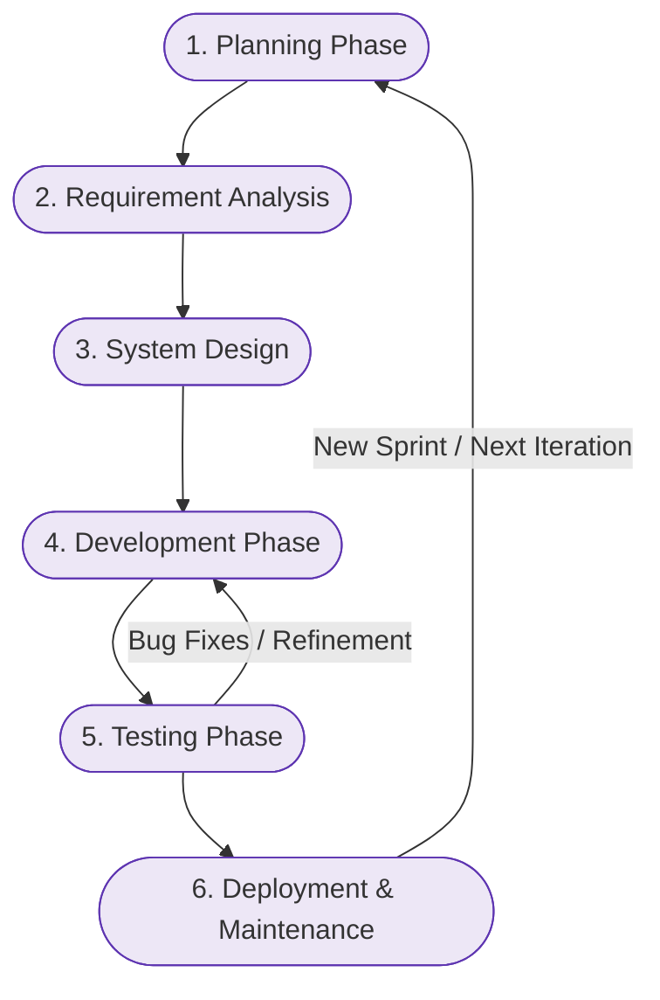
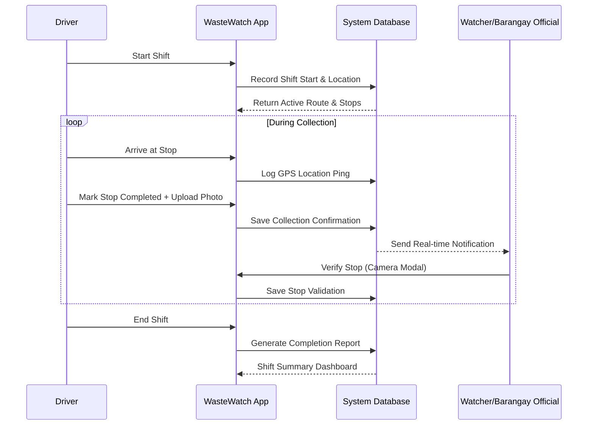
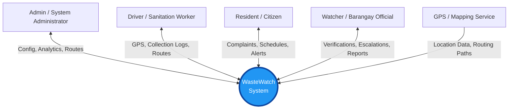
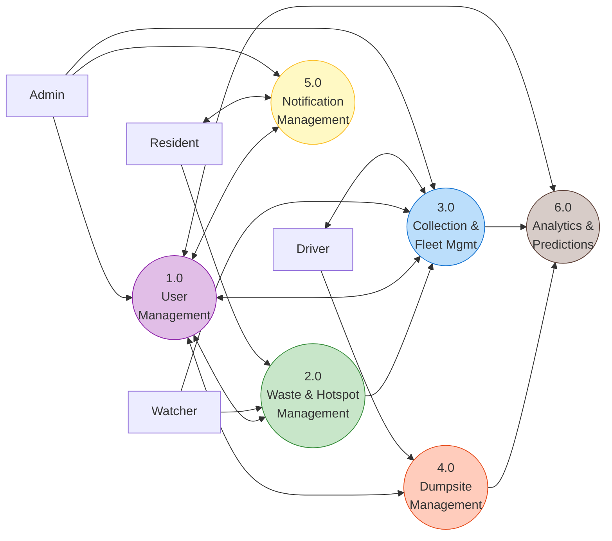
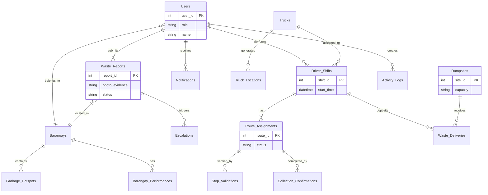

# Chapter 3 System Diagrams

Here are the Mermaid.js codes for all the diagrams required in your Chapter 3. You can copy and paste these code blocks directly into any Mermaid-compatible tool (like [Mermaid Live Editor](https://mermaid.live/), Notion, or Obsidian) to generate high-quality images for your document.

## 1. Figure 1: Conceptual Framework (IPO Diagram)
This diagram illustrates the Input-Process-Output flow of WasteWatch.

```mermaid
flowchart LR
    subgraph Inputs[Input]
        direction TB
        I1(Resident & Barangay Data)
        I2(Waste Incident Reports)
        I3(GPS Location Data)
        I4(System Settings)
    end

    subgraph Processes[Process]
        direction TB
        P1(Hotspot Mapping & GIS Analysis)
        P2(Route Optimization Algorithm)
        P3(Real-time Truck Tracking)
        P4(Predictive Analytics & Reporting)
    end

    subgraph Outputs[Output]
        direction TB
        O1(Optimized Collection Routes)
        O2(Real-time Fleet Dashboards)
        O3(Waste Hotspot Alerts)
        O4(System Performance Analytics)
    end

    Inputs --> Processes
    Processes --> Outputs
    
    style Inputs fill:#e3f2fd,stroke:#1e88e5
    style Processes fill:#fff3e0,stroke:#fb8c00
    style Outputs fill:#e8f5e9,stroke:#43a047
```

## 2. Figure 2: Software Development Lifecycle (Agile Scrum)
This diagram shows the iterative Agile methodology used to develop the system.

## 3. Figure 3: System Sequence Diagram (Driver Shift Tracking Flow)
This details the interactions when a driver performs a shift.

## 4. Figure 4: Context Diagram (System Boundaries)
This provides a high-level view of how external entities interact with WasteWatch.

## 5. Figure 5: Data Flow Diagram (DFD Level 0)
This maps the major processes based on your actual, full-scale system architecture.

## 6. Figure 6: Entity Relationship Diagram (ERD)
This is the fully expanded ERD that accurately matches your 20+ database tables, rather than the simplified 7-entity version.

