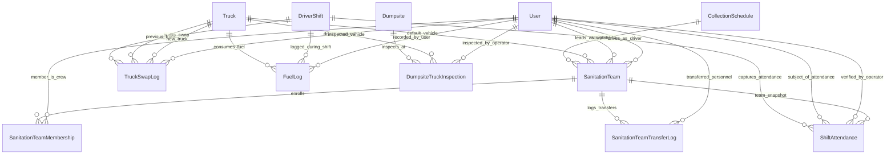

# Phase 0 Architecture Report: Sanitation Team Workflow & Dumpsite Fleet Operations

**Project Name:** WasteWatch  
**Official Title:** WasteWatch: A Progressive Web-Based Solid Waste Management System with Hotspot Mapping, Truck Tracking, and Route Optimization for Lucena City  
**Role:** Senior Full-Stack Software Architect and Technical Implementation Analyst  
**Document Status:** Complete Phase 0 Architecture Assessment & Blueprint (Pre-Implementation)  
**Target Auditor:** Claude (Principal Software Architect and Code Quality Validator)  

---

## Section 1 — Executive Summary

### 1.1 Context and Existing Architectural State
A thorough investigation of the WasteWatch codebase reveals that workforce operations are currently managed through disconnected entities:
1. **Workforce Allocation:** Drivers and Crew members are assigned to trucks via unstructured many-to-many relationships directly on the `Truck` model (`Truck.drivers`, `Truck.crew`). While a `TruckCrewAssignment` model was previously introduced in migration `0002_truckcrewassignment_wastedelivery_and_more`, the active SQLite database contains **zero rows** in that table because the administrative interface (`TruckManagement.jsx`) modifies `Truck.drivers` and `Truck.crew` directly.
2. **Watcher Scoping:** Watchers are strictly constrained to their residential barangay boundary (`user.barangay`). In `StopValidationViewSet` (`watcher/views.py`), querysets for watchers are filtered with `qs = qs.filter(barangay=user.barangay)`. In `WatcherMapTaskModule.jsx`, tasks are similarly filtered on the client by matching `user.barangay`. Watchers have no link to collection trucks, drivers, or multi-barangay routes.
3. **Shift Initialization & Attendance:** The driver shift lifecycle (`DriverShift`) snapshots only the driver, truck, and schedule during `pre_start_shift()`. No roll call, crew attendance, or team leader validation occurs before dispatch.
4. **Staging Destination Misalignment:** Both backend dispatch validation (`start_shift()` in `driver/views.py`) and frontend routing modules (`NavigateToBaseModule.jsx`) anchor the driver's pre-shift travel to `schedule.waypoints[0]` (designated as "Home Base" / "City Hall" in `SystemSetting`). In reality, actual fleet staging, weigh-in, and shift-end activities occur at the **Dumpsite** (`dumpsite.Dumpsite`).
5. **Dumpsite Fleet Management:** The dumpsite operator role (`UserRole.DUMPSITE`) currently has tools for recording inbound waste delivery weights (`ArrivalLogger.jsx`, `WasteDeliveryViewSet`), but lacks capabilities to manage truck statuses, inspect fleet conditions, review daily shift rosters, or track fuel usage.

### 1.2 System Compatibility and Non-Negotiable Decisions
* **Crew Representation:** Crew members are citizens with an administrator-selectable crew designation (`User.role == 'citizen'` and `User.employee_type == 'crew_member'`). This existing pattern in `accounts/models.py` and `UserManagement.jsx` is fully respected and preserved.
* **Authentication & Permission Architecture:** WasteWatch uses session authentication with CSRF tokens (`api/client.js`). Crucially, administrative access is determined by `user.role == 'admin'` (defined in `accounts/permissions.py:IsAdminRole`), **not** Django's built-in `is_staff`. All proposed permission classes adhere strictly to this custom role-checking standard.
* **Iconography:** In accordance with repository standards (`AGENTS.md`), **zero emojis** are permitted anywhere in application code, UI labels, logs, or error responses. All iconography utilizes Lucide React and SVG components.

### 1.3 Major Architectural Risks
1. **Dumpsite Foreign Key Nullability on Existing Routes:** In the production/development database, certain `CollectionSchedule` instances have `dumpsite_id = None`. If navigation targets switch unconditionally to `schedule.dumpsite`, pre-shift navigation will fail unless an authoritative fallback hierarchy is established.
2. **Watcher Route Scope vs. Civic Report Integrity:** Decoupling watchers from their residential barangay so they can monitor an entire multi-barangay collection route must not compromise civic discussion/voting rules (`can_vote_on_report()` in `accounts/permissions.py`), which strictly prohibit cross-barangay community voting.
3. **Concurrent Reassignments & Truck Allocation:** Multiple dumpsite operators or admins attempting to swap trucks or reassign drivers mid-shift could produce race conditions unless guarded by database transactions (`select_for_update()`) and uniqueness constraints.

### 1.4 Recommended Approach
Implement an enduring workforce entity (`SanitationTeam`) linked to a route (`CollectionSchedule`) and default truck (`Truck`), with audited team membership history (`SanitationTeamMembership`). Introduce a transactional `ShiftAttendance` ledger recorded during pre-shift roll call in `AssignmentModule.jsx`, surface service history in `Profile.jsx`, re-anchor base dispatch navigation to the assigned `Dumpsite`, and equip the Dumpsite Operator with fleet inspection (`DumpsiteTruckInspection`), truck swap auditing (`TruckSwapLog`), and fuel recording (`FuelLog`).

---

## Section 2 — Repository Inspection Inventory

| Inspected File Path | Purpose and Relevance | Access Status |
| :--- | :--- | :--- |
| `wastewatch/backend/wastewatch/settings.py` | Verified Django 4.2.30, database configuration (SQLite default, PostgreSQL via `DATABASE_URL`), `INSTALLED_APPS`, and time zone (`Asia/Manila`). | Fully Verified |
| `wastewatch/backend/accounts/models.py` | Examined custom `User`, `UserRole` (`admin`, `brgy_official`, `watcher`, `driver`, `citizen`, `dumpsite`), and `EmployeeType` (`crew_member`). | Fully Verified |
| `wastewatch/backend/accounts/permissions.py` | Verified `IsAdminRole`, `is_admin_user` (role-based, not `is_staff`), report moderation, and voting access rules. | Fully Verified |
| `wastewatch/backend/accounts/api_views.py` | Verified `/api/auth/me/`, `/api/accounts/users/`, and role management behavior. | Fully Verified |
| `wastewatch/backend/driver/models.py` | Inspected `Truck`, `CollectionSchedule`, `DriverShift`, `TruckCrewAssignment`, `PickupStatus`, `TruckLocation`, and `SystemSetting`. | Fully Verified |
| `wastewatch/backend/driver/views.py` | Inspected `DriverShiftViewSet` (`pre_start_shift`, `start_shift`, `end_shift`), `TruckViewSet`, and `CollectionScheduleViewSet`. | Fully Verified |
| `wastewatch/backend/driver/crew_resolver.py` | Discovered that crew assignments are dynamically inferred from `Truck.crew` M2M rather than `TruckCrewAssignment`. | Fully Verified |
| `wastewatch/backend/driver/tests/test_crew_assignment_api.py` | Examined test harness for crew assignment endpoints. | Fully Verified |
| `wastewatch/backend/dumpsite/models.py` | Inspected `Dumpsite`, `WasteDelivery`, fill levels, and operator assignment linkage. | Fully Verified |
| `wastewatch/backend/dumpsite/views.py` | Inspected `DumpsiteViewSet` (`inbound_queue`, `log_arrival`), `IsAdminOrDumpsiteRole`, and queue polling. | Fully Verified |
| `wastewatch/backend/watcher/models.py` | Inspected `StopValidation`, `GarbageReport`, `Escalation`, and watcher inspection states. | Fully Verified |
| `wastewatch/backend/watcher/views.py` | Verified lines 1638–1640 where `StopValidationViewSet` hard-filters by `user.barangay`. | Fully Verified |
| `wastewatch/backend/notifications/models.py` | Inspected `Notification`, `NotificationType` enum, and user/barangay targeting fields. | Fully Verified |
| `wastewatch/backend/notifications/services.py` | Inspected notification broadcast helpers and deduplication logic. | Fully Verified |
| `wastewatch/frontend/src/pages/driver/components/AssignmentModule.jsx` | Analyzed driver pre-shift summary, route fetching, and transition to `navigate_to_base`. | Fully Verified |
| `wastewatch/frontend/src/pages/driver/DriverRouteFlow.jsx` | Analyzed phase machine: `assignment` -> `navigate_to_base` -> `confirm_start` -> `checkin` -> `shiftroute` -> `end_shift`. | Fully Verified |
| `wastewatch/frontend/src/pages/driver/components/NavigateToBaseModule.jsx` | Analyzed ORS turn-by-turn routing to `waypoints[0]`, distance checking, and base arrival threshold (150m). | Fully Verified |
| `wastewatch/frontend/src/pages/driver/components/ConfirmStartModule.jsx` | Analyzed base confirmation and pre-flight schedule presentation. | Fully Verified |
| `wastewatch/frontend/src/pages/driver/components/CheckInModule.jsx` | Analyzed GPS permission acquisition and automated dispatch boot sequence. | Fully Verified |
| `wastewatch/frontend/src/pages/driver/components/EndShiftModule.jsx` | Verified existing dumpsite weigh-in sub-workflow (`NavigateToDumpsiteModule`, calibration polling). | Fully Verified |
| `wastewatch/frontend/src/pages/watcher/WatcherMapTaskModule.jsx` | Discovered client-side filtering restricting tasks to `user?.barangay`. | Fully Verified |
| `wastewatch/frontend/src/pages/Profile.jsx` | Analyzed current profile layout and mock assignments for drivers, watchers, and brgy officials. | Fully Verified |
| `wastewatch/frontend/src/pages/admin/TruckManagement.jsx` | Discovered direct UI assignment modal that mutates `truck.drivers` and `truck.crew` M2M. | Fully Verified |
| `wastewatch/frontend/src/pages/admin/UserManagement.jsx` | Verified UI toggle for `employee_type='crew_member'` on Citizen users. | Fully Verified |
| `wastewatch/frontend/src/pages/dumpsite/ArrivalLogger.jsx` | Inspected dumpsite weigh-in UI, payload structures, and truck fill slider. | Fully Verified |
| `wastewatch/frontend/src/pages/dumpsite/TruckQueue.jsx` | Inspected dumpsite queue monitoring and truck filtering. | Fully Verified |
| `wastewatch/frontend/src/pages/dumpsite/components/TrucksOverlay.jsx` | Verified truck-to-dumpsite resolution via schedules matching `s.dumpsite === siteId`. | Fully Verified |

*Note:* All target files were accessible and read. No files failed inspection.

---

## Section 3 — Existing Architecture

### 3.1 User and Workforce Model
* **Model:** `accounts.User` (subclasses `AbstractUser`).
* **Roles:** `UserRole` (`admin`, `brgy_official`, `watcher`, `driver`, `citizen`, `dumpsite`).
* **Crew Designation:** `employee_type = models.CharField(max_length=20, choices=[('', '—'), ('crew_member', 'Crew Member')], blank=True)`.
* **Crew Account Rule:** Crew members are citizens with `employee_type='crew_member'`. They retain standard citizen privileges (login, personal report viewing), while being eligible for collection duty assignments.

### 3.2 Vehicle Model (`driver.Truck`)
* **Identifiers & Specs:** `plate_number` (unique CharField), `model`, `max_capacity_kg` (Decimal), `current_capacity` (0–100%), `photo`, `date_bought`.
* **State Management:** `status` (`active`, `maintenance`, `inactive`), `maintenance_start`, `status_reason`, `past_crew_names`.
* **Current Allocations:** `drivers = models.ManyToManyField(User, related_name='assigned_trucks', blank=True)` and `crew = models.ManyToManyField(User, related_name='crew_trucks', blank=True)`.
* **Critical Finding:** When a truck's status transitions to `inactive`, its `save()` method wipes `self.drivers.clear()` and `self.crew.clear()`, saving past names only as a comma-delimited string in `past_crew_names`. There is no historical relational audit of who drove or staffed the truck previously.

### 3.3 Route and Schedule Model (`driver.CollectionSchedule`)
* **Route Definition:** Defines recurring or single-date routes. Contains `truck` (FK), `driver` (FK), `barangays` (M2M), `start_time`, `end_time`, `days` (e.g. "Mon, Wed, Fri"), and `waypoints` (JSONField containing an ordered list of coordinate dictionaries).
* **Facility Link:** `dumpsite = models.ForeignKey('dumpsite.Dumpsite', null=True, blank=True)`. In existing records, this field is nullable, and historical records exist where `dumpsite_id` is null.
* **Stop Synchronization:** Automatically creates and updates `PickupStatus` rows for stops 1..N (skipping waypoint 0).

### 3.4 Shift Model (`driver.DriverShift`)
* **Lifespan:** Initiated in `pre_start_shift()`, confirmed in `start_shift()`, updated during collection, and closed in `end_shift()`.
* **Phases:** `navigate_to_base`, `confirm_start`, `checkin`, `shiftroute`, `end_shift`.
* **Operational Status:** `op_status` (`on_duty`, `on_route`, `heading_to_dumpsite`, `at_dumpsite`, `returning_to_base`, `delayed`).
* **Constraints:** `UniqueConstraint(fields=['driver'], condition=Q(is_active=True))` and `UniqueConstraint(fields=['truck'], condition=Q(is_active=True))`.
* **Critical Finding:** The shift tracks the `driver`, `truck`, and `schedule`, but has **no knowledge of crew members or watchers**.

### 3.5 Facility Model (`dumpsite.Dumpsite`)
* **Fields:** `name`, `type` (`landfill`, `dumpsite`, `transfer`, `composting`), `barangay` (FK), `latitude`, `longitude`, `max_capacity_kg`, `current_fill_kg`.
* **Operator Relationship:** `operator = models.OneToOneField('accounts.User', null=True, blank=True, related_name='operated_dumpsite')`. Conversely, `User.dumpsite` provides a reverse ForeignKey.

### 3.6 Watcher Task Assignment
* In `watcher/models.py`, `StopValidation` represents the inspection record for a specific schedule, stop order, and date.
* In `watcher/views.py:StopValidationViewSet.get_queryset()`, line 1639 filters exclusively by `user.barangay`.
* In `WatcherMapTaskModule.jsx`, the frontend filters out any stop whose `barangay_id` or `barangay_names` does not match `user.barangay`.

---

## Section 4 — Proposed Database Architecture

To fulfill the approved requirements without breaking existing historical shifts, the database architecture is augmented with structured workforce and audit models.

### 4.1 Mermaid Entity-Relationship Diagram



### 4.2 Model Definitions and Integrity Rules

#### A. Model `SanitationTeam`
Represents an enduring operational workforce unit assigned to a collection route.
* `id`: AutoField (Primary Key).
* `name`: `CharField(max_length=120, unique=True)` (e.g. "Sanitation Team 1 - Poblacion Loop").
* `schedule`: `ForeignKey('driver.CollectionSchedule', on_delete=models.PROTECT, related_name='sanitation_teams')`.
* `default_truck`: `ForeignKey('driver.Truck', on_delete=models.SET_NULL, null=True, blank=True, related_name='sanitation_teams')`.
* `team_leader`: `ForeignKey('accounts.User', on_delete=models.PROTECT, related_name='led_teams', limit_choices_to={'role': 'watcher'})`.
* `driver`: `ForeignKey('accounts.User', on_delete=models.PROTECT, related_name='driven_teams', limit_choices_to={'role': 'driver'})`.
* `is_active`: `BooleanField(default=True, db_index=True)`.
* `notes`: `TextField(blank=True)`.
* `created_at`: `DateTimeField(auto_now_add=True)`.
* `updated_at`: `DateTimeField(auto_now=True)`.
* **Constraints & Indexes:**
  * `UniqueConstraint(fields=['schedule'], condition=Q(is_active=True), name='unique_active_team_per_route')`
  * `UniqueConstraint(fields=['driver'], condition=Q(is_active=True), name='unique_active_team_per_driver')`
  * `UniqueConstraint(fields=['team_leader'], condition=Q(is_active=True), name='unique_active_team_per_leader')`

#### B. Model `SanitationTeamMembership`
Tracks Crew Members assigned to a team over time, preserving historical membership without silent overwrites.
* `id`: AutoField (Primary Key).
* `team`: `ForeignKey(SanitationTeam, on_delete=models.CASCADE, related_name='memberships')`.
* `user`: `ForeignKey('accounts.User', on_delete=models.PROTECT, related_name='team_memberships', limit_choices_to={'employee_type': 'crew_member'})`.
* `start_date`: `DateField(default=timezone.localdate, db_index=True)`.
* `end_date`: `DateField(null=True, blank=True, db_index=True)` (null indicates current active assignment).
* `is_active`: `BooleanField(default=True, db_index=True)`.
* `created_at`: `DateTimeField(auto_now_add=True)`.
* **Constraints:**
  * `UniqueConstraint(fields=['user'], condition=Q(is_active=True), name='unique_active_team_per_crew_member')`

#### C. Model `SanitationTeamTransferLog`
Audits all personnel adjustments (Leader, Driver, or Crew) across teams.
* `id`: AutoField (Primary Key).
* `transferred_user`: `ForeignKey('accounts.User', on_delete=models.PROTECT, related_name='transfer_history')`.
* `role_at_transfer`: `CharField(max_length=20)` (`watcher`, `driver`, `crew_member`).
* `from_team`: `ForeignKey(SanitationTeam, on_delete=models.SET_NULL, null=True, blank=True, related_name='transfers_out')`.
* `to_team`: `ForeignKey(SanitationTeam, on_delete=models.SET_NULL, null=True, blank=True, related_name='transfers_in')`.
* `effective_date`: `DateField(default=timezone.localdate)`.
* `reason`: `CharField(max_length=255)`.
* `initiated_by`: `ForeignKey('accounts.User', on_delete=models.SET_NULL, null=True, related_name='initiated_transfers')`.
* `created_at`: `DateTimeField(auto_now_add=True)`.

#### D. Model `ShiftAttendance`
Immutable record of roll-call attendance submitted by the Driver and verified by the Dumpsite Operator.
* `id`: AutoField (Primary Key).
* `shift`: `ForeignKey('driver.DriverShift', on_delete=models.CASCADE, related_name='attendance_records')`.
* `team`: `ForeignKey(SanitationTeam, on_delete=models.PROTECT, related_name='shift_attendances')`.
* `user`: `ForeignKey('accounts.User', on_delete=models.PROTECT, related_name='shift_attendances')`.
* `role`: `CharField(max_length=20, choices=[('team_leader', 'Team Leader'), ('driver', 'Driver'), ('crew_member', 'Crew Member')])`.
* `status`: `CharField(max_length=20, choices=[('present', 'Present'), ('absent', 'Absent'), ('late', 'Late'), ('excused', 'Excused')], default='present')`.
* `marked_by`: `ForeignKey('accounts.User', on_delete=models.PROTECT, related_name='marked_attendances')`.
* `marked_at`: `DateTimeField(auto_now_add=True)`.
* `verified_by_dumpsite`: `BooleanField(default=False)`.
* `verified_by`: `ForeignKey('accounts.User', on_delete=models.SET_NULL, null=True, blank=True, related_name='verified_attendances')`.
* `verified_at`: `DateTimeField(null=True, blank=True)`.
* `notes`: `TextField(blank=True)`.
* **Constraints:**
  * `UniqueConstraint(fields=['shift', 'user'], name='unique_attendance_per_user_shift')`

#### E. Model `TruckSwapLog`
Audits vehicle changes before or during active shifts.
* `id`: AutoField (Primary Key).
* `shift`: `ForeignKey('driver.DriverShift', on_delete=models.SET_NULL, null=True, blank=True, related_name='truck_swaps')`.
* `team`: `ForeignKey(SanitationTeam, on_delete=models.SET_NULL, null=True, blank=True, related_name='truck_swaps')`.
* `driver`: `ForeignKey('accounts.User', on_delete=models.PROTECT, related_name='driver_truck_swaps')`.
* `previous_truck`: `ForeignKey('driver.Truck', on_delete=models.PROTECT, null=True, blank=True, related_name='swapped_out_logs')`.
* `new_truck`: `ForeignKey('driver.Truck', on_delete=models.PROTECT, related_name='swapped_in_logs')`.
* `swap_type`: `CharField(max_length=30, choices=[('pre_shift_reassignment', 'Pre-Shift Reassignment'), ('emergency_swap', 'Emergency Swap (Mid-Shift)')])`.
* `reason`: `CharField(max_length=30, choices=[('breakdown', 'Mechanical Breakdown'), ('maintenance', 'Scheduled Maintenance'), ('capacity_mismatch', 'Capacity Mismatch'), ('operator_reassigned', 'Operator Reassigned'), ('other', 'Other')])`.
* `notes`: `TextField(blank=True)`.
* `approved_by`: `ForeignKey('accounts.User', on_delete=models.SET_NULL, null=True, blank=True, related_name='approved_truck_swaps')`.
* `created_at`: `DateTimeField(auto_now_add=True)`.

#### F. Model `FuelLog`
Records fuel additions and levels at operational shift stages.
* `id`: AutoField (Primary Key).
* `truck`: `ForeignKey('driver.Truck', on_delete=models.PROTECT, related_name='fuel_logs')`.
* `shift`: `ForeignKey('driver.DriverShift', on_delete=models.SET_NULL, null=True, blank=True, related_name='fuel_logs')`.
* `logged_by`: `ForeignKey('accounts.User', on_delete=models.PROTECT, related_name='logged_fuels')`.
* `log_stage`: `CharField(max_length=25, choices=[('shift_start', 'Shift Start'), ('mid_shift', 'Mid Shift'), ('dumpsite_arrival', 'Dumpsite Arrival'), ('shift_end', 'Shift End')])`.
* `fuel_level_percent`: `PositiveSmallIntegerField()` (Validated 0–100).
* `liters_added`: `DecimalField(max_digits=7, decimal_places=2, default=0.00)` (Must be >= 0).
* `cost`: `DecimalField(max_digits=10, decimal_places=2, null=True, blank=True)` (Must be >= 0).
* `odometer_km`: `DecimalField(max_digits=10, decimal_places=2, null=True, blank=True)` (Must be >= 0).
* `receipt_photo`: `CloudinaryField('image', null=True, blank=True)`.
* `created_at`: `DateTimeField(auto_now_add=True)`.

#### G. Model `DumpsiteTruckInspection`
Formal vehicle inspection logs recorded by the Dumpsite Operator.
* `id`: AutoField (Primary Key).
* `dumpsite`: `ForeignKey('dumpsite.Dumpsite', on_delete=models.PROTECT, related_name='inspections')`.
* `truck`: `ForeignKey('driver.Truck', on_delete=models.PROTECT, related_name='inspections')`.
* `operator`: `ForeignKey('accounts.User', on_delete=models.PROTECT, related_name='conducted_inspections')`.
* `reported_status`: `CharField(max_length=20, choices=[('active', 'Active'), ('maintenance', 'Maintenance'), ('inactive', 'Inactive'), ('issue_reported', 'Issue Reported')])`.
* `issue_category`: `CharField(max_length=20, choices=[('none', 'None / Normal'), ('hydraulic', 'Hydraulic System'), ('tire', 'Tires / Wheels'), ('engine', 'Engine / Transmission'), ('safety', 'Brakes / Safety Equipment'), ('cleanliness', 'Excessive Odor / Cleanliness')])`.
* `operator_remarks`: `TextField()`
* `escalated_to_admin`: `BooleanField(default=False)`.
* `created_at`: `DateTimeField(auto_now_add=True)`.

---

## Section 5 — API Architecture

All endpoints follow Django REST Framework standards with session and CSRF verification (`IsAuthenticated`, `IsAdminRole`, `IsAdminOrDumpsiteRole`).

### 5.1 Sanitation Team Management (`/api/driver/teams/`)

#### 1. List / Create Teams
* **Endpoint:** `GET /api/driver/teams/`, `POST /api/driver/teams/`
* **Permission:** `GET`: `IsAuthenticated`; `POST`: `IsAdminRole`
* **POST Request Payload:**
  ```json
  {
    "name": "Team 1 - South Mayao",
    "schedule_id": 80,
    "default_truck_id": 47,
    "team_leader_id": 145,
    "driver_id": 119,
    "crew_member_ids": [149]
  }
  ```
* **Success Response (201 Created):**
  ```json
  {
    "id": 1,
    "name": "Team 1 - South Mayao",
    "schedule": { "id": 80, "area": "Mayao Loop", "days": "Mon, Wed, Fri" },
    "default_truck": { "id": 47, "plate_number": "ABS-CBN", "model": "Isuzu Forward" },
    "team_leader": { "id": 145, "full_name": "Watcher Talao", "email": "watcher@lucena.gov.ph" },
    "driver": { "id": 119, "full_name": "Driver One", "email": "driver1@test.com" },
    "crew_members": [
      { "id": 149, "full_name": "Demo Listion", "email": "demo@lucena.gov.ph" }
    ],
    "is_active": true
  }
  ```
* **Validation & Errors:**
  * 400 Bad Request: Returns `{"error": "Driver is already assigned to an active team."}` if a conflict occurs.

#### 2. Transfer Personnel (`POST /api/driver/teams/transfer_personnel/`)
* **Permission:** `IsAdminOrDumpsiteRole`
* **Request Payload:**
  ```json
  {
    "user_id": 149,
    "target_team_id": 2,
    "effective_date": "2026-11-07",
    "reason": "Rebalanced crew capacity"
  }
  ```
* **Success Response (200 OK):**
  ```json
  {
    "status": "success",
    "message": "Demo Listion successfully transferred to Team 2 - North Loop.",
    "transfer_log_id": 12
  }
  ```

---

### 5.2 Driver Roll Call & Pre-Shift Staging (`/api/driver/shift/`)

#### 1. Pre-Flight Team Roster Retrieval (`GET /api/driver/shift/my_team_roster/`)
* **Permission:** `IsAuthenticated` (Driver only)
* **Response (200 OK):**
  ```json
  {
    "team_id": 1,
    "team_name": "Team 1 - South Mayao",
    "route_name": "Schedule 80 - Ibabang Dupay",
    "dumpsite": {
      "id": 1,
      "name": "GDS Dumpsite",
      "latitude": "13.944758",
      "longitude": "121.623473"
    },
    "assigned_truck": {
      "id": 47,
      "plate_number": "ABS-CBN",
      "model": "Isuzu Forward",
      "status": "active"
    },
    "team_leader": { "id": 145, "full_name": "Watcher Talao" },
    "crew_members": [
      { "id": 149, "full_name": "Demo Listion" }
    ]
  }
  ```

#### 2. Pre-Start Shift with Attendance & Truck Confirmation (`POST /api/driver/shift/pre_start/`)
* **Permission:** `IsAuthenticated` (Driver)
* **Request Payload:**
  ```json
  {
    "duty_type": "normal",
    "truck_id": 47,
    "truck_swap_reason": "",
    "initial_fuel_percent": 85,
    "initial_odometer_km": 14250.5,
    "attendance": [
      { "user_id": 145, "status": "present", "notes": "" },
      { "user_id": 149, "status": "absent", "notes": "Called in sick" }
    ]
  }
  ```
* **Execution Behavior:**
  1. Opens atomic transaction with `select_for_update()`.
  2. If `truck_id` differs from the team's default truck, records a `TruckSwapLog` (`regular_reassignment`).
  3. Creates `DriverShift` with `status='navigate_to_dumpsite'`, stamped with `schedule` and `truck`.
  4. Records `ShiftAttendance` entries for the driver (auto-marked `present`), the team leader, and each crew member.
  5. Records initial `FuelLog` (`log_stage='shift_start'`).
* **Response (201 Created):** Returns full `DriverShiftSerializer` payload including destination coordinates pointing to `dumpsite`.

---

### 5.3 Dumpsite Operator Fleet & Attendance Endpoints

#### 1. Dumpsite Team & Attendance Overview (`GET /api/dumpsite/dumpsites/{id}/shift_roster_today/`)
* **Permission:** `IsAdminOrDumpsiteRole`
* **Response (200 OK):**
  ```json
  {
    "dumpsite_id": 1,
    "date": "2026-11-07",
    "total_crews_scheduled": 8,
    "total_present": 7,
    "total_absent": 1,
    "teams": [
      {
        "shift_id": 60,
        "team_name": "Team 1 - South Mayao",
        "truck_plate": "ABS-CBN",
        "driver_name": "Driver One",
        "shift_status": "navigate_to_dumpsite",
        "attendance": [
          { "user_id": 119, "name": "Driver One", "role": "driver", "status": "present", "verified": true },
          { "user_id": 145, "name": "Watcher Talao", "role": "team_leader", "status": "present", "verified": false },
          { "user_id": 149, "name": "Demo Listion", "role": "crew_member", "status": "absent", "verified": false }
        ]
      }
    ]
  }
  ```

#### 2. Dumpsite Attendance Verification (`PATCH /api/dumpsite/attendance/{id}/verify/`)
* **Permission:** `IsAdminOrDumpsiteRole`
* **Request Payload:**
  ```json
  {
    "status": "present",
    "notes": "Late arrival at dumpsite staging; confirmed in person"
  }
  ```
* **Behavior:** Updates `verified_by_dumpsite=True`, stamps `verified_by=request.user`, `verified_at=now()`, and appends correction notes without erasing original driver-marked status.

#### 3. Vehicle Inspection & Status Escalation (`POST /api/dumpsite/dumpsites/{id}/inspect_truck/`)
* **Permission:** `IsAdminOrDumpsiteRole`
* **Request Payload:**
  ```json
  {
    "truck_id": 47,
    "reported_status": "maintenance",
    "issue_category": "hydraulic",
    "operator_remarks": "Compactor blade hydraulic cylinder leaking high pressure fluid",
    "escalate_to_admin": true
  }
  ```
* **Behavior:**
  1. Saves `DumpsiteTruckInspection` row.
  2. Updates `Truck.status = 'maintenance'` and stamps `maintenance_start`.
  3. Creates `Notification` with `type='SCHEDULE_CHANGE'` (or new `TRUCK_ISSUE`) targeted to administrators.

#### 4. Fuel Logging (`POST /api/dumpsite/fuel-logs/`)
* **Permission:** `IsAuthenticated` (Dumpsite Operator, Driver, or Admin)
* **Request Payload:**
  ```json
  {
    "truck_id": 47,
    "shift_id": 60,
    "log_stage": "dumpsite_arrival",
    "fuel_level_percent": 62,
    "liters_added": 40.0,
    "cost": 2400.00,
    "odometer_km": 14312.0
  }
  ```

---

### 5.4 Profile Attendance History (`GET /api/accounts/users/attendance_history/`)
* **Permission:** `IsAuthenticated`
* **Target Roles:** `driver`, `watcher`, `citizen` (with `employee_type='crew_member'`).
* **Response (200 OK):**
  ```json
  {
    "summary": {
      "total_shifts_scheduled": 24,
      "shifts_attended": 23,
      "attendance_rate_percent": 95.8
    },
    "records": [
      {
        "shift_id": 60,
        "date": "2026-11-07",
        "team_name": "Team 1 - South Mayao",
        "route_name": "Schedule 80 - Ibabang Dupay",
        "truck_plate": "ABS-CBN",
        "my_role": "crew_member",
        "status": "present",
        "verified_by_dumpsite": true,
        "notes": ""
      }
    ]
  }
  ```

---

## Section 6 — Workflow Specifications

### 6.1 Team Creation and Management
1. Administrator navigates to the **Sanitation Team Management** tab in the Admin portal.
2. Form prompts selection of Team Name, Collection Route (`CollectionSchedule`), Default Truck (`Truck`), Team Leader (`User` where `role='watcher'`), Driver (`User` where `role='driver'`), and Crew Members (`User` where `employee_type='crew_member'`).
3. Backend validates uniqueness: verifies neither the driver, watcher, nor route is assigned to an existing active team.
4. On creation, `SanitationTeam` is saved and individual `SanitationTeamMembership` records are generated with `start_date=localdate()`.

### 6.2 Personnel Transfers
1. Admin or Dumpsite Operator opens the Team Management screen and clicks **Transfer Member**.
2. Selects personnel, destination team, effective date, and enters a mandatory operational reason.
3. Backend checks if the personnel has an active shift right now. If a shift is active, the transfer is scheduled with `effective_date = tomorrow` to prevent corrupting active shift rosters.
4. If effective immediately (no shift running), the existing `SanitationTeamMembership` sets `end_date=today`, `is_active=False`, and creates a new active membership on the target team. A `SanitationTeamTransferLog` row is created.

### 6.3 Driver-Truck Reassignment (Pre-Shift)
1. In `AssignmentModule.jsx`, the driver reviews the default truck. If driving a different truck, the driver selects a replacement truck from available active trucks.
2. Driver enters a reassignment reason (e.g. "Primary truck scheduled for wash/lube").
3. Shift starts with the new truck; backend records a `TruckSwapLog` (`pre_shift_reassignment`).

### 6.4 Emergency Truck Swapping (Mid-Shift)
1. Driver or Dumpsite Operator triggers **Emergency Truck Swap** due to breakdown.
2. Selects replacement truck and breakdown reason.
3. Transactional endpoint validates replacement truck is active and not tied to another running shift.
4. Active `DriverShift.truck` is updated to the replacement truck; previous truck is recorded in `TruckSwapLog` (`emergency_swap`).
5. Previous truck's status is set to `maintenance` with reason logged.
6. The driver's app updates without resetting the route or clearing already collected stops.

### 6.5 Driver Crew Attendance Checklist (Roll Call)
1. Driver opens `AssignmentModule.jsx`.
2. App queries `/api/driver/shift/my_team_roster/`.
3. Displays interactive checklist showing assigned Team Leader and Crew Members with "Present" and "Absent" toggles.
4. Driver checks the status of each personnel.
5. On tapping **Start Normal Duty**, payload transmits `{ duty_type, truck_id, attendance: [...] }`.
6. Attendance is permanently written to `ShiftAttendance`.

### 6.6 Dumpsite Attendance Verification
1. Dumpsite Operator opens **Live Dumpsite Operations** -> **Team Roster Tab**.
2. Operator sees all dispatched shifts and driver-submitted attendance.
3. Operator visually confirms crew upon truck arrival at staging.
4. Operator clicks **Verify Roster** or adjusts a status (e.g. marking a late crew member present with an audit note).

### 6.7 Dumpsite Vehicle Inspections
1. Dumpsite Operator inspects arriving or staged trucks.
2. Clicks **Log Vehicle Inspection** in the Dumpsite portal.
3. Selects condition status, issue category, and enters notes.
4. If an issue is flagged, truck availability is updated and an administrative notification is dispatched.

### 6.8 Fuel Recording
1. Fuel can be logged at Shift Start (driver in `AssignmentModule`), Dumpsite Arrival (dumpsite operator), or Shift End (driver in `EndShiftModule`).
2. Inputs fuel gauge percentage (0–100%), optional liters added, cost, and odometer reading.
3. Recorded in `FuelLog` with timestamps and user identification.

### 6.9 Shift Initialization and Dispatch (Dumpsite-Centered)
1. Driver completes roll call and fuel check.
2. App advances to phase `navigate_to_dumpsite`.
3. App targets the **Assigned Dumpsite** coordinates (`dumpsite.latitude`, `dumpsite.longitude`).
4. Upon reaching the dumpsite staging perimeter (<= 150m), app unlocks "Confirm Arrival at Dumpsite".
5. Driver confirms staging arrival -> enters `checkin` -> commences route collection (`shiftroute`).

### 6.10 Shift Completion
1. Driver completes route or marks truck full.
2. App instructs driver: **Return to Assigned Dumpsite**.
3. Dumpsite weigh-in occurs via `ArrivalLogger.jsx`.
4. Driver finalizes shift in `EndShiftModule.jsx`, recording final fuel level and odometer reading.

### 6.11 Watcher Route-Based Responsibilities
1. Watcher logs into `WatcherTasksHub` / `WatcherMapTaskModule`.
2. Backend checks if the watcher is assigned as `team_leader` of an active `SanitationTeam`.
3. If assigned to a team, the watcher's stop validations encompass **all stops on the team's route**, even if those stops span 3 or 4 different barangays.
4. If not assigned to a team (fallback), the watcher's scope defaults to `user.barangay`.

### 6.12 Profile Attendance History
1. Driver, Watcher, or Crew Member opens `/profile`.
2. A dedicated card **"Shift Attendance & Service Log"** renders attendance history.
3. Computes attendance percentage and lists completed shifts with verification badges.

---

## Section 7 — Frontend Change Inventory

### 7.1 Existing Files to Modify

| Frontend File Path | Required Changes |
| :--- | :--- |
| `frontend/src/pages/driver/components/AssignmentModule.jsx` | Add team roster fetch (`/api/driver/shift/my_team_roster/`); render crew roll-call checklist; add truck swap selector if default truck changed; replace "START NORMAL DUTY" payload with attendance array; rename next step to `navigate_to_dumpsite`. |
| `frontend/src/pages/driver/DriverRouteFlow.jsx` | Update `PHASES` metadata: replace `{ key: 'navigate_to_base', label: 'Navigate to Base' }` with `{ key: 'navigate_to_dumpsite', label: 'Navigate to Dumpsite', desc: 'Head to assigned dumpsite staging' }`. |
| `frontend/src/pages/driver/components/NavigateToBaseModule.jsx` | Rename component or repurpose: resolve destination coordinates from `schedule.dumpsite_detail` instead of `waypoints[0]`. Update UI labels from "Home Base" to "Assigned Dumpsite". |
| `frontend/src/pages/driver/components/ConfirmStartModule.jsx` | Update header copy and location summary to reflect staging at the Assigned Dumpsite. |
| `frontend/src/pages/driver/components/EndShiftModule.jsx` | Add final fuel log submission card during shift closeout. |
| `frontend/src/pages/watcher/WatcherMapTaskModule.jsx` | Remove hardcoded `user.barangay` filtering when the watcher has an assigned team route (`team_schedule_id`). |
| `frontend/src/pages/Profile.jsx` | Add **Shift Attendance & Service History** card for driver, watcher, and crew roles. Render stats (attendance rate, completed shifts) and historical shift table. |
| `frontend/src/pages/admin/TruckManagement.jsx` | Refactor driver and crew assignment modal: redirect workforce assignments to the new Sanitation Team Management tab while maintaining truck hardware settings. |
| `frontend/src/pages/admin/AdminDashboard.jsx` | Add navigation pill / tab link for **Sanitation Teams**. |
| `frontend/src/pages/dumpsite/TruckQueue.jsx` | Add **Team Overview** and **Vehicle Inspection** action buttons to the header. |
| `frontend/src/pages/dumpsite/ArrivalLogger.jsx` | Add optional fuel level and odometer input fields on weigh-in submission. |

### 7.2 Proposed New Components
* `frontend/src/pages/admin/SanitationTeamManagement.jsx`: Complete admin workspace to create teams, assign leaders/drivers/crews/routes/trucks, and execute personnel transfers.
* `frontend/src/pages/dumpsite/components/DumpsiteTeamRoster.jsx`: Dumpsite Operator view displaying today's teams, active shifts, absent crew members, and attendance verification actions.
* `frontend/src/pages/dumpsite/components/TruckInspectionModal.jsx`: Modal for dumpsite operators to log mechanical issues and update truck availability.
* `frontend/src/pages/driver/components/TruckSwapModal.jsx`: Emergency truck swap modal for mid-shift vehicle replacement.

---

## Section 8 — Permission Matrix

| Action / Capability | Admin | Dumpsite Operator | Driver | Watcher (Leader) | Crew Member | Brgy Official | Citizen |
| :--- | :---: | :---: | :---: | :---: | :---: | :---: | :---: |
| **Create / Delete Sanitation Team** | Yes | No | No | No | No | No | No |
| **Assign / Transfer Personnel** | Yes | Yes | No | No | No | No | No |
| **Change Team Default Truck** | Yes | Yes | No | No | No | No | No |
| **Emergency Truck Swap (Mid-Shift)** | Yes | Yes | Yes (own shift) | No | No | No | No |
| **Submit Pre-Shift Roll Call** | No | No | Yes (own crew) | No | No | No | No |
| **Verify / Correct Shift Attendance** | Yes | Yes | No | No | No | No | No |
| **View Own Shift Attendance History** | Yes | Yes | Yes | Yes | Yes | No | No |
| **Log Vehicle Inspection (Dumpsite)** | Yes | Yes | No | No | No | No | No |
| **Log Truck Fuel Usage** | Yes | Yes | Yes (own shift) | No | No | No | No |
| **Inspect Stops Along Team Route** | Yes | No | View Only | Yes (all route stops) | No | Own Brgy Only | No |

---

## Section 9 — Migration and Backward Compatibility

### 9.1 Schema Changes
1. **New Tables Created:**
   * `driver_sanitationteam`
   * `driver_sanitationteammembership`
   * `driver_sanitationteamtransferlog`
   * `driver_shiftattendance`
   * `driver_truckswaplog`
   * `driver_fuellog`
   * `dumpsite_dumpsitetruckinspection`
2. **Modifications to Existing Tables:**
   * `driver_drivershift`: Add nullable foreign key `team_id` (`models.ForeignKey('SanitationTeam', null=True, blank=True, on_delete=models.SET_NULL)`).
   * `notifications_notification`: Ensure `NotificationType` enum accommodates `TRUCK_ISSUE`.

### 9.2 Preserving Existing Data
* **Historical Shifts:** The 59 existing `DriverShift` rows have `team=None`. All shift views and serializers must check `if shift.team:` before accessing team attributes to ensure historical shifts render without error.
* **Existing Trucks & Schedules:** `Truck.drivers` and `Truck.crew` M2M fields will remain intact during transition so that existing endpoints do not break.
* **Schedule Dumpsite Nullability:** A data migration or service fallback will link any `CollectionSchedule` with `dumpsite_id=None` to the primary city dumpsite (Dumpsite ID 1, `GDS`), ensuring no schedule lacks an operational hub.

### 9.3 Rollback Safety
Because all new structures are separate additive models with nullable relationships on `DriverShift`, rolling back migrations will not drop or corrupt core user, truck, or schedule tables.

---

## Section 10 — Edge Cases and Failure Scenarios

1. **Driver Without Assigned Team:**
   * *Resolution:* In `AssignmentModule.jsx`, if `/api/driver/shift/my_team_roster/` returns 404, display an explicit banner: "No Sanitation Team assigned. Please contact your administrator." The Start Duty button is disabled.
2. **Team Without Crew Members:**
   * *Resolution:* The roll-call list displays an informational notice: "No crew members assigned to your team today." Driver can proceed with solitary or driver-only collection without UI crash.
3. **Crew Member Transferred Before Shift:**
   * *Resolution:* Roster queries check `SanitationTeamMembership.objects.filter(team=team, is_active=True, start_date__lte=today)`. The transferred crew member immediately appears on the new team's pre-shift roster.
4. **Crew Member Transferred After Shift Starts:**
   * *Resolution:* Mid-shift roster modifications do not retroactively alter the active shift. The active shift's attendance was already sealed in `ShiftAttendance` at `pre_start`. The transfer takes effect on the next scheduled shift.
5. **Driver Absent:**
   * *Resolution:* Dumpsite Operator or Admin uses the Team Management screen to assign a substitute driver to the team for today's date.
6. **Watcher / Team Leader Absent:**
   * *Resolution:* The driver marks the Watcher as `absent` during roll call. The driver can still start and execute the shift; missed pre-inspections fall back to driver collection logs.
7. **Truck Unavailable (In Maintenance):**
   * *Resolution:* `pre_start_shift()` blocks initialization and returns 400: `"This truck is currently under maintenance"`. The driver is prompted to select an available active replacement truck.
8. **Truck Breakdown During Collection:**
   * *Resolution:* Driver clicks "Report Breakdown / Request Swap" in `DriverRouteFlow`. Prompts emergency truck swap workflow.
9. **Emergency Truck Replacement Mid-Shift:**
   * *Resolution:* Updates `DriverShift.truck` to new truck, logs `TruckSwapLog`, moves broken truck to `maintenance`, and preserves all previously collected stops and GPS tracks.
10. **Two Operators Attempting to Assign the Same Truck:**
    * *Resolution:* Database transaction with `select_for_update()` on the `Truck` record. The second request catches the active assignment conflict and fails with 409 Conflict.
11. **Two Operators Attempting to Transfer the Same Employee:**
    * *Resolution:* Evaluated sequentially within `transaction.atomic()`; uniqueness constraint on `unique_active_team_per_crew_member` prevents dual assignment.
12. **Duplicate Attendance Submissions:**
    * *Resolution:* Database uniqueness constraint `UniqueConstraint(fields=['shift', 'user'])` prevents duplicate attendance records. API returns 200 idempotent response if already submitted.
13. **Attendance Correction After Submission:**
    * *Resolution:* Only Dumpsite Operators and Admins can update attendance via `PATCH /api/dumpsite/attendance/{id}/verify/`. Original `marked_by` is preserved; `verified_by` and notes capture the correction.
14. **Fuel Logging After Truck Replacement:**
    * *Resolution:* `FuelLog` references both `truck` and `shift`. When a truck swap occurs, fuel logs before the swap belong to Truck A; fuel logs after belong to Truck B.
15. **Deleted or Deactivated User with Historical Attendance:**
    * *Resolution:* ForeignKeys on `ShiftAttendance` use `on_delete=models.PROTECT`, preventing deletion of users who have historical operational attendance.
16. **Assigned Dumpsite Missing on Route:**
    * *Resolution:* If `schedule.dumpsite` is null, the system automatically falls back to `Dumpsite.objects.first()` (ID 1, GDS) rather than crashing or using a 0,0 coordinate.

---

## Section 11 — Prioritized Implementation Roadmap

### Milestone 1: Database Architecture & Core Models
* **Dependencies:** None.
* **Deliverables:** New models in `driver/models.py` (`SanitationTeam`, `SanitationTeamMembership`, `SanitationTeamTransferLog`, `ShiftAttendance`, `TruckSwapLog`, `FuelLog`) and `dumpsite/models.py` (`DumpsiteTruckInspection`).
* **Migrations:** Generate and apply additive Django migrations.
* **Testing:** Unit tests verifying constraints, historical membership preservation, and cascading protection.

### Milestone 2: Backend APIs and Permission Enforcement
* **Dependencies:** Milestone 1.
* **Deliverables:** DRF ViewSets and endpoints for Teams, Transfers, Pre-Flight Roster, Attendance, Truck Swaps, Inspections, and Fuel.
* **Testing:** API test suite covering roll call submission, duplicate rejection, and permission boundaries.

### Milestone 3: Driver Mobile Workflow Enhancement
* **Dependencies:** Milestone 2.
* **Deliverables:** Update `AssignmentModule.jsx` with crew roll call; rebrand `NavigateToBaseModule.jsx` to `NavigateToDumpsiteModule.jsx`; update `DriverRouteFlow.jsx` phase machine; add pre-shift fuel logging.
* **Testing:** End-to-end driver flow test from team roster check to dumpsite staging arrival.

### Milestone 4: Dumpsite Operator Workspace Expansion
* **Dependencies:** Milestone 2.
* **Deliverables:** Dumpsite Team Roster viewer, attendance verification modal, truck inspection logger, and weigh-in fuel input.
* **Testing:** Verify attendance correction preserves audit logs and inspection updates truck maintenance status.

### Milestone 5: Admin Sanitation Team Management & Watcher Scope
* **Dependencies:** Milestone 2.
* **Deliverables:** `SanitationTeamManagement.jsx` in Admin Dashboard; update `WatcherMapTaskModule.jsx` to query all stops along the team's route.
* **Testing:** Test cross-barangay route inspections for team leaders and transfer operations.

### Milestone 6: Profile Attendance History & Full System Validation
* **Dependencies:** Milestones 3, 4, 5.
* **Deliverables:** Shift Attendance & Service Log card in `Profile.jsx`; performance statistics; complete manual and automated regression tests.
* **Testing:** Zero emoji audit, performance profiling on attendance history queries.

---

## Section 12 — Unresolved Questions

1. **Dumpsite Geofence Radius Consistency:**
   * *Finding:* `NavigateToBaseModule.jsx` currently triggers arrival at **150 meters** (`BASE_ARRIVAL_RADIUS_M = 150`), whereas `driver/views.py:start_shift()` enforces a **1000 meter** distance limit.
   * *Question:* Should the staging radius at the Dumpsite be unified to 150 meters across both client and server? *(Recommended: Yes, 150–200m is optimal for dumpsite facility perimeters).*
2. **Handling Legacy Schedules Lacking Dumpsite FK:**
   * *Finding:* Schedule ID 79 and 81 have `dumpsite_id = None`.
   * *Question:* Should an automated migration link all orphan schedules to Dumpsite 1 (`GDS`) by default? *(Recommended: Yes, ensuring all routes have an explicit dumpsite).*
3. **Deprecation of `driver.models.TruckCrewAssignment`:**
   * *Finding:* The model exists but has zero active records in development.
   * *Question:* Should `TruckCrewAssignment` be kept as a deprecated alias or gracefully removed in favor of `SanitationTeamMembership`? *(Recommended: Maintain backwards-compatible read alias during transition, then retire).*

---

## Section 13 — Claude Validation Handoff

### 13.1 Handoff Summary for Principal Architect (Claude)
* **Approved Core Scope:** Transition WasteWatch from isolated Driver/Watcher silos to a unified **Sanitation Team Workflow** (Team Leader Watcher + Driver + Crew Members) tied to a collection route (`CollectionSchedule`).
* **Staging Hub:** All shift dispatches and shift conclusions anchor at the **Assigned Dumpsite**.
* **Driver Responsibility:** Driver performs pre-shift crew roll call in `AssignmentModule.jsx`. Attendance is immutable and auditable.
* **Fleet Management:** Dumpsite Operator can inspect trucks, update operational statuses, and verify attendance. Emergency truck swaps and fuel usage are tracked in dedicated log tables.
* **Compliance Checks:**
  * Zero emojis across all code, labels, and UI.
  * Preserves Citizen model for Crew (`role='citizen'`, `employee_type='crew_member'`).
  * Preserves custom `IsAdminRole` authentication standards.
  * Protects historical shifts and prevents cascading deletion of workforce records.

This Phase 0 blueprint is ready for independent architectural review and validation.

